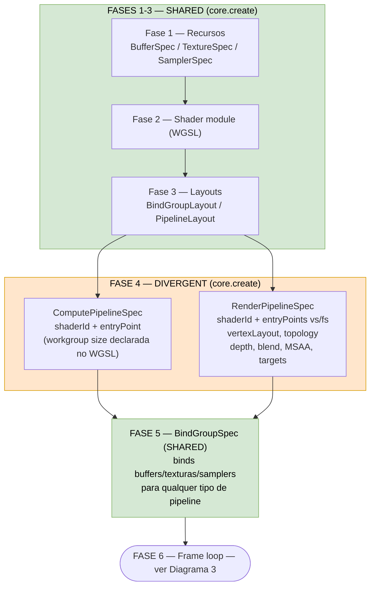
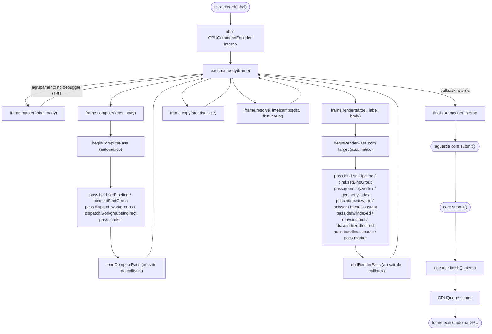
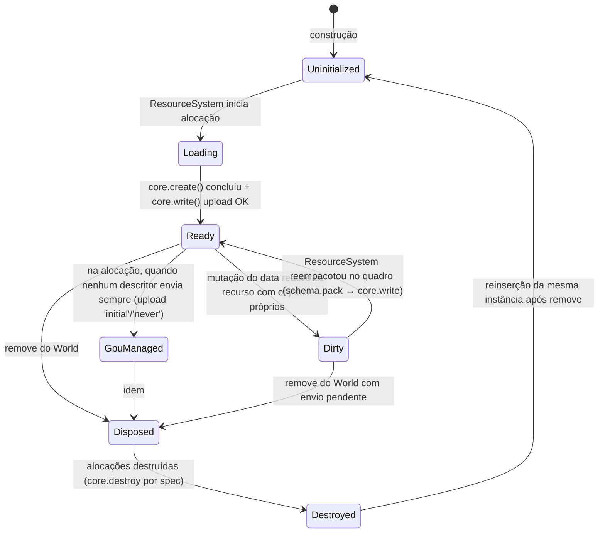
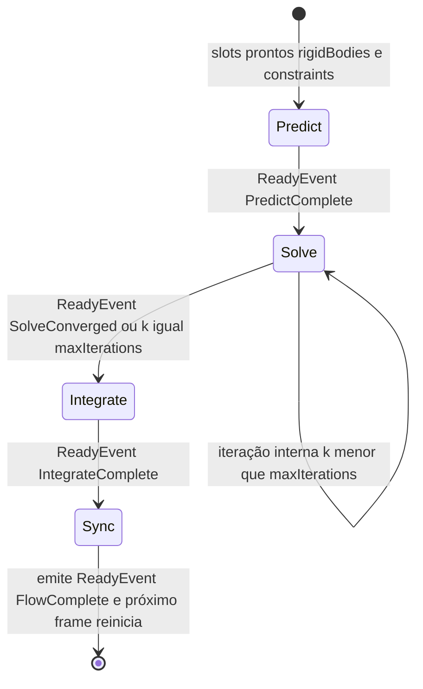
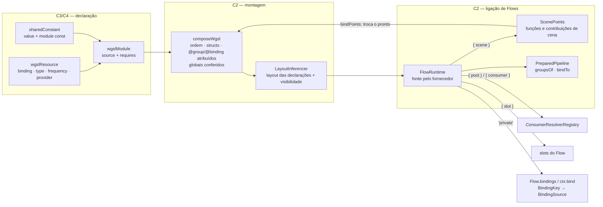
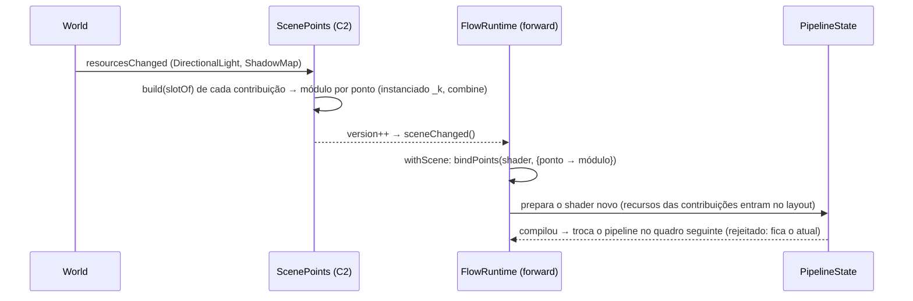
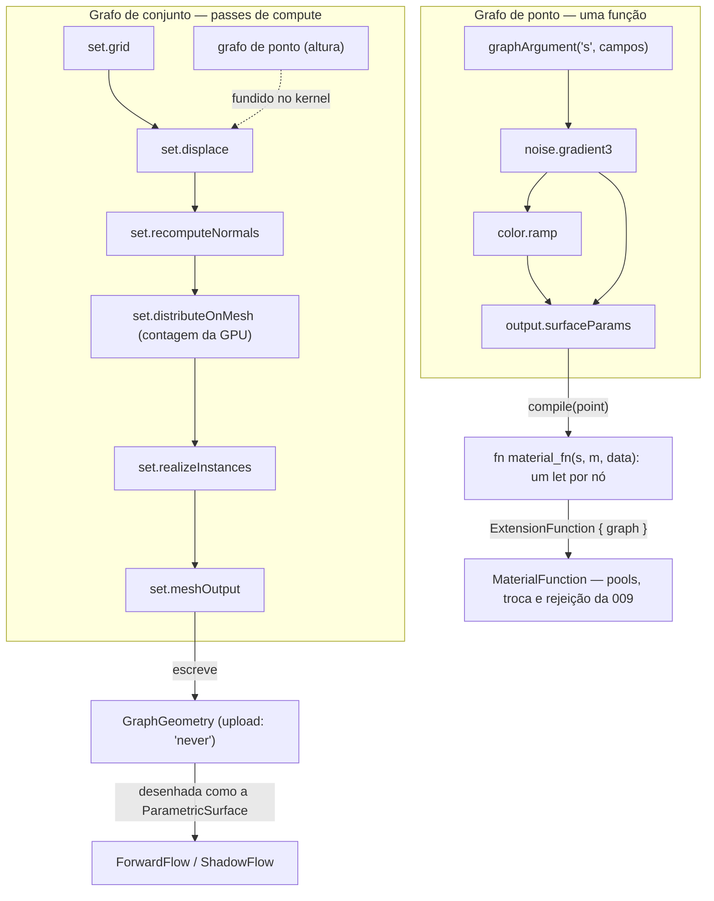
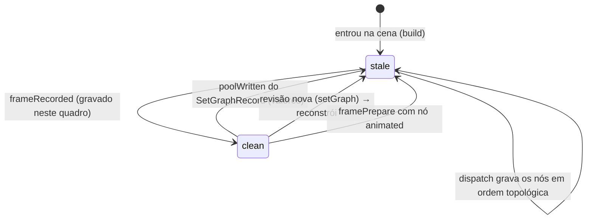

# Arquitetura do Motor — Camadas 1 a 4

Este guia descreve a arquitetura **corrente** do Clay Engine após a refatoração clean. O motor é
organizado em quatro camadas com regra de importação estrita: **C1 Hardware** (`src/core` — `EngineCore`
sobre WebGPU), **C2 Sincronização/ECS** (`src/scene` — `World`, `ResourceSystem`/`ExecutionSystem`, `Flow`,
descritores `Schema`/`GPUDescriptor`), **C3 Elementos** (`src/elements` — geometrias, materiais, bodies,
colliders, constraints, forcefields, flows) e **C4 Apresentação** (`src/presentation` — `Application`,
controllers, pós-processamento).

> A arquitetura legada baseada em Loaders e Singletons (`SceneLoader`, `PhysicsResourceLoader`,
> `WebGPUContext`…) foi **removida**. Sua descrição histórica está no apêndice de
> [Migração legacy → clean](./migration_legacy_to_clean.md).

## Camada 1: Hardware API (`src/core`)

Reorganização radical da Camada 1 com superfície pública **mínima** e callback-oriented. O acesso ao hardware passa por uma única facade `EngineCore` com poucos métodos de ação direta; encoders, passes e recursos GPU **nunca escapam como objetos** — **recursos são identificados pelo próprio `ResourceSpec`** (spec-as-identity: `core.create(spec)` retorna `spec` e o engine hasheia o conteúdo internamente para dedup/idempotência) e passes existem apenas dentro de callbacks. Substitui a antiga hierarquia de managers paralelos e hierarquia de classes `Engine*` por um contrato único e tipado estaticamente via discriminated unions.

| Antes (legado) | Agora (clean) |
|---|---|
| `WebGPUContext` Singleton — 11 dependências diretas | `GpuContext` value object interno — injetado uma vez no bootstrap |
| `WebGPUEngineCore` expõe 8 managers navegáveis via getters | `EngineCore` com 8 métodos de ação + 2 únicos getters (profiler, canvasFormat) |
| `BufferManager`, `TextureManager`, `BindGroupManager`, `PipelineManager` como interfaces públicas paralelas | Todos viram implementação interna — fronteira pública reduz a `EngineCore` |
| Navegação em 3 níveis: `core.resources.buffers.createStorage(...)` | Ação direta: `core.create({ kind: 'buffer', subkind: 'storage', ... })` |
| `EngineBuffer` flat e `Engine*` classes que vazam estrutura (`buf.native`) | **Spec é a identidade** — `core.create(spec)` retorna `spec`; engine hasheia internamente (UUIDv5 sobre serialização estável) e mantém `Map<hash, GPUObject>`. Zero estrutura GPU exposta |
| `Encoder` e passes retornáveis e reteníveis por C2 | Encoder implícito no `record()`; passes só existem dentro de callbacks |
| 14 métodos de fábrica (`createVertexBuffer`, `createStorageBuffer`, …) | 1 método genérico `create<S extends ResourceSpec>(spec: S): S` — inferência por discriminated union |
| Indirect/Staging como pastas separadas | Subtipos discriminados via `subkind: 'indirect'`/`'staging'` no `BufferSpec` |
| Copy e Readback desconectos da fase de gravação | `frame.copy()` dentro de callback, `core.readback()` direto |

### Diagrama 1 — Contratos públicos, specs por família e implementação

```mermaid
classDiagram

    %% ═══════════════════════════════════════════════════════════════════════
    %% CONTRATOS PÚBLICOS — core/contracts/
    %% 5 interfaces: a fronteira inteira da Camada 1
    %% ═══════════════════════════════════════════════════════════════════════
    namespace Contratos_Publicos {
        class EngineCore {
            <<Interface — facade única | impl: GpuEngineCore>>
            +create~S~(spec: S) S
            +createAsync~S~(spec: S) Promise~S~
            +write(spec: BufferSpec, data: ArrayBufferView, offset?) void
            +writeTexture(spec: TextureSpec, data: ArrayBufferView, layout: TextureDataLayout, size: Extent3D) void
            +destroy(spec: ResourceSpec) void
            +readback(spec: StagingBufferSpec) Promise~ArrayBuffer~
            +record(label?, body: (frame) => void) void
            +submit() void
            +initialize(canvas, options?: CanvasOptions) Promise~void~
            +reconfigureCanvas(options?: CanvasOptions) void
            +withErrorScope~T~(filter, body: () => T) Promise~T~
            +shutdown() void
            +profiler: Profiler
            +canvasFormat: GPUTextureFormat
        }
        class Frame {
            <<Interface — callback-scoped | impl: GpuFrame>>
            +canvasView: TextureViewSpec
            +compute(label?, body: (pass) => void) void
            +render(target: RenderTarget, label?, body: (pass) => void) void
            +copy(src: BufferSpec, dst: BufferSpec, size, srcOffset?, dstOffset?) void
            +copyBufferToTexture(src: BufferSpec, dst: TextureSpec, layout, size, options?) void
            +copyTextureToBuffer(src: TextureSpec, dst: BufferSpec, layout, size, options?) void
            +copyTextureToTexture(src: TextureSpec, dst: TextureSpec, size, options?) void
            +marker(label, body: () => void) void
            +resolveTimestamps(dst: StagingBufferSpec, first, count) void
        }
        class ComputePass {
            <<Interface — agrega slots | impl: GpuComputePass (+Binder+Dispatcher)>>
            +bind: Binder~ComputePipelineSpec~
            +dispatch: Dispatcher
            +marker(label) void
        }
        class RenderPass {
            <<Interface — agrega slots | impl: GpuRenderPass (+5 slots)>>
            +bind: Binder~RenderPipelineSpec~
            +geometry: GeometryBinder
            +state: RenderState
            +draw: Drawer
            +bundles: BundleRunner
            +marker(label) void
        }
        class Profiler {
            <<Interface — única exposição de objeto | impl: GpuProfilerSystem>>
            +isSupported: boolean
            +timestampWritesFor(first, last) object
            +readRange(first, count) Promise~BigInt64Array~
        }
    }

    %% ═══════════════════════════════════════════════════════════════════════
    %% PASS SLOTS — Interface Segregation aplicada sobre ComputePass e RenderPass
    %% Binder é compartilhado (generic em P) — o resto é específico por tipo de pass
    %% ═══════════════════════════════════════════════════════════════════════
    namespace Pass_Slots_SHARED {
        class Binder~P~ {
            <<Interface — impl: GpuComputePass / GpuRenderPass (narrow por P)>>
            +setPipeline(spec: P) this
            +setBindGroup(index, spec: BindGroupSpec, dynamicOffsets?) this
        }
    }

    namespace Pass_Slots_COMPUTE {
        class Dispatcher {
            <<Interface — impl: GpuComputePass>>
            +workgroups(x, y?, z?) this
            +workgroupsIndirect(spec: IndirectBufferSpec, offset?) this
        }
    }

    %% ═══════════════════════════════════════════════════════════════════════
    %% RENDER TARGET — value objects passados inline para frame.render()
    %% Não criados via core.create(); referenciam TextureViewSpec já existentes
    %% ═══════════════════════════════════════════════════════════════════════
    namespace Render_Target_ValueObjects {
        class RenderTarget {
            <<value object>>
            +colorAttachments: ColorAttachment[]
            +depthStencilAttachment?: DepthStencilAttachment
            +maxDrawCount?: number
        }
        class ColorAttachment {
            <<value object>>
            +view: TextureViewSpec
            +resolveTarget?: TextureViewSpec
            +clearValue?: [r, g, b, a]
            +loadOp: 'load'|'clear'
            +storeOp: 'store'|'discard'
            +depthSlice?: number
        }
        class DepthStencilAttachment {
            <<value object>>
            +view: TextureViewSpec
            +depthClearValue?: number
            +depthLoadOp?: 'load'|'clear'
            +depthStoreOp?: 'store'|'discard'
            +depthReadOnly?: boolean
            +stencilClearValue?: number
            +stencilLoadOp?: 'load'|'clear'
            +stencilStoreOp?: 'store'|'discard'
            +stencilReadOnly?: boolean
        }
    }

    %% ═══════════════════════════════════════════════════════════════════════
    %% VALUE OBJECTS DE PIPELINE — usados dentro de RenderPipelineSpec
    %% Estruturas inline; não criadas via core.create()
    %% ═══════════════════════════════════════════════════════════════════════
    namespace Pipeline_ValueObjects {
        class VertexBufferLayout {
            <<value object>>
            +arrayStride: number
            +stepMode?: 'vertex'|'instance'
            +attributes: VertexAttribute[]
        }
        class VertexAttribute {
            <<value object>>
            +shaderLocation: number
            +offset: number
            +format: GPUVertexFormat
        }
        class DepthSpec {
            <<value object>>
            +format: GPUTextureFormat
            +depthWriteEnabled?: boolean
            +depthCompare?: GPUCompareFunction
            +stencilFront?: StencilFaceState
            +stencilBack?: StencilFaceState
            +stencilReadMask?: number
            +stencilWriteMask?: number
            +depthBias?: number
            +depthBiasSlopeScale?: number
            +depthBiasClamp?: number
        }
        class StencilFaceState {
            <<value object>>
            +compare?: GPUCompareFunction
            +failOp?: GPUStencilOperation
            +depthFailOp?: GPUStencilOperation
            +passOp?: GPUStencilOperation
        }
        class ColorTargetSpec {
            <<value object>>
            +format: GPUTextureFormat
            +blend?: BlendSpec
            +writeMask?: number
        }
        class BlendSpec {
            <<value object>>
            +color: BlendComponent
            +alpha: BlendComponent
        }
        class BlendComponent {
            <<value object>>
            +operation?: GPUBlendOperation
            +srcFactor?: GPUBlendFactor
            +dstFactor?: GPUBlendFactor
        }
        class MultisampleSpec {
            <<value object>>
            +count?: 1|4
            +mask?: number
            +alphaToCoverageEnabled?: boolean
        }
    }

    %% ═══════════════════════════════════════════════════════════════════════
    %% VALUE OBJECTS DE BINDING — usados em LayoutSpec e BindGroupSpec
    %% Cada um é discriminated union sobre kind
    %% ═══════════════════════════════════════════════════════════════════════
    namespace Binding_ValueObjects {
        class BindingLayoutEntry {
            <<discriminated union — 5 variantes por kind>>
            +binding: number
            +visibility: number
            +kind: 'buffer'|'sampler'|'texture'|'storage-texture'|'external-texture'
        }
        class BindingEntry {
            <<discriminated union — 3 variantes por kind>>
            +binding: number
            +kind: 'buffer'|'sampler'|'textureview'
        }
    }

    namespace Pass_Slots_RENDER {
        class GeometryBinder {
            <<Interface — impl: GpuRenderPass>>
            +vertex(slot, spec: VertexBufferSpec, offset?, size?) this
            +index(spec: IndexBufferSpec, offset?, size?) this
        }
        class RenderState {
            <<Interface — impl: GpuRenderPass>>
            +viewport(x, y, w, h, minDepth, maxDepth) this
            +scissor(x, y, w, h) this
            +blendConstant(color) this
            +stencilReference(ref) this
        }
        class Drawer {
            <<Interface — impl: GpuRenderPass>>
            +vertices(count, instances?, firstVertex?, firstInstance?) this
            +indexed(count, instances?, firstIndex?, baseVertex?, firstInstance?) this
            +indirect(spec: IndirectBufferSpec, offset?) this
            +indexedIndirect(spec: IndirectBufferSpec, offset?) this
        }
        class BundleRunner {
            <<Interface — impl: GpuRenderPass>>
            +execute(specs: BundleSpec[]) this
        }
    }

    %% ═══════════════════════════════════════════════════════════════════════
    %% SPECS — organizados pelas 6 fases do ciclo WebGPU
    %% SHARED   = spec comum a compute e render
    %% DIVERGENT = spec difere entre compute e render
    %% ═══════════════════════════════════════════════════════════════════════
    namespace FASE_1_Recursos_SHARED {
        class BufferSpec {
            <<abstract — família | spec-as-identity>>
            kind='buffer'
            +discriminator?: string
            +subkind
        }
        class VertexBufferSpec {
            subkind='vertex'
            +byteSize: number
            +stride: number
            +count: number
        }
        class IndexBufferSpec {
            subkind='index'
            +byteSize: number
            +count: number
            +format: GPUIndexFormat
        }
        class UniformBufferSpec {
            subkind='uniform'
            +byteSize: number
        }
        class StorageBufferSpec {
            subkind='storage'
            +byteSize: number
        }
        class IndirectBufferSpec {
            subkind='indirect'
            +byteSize: number
        }
        class StagingBufferSpec {
            subkind='staging'
            +byteSize: number
        }
        class TextureSpec {
            kind='texture'
            +discriminator?: string
            +dimension?: '1d'|'2d'|'3d'
            +width: number
            +height: number
            +depthOrArrayLayers?: number
            +format: GPUTextureFormat
            +usage: number
            +mipLevelCount?: number
            +sampleCount?: 1|4
            +viewFormats?: GPUTextureFormat[]
        }
        class TextureViewSpec {
            kind='textureview'
            +discriminator?: string
            +source: TextureSpec
            +dimension?: GPUTextureViewDimension
            +format?: GPUTextureFormat
            +baseMipLevel?: number
            +mipLevelCount?: number
            +baseArrayLayer?: number
            +arrayLayerCount?: number
            +aspect?: 'all'|'depth-only'|'stencil-only'
        }
        class SamplerSpec {
            kind='sampler'
            +discriminator?: string
            +desc?: GPUSamplerDescriptor
        }
    }

    namespace FASE_2_Shader_SHARED {
        class ShaderModuleSpec {
            kind='shader'
            +discriminator?: string
            +source: string
            +label?: string
        }
    }

    namespace FASE_3_Layout_SHARED {
        class LayoutSpec {
            kind='layout'
            +discriminator?: string
            +entries: BindingLayoutEntry[]
        }
    }

    namespace FASE_4_Pipelines_DIVERGENT {
        class PipelineSpec {
            <<abstract — família | spec-as-identity>>
            kind='pipeline'
            +discriminator?: string
            +layouts: LayoutSpec[]
            +subkind
        }
        class ComputePipelineSpec {
            subkind='compute'
            +shader: ShaderModuleSpec
            +entryPoint: string
            +constants?: Record~string, number~
        }
        class RenderPipelineSpec {
            subkind='render'
            +vertex: VertexStage
            +fragment?: FragmentStage
            +primitive?: PrimitiveSpec
            +depthStencil?: DepthSpec
            +multisample?: MultisampleSpec
        }
    }

    namespace FASE_5_BindGroup_SHARED {
        class BindGroupSpec {
            kind='bindgroup'
            +discriminator?: string
            +layout: LayoutSpec
            +bindings: BindingEntry[]
        }
    }

    namespace RENDER_ONLY_Bundles {
        class BundleSpec {
            kind='bundle'
            +discriminator: string
            +formats: BundleFormats
            +body: (pass: RenderPass) => void
        }
    }

    %% ── FLUXO DE SPECS por fase: EngineCore.create() aceita qualquer spec ───
    %% (1 arrow por família; variantes resolvidas via subkind no discriminated union)
    %% Fase 1 — Recursos físicos
    EngineCore ..> BufferSpec       : create (qualquer subkind)
    EngineCore ..> TextureSpec      : create
    EngineCore ..> TextureViewSpec  : create
    EngineCore ..> SamplerSpec      : create
    %% Fase 2 — Shader module
    EngineCore ..> ShaderModuleSpec : create
    %% Fase 3 — Layout
    EngineCore ..> LayoutSpec       : create
    %% Fase 4 — Pipelines (divergent)
    EngineCore ..> PipelineSpec     : create (compute ou render)
    %% Fase 5 — BindGroups
    EngineCore ..> BindGroupSpec    : create
    %% Render-only
    EngineCore ..> BundleSpec       : create

    %% ── HIERARQUIA DE FAMÍLIAS (extends — campos comuns na base) ───────────
    BufferSpec   <|-- VertexBufferSpec
    BufferSpec   <|-- IndexBufferSpec
    BufferSpec   <|-- UniformBufferSpec
    BufferSpec   <|-- StorageBufferSpec
    BufferSpec   <|-- IndirectBufferSpec
    BufferSpec   <|-- StagingBufferSpec
    PipelineSpec <|-- ComputePipelineSpec
    PipelineSpec <|-- RenderPipelineSpec

    %% ── DEPENDÊNCIAS ENTRE SPECS (grafo de referências) ─────────────────────
    PipelineSpec    ..> ShaderModuleSpec : shader (referência direta)
    PipelineSpec    ..> LayoutSpec       : layouts (array)
    BindGroupSpec   ..> LayoutSpec       : layout (referência direta)
    TextureViewSpec ..> TextureSpec      : source (referência direta)

    %% ── PASSES ↔ SLOTS (composição — Binder reutilizado via P) ─────────────
    ComputePass o-- Binder         : bind
    ComputePass o-- Dispatcher     : dispatch
    RenderPass  o-- Binder         : bind
    RenderPass  o-- GeometryBinder : geometry
    RenderPass  o-- RenderState    : state
    RenderPass  o-- Drawer         : draw
    RenderPass  o-- BundleRunner   : bundles

    %% ── RENDER TARGET (value-object composition) ───────────────────────────
    RenderTarget *-- ColorAttachment           : colorAttachments[]
    RenderTarget *-- DepthStencilAttachment    : depthStencilAttachment?
    Frame        ..> RenderTarget              : render(target, body)

    %% ── PIPELINE VALUE OBJECTS (usados por RenderPipelineSpec) ──────────────
    RenderPipelineSpec *-- VertexBufferLayout : vertexBuffers[]
    RenderPipelineSpec *-- DepthSpec          : depth?
    RenderPipelineSpec *-- MultisampleSpec    : multisample?
    RenderPipelineSpec *-- ColorTargetSpec    : colorTargets[]
    VertexBufferLayout *-- VertexAttribute    : attributes[]
    DepthSpec          *-- StencilFaceState   : stencilFront/stencilBack?
    ColorTargetSpec    *-- BlendSpec          : blend?
    BlendSpec          *-- BlendComponent     : color/alpha

    %% ── BINDING VALUE OBJECTS (usados por LayoutSpec e BindGroupSpec) ───────
    LayoutSpec    *-- BindingLayoutEntry : entries[]
    BindGroupSpec *-- BindingEntry       : bindings[]

    %% ── FLUXO DE CALLBACKS ─────────────────────────────────────────────────
    EngineCore ..> Frame : record(body) injeta
    Frame ..> ComputePass : compute(body) injeta
    Frame ..> RenderPass : render(body) injeta
    EngineCore ..> Profiler : expõe (única exceção)
```



### Implementações `Gpu*` — tabela (internas, não aparecem no classDiagram)

Assim como handles, as classes `Gpu*` não aparecem como caixas no classDiagram — seriam caixas sem atributos/métodos públicos (o contrato vive nas interfaces que implementam). Residem em `core/gpu/` e **nunca são importadas por C2/C3/C4** — o bootstrap instancia `GpuEngineCore` e entrega como `EngineCore`.

| Classe            | Implementa                                                               | Responsabilidade |
|---|---|---|
| `GpuEngineCore`      | `EngineCore`                                                             | Facade raiz — dispatcher de `create()` para o store, abre encoder em `record()`, expõe `Profiler`. Composto por `GpuContext`, `GpuResourceStore`, `GpuCommandState`. |
| `GpuFrame`           | `Frame`                                                                  | Vida de 1 callback `record()` — expõe `compute`/`render`/`copy`/`marker`/`resolveTimestamps`. Instancia passes sob demanda. |
| `GpuComputePass`     | `ComputePass`, `Binder<ComputePipelineSpec>`, `Dispatcher`                 | 1 objeto com 3 visões tipadas via getters `this as Binder<…>` / `this as Dispatcher`. |
| `GpuRenderPass`      | `RenderPass`, `Binder<RenderPipelineSpec>`, `GeometryBinder`, `RenderState`, `Drawer`, `BundleRunner` | 1 objeto com 6 visões tipadas — zero alocação extra. |
| `GpuProfilerSystem`  | `Profiler`                                                               | Timestamp queries + resolve/readback parcial. |
| `GpuContext`         | — (value object interno)                                                 | Tupla `{ device, queue, canvasFormat, canvas }` construída no bootstrap, injetada nos outros `Gpu*`. |
| `GpuResourceStore`   | — (helper interno)                                                       | Indexa `GPUBuffer / GPUTexture / GPUSampler / GPUShaderModule / GPUBindGroupLayout / GPUBindGroup / GPUPipeline / GPURenderBundle` por handle id e categoria. |
| `GpuCommandState`    | — (helper interno)                                                       | Encoder ativo + pilha de passes durante uma chamada a `record()`. |

**Composição interna:** `GpuEngineCore *-- GpuContext`, `GpuResourceStore`, `GpuCommandState`. `GpuEngineCore` instancia `GpuFrame` em `record()`; `GpuFrame` instancia `GpuComputePass`/`GpuRenderPass` nas callbacks de `compute()`/`render()`. Estes laços de instanciação também ficam ocultos ao classDiagram porque envolvem exclusivamente classes internas.

### Specs como identidade (spec-as-identity)

**Não há handles branded.** Recursos são identificados pelo próprio `ResourceSpec` que o consumidor passou em `core.create(spec)`. O engine hasheia o conteúdo do spec (UUIDv5 sobre serialização JSON estável) e mantém `Map<hash, GPUObject>` interno. `core.create(spec)` retorna `spec` (a mesma referência) — chamadas com specs estruturalmente iguais retornam o mesmo handle subjacente (idempotência por construção).

| Categoria | subkind/discriminator | Campos no spec |
|---|---|---|
| `BufferSpec`    | `vertex`   | `stride, count` |
| `BufferSpec`    | `index`    | `count, format` |
| `BufferSpec`    | `uniform`  | `byteSize` |
| `BufferSpec`    | `storage`  | `byteSize` |
| `BufferSpec`    | `indirect` | `byteSize` |
| `BufferSpec`    | `staging`  | `byteSize` |
| `TextureSpec`        | —          | `dimension, width, height, depthOrArrayLayers, format, mipLevelCount, sampleCount` |
| `TextureViewSpec`    | —          | `source: TextureSpec, format?, dimension?` |
| `SamplerSpec`        | —          | `desc?: GPUSamplerDescriptor` |
| `ShaderModuleSpec`   | —          | `source: string` |
| `LayoutSpec`         | —          | `entries: BindingLayoutEntry[]` |
| `BindGroupSpec`      | —          | `layout: LayoutSpec, bindings: BindingEntry[]` |
| `ComputePipelineSpec`| `compute`  | `shader: ShaderModuleSpec, entryPoint, layouts` |
| `RenderPipelineSpec` | `render`   | `vertex/fragment stages, primitive, depth, multisample, colorTargets, layouts` |
| `BundleSpec`         | —          | `formats, body: (pass: RenderPass) => void` |

`ResourceSpec` é o union discriminado de todas as variantes — aceito por `destroy()` e outras operações universais. Cada spec carrega `discriminator?: string` opcional que o caller (LayoutInferencer/ResourceSystem) preenche para diferenciar duas alocações estruturalmente iguais (ex.: dois Camera com mesmo `byteSize` precisam de discriminator pra virarem buffers distintos).

Consumidor acessa metadata direto do spec que detém: `vboSpec.byteSize`, `texSpec.width`. Nunca há "id branded" separado.

**Identidade calculada uma vez, imutável e com posse** (spec 004):

- `specHash(spec)` é **memorizado por referência** (`WeakMap<object, string>`): o hash de um objeto de spec é calculado
  no máximo uma vez; a entrada some junto com a spec.
- O hash é **composto**: uma spec aninhada (shader num pipeline, layout/buffers num bind group) entra na serialização
  como `{"$spec": hash}` — o WGSL de um shader é serializado e passado pelo SHA-1 uma única vez. Funções
  (`BundleSpec.body`) entram por identidade de referência (`{"$fn": id}`): corpos diferentes nunca colidem.
- `core.create`/`createAsync` **congelam a spec em profundidade**: alterar uma spec depois de criada lança `TypeError`
  na hora (em vez de deixar um hash velho). Para mudar um recurso, crie uma spec nova.
- O store guarda **posse por spec**: specs de conteúdo igual compartilham o objeto de GPU, e `core.destroy(spec)` remove
  só a posse daquela spec — o objeto morre com o último dono. Quem cria kernels com `createComputeKernel` libera com
  `destroyComputeKernel` ao substituí-los.

### Buffers polivalentes — compute produz, render consome

Cada `subkind` de buffer define **propósito semântico**, não uma restrição de uso. A implementação traduz subkind em usage flags WebGPU de forma que o mesmo `GPUBuffer` serve ambos os lados do pipeline sem cópia:

| subkind | usage WebGPU resultante | padrão típico |
|---|---|---|
| `vertex`   | `VERTEX \| STORAGE \| COPY_DST`   | compute escreve posições/normais → render lê como vertex |
| `index`    | `INDEX \| STORAGE \| COPY_DST`    | compute escreve índices → render lê como index |
| `indirect` | `INDIRECT \| STORAGE \| COPY_DST` | compute gera draw counts → render drawIndirect |
| `storage`  | `STORAGE \| COPY_SRC \| COPY_DST` | buffer interno de compute (solvers de física, neighbor grids) |
| `uniform`  | `UNIFORM \| COPY_DST`             | constantes para ambos os pipelines |
| `staging`  | `COPY_DST \| MAP_READ`            | readback de GPU para CPU |

**Zero cópia entre passes.** Um `VertexBufferSpec` criado para ser consumido no render pode ser bound como storage em um `ComputePass` via `BindGroup` — a barreira de memória entre passes dentro do mesmo encoder é automática.

**Consequência arquitetural:** o engine é compute-first. Geometria (posições de vértice), particle surfaces, cloth/fluid meshes, transform matrices de instâncias são todos calculados por compute e consumidos pelo render sem tradução intermediária. Material (Layer 3) configura **vertex stage + fragment stage** do render pipeline — mas como a transformação pesada já aconteceu no compute, o vertex shader tende a ser fino (MVP final + pass-through de atributos); o peso semântico do Material concentra-se no fragment.

### Diagrama 2 — Construção de recursos e pipelines (setup)

Fluxo das chamadas `core.create(spec)` agrupadas pelas 5 fases de setup do WebGPU, evidenciando o que é compartilhado entre compute/render e onde diverge.



**Observações:**
- Apenas **Pipeline** (fase 4) e **Pass** (fase 6, ver Diagrama 3) divergem entre compute e render — ~70% do ciclo é compartilhado
- `RenderPipelineSpec` carrega todo o fixed-function: topologia, vertexLayout, depth/stencil, blending, MSAA, color targets — mais o par de entrypoints vs/fs
- `ComputePipelineSpec` é muito mais enxuto — só entrypoint; workgroup size declarada no próprio WGSL (`@workgroup_size(...)`)
- O mesmo `BindGroup` pode ser consumido por qualquer tipo de pass desde que o shader declare bindings compatíveis com o layout

### Diagrama 3 — Ciclo de um frame (etapas explícitas dos passes)

No original, as etapas de cada pass eram obscuras (só apareciam `beginX → GPURawEncoder`). Com callbacks, begin/end viram automáticos — o flowchart abaixo explicita como.



Observações do ciclo:
- **Encoder nunca escapa** — aberto antes da callback, fechado depois, submetido por `core.submit()`
- **Begin/end dos passes são automáticos** — garantidos pelo escopo da callback
- **Nested callbacks permitidos** — `frame.marker(() => { frame.compute(...); frame.render(...) })` funciona
- **Ordem da body callback define ordem GPU** — compute antes de render = dependência implícita

### Vocabulário de tipos em TypeScript

**Specs como identidade.** Não há handles branded. Cada spec é um objeto declarativo discriminado por `kind` (e `subkind` quando família). `core.create(spec)` retorna `spec` (a mesma referência); engine hasheia o conteúdo (UUIDv5 sobre serialização JSON estável) para dedup interno. Specs estruturalmente iguais → mesmo handle subjacente.

```typescript
// ── Bases de família (campos comuns DRY) ──────────────────────────────────
interface BufferSpec {
    kind: 'buffer'
    subkind: 'vertex' | 'index' | 'uniform' | 'storage' | 'indirect' | 'staging'
    discriminator?: string  // caller preenche quando dois specs estruturalmente iguais precisam ser distintos
}

// ── Variantes da família Buffer ───────────────────────────────────────────
interface VertexBufferSpec   extends BufferSpec { subkind: 'vertex';   byteSize: number; stride: number; count: number }
interface IndexBufferSpec    extends BufferSpec { subkind: 'index';    byteSize: number; count: number; format: GPUIndexFormat }
interface UniformBufferSpec  extends BufferSpec { subkind: 'uniform';  byteSize: number }
interface StorageBufferSpec  extends BufferSpec { subkind: 'storage';  byteSize: number }
interface IndirectBufferSpec extends BufferSpec { subkind: 'indirect'; byteSize: number }
interface StagingBufferSpec  extends BufferSpec { subkind: 'staging';  byteSize: number }

type AnyBufferSpec = VertexBufferSpec | IndexBufferSpec | UniformBufferSpec
                   | StorageBufferSpec | IndirectBufferSpec | StagingBufferSpec

// ── Variantes da família Pipeline ─────────────────────────────────────────
interface PipelineSpec {
    kind: 'pipeline'
    subkind: 'compute' | 'render'
    discriminator?: string
    layouts: readonly LayoutSpec[]   // ordem reflete bindGroup index esperado
}

interface ComputePipelineSpec extends PipelineSpec {
    subkind: 'compute'
    shader: ShaderModuleSpec
    entryPoint: string
    constants?: Readonly<Record<string, number>>
}

interface RenderPipelineSpec extends PipelineSpec {
    subkind: 'render'
    vertex: VertexStage
    fragment?: FragmentStage
    primitive?: PrimitiveSpec
    depthStencil?: DepthSpec
    multisample?: MultisampleSpec
}

interface VertexStage   { shader: ShaderModuleSpec; entryPoint: string; buffers?: readonly VertexBufferLayout[]; constants?: Readonly<Record<string, number>> }
interface FragmentStage { shader: ShaderModuleSpec; entryPoint: string; targets: readonly ColorTargetSpec[]; constants?: Readonly<Record<string, number>> }

type AnyPipelineSpec = ComputePipelineSpec | RenderPipelineSpec

// ── Specs stand-alone ──────────────────────────────────────────────────────
interface TextureSpec {
    kind: 'texture'
    discriminator?: string
    dimension?: '1d' | '2d' | '3d'
    width: number
    height: number
    depthOrArrayLayers?: number
    format: GPUTextureFormat
    usage: number
    mipLevelCount?: number
    sampleCount?: 1 | 4
    viewFormats?: readonly GPUTextureFormat[]
    label?: string
}

interface TextureViewSpec {
    kind: 'textureview'
    discriminator?: string
    source: TextureSpec                        // referência direta — não id
    dimension?: GPUTextureViewDimension
    format?: GPUTextureFormat
    baseMipLevel?: number
    mipLevelCount?: number
    baseArrayLayer?: number
    arrayLayerCount?: number
    aspect?: 'all' | 'depth-only' | 'stencil-only'
    label?: string
}

interface SamplerSpec      { kind: 'sampler';   discriminator?: string; desc?: GPUSamplerDescriptor }
interface ShaderModuleSpec { kind: 'shader';    discriminator?: string; source: string; label?: string }
interface LayoutSpec       { kind: 'layout';    discriminator?: string; entries: readonly BindingLayoutEntry[] }
interface BindGroupSpec    { kind: 'bindgroup'; discriminator?: string; layout: LayoutSpec; bindings: readonly BindingEntry[] }
interface BundleSpec       { kind: 'bundle';    discriminator: string; formats: BundleFormats; body: (pass: RenderPass) => void }

type ResourceSpec = AnyBufferSpec | TextureSpec | TextureViewSpec | SamplerSpec
                  | ShaderModuleSpec | LayoutSpec | AnyPipelineSpec | BindGroupSpec | BundleSpec

// ── Tipos auxiliares para upload/cópia de textura ─────────────────────────
interface TextureDataLayout {
    bytesPerRow: number
    rowsPerImage?: number                        // obrigatório se target tem > 1 layer/depth
    offset?: number                              // default 0
}

type Extent3D = readonly [width: number, height?: number, depthOrArrayLayers?: number]

interface TextureCopyOptions {
    mipLevel?: number                            // default 0
    origin?: readonly [x: number, y?: number, z?: number]  // default [0, 0, 0]
    aspect?: 'all' | 'depth-only' | 'stencil-only'
}

interface CanvasOptions {
    alphaMode?: 'opaque' | 'premultiplied'       // default 'opaque'
    colorSpace?: 'srgb' | 'display-p3'
}

// ── Render target: value objects passados inline para frame.render() ──────
// Não são criados via core.create(); estruturas de dados efêmeras por frame.
// Referenciam TextureViewSpec previamente criados (ou frame.canvasView).

interface RenderTarget {
    colorAttachments: readonly ColorAttachment[]        // até 8 (MRT)
    depthStencilAttachment?: DepthStencilAttachment
    maxDrawCount?: number                               // limite opcional de drawCalls
}

interface ColorAttachment {
    view: TextureViewSpec
    resolveTarget?: TextureViewSpec                       // para MSAA: sampleCount>1 no view, resolveTarget=sampleCount=1
    clearValue?: readonly [r: number, g: number, b: number, a: number]
    loadOp: 'load' | 'clear'
    storeOp: 'store' | 'discard'
    depthSlice?: number                                 // para view '3d' texture
}

interface DepthStencilAttachment {
    view: TextureViewSpec                                 // precisa ser view de formato depth/stencil
    depthClearValue?: number                            // default 0 (usado quando depthLoadOp==='clear')
    depthLoadOp?: 'load' | 'clear'
    depthStoreOp?: 'store' | 'discard'
    depthReadOnly?: boolean                             // default false
    stencilClearValue?: number                          // default 0
    stencilLoadOp?: 'load' | 'clear'
    stencilStoreOp?: 'store' | 'discard'
    stencilReadOnly?: boolean                           // default false
}

// ── Pipeline value objects (usados em RenderPipelineSpec) ─────────────────

interface VertexAttribute {
    shaderLocation: number                              // @location(N) no WGSL
    offset: number                                      // bytes desde o início do vértice
    format: GPUVertexFormat                             // 'float32', 'float32x2', 'float32x4', 'uint32', 'sint16x4', etc.
}

interface VertexBufferLayout {
    arrayStride: number                                 // bytes por vértice (ou instância)
    stepMode?: 'vertex' | 'instance'                    // default 'vertex'
    attributes: readonly VertexAttribute[]
}

interface StencilFaceState {
    compare?: GPUCompareFunction                        // default 'always'
    failOp?: GPUStencilOperation                        // default 'keep'
    depthFailOp?: GPUStencilOperation                   // default 'keep'
    passOp?: GPUStencilOperation                        // default 'keep'
}

interface DepthSpec {
    format: GPUTextureFormat                            // obrigatório: 'depth24plus', 'depth32float', 'depth24plus-stencil8', etc.
    depthWriteEnabled?: boolean                         // default false
    depthCompare?: GPUCompareFunction                   // default 'always'
    stencilFront?: StencilFaceState
    stencilBack?: StencilFaceState
    stencilReadMask?: number                            // default 0xFFFFFFFF
    stencilWriteMask?: number                           // default 0xFFFFFFFF
    depthBias?: number                                  // default 0
    depthBiasSlopeScale?: number                        // default 0
    depthBiasClamp?: number                             // default 0
}

interface BlendComponent {
    operation?: GPUBlendOperation                       // default 'add'
    srcFactor?: GPUBlendFactor                          // default 'one'
    dstFactor?: GPUBlendFactor                          // default 'zero'
}

interface BlendSpec {
    color: BlendComponent
    alpha: BlendComponent
}

interface ColorTargetSpec {
    format: GPUTextureFormat                            // precisa bater com o ColorAttachment.view.format
    blend?: BlendSpec                                   // ausente = sem blending (equivale a opaque write)
    writeMask?: number                                  // bitmask GPUColorWriteFlags; default 0xF (RGBA)
}

interface MultisampleSpec {
    count?: 1 | 4                                       // default 1
    mask?: number                                       // default 0xFFFFFFFF
    alphaToCoverageEnabled?: boolean                    // default false
}

// ── BindingLayoutEntry (usado em LayoutSpec.entries) ──────────────────────
// Discriminated union por kind — exatamente uma variante por entry.

interface BaseBindingLayoutEntry {
    binding: number
    visibility: number                                  // bitmask: GPUShaderStage.VERTEX | FRAGMENT | COMPUTE
}

interface BufferBindingLayoutEntry extends BaseBindingLayoutEntry {
    kind: 'buffer'
    type?: 'uniform' | 'storage' | 'read-only-storage' // default 'uniform'
    hasDynamicOffset?: boolean                          // default false
    minBindingSize?: number                             // default 0
}

interface SamplerBindingLayoutEntry extends BaseBindingLayoutEntry {
    kind: 'sampler'
    type?: 'filtering' | 'non-filtering' | 'comparison' // default 'filtering'
}

interface TextureBindingLayoutEntry extends BaseBindingLayoutEntry {
    kind: 'texture'
    sampleType?: 'float' | 'unfilterable-float' | 'depth' | 'sint' | 'uint'  // default 'float'
    viewDimension?: GPUTextureViewDimension             // default '2d'
    multisampled?: boolean                              // default false
}

interface StorageTextureBindingLayoutEntry extends BaseBindingLayoutEntry {
    kind: 'storage-texture'
    access?: 'write-only' | 'read-only' | 'read-write' // default 'write-only'
    format: GPUTextureFormat
    viewDimension?: GPUTextureViewDimension             // default '2d'
}

interface ExternalTextureBindingLayoutEntry extends BaseBindingLayoutEntry {
    kind: 'external-texture'
}

type BindingLayoutEntry =
    | BufferBindingLayoutEntry
    | SamplerBindingLayoutEntry
    | TextureBindingLayoutEntry
    | StorageTextureBindingLayoutEntry
    | ExternalTextureBindingLayoutEntry

// ── BindingEntry (usado em BindGroupSpec.bindings) ────────────────────────
// Discriminated union por kind; referencia specs já criados (spec-as-identity).

interface BufferBindingEntry {
    binding: number
    kind: 'buffer'
    buffer: AnyBufferSpec                                // referência direta ao spec
    offset?: number
    size?: number
}

interface SamplerBindingEntry {
    binding: number
    kind: 'sampler'
    sampler: SamplerSpec
}

interface TextureViewBindingEntry {
    binding: number
    kind: 'textureview'
    view: TextureViewSpec
}

type BindingEntry =
    | BufferBindingEntry
    | SamplerBindingEntry
    | TextureViewBindingEntry

// ── União canônica (entrada do create, organizada pelas fases WebGPU) ─────
type ResourceSpec =
    | BufferSpec        // Fase 1 (família com 6 variantes)
    | TextureSpec       // Fase 1
    | TextureViewSpec   // Fase 1 (view é derivada de uma texture já criada)
    | SamplerSpec       // Fase 1
    | ShaderModuleSpec  // Fase 2
    | LayoutSpec        // Fase 3
    | PipelineSpec      // Fase 4 (família com 2 variantes)
    | BindGroupSpec     // Fase 5
    | BundleSpec        // Render-only (frame-time)

// `core.create<S extends ResourceSpec>(spec: S): S` retorna o próprio spec.
// Consumidor mantém referência ao spec passado e usa metadata direto.
```

Consumo fica ergonômico — metadata do spec disponível sem guardar ao lado:

```typescript
const vbo: VertexBufferSpec = core.create({
    kind: 'buffer', subkind: 'vertex',
    discriminator: 'mesh_vbo', byteSize: 32 * 1024, stride: 32, count: 1024,
})
// vbo é a própria spec — engine hasheia internamente para dedup.
console.log(vbo.stride)  // 32 — acesso direto
console.log(vbo.count)   // 1024
```

### Pass slots — composição tipada

Os passes não expõem métodos flat — são **agregações de slots** pequenos e focados. `Binder<P>` é genérico, reutilizado entre compute e render; os demais slots são específicos por lado. Nenhuma interface tem mais de 4 métodos.

```typescript
// ── Slots compartilhados (fluent chaining via `this`) ─────────────────
interface Binder<P extends PipelineSpec> {
    setPipeline(pipeline: P): this
    setBindGroup(index: number, bindGroup: BindGroupSpec, dynamicOffsets?: number[]): this
}

// ── Slots só compute ──────────────────────────────────────────────────
interface Dispatcher {
    invocations(count: number, workgroupSize: number): this   // despacho linear além de 65 535 grupos (spec 004)
    workgroups(x: number, y?: number, z?: number): this
    workgroupsIndirect(spec: IndirectBufferSpec, offset?: number): this
}

// ── Slots só render ───────────────────────────────────────────────────
interface GeometryBinder {
    vertex(slot: number, spec: VertexBufferSpec, offset?: number, size?: number): this
    index(spec: IndexBufferSpec, offset?: number, size?: number): this
}

interface RenderState {
    viewport(x: number, y: number, w: number, h: number, minDepth: number, maxDepth: number): this
    scissor(x: number, y: number, w: number, h: number): this
    blendConstant(color: readonly [number, number, number, number]): this
    stencilReference(ref: number): this
}

interface Drawer {
    vertices(count: number, instances?: number, firstVertex?: number, firstInstance?: number): this
    indexed(count: number, instances?: number, firstIndex?: number, baseVertex?: number, firstInstance?: number): this
    indirect(spec: IndirectBufferSpec, offset?: number): this
    indexedIndirect(spec: IndirectBufferSpec, offset?: number): this
}

interface BundleRunner {
    execute(ids: BundleSpec[]): this
}

// ── Passes como agregações ────────────────────────────────────────────
interface ComputePass {
    readonly bind:     Binder<ComputePipelineSpec>
    readonly dispatch: Dispatcher
    marker(label: string): void
}

interface RenderPass {
    readonly bind:     Binder<RenderPipelineSpec>   // mesma interface, P diferente
    readonly geometry: GeometryBinder
    readonly state:    RenderState
    readonly draw:     Drawer
    readonly bundles:  BundleRunner
    marker(label: string): void
}
```

Uso — agrupamento semântico elimina leitura linear de 14 métodos:

```typescript
frame.compute('physics step', pass => {
    pass.bind
        .setPipeline(xpbdPipeline)            // ComputePipelineSpec
        .setBindGroup(0, paramsBg)            // BindGroupSpec
        .setBindGroup(1, bodiesBg);
    pass.dispatch.workgroups(workgroupCount);
    pass.marker('after prediction');
});

// RenderTarget é construído inline a cada frame; canvasView vem do Frame
const target: RenderTarget = {
    colorAttachments: [{
        view: frame.canvasView,                // TextureViewSpec do swapchain
        clearValue: [0.05, 0.05, 0.08, 1],
        loadOp: 'clear',
        storeOp: 'store',
    }],
    depthStencilAttachment: {
        view: depthView,                       // TextureViewSpec
        depthClearValue: 1.0,
        depthLoadOp: 'clear',
        depthStoreOp: 'store',
    },
};

frame.render(target, 'opaque', pass => {
    pass.bind
        .setPipeline(pbrPipeline)              // RenderPipelineSpec
        .setBindGroup(0, sceneBg);
    pass.geometry
        .vertex(0, meshVbo)                    // VertexBufferSpec
        .index(meshIbo);                       // IndexBufferSpec
    pass.state
        .viewport(0, 0, 1920, 1080, 0, 1)
        .scissor(0, 0, 1920, 1080);
    pass.draw.indexedIndirect(drawCommands);   // IndirectBufferSpec
});
```

**Implementação:** uma classe `GpuRenderPass` implementa `RenderPass` + todos os slots; os getters retornam `this` com narrow por interface (`this as Binder<RenderPipelineSpec>`, etc.). Zero alocação adicional — o "slot" é apenas uma visão tipada do mesmo objeto.

### O que o compilador trava

- **Cross-category:** passar `PipelineSpec` onde se espera `BufferSpec` — erro de compilação
- **Cross-subkind:** passar `ComputePipelineSpec` em `RenderPass.setPipeline` (que exige `RenderPipelineSpec`) — erro de compilação
- **Readback só em Staging:** `readback(spec: StagingBufferSpec)` — passar storage buffer é erro de compilação
- **Passes só em callback:** `ComputePass` / `RenderPass` só aparecem como parâmetro de callback — impossível reter como campo para uso entre frames

### Princípio da fronteira

Toda interface em `Contratos_Publicos` é o **contrato exportado** da Camada 1. Nenhum tipo concreto (`Gpu*`) escapa — camadas superiores operam exclusivamente sobre:
- 5 interfaces principais (`EngineCore`, `Frame`, `ComputePass`, `RenderPass`, `Profiler`)
- 6 interfaces de slot (`Binder<P>`, `Dispatcher`, `GeometryBinder`, `RenderState`, `Drawer`, `BundleRunner`) — fatoração por Interface Segregation; nenhuma com mais de 4 métodos
- 13 value objects auxiliares — inline, não criados via `create()`:
  - **Render target (3)**: `RenderTarget`, `ColorAttachment`, `DepthStencilAttachment`
  - **Pipeline (8)**: `VertexBufferLayout`, `VertexAttribute`, `DepthSpec`, `StencilFaceState`, `ColorTargetSpec`, `BlendSpec`, `BlendComponent`, `MultisampleSpec`
  - **Binding (2 discriminated unions)**: `BindingLayoutEntry` (5 variantes), `BindingEntry` (3 variantes)
- 9 specs principais (`BufferSpec` família + 7 stand-alone) — sem branded handles separados; spec é a identidade
- 9 kinds de `ResourceSpec` (discriminated union cobrindo as 6 fases WebGPU + bundles + textureview derivado)

Encoders, passes e recursos GPU concretos **nunca aparecem como objetos retornáveis** — recursos são identificados pelo próprio spec (spec-as-identity, hash interno) e passes só existem dentro de callbacks. As implementações `Gpu*` ficam inteiramente dentro de `core/gpu/` e são instanciadas via bootstrap no ponto de entrada da aplicação.

### Correções aplicadas ao diagrama

| # | Antes | Depois | Princípio |
|---|---|---|---|
| 1 | 21 interfaces públicas (Resources, Commands, alocadores, caches, tipos de recurso) | 5 interfaces principais + 6 slots + 9 specs (spec-as-identity) | Minimização + Interface Segregation |
| 1b | `RenderPass` com 14 métodos flat (god class) e duplicação de setPipeline/setBindGroup/marker com `ComputePass` | Passes como agregação de slots tipados (`bind`, `dispatch`, `geometry`, `state`, `draw`, `bundles`); `Binder<P>` reutilizado entre os dois | Interface Segregation + reuso via generic |
| 1c | 14 arrows de `EngineCore ..> *Spec` e campos `kind='buffer'`/`id: string` duplicados em 6 variantes; `layoutId`/`shaderModuleId` duplicados em 2 | 2 famílias abstratas (`BufferSpec`, `PipelineSpec`) com bases DRY; 8 arrows totais saindo de EngineCore | Fatoração por família discriminada via subkind |
| 1d | `TextureSpec` mínimo (width/height/format/usage) — insuficiente para mipmaps, 3D, arrays, MSAA, view reinterpretation; sem upload (`writeTexture`); sem cópias envolvendo texturas; sem `TextureView`; sem acesso à canvas surface | `TextureSpec` completo (dimension/depthOrArrayLayers/mipLevelCount/sampleCount/viewFormats); `TextureViewSpec` novo; `EngineCore.writeTexture`; `Frame.copyBufferToTexture`/`copyTextureToBuffer`/`copyTextureToTexture`; `Frame.canvasView` per-frame | Fechamento do Tema A (texturas completas) |
| 1e | `frame.render(target, ...)` com `target` opaco — MRT, depth/stencil attachments, load/store ops, MSAA resolve sem representação | 3 value objects tipados: `RenderTarget` (até 8 color + 1 depth/stencil), `ColorAttachment` (view/resolveTarget/clear/load/store), `DepthStencilAttachment` (depth + stencil independentes com load/store e readOnly) | Fechamento do Tema B (render targets) |
| 1f | Specs derivados referenciados mas não definidos (`VertexLayout`, `DepthSpec`, `BlendSpec`, `ColorTargetSpec`, `MultisampleSpec`, `BindingLayoutEntry`, `BindingEntry`); `blend?` estava no pipeline em vez de por color-target | 8 value objects de pipeline (VertexBufferLayout/Attribute, DepthSpec/StencilFaceState, BlendSpec/BlendComponent, ColorTargetSpec, MultisampleSpec) + 2 discriminated unions de binding (5+3 variantes); `blend` movido para `ColorTargetSpec`; `vertexLayout` renomeado `vertexBuffers` alinhando com spec WebGPU | Fechamento do Tema C (specs derivados) |
| 2 | Navegação por getters em 3 níveis (`core.resources.buffers.createStorage`) | Ação direta (`core.create({ kind: 'buffer', subkind: 'storage', ... })`) | Encapsulamento |
| 3 | `Encoder` / `ComputePass` / `RenderPass` retornáveis e reteníveis por C2 | Callbacks injetam passes — nunca escapam | Lifetime safety |
| 4 | Recursos como classes com `buf.native`, `tex.native` vazando | Spec-as-identity (`BufferSpec`, `TextureSpec`) — engine hasheia conteúdo, zero estrutura GPU exposta | DIP radical |
| 5 | 14 métodos de fábrica explícitos | 1 método `create<S extends ResourceSpec>(spec: S): S` com inferência via union discriminada — spec-as-identity | Generalidade |
| 6 | `Pipeline<T>` phantom generic | `ComputePipelineSpec` e `RenderPipelineSpec` como subtipos discriminados via `subkind` | Type safety real |
| 7 | `BundleCache.beginRecording → RenderPass` (LSP quebrado) | `create({ kind: 'bundle', body: (pass) => ... })` — callback no spec | LSP |
| 8 | `CopyManager` separado do encoder | `frame.copy(src, dst)` dentro da callback | Responsabilidade temporal |
| 9 | `GpuEncoder` e demais `Gpu*` vazando via interface pública | Implementações `Gpu*` são inteiramente internas a `core/gpu/` | DIP total |
| 10 | Classes soltas no diagrama sem conexões visíveis | Todas as relações de produção/consumo desenhadas explicitamente | Clareza visual |

### Robustez e utilidades — polimento da fronteira

Quatro capacidades adicionais do `EngineCore` resolvem necessidades operacionais sem expandir a fronteira: dedup de shader, redimensionamento de canvas, escopo de erro para debugging e criação assíncrona de pipelines pesados.

#### 1. Idempotência de `create` por hash do spec

`core.create(spec)` é **idempotente** — específicamente, idempotente por hash (UUIDv5 sobre serialização JSON estável) do conteúdo do `spec`. Chamar com specs estruturalmente iguais retorna o mesmo handle subjacente — não tenta recriar. Dois `Resource`s com o mesmo WGSL produzem `ShaderModuleSpec`s iguais → mesmo hash → compilação única, sem registry intermediário.

```typescript
const s1 = core.create({ kind: 'shader', source: wgsl });   // compila
const s2 = core.create({ kind: 'shader', source: wgsl });   // no-op — engine retorna o mesmo GPUShaderModule subjacente
// s1 e s2 podem ser objetos diferentes, mas apontam para o mesmo recurso GPU.

// Para diferenciar duas alocações estruturalmente iguais (ex.: dois Camera com mesmo byteSize),
// caller fornece `discriminator`:
core.create({ kind: 'buffer', subkind: 'uniform', byteSize: 64, discriminator: 'camera_main' });
core.create({ kind: 'buffer', subkind: 'uniform', byteSize: 64, discriminator: 'camera_mirror' });
// → dois GPUBuffer distintos, hashes diferentes via discriminator.
```

Implementação interna no `GpuEngineCore`: cada `create(spec)` congela a spec, obtém o hash memorizado (UUIDv5 sobre a
serialização canônica composta) e consulta o `store: Map<hash, entrada>` — em hit, só registra a spec como dona da
entrada. `createAsync` concorrente da mesma spec (ou de specs de mesmo conteúdo) compila uma vez: as chamadas aguardam a
mesma compilação em voo e cada uma registra a própria posse.

#### 2. `reconfigureCanvas(options?)` — redimensionamento e reconfiguração

`initialize(canvas, options?)` é one-shot. Quando o canvas muda de tamanho (resize de janela) ou de formato (HDR toggle), o dev chama `core.reconfigureCanvas(options?)`:

```typescript
window.addEventListener('resize', () => {
  canvas.width  = canvas.clientWidth  * devicePixelRatio;
  canvas.height = canvas.clientHeight * devicePixelRatio;
  core.reconfigureCanvas();      // reaplica configuração + recicla textures size-canvas
});
```

Semântica:
- Re-executa `GPUCanvasContext.configure(...)` com as `options` atuais (ou novas, se passadas).
- **Invalida handles de texturas com tamanho dependente do canvas** (ex.: depth buffers criados com `size: 'canvas'`). O `EventBus` emite `canvasReconfigured` — `ResourceSystem` recicla os Resources marcados.
- `canvasFormat` pode mudar entre chamadas (ex.: `'bgra8unorm'` → `'rgba16float'`).

#### 3. `withErrorScope(filter, body)` — debugging de validação

Wrapper sobre `pushErrorScope`/`popErrorScope` do WebGPU. Captura erros de validação/OOM dentro de um bloco de código, útil para isolar o culpado em testes e ferramentas:

```typescript
await core.withErrorScope('validation', async () => {
  core.create({ kind: 'pipeline', ... });    // se spec inválido, o erro é capturado aqui
});
```

Semântica:
- `filter: 'validation' | 'out-of-memory' | 'internal'`.
- Se o bloco emitir erro nesse filtro, a `Promise` rejeita com `GPUValidationError`/`GPUOutOfMemoryError`.
- Em build de produção pode ser no-op configurável (evita custo de scope em hot path).
- Usado internamente pelo `Profiler` ao ativar `GpuOptions.debug: true`.

#### 4. `createAsync<S>(spec)` — criação assíncrona de pipelines pesados

Para `RenderPipeline`/`ComputePipeline` grandes, a compilação síncrona pode introduzir stall de ~100 ms no thread principal na primeira frame. `createAsync<S>(spec)` paraleliza via `createRenderPipelineAsync`/`createComputePipelineAsync`:

```typescript
// Devolve a própria spec (identidade = hash do conteúdo + `discriminator`), já materializada.
const pipeline = await core.createAsync<RenderPipelineSpec>({
  kind: 'pipeline', subkind: 'render', discriminator: 'mat_standard', ...
});
```

Regras:
- Disponível apenas para `kind: 'pipeline'` (outros recursos são síncronos e baratos).
- `create` síncrono continua válido — recomendado para pipelines pequenos (post-process, UI) e durante testes.
- O `ResourceSystem` usa `createAsync` quando `PipelineDescriptor.preferAsync: true` é declarado no C3.


```
src/core/
│
├── contracts/                       ← ÚNICO ponto de importação para C2/C3/C4
│     ├── EngineCore.ts                interface — facade pública
│     ├── Frame.ts                     interface — handle transiente de gravação
│     ├── passes.ts                    ComputePass + RenderPass (agregações transientes)
│     ├── slots.ts                     Binder<P> + Dispatcher + GeometryBinder + RenderState + Drawer + BundleRunner
│     ├── Profiler.ts                  interface de profiler
│     ├── (sem handles.ts — spec-as-identity; specs em specs.ts são suficientes)
│     ├── specs.ts                     BufferSpec + PipelineSpec (famílias) + 7 stand-alone + ResourceSpec union
│     ├── render_target.ts             RenderTarget + ColorAttachment + DepthStencilAttachment (value objects)
│     ├── pipeline_descriptors.ts      VertexBufferLayout/Attribute + DepthSpec/StencilFaceState + BlendSpec/Component + ColorTargetSpec + MultisampleSpec
│     └── binding_descriptors.ts       BindingLayoutEntry (5 variants) + BindingEntry (3 variants) — discriminated unions
│
└── gpu/                             ← implementação WebGPU — NUNCA importada por cima
      ├── GpuEngineCore.ts             implementa EngineCore
      ├── GpuContext.ts                value object device/queue/format/canvas
      ├── GpuResourceStore.ts          indexa recursos WebGPU por id (por categoria)
      ├── GpuCommandState.ts           gerencia encoder ativo durante record()
      ├── GpuFrame.ts                  implementa Frame
      ├── GpuComputePass.ts            implementa ComputePass + Binder + Dispatcher
      ├── GpuRenderPass.ts             implementa RenderPass + Binder + GeometryBinder + RenderState + Drawer + BundleRunner
      └── profiler/
            └── GpuProfilerSystem.ts   implementa Profiler
```

> **Regra de importação:** camadas superiores (C2, C3, C4) importam exclusivamente de `core/contracts/`.
> A pasta `core/gpu/` é substituível por outro backend (`core/webgl/`, `core/mock/`) sem tocar os contratos — toda a lógica WebGPU fica isolada lá.

---

### Dispositivo, limites e despacho (spec 004)

- **`DeviceOptions`** em `core.initialize(canvas, canvasOptions, device)`: preferência de potência, features exigidas
  (ausente → erro que nomeia a feature) e desejadas (ausente → só no relatório), `requiredLimits` (acima do máximo do
  adaptador → máximo, registrado). O motor pede `timestamp-query` quando disponível e os limites com que suas cenas
  escalam (`maxBufferSize`, `maxStorageBufferBindingSize`, `maxStorageBuffersPerShaderStage`, `maxBindGroups`,
  `maxComputeWorkgroupStorageSize`, `maxComputeInvocationsPerWorkgroup`) no máximo do adaptador. `requestRecover` e
  `reconfigureCanvas` reaplicam as opções guardadas.
- **`core.capabilities()`** devolve o relatório (`DeviceCapabilities`): adaptador, potência, features obtidas e
  ausentes, limites efetivos e limites reduzidos. C4 o expõe em `app.capabilities`. `core.canvasSize()` informa o
  tamanho do canvas (texturas `sizeFromCanvas` da C2).
- **`pass.dispatch.invocations(count, workgroupSize)`**: a C1, que conhece `maxComputeWorkgroupsPerDimension`, distribui
  os grupos em x/y; o shader indexa por `gid.x + gid.y * num_workgroups.x * WG` e descarta `i >= count`.
  `workgroups(x, y, z)` acima do limite lança nomeando o limite (em vez de um erro de validação silencioso).
- **`frame.clear(buffer, offset?, size?)`** zera um buffer **no fluxo de comandos do quadro**. Escritas por
  `core.write` entram na fila antes do command buffer do quadro inteiro — reescrever o mesmo buffer durante a gravação
  faz todos os passes lerem o último valor (achado A1 da spec 004). Por isso parâmetros por iteração usam regiões
  distintas de buffer com offset dinâmico (`PerStepUniforms`, C3) e contagens reconstruídas várias vezes no quadro
  usam `frame.clear`.

### Pipeline completo — fluxo de um frame via Camada 1

O fluxo usa 6 fases bem delimitadas: alocar recursos persistentes → escrever dados → gravar (dentro de callback) → submeter → (opcional) ler de volta.

```typescript
// ── 1. ALOCAÇÃO DE RECURSOS PERSISTENTES ──────────────────────────────────
// Recursos vivem entre frames. Spec é a identidade — engine hasheia internamente.

const particles: StorageBufferSpec = core.create({
  kind: 'buffer', subkind: 'storage',
  byteSize: PARTICLE_COUNT * PARTICLE_STRIDE,
  discriminator: 'particles',
});

const camera: UniformBufferSpec = core.create({
  kind: 'buffer', subkind: 'uniform',
  byteSize: CAMERA_STRIDE,
  discriminator: 'camera',
});

const material: UniformBufferSpec = core.create({
  kind: 'buffer', subkind: 'uniform',
  byteSize: MATERIAL_STRIDE,
  discriminator: 'material',
});

// ── 2. SHADER MODULES (compartilhados entre pipelines) ────────────────────

const particleSimShader: ShaderModuleSpec = core.create({
  kind: 'shader', source: particleSimWGSL, discriminator: 'particle_sim',
});
const particleRenderShader: ShaderModuleSpec = core.create({
  kind: 'shader', source: particleRenderWGSL, discriminator: 'particle_render',
});

// ── 3. LAYOUTS ────────────────────────────────────────────────────────────

const simLayout: LayoutSpec = core.create({
  kind: 'layout',
  entries: [{ binding: 0, visibility: GPUShaderStage.COMPUTE, kind: 'buffer', type: 'storage' }],
  discriminator: 'sim_layout',
});

const renderLayout: LayoutSpec = core.create({
  kind: 'layout',
  entries: [
    { binding: 0, visibility: GPUShaderStage.VERTEX,   kind: 'buffer', type: 'uniform' },
    { binding: 1, visibility: GPUShaderStage.FRAGMENT, kind: 'buffer', type: 'uniform' },
  ],
  discriminator: 'render_layout',
});

// ── 4. PIPELINES ──────────────────────────────────────────────────────────

const simPipeline: ComputePipelineSpec = core.create({
  kind: 'pipeline', subkind: 'compute',
  layouts: [simLayout],
  shader: particleSimShader,
  entryPoint: 'cs_main',
  discriminator: 'sim_pipeline',
});

const renderPipeline: RenderPipelineSpec = core.create({
  kind: 'pipeline', subkind: 'render',
  layouts: [renderLayout],
  vertex:   { shader: particleRenderShader, entryPoint: 'vs_main' },
  fragment: { shader: particleRenderShader, entryPoint: 'fs_main', targets: [{ format: core.canvasFormat }] },
  discriminator: 'render_pipeline',
});

// ── 5. BIND GROUPS ────────────────────────────────────────────────────────

const simBg: BindGroupSpec = core.create({
  kind: 'bindgroup',
  layout: simLayout,
  bindings: [{ binding: 0, kind: 'buffer', buffer: particles }],
  discriminator: 'sim_bg',
});

const renderBg: BindGroupSpec = core.create({
  kind: 'bindgroup',
  layout: renderLayout,
  bindings: [
    { binding: 0, kind: 'buffer', buffer: camera },
    { binding: 1, kind: 'buffer', buffer: material },
  ],
  discriminator: 'render_bg',
});

// ── 6. ESCRITA DE DADOS CPU → GPU (fora do encoder, via queue) ────────────

core.write(particles, initialParticleData);
core.write(camera,    cameraData);
core.write(material,  materialData);

// ── 7. GRAVAÇÃO — tudo dentro de callbacks, passes nunca escapam ──────────

core.record('frame', frame => {
  frame.marker('simulate', () => {
    frame.compute('sim', pass => {
      pass.bind.setPipeline(simPipeline)              // exige ComputePipelineSpec
              .setBindGroup(0, simBg);
      pass.dispatch.workgroups(Math.ceil(PARTICLE_COUNT / 64));
    });
  });

  frame.marker('render', () => {
    const target: RenderTarget = {
      colorAttachments: [{
        view: frame.canvasView, clearValue: [0.1, 0.1, 0.15, 1], loadOp: 'clear', storeOp: 'store',
      }],
    };
    frame.render(target, 'forward', pass => {
      pass.bind.setPipeline(renderPipeline)           // exige RenderPipelineSpec
              .setBindGroup(0, renderBg);
      pass.draw.vertices(PARTICLE_COUNT);
    });
  });
});

// ── 8. SUBMISSÃO ──────────────────────────────────────────────────────────

core.submit();

// ── 9. READBACK (opcional, async pós-submit) ──────────────────────────────

const staging: StagingBufferSpec = core.create({
  kind: 'buffer', subkind: 'staging', byteSize: 1024, discriminator: 'dbg',
});
// ... uma iteração de record() que faz frame.copy(particles, staging, 1024) ...
// ... core.submit() ...
const bytes = await core.readback(staging);  // exige StagingBufferSpec
```

---

## Camada 2: Sincronização e Inventário

A Camada 2 é a ponte entre o hardware (C1) e os elementos de cena (C3). Ela não conhece geometrias específicas nem solvers concretos — opera sobre **duas abstrações gerenciáveis complementares**:

- **`Resource`** — contrato único de dado GPU. Implementado por classes data-bearing (Camera, Material, Transform, RigidBody, ...). Cada Resource declara `getDescriptors()` retornando uma bag de `GPUDescriptor`. Coalescing é declarativo via `storage: 'individual' | 'pool'` em cada descritor:
  - `storage: 'individual'` (default): buffer GPU próprio por instância — Camera, `Time`, a textura `depth` do `ShadowMap`, os alvos do quadro (`FrameTargets`).
  - Materiais (`StandardMaterial`, `WireframeMaterial`, `PointSpriteMaterial`) usam `storage: 'pool'` com `role: 'storage-ro'`: um pool de storage por schema (`array<T>`, stride do struct), indexado no shader pelo `materialSlot` do registro `Renderable` — ver "Pools canônicos". Pools são sempre de storage: `role: 'uniform'` em pool é rejeitado.
  - `storage: 'pool'`: engine agrega N instâncias do mesmo schema em um buffer global contíguo. Pool key = `${schema.name}` (ou `${schema.name}:${algorithm}` quando o Resource declara FlowDescriptor). Membros indexam por slot estável atribuído na inserção; o ResourceSystem mantém isso em `Map<poolKey, PoolEntry>` interno. Um Flow consome o pool por um slot (`slot.pool('SchemaName')`, `slot.bodies()`) e o shader o lê por um recurso declarado (`wgslResource`, spec 031) com fornecedor `{ pool: 'SchemaName' }` — resolvido pelo `PoolResolver` que o `ResourceSystem` registra ao criar o pool — ou `{ slot: 'nome' }` (o pool que o slot do Flow resolveu); a C2 cria e mantém o bind group. Ver "Contrato de shader estruturado".

Resources implementam ciclo de vida 7-state (`ResourceStateHandler`, State Pattern), são registrados no `World` ECS e observados pelo `EventBus`. Cardinalidade é declarativa por descritor, não por tipo separado.

```mermaid
classDiagram

    %% ── CAMADA 1 — INTERFACE (referência; contrato completo em C1) ───────────
    namespace Camada_1 {
        class EngineCore {
            <<Facade única de C1 | callback-based | spec-as-identity>>
            +create~S~(spec: S) S
            +createAsync~S~(spec: S) Promise~S~
            +write(spec: BufferSpec, data, offset?) void
            +writeTexture(spec: TextureSpec, data, layout, size) void
            +destroy(spec: ResourceSpec) void
            +readback(spec: StagingBufferSpec) Promise~ArrayBuffer~
            +record(label?, body: (frame) => void) void
            +submit() void
            +initialize(canvas, options?) Promise~void~
            +reconfigureCanvas(options?) void
            +withErrorScope(filter, body) Promise~T~
            +shutdown() void
            +profiler: Profiler
            +canvasFormat: GPUTextureFormat
        }
        class Frame {
            <<Interface callback-scoped — entregue em record()>>
            +canvasView: TextureViewSpec
            +compute(label?, body: (pass) => void) void
            +render(target: RenderTarget, label?, body: (pass) => void) void
            +copy(src, dst, size, srcOffset?, dstOffset?) void
            +copyBufferToTexture(src, dst, layout, size, options?) void
            +copyTextureToBuffer(src, dst, layout, size, options?) void
            +copyTextureToTexture(src, dst, size, options?) void
            +marker(label, body) void
            +resolveTimestamps(dst, first, count) void
        }
        class ComputePass {
            <<Callback-scoped; agrega slots tipados>>
            +bind: Binder~ComputePipelineSpec~
            +dispatch: Dispatcher
            +marker(label) void
        }
        class RenderPass {
            <<Callback-scoped; agrega slots tipados>>
            +bind: Binder~RenderPipelineSpec~
            +geometry: GeometryBinder
            +state: RenderState
            +draw: Drawer
            +bundles: BundleRunner
            +marker(label) void
        }
    }
    note for EngineCore "EngineCore é retido como instância apenas por C2 (ResourceSystem + ExecutionSystem). C3 e C4 não importam de core/ — usam contratos via re-exports de scene/.\nFrame/ComputePass/RenderPass chegam via callbacks — never retained.\nTodas criações via core.create(spec) com discriminated union ResourceSpec; engine hasheia o spec internamente para dedup."

    %% ── NÚCLEO ECS ───────────────────────────────────────────────────────────
    namespace Nucleo_ECS {
        class World {
            <<ECS store — EntityId: u32, components indexados por schema>>
            +insert(entity: Entity) EntityId
            +remove(entity: Entity) void
            +get(id: EntityId, schema: StructSchema) Resource
            +queryBySchema(schema: StructSchema) Entity[]
            +query(tags: string[]) EntityId[]
        }
    }
    note for World "insert(entity) é atômico: aloca novo EntityId, armazena a entity (raiz),\ne percorre `entity.attached` co-localizando cada part no MESMO id.\nQuery por schema retorna entidades com aquele Resource (tipo via nome do schema).\nQuery por tags continua para tags semânticas de domínio (ex.: 'planet')."

    %% ── CONTRATOS DE COMPOSIÇÃO + CICLO DE VIDA ──────────────────────────────
    namespace Contratos_Recurso {
        class Entity {
            <<Abstract — composição genérica | herdada por TODA classe que entra na cena>>
            -parts: Entity[]
            +add(e: Entity) this
            +attached: readonly Entity[]
        }
        class Resource {
            <<Interface — contrato GPU (implementado por classes data-bearing)>>
            +getDescriptors() GPUDescriptor[]
            +getPipelineDescriptors() PipelineDescriptor[]
            +getFlowDescriptors() FlowDescriptor[]?
            +state: ResourceState
        }
    }
    note for Entity "Base abstrata de composição. Define APENAS `add(e)` e `attached`.\nNão tem dado GPU, não declara state.\nClasses data-bearing herdam Entity AND implementam Resource.\nClasses de coleção (ex.: Scene) herdam Entity sem implementar Resource."
    note for Resource "Contrato GPU puro. Implementado por classes que carregam dado para a GPU\n(Camera, Material, Geometry, RigidBody, ...). Cada classe declara `static schema`\n(StructSchema com nome — o tag de tipo). Dado mora em `data: Record<string, unknown>`\ngovernado pelo schema; ResourceSystem chama `schema.pack(data)` diretamente. `state` é\nenum público alterado só por `ResourceSystem.transition()`, que valida e lança — não há `transitionTo` no Resource.\n\nCoalescing é declarativo via `storage: 'pool'` no GPUDescriptor — sem classe paralela.\nEngine internamente mantém `Map<poolKey, PoolEntry>` indexado por schema.name (+ algoritmo se\nResource declarar getFlowDescriptors). PoolEntry é struct plain (bufferSpec, bindGroupSpec,\ncount, slotByEntity); o shader lê o pool por um recurso declarado com fornecedor { pool } ou { slot },\ne a C2 liga o bind group."

    %% ── CICLO DE VIDA (interno do ResourceSystem; Resource só carrega `state` simples) ──
    namespace Ciclo_Vida {
        class ResourceState {
            <<Enum — 7 estados | exposto em Resource.state>>
            Uninitialized
            Loading
            Ready
            Dirty
            GpuManaged
            Disposed
            Destroyed
        }
        class ResourceStateHandler {
            <<INTERNO ao ResourceSystem | flyweight singleton | NÃO exposto no contrato Resource>>
            +stateId: ResourceState
            +canRender() boolean
            +needsAllocation() boolean
            +needsUpdate() boolean
            +needsDisposal() boolean
            +suppressCpuUpload() boolean
            +ignoreDirtyMark() boolean
            +validTransitions() ResourceState[]
        }
        class ResourceStateHandlerRegistry {
            <<INTERNO | flyweight registry consultado pelo ResourceSystem>>
            +get(state: ResourceState) ResourceStateHandler
        }
    }
    note for ResourceState "Resource.state é enum público. Só ResourceSystem.transition() o altera:\nvalida pela tabela do handler do estado atual e lança em transição inválida.\nHandler com capabilities (`canRender`, etc.) é detalhe INTERNO do ResourceSystem — não vaza pro contrato."

    %% ── DESCRITORES GPU — a bag semântica (sem group/binding/visibility/usage) ──
    namespace Descritores_GPU {
        class Schema {
            <<Abstract — contrato de layout CPU↔GPU>>
            +stride: number
            +toWGSL() string
        }
        class FieldType {
            <<Enum — tipo primitivo WGSL (compostos: fieldArray, fieldStruct, fieldRuntimeArray)>>
            f32
            vec2f
            vec3f
            vec4f
            mat3x3f
            mat4x4f
            u32
            vec2u..vec4u
            i32
            vec2i..vec4i
            atomicU32
            atomicI32
        }
        class StructSchema {
            <<Layout de struct — campos nomeados, ordem preservada | nome = tag de tipo>>
            +name: string
            +fields: Map~string, FieldType~
            +stride: number
            +offsetOf(field: string) number
            +applyDefaults(values) Record~string, unknown~
            +pack(data: Record~string, unknown~) Uint8Array
            +packInto(target, byteOffset, data) void
            +toWGSL() string
            +wgslName: string
            +addressSpace: 'storage'|'uniform'
        }
        class TensorSchema {
            <<Layout de tensor N-dimensional (shape) | nome = tag de tipo>>
            +name: string
            +shape: number[]
            +elementType: FieldType
            +stride: number
            +pack(data: Record~string, unknown~) Float32Array
            +toWGSL() string
        }
        class GPUDescriptor {
            <<Bag — declaração semântica de recurso alocável>>
            +id: string
            +role: 'uniform'|'storage-rw'|'storage-ro'|'vertex'|'index'|'indirect'|'staging'|'texture'|'sampler'
            +schema?: Schema
            +count?: number
            +storage?: 'individual'|'pool'
            +textureShape?: TextureShape
            +samplerShape?: SamplerShape
        }
        class PipelineDescriptor {
            <<Bag — declaração semântica de pipeline>>
            +id: string
            +role: 'compute'|'render'
            +shader: WgslModule
            +entryPoints: string[]
            +family?: string
            +pools?: Map~WgslResource, string~
            +constants?: Record~string, number~
            +verify?: boolean
            +extensions?: PointImplementation[]
            +topology?: GPUPrimitiveTopology
            +depth?: DepthSpec
            +multisample?: MultisampleSpec
            +colorTargets?: ColorTargetSpec[]
            +vertexBuffers?: VertexBufferLayout[]
        }
        class FlowDescriptor {
            <<Bag opcional — algoritmo físico para seleção de Flow>>
            +algorithm: string
            +bodyType: string
        }
    }
    note for GPUDescriptor "Bag declarativa: Resource diz **o que é** (role), **como é estruturado**\n(schema/textureShape/samplerShape) e **como é alocado** (storage).\nstorage: 'individual' (default) → buffer GPU próprio por instância.\nstorage: 'pool' → engine agrega N instâncias do mesmo schema num buffer global\n(coalescing). Pool key = schema.name (+ algoritmo se Resource declarar FlowDescriptor).\nC2 infere group/binding/visibility/usage/layoutId a partir daqui + WGSL AST."
    note for PipelineDescriptor "Bag declarativa de pipeline: módulo WGSL de entrada + entry points. O que o pipeline\nlê é o conjunto de recursos declarados (wgslResource) que o módulo alcança por requires —\nnão há lista de nomes. family = família de desenho (surface, points, wire…); pools troca o\npool de um recurso neste pipeline; constants = override do WGSL; verify/extensions =\ncódigo de fora conferido pelo compilador (spec 009). Campos fixed-function opcionais\nreutilizam os value objects de C1 (DepthSpec, MultisampleSpec, ColorTargetSpec, VertexBufferLayout)."
    note for FlowDescriptor "Bag opcional — só Resources que participam de Flow físico declaram via\n`getFlowDescriptors?()`. Default por classe (`static defaultAlgorithm`) + override\nper-instance (`new RigidBody({...}, { algorithm: 'XPBD' })`).\nResourceSystem usa `(schema.name, algorithm)` como pool key — bodies de algoritmos\ndiferentes coexistem em pools distintos com Flows distintos no mesmo frame.\nResources não-físicos (Camera, Material, Geometry) não implementam este método."

    %% ── FLOW — execução multi-pass orquestrada por state machine + eventos ──
    namespace Flows {
        class Flow~TSlots,S~ {
            <<abstract PÚBLICO — slots tipados + máquina de estados por eventos; dev estende para algoritmos N3>>
            +type: string
            +slots: TSlots
            +pipelines: PipelineDescriptor[]
            +bindings: BindingSources
            +listens: Schema[]
            +lifecycle: FlowLifecycle
            +state: S
            #initialState: S
            #transitions: FlowTransitions
            +dispatch(frame: Frame, bound: BoundFlow) void
            +dispose() void
        }
        class RenderFlow~TSlots,S~ {
            <<abstract PÚBLICO — Flow cujo slot target (slot.target) é o alvo de render>>
            +slots: TSlots
            #colorView(frame, target) TextureViewSpec
        }
        class FlowRegistry {
            <<Registro por factory — ver "Registro no FlowRegistry">>
            +register(factory, options: RegisterOptions) FlowRegistration
            +override(bodyType, factory, options) FlowRegistration
            +unregister(registration) boolean
            +resolve(bodyType: string) FlowRegistration
            +flowsInPhase(phase: Phase) Flow[]
        }
        class RegisterOptions {
            <<opções do registro — a ordem do quadro e a seleção vêm daqui, não do Flow>>
            +type: string
            +phase: Phase
            +bodyType?: string
            +priority?: number
        }
        class Phase {
            <<enum nomeado — physics, transform, shadow, forward, post, ui>>
        }
    }
    note for Flow "Classe abstrata PÚBLICA agnóstica entre compute e render. Engine fornece defaults\nfísicos (LCPFlow, XPBDFlow, FEMFlow, MPMFlow, PBFFlow, SPHFlow), TransformFlow e de render\n(ShadowFlow, ForwardFlow, PostFlow, UIFlow, DebugFlow). Dev escreve subclasses adicionais\n(nível N3) e as registra por factory no FlowRegistry.\n\nDeclara slots (slot.*), pipelines, privados pelo recurso declarado (Map<BindingKey, BindingSource>) e a tabela de transições.\nA C2 resolve os slots, infere os layouts, liga os bind groups e controla o ciclo de vida\npending → preparing → ready → disposed. O estado do algoritmo (S) só muda por transições;\nevento sem entrada na tabela lança FlowTransitionError.\n\ndispatch(frame, bound) é o único ponto de gravação e só grava: recursos privados são\nrecriados e religados em transições (ctx.bind / ctx.prepare / ctx.release)."
    note for FlowRegistry "Registro por factory: register(factory, { type, phase, bodyType?, priority? }).\nSem bodyType, a factory é instanciada no registro; com bodyType, quando o pool do tipo passa\na existir (poolCreated) e o registro vence a seleção.\noverride(bodyType, factory, options) vence a prioridade; unregister(registration) descarta a instância\n(objetos de GPU, inscrições) e instancia o próximo vencedor.\n\nExecutionSystem itera fases na ordem fixa physics → transform → shadow → forward → post → ui.\nDentro da fase: priority decrescente, empate pela ordem de registro (sem before/after/at).\nresolve(bodyType): override, senão maior priority (empate: o último registrado).\n\nOs Flows padrão (solvers, Transform, Shadow, Forward, Post, Debug, UI) são registrados por\nfactory em registerPresentationDefaults (Application.create)."
    note for RenderFlow "Subclasse abstrata de Flow para estágios que renderizam — Shadow/Forward/Post/UI.\nO alvo é um slot como os demais: slot.target('canvas') ou { color, depth } com texturas de Resources\n(FrameTargets.color/depth, ShadowMap.depth), resolvido pela C2 e recriado com o canvas.\ndispatch(frame, bound) abre frame.render(...) com a view de bound.slots.target (colorView)."

    %% ── SISTEMAS LAYER 2 ─────────────────────────────────────────────────────
    namespace Sistemas {
        class ResourceSystem {
            <<Ciclo de vida de recursos GPU | consome core.create/createAsync/write/writeTexture/destroy>>
            +onResourcesChanged(event: ChangedEvent~Resource~) void
            +ensureFlowAllocated(flow: Flow, options: RegisterOptions) void
            +releaseFlow(flow: Flow) void
        }
        class ExecutionSystem {
            <<Reativo — abre core.record por frame e itera Flows por fase>>
            +onFlowReady(event: flowReady) void
            +onFlowSuspended(event: flowSuspended) void
            +onFrameTick() void
        }
        class LayoutInferencer {
            <<C2 — layout das declarações de recursos do shader montado: grupos, bindings, tipo e visibilidade>>
            +infer(shader: ComposedShader, entryPoints: string[]) InferredLayout
        }
    }
    note for LayoutInferencer "Os bindings vêm só de ComposedShader.bindings — as declarações wgslResource com grupo e ligação\natribuídos por composeWgsl (spec 031); nenhuma regex sobre @group/@binding. Do fonte montado só\nvarre as funções, para a visibilidade: a união dos estágios das entradas que alcançam (chamadas\ntransitivas contam) uma função que cita a variável. Cada entrada inferida carrega o recurso declarado.\n\nA ligação de Flows (C2, flowBinding) dá a cada binding a fonte pelo fornecedor da declaração:\npools do descritor (troca por pipeline) → 'private' (fonte do Flow pela identidade do recurso,\n{ pipeline, resource } vence o recurso) → { scene } → { slot } → { pool } / { consumer } (ConsumerResolver).\nPrivado sem fonte → FlowBindingError. Fonte ainda inexistente → o pipeline espera.\n\nLayouts e bind groups são criados pela C2; nenhum estágio os cria (verificado no gate).\nOverride: a visibilidade explícita do descritor (bindings[variável].visibility) vence a inferida."
    note for ResourceSystem "Reage a eventos do World (resourcesChanged, resourceDirty).\nRoteia por descriptor.storage:\n- 'individual' → core.create(spec) próprio por instância.\n- 'pool' → poolKey = schema.name (+ algoritmo se getFlowDescriptors presente).\n  Pool aloca buffer global de storage (array<T>, stride do struct) com capacity inicial,\n  realoca 2× ao exceder. Registros de entidade (slot.entities com record, ex.: Renderable)\n  são pools mantidos pela C2 com os slots referidos. Slots seguem POLÍTICA FREE-LIST:\n  remoção marca slot como livre; próxima inserção reusa slot livre antes de crescer.\n  Slots NUNCA migram.\n\nPrimeiro recurso de um schema → poolCreated(poolKey); realocação → poolReallocated(poolKey).\nA ligação de Flows (ensureFlowAllocated) recria os bind groups que usavam o buffer e emite\nbindGroupReplaced { flow, pipeline, group, oldSpec, newSpec }.\n\nPipelines com preferAsync=true → core.createAsync; o Flow só fica ready (flowReady)\ndepois de compilar. Enquanto compila, o ExecutionSystem não o grava."
    note for ExecutionSystem "Não tem loop imperativo. Reage a eventos:\n- flowReady / flowSuspended: mantém os Flows ativos (com o BoundFlow de cada um).\n- frameTick: emite frameRecording (a C2 envia os dados sujos, reconcilia os Flows e entrega\n  framePrepare), abre core.record('frame', frame => { ... }) UMA vez por frame.\n\nDentro do record, itera os Flows ativos pelas fases na ordem fixa\nphysics → transform → shadow → forward → post → ui (dentro da fase: priority decrescente,\nempate pelo registro). Cada flow.dispatch(frame, bound) grava os seus passes.\n\nAo sair do callback, chama core.submit() e emite frameComplete { timestamp, dt, elapsed }.\nBarreiras inter-pass são automáticas (WebGPU). Submit único, encoder único, sem micro-requests."

    %% ── FENÔMENOS GLOBAIS ────────────────────────────────────────────────────
    namespace Fenomenos_Globais {
        class EventBus {
            <<Interface — eventos de ciclo do pipeline GPU>>
            +on(type, handler) unsubscribe
            +off(type, handler)
            +emit(type, payload)
        }
        class DefaultEventBus {
            <<Implementation>>
        }
        class ChangedEvent~T~ {
            <<Abstract — conjunto de resources mudou>>
            +added: T[]
            +removed: T[]
        }
        class ReadyEvent~T~ {
            <<Abstract — alvo GPU disponível — pipelines compilados se aplicável>>
            +payload: T
        }
        class PoolReallocatedEvent {
            <<Pool buffer recriado — bind groups dependentes precisam recriar>>
            +poolKey: string
            +oldByteSize: number
            +newByteSize: number
        }
        class BindGroupReplacedEvent {
            <<BindGroup recriado após pool realloc>>
            +oldSpec: BindGroupSpec
            +newSpec: BindGroupSpec
        }
        class FrameTickEvent {
            <<Início do frame — emitido pelo GameLoop>>
            +dt: number
            +elapsed: number
        }
        class FrameCompleteEvent {
            <<Fim do submit do frame — emitido pelo ExecutionSystem após core.submit()>>
            +timestamp: number
            +dt: number
            +elapsed: number
        }
        class EventMap {
            <<Mapa canônico de eventos do pipeline GPU>>
            +resourcesChanged ChangedEvent~Resource~
            +flowReady ReadyEvent~FlowReadyPayload~
            +flowSuspended ReadyEvent~FlowSuspendedPayload~
            +poolCreated PoolCreatedPayload
            +poolReallocated PoolReallocatedEvent
            +bindGroupReplaced BindGroupReplacedEvent
            +frameTick FrameTickEvent
            +frameComplete FrameCompleteEvent
            +frameRetired FrameRetiredPayload
        }
    }

    %% ── RELAÇÕES ─────────────────────────────────────────────────────────────

    %% Núcleo ECS
    World --> Resource        : armazena Resources por EntityId
    World --> EventBus        : emite eventos ao inserir, atualizar e remover
    ResourceSystem ..> EventBus : escuta eventos de World

    %% Contratos compartilhados
    ResourceSystem ..> ResourceStateHandler : transition() consulta o handler de resource.state

    %% Ciclo de vida
    ResourceStateHandler ..> ResourceState             : stateId
    ResourceStateHandlerRegistry ..> ResourceStateHandler : flyweight lookup

    %% Resource declara descriptors (a bag — declaração semântica)
    %% storage: 'pool' no GPUDescriptor instrui ResourceSystem a coalescer no Map<poolKey, PoolEntry> interno.
    Resource ..> GPUDescriptor       : getDescriptors
    Resource ..> PipelineDescriptor  : getPipelineDescriptors
    Resource ..> FlowDescriptor      : getFlowDescriptors (opcional — só física)

    %% Descritores GPU — a bag semântica que C2 consome e infere o mecânico
    TensorSchema --|> Schema : estende
    StructSchema --|> Schema : estende
    Schema --> FieldType : tipos primitivos
    GPUDescriptor --> Schema : schema do conteúdo StructSchema ou TensorSchema

    %% Sistemas Layer 2 — consomem EngineCore via callback-based API
    ResourceSystem ..> EventBus : escuta ChangedEvent
    ResourceSystem --> World : consulta Resources por EntityId
    ResourceSystem ..> GPUDescriptor : lê bag para inferir ResourceSpec
    ResourceSystem ..> LayoutInferencer : prepara os pipelines dos Flows com o layout das declarações
    ResourceSystem ..> EngineCore : core create createAsync write writeTexture destroy
    ResourceSystem --> EventBus : emite ReadyEvent Flow poolReallocated bindGroupReplaced

    LayoutInferencer ..> PipelineDescriptor : lê shader (WgslModule montado) e entryPoints; fontes pelos fornecedores declarados

    ExecutionSystem ..> EventBus : escuta frameTick, flowReady e flowSuspended
    ExecutionSystem ..> EngineCore : core record body core submit
    ExecutionSystem ..> Frame : recebe em callback e delega compute e render
    ExecutionSystem ..> Flow : dispatcha Flow por fase
    ExecutionSystem ..> FlowRegistry : flowsInPhase
    ExecutionSystem --> EventBus : emite frameComplete após submit
    ExecutionSystem ..> ComputePass : grava via slots bind dispatch marker
    ExecutionSystem ..> RenderPass : grava via slots bind geometry state draw bundles

    %% Flow — consome pools/Resources via slots e transita via eventos
    Flow o-- Resource : slots resolvidos pelo ResourceSystem (pool ou individual)
    Flow ..> EventBus : escuta ReadyEvent upstream e emite ReadyEvent Flow
    Flow ..> ComputePass : dispatch grava compute passes via frame.compute(...)
    Flow ..> RenderPass : dispatch grava render passes via frame.render(target, ...) quando aplicável

    %% Layer 1 — injeção de callback
    EngineCore ..> Frame : record body injeta
    Frame ..> ComputePass : compute body injeta
    Frame ..> RenderPass : render target body injeta

    %% Eventos
    DefaultEventBus ..|> EventBus : implementa
    EventBus ..> EventMap : contrato de tipos
    EventMap --> ChangedEvent : changed events
    EventMap --> ReadyEvent : ready events
    EventMap --> PoolReallocatedEvent : pool grew
    EventMap --> BindGroupReplacedEvent : bind group recriado
    EventMap --> FrameTickEvent : frameTick
    EventMap --> FrameCompleteEvent : frameComplete
    EventMap --> FrameRetiredPayload : frameRetired
```

### Padrão bag — declaração semântica + inferência automática

A bag (`GPUDescriptor[]` + `PipelineDescriptor[]` + `FlowDescriptor[]?`) é **declarativa**: o Resource diz o que é (role), como é estruturado (schema/textureShape/samplerShape), como é alocado (`storage`) e — se aplicável — qual algoritmo físico precisa (`getFlowDescriptors?()`). O que o shader lê não é uma lista de nomes no descritor: é o conjunto de **recursos declarados** (`wgslResource`, spec 031) que o módulo de entrada alcança por `requires`, cada um com tipo, frequência e fornecedor. O mecânico (group/binding/visibility/usage/layout) é **atribuído e inferido pela C2**: `composeWgsl` emite as linhas `@group/@binding` com os números que ele mesmo atribui, o `LayoutInferencer` lê essas declarações (grupo, ligação, tipo) e deriva a visibilidade, e a ligação de Flows dá a cada binding a fonte do seu fornecedor — o pool, um resolver da cena, um slot do Flow, um ponto de cena ou o privado do Flow, sempre pela identidade do recurso. Nenhum estágio do motor cria layout nem bind group, e nenhum módulo escreve `@group/@binding` (verificado no gate). **Coalescing** é declarado por `storage: 'pool'` no descriptor — engine roteia para buffer global.

**O que o Resource declara (semântico):**

```typescript
// C3 — o recurso compartilhado é declarado uma vez (elements/material/renderResources.ts) e requerido por quem o usa.
export const standardMaterialsResource = wgslResource({
    name: 'materials',
    binding: { storage: 'read' },
    type: { schema: StandardMaterialSchema, array: true },   // array<StandardMaterial>, struct gerado do schema
    frequency: 'batch',                                       // muda entre grupos de desenho
    provider: { pool: StandardMaterialSchema.name },          // o pool da C2 com essa chave
});

// shaders.ts do pacote — o único lugar que importa o `.wgsl` (spec 005): módulo com dependências, recursos e structs.
import forwardSource from '../gpu/wgsl/forward.wgsl?raw';    // nenhuma linha @group/@binding no fonte
export const forward = wgslModule({
    name: 'forward',
    source: forwardSource,
    requires: [
        brdf, NONE.module, forwardCameraReady, materialPointTypes, forwardMaterialReady,
        sceneLightDirectionReady, lightVisibilityReady, lightTransmissionReady,   // pontos de cena (luz, sombra, água)
        camerasResource, worldsResource, renderablesResource, instancesResource,
        surfaceDiffReadResource, standardMaterialsResource, forwardFrameResource,
    ],
    structs: [/* Camera.matricesSchema, Transform.worldSchema, RenderableSchema, … */],
});

class StandardMaterial extends Material<StandardMaterialData> {
    static readonly schema = StandardMaterialSchema;            // albedo, roughness, metallic

    getDescriptors(): readonly GPUDescriptor[] {
        // Um registro por entidade no pool de storage do schema, lido como array<T> pelo `materialSlot` do Renderable.
        return [{ id: 'material', role: 'storage-ro', schema: StandardMaterial.schema, storage: 'pool' }];
    }

    getPipelineDescriptors(): readonly PipelineDescriptor[] {
        return [{
            id: 'pipeline_standard',
            role: 'render',
            shader: forward,                                     // o que o shader lê vem dos recursos que ele requer
            entryPoints: ['vs_main', 'fs_main'],
            family: 'surface',                                   // família de desenho (os estágios selecionam por ela)
            topology: 'triangle-list',
            cullMode: 'back',
        }];
    }
}
```

**O que a C2 deriva (mecânico, invisível ao usuário):**

```
composeWgsl(forward) →                                   // grupo = posto da frequência presente; ligação = ordem do nome
    @group(0) @binding(0) var<storage, read> cameras:     array<CameraMatrices>     // frame — { pool: 'CameraMatrices' }
    @group(1) @binding(0) var<uniform>       forward_frame: ForwardFrameParams      // stage — 'private' (o ForwardFlow liga)
    @group(1) @binding(1) var<storage, read> instances:   array<RenderInstance>     // stage — { pool }
    @group(1) @binding(2) var<storage, read> renderables: array<Renderable>         // stage — { pool }
    …                                                                                // surface_diff, worlds
    @group(2) @binding(0) var<storage, read> materials:   array<StandardMaterial>   // batch — { pool: 'StandardMaterial' }
    (+ os recursos das contribuições de cena compostas no pipeline: shadow_map, shadow_sampler, lights, caustic_map…)

LayoutInferencer.infer(composed, ['vs_main', 'fs_main']) →
    → só as declarações; visibilidade pelas funções que cada entrada alcança
    → frequência de cada grupo (groupsOf('batch') no desenho, sem índices escritos no estágio)
    → limites do device conferidos na preparação (limit-exceeded)
```

**O que chega na Camada 1 (via `core.create`):**

```typescript
// Ordem topológica — shader → layout → recursos → pipeline → bindgroup.
// `create(spec)` devolve a própria spec; a identidade de GPU é o hash do conteúdo + `discriminator` (mesma spec →
// mesmo objeto, posse contada). Specs se referenciam por objeto, não por nome. O `id` dos GPUDescriptors
// ('material', …) é só o nome local do descritor — nunca identidade de GPU.
const shader = core.create<ShaderModuleSpec>(composeWgsl(forward).spec);
const layouts = inferred.groups.map((g) => core.create<LayoutSpec>({ kind: 'layout', entries: /* do grupo */ [] }));
const pipeline = core.create<RenderPipelineSpec>({
  kind: 'pipeline', subkind: 'render', discriminator: 'pipeline_standard', layouts,
  vertex: { shader, entryPoint: 'vs_main', buffers: [/*...*/] },
  fragment: { shader, entryPoint: 'fs_main', targets: [/*...*/] },
  primitive: { topology: 'triangle-list', cullMode: 'back' }, depthStencil: { /*...*/ } });
const batch = core.create<BindGroupSpec>({
  kind: 'bindgroup', layout: layouts[2]!,
  bindings: [{ binding: 0, kind: 'buffer', buffer: standardMaterialPool /* fonte de { pool: 'StandardMaterial' } */ }] });
```

**Pontos de override:** `PipelineDescriptor.pools` (`Map<WgslResource, string>`) troca, só naquele pipeline, o pool
que fornece um recurso declarado (ex.: um material com pool próprio usando um shader que declara `materials` de outro
schema); `PipelineDescriptor.constants` passa constantes `override` do WGSL (variantes sem remendo de texto);
`PipelineDescriptor.bindings[variável].visibility` vence a visibilidade inferida. Não há `binding`/`group` explícitos:
o motor atribui todos.

### Ciclo de vida — 7 estados e capabilities

**Definição única.** `Resource.state` é um enum público (`ResourceState`), alterado **só** por `ResourceSystem.transition(resource, to)`, que valida contra a tabela abaixo (transições válidas do handler do estado atual) e **lança** em transição inválida. Os handlers (`ResourceStateHandler`, um singleton stateless por estado) são internos do `ResourceSystem` e carregam as capabilities que eliminam guards dispersos (`if (state === Ready)`); o `Resource` não carrega handler. O `ResourceSystem` trabalha em reação a acontecimentos — inserção e remoção no World (`resourcesChanged`), mutação do `data` reativo, início da gravação do quadro (`frameRecording`) — e é ele quem chama `transition()`; os eventos de estado (`resourceReady`) são emitidos **depois** da transição: um evento nunca muda estado por si. Resources com `storage: 'pool'` usam os mesmos estados; o pool em si não é um Resource.

| Estado | `canRender` | `needsAllocation` | `needsUpdate` | `needsDisposal` | `suppressCpuUpload` | `ignoreDirtyMark` | `reportsIgnoredMutation` | Transições válidas |
|---|:-:|:-:|:-:|:-:|:-:|:-:|:-:|---|
| **Uninitialized** | ❌ | ✅ | ❌ | ❌ | ❌ | ✅ | ❌ | → Loading |
| **Loading**       | ❌ | ❌ | ❌ | ❌ | ❌ | ✅ | ❌ | → Ready |
| **Ready**         | ✅ | ❌ | ❌ | ❌ | ❌ | ❌ | ❌ | → Dirty, GpuManaged, Disposed |
| **Dirty**         | ❌ | ❌ | ✅ | ❌ | ❌ | ✅ | ❌ | → Ready, Disposed |
| **GpuManaged**    | ✅ | ❌ | ❌ | ❌ | ✅ | ✅ | ✅ | → Ready, Disposed |
| **Disposed**      | ❌ | ❌ | ❌ | ✅ | ❌ | ✅ | ❌ | → Destroyed |
| **Destroyed**     | ❌ | ❌ | ❌ | ❌ | ❌ | ✅ | ❌ | → Uninitialized (reinserção) |

**Diagrama de transições:**



Dado em pool não passa por `Dirty` (spec 007): a mutação marca o slot no bitset do pool e o recurso continua `Ready`;
`Dirty` e a fila de envio são só de recursos com objetos próprios. `GpuManaged → Ready` é válida na tabela, mas nenhum caminho atual a usa (não há `enterGpuManagedMode`/`exitGpuManagedMode`): um recurso entra em `GpuManaged` só na alocação e sai dele só pela remoção.

**Implementação:** 7 classes concretas `{Uninitialized/Loading/Ready/Dirty/GpuManaged/Disposed/Destroyed}ResourceStateHandler` — cada uma stateless, instância única via `ResourceStateHandlerRegistry.get(state)`. As transições são dirigidas pelos eventos que o `ResourceSystem` recebe (`resourcesChanged`, `resourceDirty`, `frameRecording`) e **toda mudança de estado passa por `ResourceSystem.transition(resource, to)`**, que consulta as transições válidas do handler atual e **lança** em transição inválida (com estado atual, destino e schema). As regras de comportamento vêm do handler, nunca de comparação de estado: `suppressCpuUpload()` bloqueia o envio, `ignoreDirtyMark()` ignora a marcação de sujo e `reportsIgnoredMutation()` decide se a mutação ignorada merece aviso (só `GpuManaged` — `Dirty` também ignora, mas porque já está na fila).

### ConsumerResolver — fornecedores nomeados da cena (`{ pool }` e `{ consumer }`)

Um recurso declarado (`wgslResource`) cujo fornecedor é `{ pool: chave }` ou `{ consumer: nome }` recebe a fonte de um
`ConsumerResolver` registrado com esse nome no `ConsumerResolverRegistry` da cena. O shader declara a intenção (o
recurso `shadow_map` vem do resolver `ShadowCaster.depth`) sem saber se a fonte é um buffer individual, um pool
coalescido (`storage: 'pool'`), uma textura alocada pela C2 ou uma estratégia custom. O nome está no recurso, não no
descritor do pipeline: não há lista de nomes por pipeline, e o casamento é pela declaração, nunca pelo tipo do binding.

```typescript
interface ConsumerResolver {
  readonly name: string;       // nome do fornecedor: chave do pool, 'Time', 'ShadowCaster.depth', 'Light.live'…
  readonly typeName: string;   // tipo WGSL que a fonte preenche (struct do elemento, texture_depth_2d, sampler_comparison…)
  resolve(ctx: ResolveContext): ResolvedSource | undefined;   // undefined: o dado ainda não existe — o pipeline espera
}

class ConsumerResolverRegistry {
  register(resolver: ConsumerResolver): void;           // registra ou substitui o do mesmo nome
  registerDefault(resolver: ConsumerResolver): boolean; // não substitui um registrado antes
  has(name: string): boolean;
  resolve(name: string, ctx: ResolveContext): ResolvedSource | undefined;   // nome sem resolver: ConsumerResolutionError
}
```

**Estratégias fornecidas pela engine** (`scene/consumers/strategies`):

| Resolver | Fonte | Registrado por |
|---|---|---|
| `PoolResolver(poolKey, schema)` | buffer atual do pool (`array<T>`) | `ResourceSystem`, ao criar o pool — é o que atende `{ pool: chave }` |
| `PoolLiveResolver(poolKey)` | bitset de slots vivos do pool (`<pool>.live`, spec 008) | `ResourceSystem`, com o pool |
| `SingletonResolver(schema, descId, { name?, select? })` | descritor do primeiro Resource do schema na cena | cena (`Time`), elementos (`GravityField`, `ParticlePhysics`) |
| `TextureResolver(name, typeName, schema, descId, select?)` | view de textura alocada pela C2 | quem precisar |

Os elementos registram os seus por padrão em `Application.create` (`ELEMENT_CONSUMERS`: gravidade, material de
partículas, `ShadowCaster.depth`/`ShadowCaster.sampler` — o mapa da luz que projeta sombra).

**Extensão:** dev registra um resolver novo e declara o recurso que ele fornece:

```typescript
// Fonte: a view do descritor 'skybox' do primeiro Environment da cena (estratégia pronta da C2).
const skybox = new TextureResolver('Environment.skybox', 'texture_cube<f32>', Environment.schema, 'skybox');

// Registrar no bootstrap:
await Application.create({ canvas, consumers: (r) => r.register(skybox) });

// O recurso declarado uma vez; o módulo que o lê o põe em `requires`.
export const skyboxResource = wgslResource({
  name: 'skybox',
  binding: { texture: { sample: 'f32', dimension: 'cube' } },
  frequency: 'frame',
  provider: { consumer: 'Environment.skybox' },
});
export const environmentShader = wgslModule({ name: 'environment', source, requires: [camerasResource, skyboxResource] });
```

**Como a C2 usa:** ao preparar um pipeline, para cada binding inferido com fornecedor `{ pool }`/`{ consumer }`, chama
`registry.resolve(nome, ctx)`; nome sem resolver registrado (pool ainda inexistente) ou fonte `undefined` deixa o
pipeline esperando, sem erro (`has` é conferido antes). A fonte recriada (pool que cresceu, textura do canvas) recria o bind group (`bindGroupReplaced`).

### Flows canônicos — máquinas de estado reativas por solver

Cada solver física estende `Flow` com seus slots e estados. Slots são referências tipadas para pools (resolvidos a partir de `bodyType` no FlowDescriptor) e Resources individuais; estados são compute passes (ou conjuntos deles) com dependências explícitas.

| Flow | Slots consumidos | Estados sequenciais | Output |
|---|---|---|---|
| `LCPFlow`   | `bodies` (RigidBody:LCP), `colliders`, `constraints`, `forceFields` | DetectContacts → AssembleA → SolvePGS×K → Apply        | impulsos aplicados |
| `XPBDFlow`  | `bodies` (RigidBody:XPBD ou SoftBody), `constraints`, `forceFields`, `colors` | Predict → Solve×N (graph-colored) → Integrate → Sync   | posições/velocidades atualizadas |
| `FEMFlow`   | `bodies` (SoftBody com tetraedros), `constraints`, `forceFields`, `colors`    | AssembleStiffness → SolveConstraints → Integrate       | deformação elástica |
| `MPMFlow`   | `particles` (FluidBody/SoftBody:MPM), `grid` (EulerianGrid), `forceFields`    | P2G → GridUpdate → G2P → ParticleAdvect                | plasticidade/fluido viscoso |
| `SPHFlow`   | `particles` (FluidBody:SPH), `neighbors` (NeighborSearchGrid), `forceFields`  | NeighborSearch → Density → Forces → Integrate          | fluido lagrangiano |
| `PBFFlow`   | `particles` (FluidBody:PBF), `neighbors` (NeighborSearchGrid), `forceFields`  | PredictPosition → FindNeighbors → SolveIncompressibility×N → UpdateVelocity | fluido incompressível |
| `DiffuseFlow` | `diffuse` (DiffuseParticles), partículas do `source` (FluidBody), `diffuse_colliders` | Neighbors → Normals → Potential → Spawn → Head → Update → Collide | spray, espuma e bolhas (fase physics, prioridade −50) |

> **Pool key e roteamento.** O FlowDescriptor `{ algorithm, bodyType }` declarado pelo Resource determina a pool key `${schema.name}:${algorithm}` (ex.: `RigidBody:LCP`, `RigidBody:XPBD`, `SoftBody:XPBD`). FlowRegistry resolve qual Flow ativar para cada pool. Um mesmo `XPBDFlow` pode processar `RigidBody:XPBD` e `SoftBody:XPBD` em frames distintos — o slot `bodies` recebe o pool correspondente; o algoritmo XPBD é generic-over-body.

**Diagrama de transições — `XPBDFlow` como exemplo:**



**Integração com EventBus (ciclo típico por frame):**

```
World.insert(rigid bodies)
  → resourcesChanged → ResourceSystem.collect
    → core.create(...) + core.write(...) → Ready handler
      → ReadyEvent<PoolEntry> { poolKey: 'RigidBody:XPBD' }

  Todos os slots do XPBDFlow em Ready?
    → XPBDFlow entra em Predict
      → ExecutionSystem escuta; dentro de core.record(frame):
          flow.dispatch(frame)               // Flow.dispatch direto — abre frame.compute(...) e grava passes
      → emite ReadyEvent<PredictComplete>

  XPBDFlow transiciona para Solve (loop interno)
  Solve → Integrate → Sync → ReadyEvent<FlowComplete>

  ExecutionSystem recebe FrameCompleteEvent → core.submit()
```

**Ganhos arquiteturais:**
- Substeps nativos — um Flow pode ter `Solve×N` como loop interno via evento de auto-transição
- Dependências explícitas — Flow só avança quando eventos upstream chegam (não há lock implícito)
- Testabilidade — cada Flow é stateless do lado do orquestrador (estado interno parametrizado por S); testável em isolamento com mocks de slot e Frame
- Extensibilidade — novo solver = nova subclasse de Flow; zero modificação no ExecutionSystem

### Política de envio por descritor (`upload`) e `GpuManaged`

Cada `GPUDescriptor` declara **quem escreve** o seu buffer:

| `upload`            | Alocação     | Mutação de `data` depois                      | Uso típico |
| ------------------- | ------------ | --------------------------------------------- | ---------- |
| `'always'` (default) | CPU envia    | enfileirada e enviada no próximo quadro       | Camera, Material, intenção do `Transform` |
| `'initial'`         | CPU envia    | ignorada (aviso único) — a GPU é dona          | `RigidBody`, `SoftBody`, `FluidBody` (simulação) |
| `'never'`           | não envia    | não se aplica — produzido só pela GPU          | saídas de estágios (ex.: `WorldTransform`) |

Um recurso cujos descritores materializados são todos `'initial'`/`'never'` entra em `GpuManaged` após a alocação
(o handler ignora marcas de sujo). No crescimento de um pool `'initial'`, o conteúdo é copiado **na GPU** do buffer
antigo para o novo (reempacotar da CPU reverteria a simulação ao estado inicial); pools `'never'` só realocam e o
produtor recalcula ao receber `poolReallocated`. Um recurso com vários descritores em pool ocupa o **mesmo slot** em
todos eles.

### Alocação da bag inteira e `ResourceDirectory` (spec 004)

O `ResourceSystem` aloca **todos** os descritores de um recurso inserido, um registro por descritor
(`Map<Resource, Map<descId, Allocation>>`):

| Papel | Conteúdo | Alocação |
|---|---|---|
| `uniform` / `storage-ro` / `storage-rw` | `schema.pack(data)`; `data[id]` como registros por elemento (`count`); `data[id]` typed array = bytes crus | buffer com `stride × count` |
| `vertex` | `data[id]` (typed array intercalado) | `VertexBufferSpec`, stride = `schema.vertexLayout.stride` (layout compacto, sem alinhamento de struct: `vec3f` = 12 bytes) |
| `index` | `data[id]` (`Uint16Array`/`Uint32Array`) | `IndexBufferSpec` com `format` derivado do array; padding a 4 bytes |
| `indirect` | `data[id]` ou `count × 5 u32` | `IndirectBufferSpec` |
| `staging` | — | `stride × count` |
| `texture` / `storage-texture` | `textureShape` (`sizeFromCanvas` → `core.canvasSize()`, recriada em `canvasReconfigured`) | `TextureSpec` + view |
| `sampler` | `samplerShape` | `SamplerSpec` |

Reatribuir `data[id]` reenvia no próximo `frameRecording`; conteúdo de outro tamanho/formato recria o buffer. O
crescimento de pool destrói buffer e bind group anteriores. O que foi alocado é localizado pelo contrato
`ResourceDirectory` (C2, estende `PoolDirectory`): `bufferOf`, `textureOf`, `textureViewOf`, `samplerOf`. Os estágios
de desenho e sombra consomem esses objetos direto (spec 006), sem cópia. Geometrias com o mesmo conteúdo compartilham
os buffers de vértice e índice (spec 007): a chave é `Resource.contentKey` (paramétricas: a dos parâmetros; arrays
próprios: hash dos bytes); o primeiro usuário cria e escreve o buffer, os demais só contam uso, e o último a sair o
destrói. Resources cujas alocações próprias são todas de geometria compartilhada usam **o mesmo mapa de alocações**
(nenhum objeto de alocação por entidade); se o conteúdo de um deles muda, ele ganha cópia própria antes (cópia na
escrita).

**Produzido no quadro** (spec 031, R5). Um dado que um estágio escreve só em alguns quadros (a superfície de água, que
só existe com água pronta) tem um estado genérico na C2, por Resource e descritor: o Flow que o escreve declara em
`framePrepare`, antes da gravação, `ctx.produced(resource, descId, produced)` (`TransitionContext`), e quem o lê
consulta `ResourceDirectory.isProduced(resource, descId)` e só grava com o dado produzido. O `ResourceSystem` guarda o
estado (`markProduced`): o primeiro Flow que marca um descritor é o produtor dele; `produced: false` de outro Flow é
ignorado e um segundo produtor marcando `true` é erro, assim como um `descId` que não é descritor do Resource. Nenhum
Resource carrega flag própria de "produzido".

### Pools canônicos — `storage: 'pool'` esperados

Abaixo os pools padrão para Resources com `storage: 'pool'` no GPUDescriptor, com o **status** de cada um. Todo o estado de cena vive em pools na GPU (spec 007): um recurso com vários descritores em pool ocupa o mesmo slot em todos, e um descritor `upload: 'never'` é o lugar onde um estágio publica o que produziu (matrizes de mundo, de câmera e de sombra).

A pool key é o `schema.name` do recurso; quando o Resource declara FlowDescriptor com algoritmo, `${schema.name}:${algorithm}` (nenhum corpo do motor declara hoje — cada algoritmo tem o seu schema: `LCPSchema`, `XPBDSoftSchema`, …).

| Pool key | Membro | Consumido por | Status |
|---|---|---|---|
| `Transform` / `WorldTransform` | intenção (posição, rotação, escala) e matriz de mundo | `TransformFlow` → forward, sombra, física | atual |
| `Camera` / `CameraMatrices` | parâmetros de projeção (`'always'`) e, no mesmo slot, `view`/`projection`/`viewProjection`/`position` (`'never'`, produzidas pelo `CameraFlow` a partir do `Transform` da câmera) | `CameraFlow` → forward (câmera ativa pelo `cameraSlot`) | atual (007) |
| `StandardMaterial`, `WireframeMaterial`, `PointSpriteMaterial` | material por schema — pool de storage (`array<T>`, stride do struct), indexado pelo `materialSlot` do `Renderable` | forward | atual |
| `ShadowMap` / `ShadowMatrix` | vieses e tamanho (`'always'`) e, no mesmo slot, a matriz luz-vista-projeção (`'never'`, produzida pelo `ShadowMatrixFlow` a partir da direção da luz); a textura `depth` é individual | sombra (desenha na `depth` com a matriz), forward (vieses e matriz pelo slot do caster) | atual (007) |
| `Renderable` | `{ transformSlot, materialSlot }` para cada entidade com Geometry + Material + Transform, mantido pela C2 a partir de `slot.entities({ all, record })` | forward: um draw por grupo de instâncias (geometria, pipeline, face); a lista `RenderInstance` dá o slot do registro de cada instância, e o shader lê matriz e material por ele | atual (006, Emenda 1; agrupado na 007) |
| `RenderInstance` / `ShadowInstance` / `RigidPoseInstance` / … | listas de instâncias dos grupos (`slot.entities({ groups })`): um `u32` por posição, segmento contíguo por grupo | forward (`instances[instance_index].renderable`), sombra (`.world`), publicação da pose, câmera, matriz de sombra | atual (007) |
| `LCPSchema` | corpo rígido — LCP | `LCPFlow` | atual |
| `XPBDSoftSchema` | partícula de corpo mole (XPBD) | `XPBDFlow` | atual |
| `XPBDRigidSchema` | corpo rígido XPBD | — (solver posicional rígido: alvo da F5) | schema sem Flow |
| `FEMSchema` | nó tetraédrico | `FEMFlow` | atual (só gravidade; elasticidade: F5) |
| `MPMSoftSchema` / `MPMFluidSchema` | partícula MPM (sólido / fluido) | `MPMFlow` | atual |
| `SPHSchema` | partícula SPH (WCSPH) | `SPHFlow` | atual |
| `PBFSchema` | partícula PBF | `PBFFlow` | atual |
| `DistanceConstraint` | distância entre partículas | `XPBDFlow` | atual |
| `SpringConstraint`, `JointConstraint` | mola, junta | — | schemas sem Flow (F5) |
| `PlaneCollider`, `BoxCollider`, `SphereCollider`, `MeshCollider` | colliders tipados | `ColliderSet` (LCP e fluidos) | atual |
| `ParticlePhysics` | física das partículas (um por World) | fluidos | atual |
| `DiffuseParticleSchema` | partícula secundária (posição e tipo; velocidade e vida), só GPU | `DiffuseFlow` | atual |
| `Light` | luz unificada (kind discriminado) | pontos de cena (spec 031): `scene_light_direction` (luz que projeta sombra), `scene_any_light_direction` (primeira luz viva: sprites de partículas); `ShadowMatrixFlow` (`lights[r.lightSlot]`, do registro `ShadowRecord`) | atual (cor e intensidade no sombreamento: F4) |

**Políticas comuns:**
- Stride do buffer global é fixo (ditado pelo WGSL struct) — engine usa `schema.pack(resource.data)` para produzir bytes conforme o layout.
- Capacidade inicial dobra quando atinge limite (growth factor 2×) → emite `poolReallocated { poolKey, oldByteSize, newByteSize }` no EventBus; ResourceSystem recria os `BindGroupSpec` que referenciam o buffer trocado e emite `bindGroupReplaced` para Flows interessados.
- Crescimento copia o conteúdo **na GPU** (`core.record` + `submit`) para todo pool que não é `'never'`: o que a GPU produziu e o que a CPU já enviou sobrevivem; slots ainda marcados são escritos no buffer novo no próximo envio.
- Remoção é "compactação lazy" — slot vazio marcado, reaproveitado em próxima inserção; compactação total em checkpoint.
- Indexação: `entityId → slot` (`Map` no PoolEntry), `slot → entidade` (`Int32Array`) e `slot → ocupante` (array denso: o Resource, um registro ou o valor de uma lista de instâncias); `PoolDirectory.poolSlotOf(poolKey, entityId)` e `poolEntityBySlot` para os Flows (constraints traduzem EntityId → slot na inserção).

### Estado de cena na GPU (spec 007)

**Envio por delta.** A mutação do `data` reativo marca **na hora** o slot do recurso em cada pool `'always'` dele
(`markSlot`: um bit num bitset por pool, com o campo de topo mudado) — sem fila de recursos nem estado `Dirty` para dado
em pool. No `frameRecording`, `flushPools` percorre o bitset em ordem, junta faixas contíguas e faz **uma escrita por
faixa** (`writeRun` empacota os ocupantes da faixa numa área reutilizável) e emite um evento por pool:

```ts
poolWritten { poolKey, schema, ranges: [first, count][], fields?: string[] }   // fields: campos de topo mudados
```

`resourceReady` fica para Resources com objetos próprios (geometria, texturas, buffers individuais), enviados inteiros.
O dado `'initial'` é empacotado na alocação e sai no primeiro envio, junto com os vizinhos. O plano de envio de cada
recurso (slot, pools `'always'`, se tem objetos próprios) é calculado na alocação; Resources com os mesmos pools
compartilham a lista.

**Conjuntos de entidades** (`slot.entities`, C2 → Flows):

```ts
slot.entities({
    all: [Geometry, Material, Transform],          // tipos exigidos na entidade (instanceof)
    record: renderableRecord,                      // registro por entidade num pool (slots dos descritores nomeados)
    groups: {                                      // grupos de instâncias mantidos pela C2
        schema: RenderInstanceSchema,              // lista: um u32 por posição
        key: forwardGroupKey,                      // chave do grupo (ex.: geometria | shader | face)
        instance: 'record',                        // valor gravado: o slot do registro, ou [Tipo, descId]
        rekeyOn: { Transform: ['scale'] },         // campos que podem mudar a chave (poolWritten com fields)
    },
    owns: [[Transform, 'transform']],              // posse da GPU sobre esse descritor (física publica a pose)
});
```

- **Registros** (`record`): a C2 mantém, por evento, um registro por entidade num pool próprio (ex.: `Renderable
  { transformSlot, materialSlot }`), com os valores num array tipado do pool (nenhum objeto por entidade).
- **Grupos** (`EntityGroups`): cada chave ocupa um segmento contíguo da lista de instâncias, com capacidade em potência de
  2; remoção troca o último para a posição liberada (uma escrita), grupo cheio muda para um segmento com o dobro,
  segmentos livres são reaproveitados. A posição de cada entidade fica na própria entrada do conjunto. O Flow recebe
  `BoundEntities.groups` (`{ key, first, count, representative }`) e desenha `draw.indexed(indexCount, count, 0, 0,
  first)` por grupo — a gravação não percorre entidades. A chave é reavaliada só quando um campo de `rekeyOn` muda.
- **Posse da GPU** (`owns`): depois do primeiro envio, a CPU não escreve mais o slot (mutação ignorada com aviso único);
  o crescimento preserva o dado por cópia na GPU. `BoundPool.gpuOwned` (quantos) e `BoundPool.ownedByGpu(slot)`.
- **Leitura sob demanda**: `ResourceSystem.read(resource, descId?)` / `readAll` (e `app.resources.read`) copiam os slots
  pedidos para um staging — uma cópia por faixa contígua por pool, num lote por microtarefa — e desempacotam pelo
  schema. É o caminho para a CPU ver um dado de posse da GPU (ex.: a pose de um corpo); nenhuma leitura acontece sem
  pedido.
- `entitiesChanged` é agregado por quadro e entregue em `prepareFrame`, antes de `framePrepare`.

**Escala.** O custo por entidade é só o dos dados de estado de cena: nenhum objeto de GPU por entidade, nada percorrido
por entidade com a cena parada. Com 1 000 000 de caixas (Geometry + Material + Transform), o heap JS retido fica em
~1,3 KB por entidade (incluindo os objetos do usuário) e a memória de GPU é a dos pools mais uma cópia da geometria.

### Geometria em compute e corpos de partículas (spec 008)

**Faixas de pool.** Um descritor em pool com `count: N` ocupa **N slots contíguos** (`[first, first + N)`) do pool; o
dado `data[id]` é por campo (SoA: um array por campo do schema, `fieldElements(tipo)` números por registro) e a C2 o
empacota no layout do `array<T>` com `StructSchema.packRange` (inverso: `unpackRange`). A alocação usa uma lista de
intervalos livres (`FreeRanges`: first-fit, coalescência na liberação, crescimento por dobra em laço); um Resource com
descritores de contagens diferentes (partículas e arestas de um corpo) tem uma faixa por pool. `BoundPool.rangeOf(id)`
(e `ResourceSystem.poolRangeOf`) devolve `{ first, count }`; `resources.read(resource, descId)` de uma faixa devolve o
dado por campo. Sem `count`, o comportamento é o de um slot por Resource.

**Slots vivos.** A C2 mantém por pool um bitset de ocupação na GPU (`array<u32>`, um bit por slot), criado no primeiro
pedido (`poolLiveBuffer`, `BoundPool.live`, recursos com fornecedor `{ slot, part: 'live' }` ou `{ consumer: '<pool>.live' }`) e escrito no mesmo envio da alocação ou liberação.
Kernels que percorrem `[0, count)` testam `pool_live(live[slot >> 5u], slot)` (módulo `poolLive` da `wgslLib`): faixas
liberadas não são simuladas nem entram na busca de vizinhança, e corpos vivos nunca mudam de slot.

**Referências de slot.** Como o slot de um Resource é da C2, campos `u32` que guardam slots são declarados no descritor:
`slotRefs: { i: 'self:body', j: 'self:body' }` (índice local na faixa do descritor `body` do próprio Resource) ou
`{ i: 'ref:body' }` (valor `{ body, index }`: índice na faixa do descritor `body` de outro Resource, alocado antes na
mesma inserção). A C2 resolve no empacotamento; índice fora da faixa ou alvo fora da cena é erro na inserção; alvo que
sai antes de quem o referencia gera aviso (os slots ficam com o bit de vivo zerado).

**Corpos-contêiner.** `FluidBody` e `SoftBody` (base `ParticleBody`) são **um** Resource com N partículas em arrays
(`position` com `x, y, z` por partícula; `velocity`, `mass` por partícula ou única), numa faixa do pool do algoritmo; o
schema precisa de `pos: vec4f`. `SoftBody({ edges })` (XPBD) declara as restrições de distância internas como um segundo
descritor em pool (`DistanceConstraint.schema`, `slotRefs` `self:body`); `DistanceConstraint({ a: { body, index }, b })`
liga partículas de corpos diferentes do mesmo pool. O teto da busca de vizinhança (`NEIGHBOR_SEARCH_MAX_PARTICLES`,
131 072) é validado pelos estágios de SPH e PBF.

**Desenho de partículas.** O `ParticleFlow` (C4, fase `forward`, depois do forward) desenha cada corpo com
`PointSpriteMaterial` num `draw.vertices(6, N)`: o vertex shader lê a posição direto do pool do corpo pelo índice da
instância (`array<vec4f>`, stride e deslocamento do campo `pos` em `ParticleDrawParams`, um por corpo com offset
dinâmico) — sem cópia para vertex buffer nem leitura de volta —, esfera impostora iluminada pela primeira luz viva da
cena (ponto de cena `scene_any_light_direction`, spec 031 — o estágio não tem slot de luzes), na cor e na profundidade
da cena (`loadOp: 'load'`).

**Água (spec 033; spec 034, T065–T066).** Um `FluidBody` com uma função `material` (a aparência pelo grafo: o mesmo
dielétrico com transmissão do vidro) e sem material de desenho é água contínua, não sprites (o `ParticleFlow` não o
recebe: o slot dele pede um `Material`). O `FluidFieldFlow` (fase `transform`) constrói na GPU o campo de distância com
sinal dos corpos (o `FluidField`, um por cena), com a tabela dos corpos — por corpo, o índice da função `material` na
composição dos acertos dos raios e o slot dos parâmetros dela. O campo contribui para os pontos dos volumes
(`ray_volume_hit`, `ray_volume_surface`, `ray_volume_transmittance`), e quem traça raios vê a água por eles: a
refração (o `RefractionVolumeRequestFlow` pede os pixels em que a superfície da água está à frente dos opacos — todos,
com a câmera dentro dela —, o `RefractionFlow` traça e a composição põe a cor; os raios de sombra dele atravessam a
água com a absorção dela) e a luz rebatida. Nenhum
pixel da água vem de uma cópia da tela. A troca de aparência de um corpo vivo usa `World.attach`/`detach` (evento
`entitiesRecomposed`; a C2 refaz os registros e os slots de entidades da entidade). As cáusticas da água voltam
unificadas com as do vidro no transporte de luz (T067); as da 017 saíram com o `FluidSurfaceMaterial` (T066).

**Geometria escrita pela GPU.** Descritores `vertex`/`index` com `upload: 'never'` (índice exige `indexFormat`) ficam
fora da deduplicação; `slot.entities({ owns: [[Geometry, 'vertices']] })` aceita descritor individual e registra o
escritor (`hasGpuWriter`; o forward avisa uma vez quando desenha uma geometria `'never'` sem escritor). O forward e a
sombra desenham geometria sem índices por `draw.vertices(vertexCount, …)`. `PointCloudGeometry({ maxPoints })` tem os
vértices só da GPU e desenha os `activeCount` primeiros. `SoftBody({ surface })` cria uma `SurfaceGeometry` (vértices
`'initial'`: posições e uvs da inserção; índices; adjacência CSR) que o `SoftSurfaceFlow` (fase `transform`) reescreve a
cada quadro — normais de face e depois posição + normal média por vértice, sem atômicos —, desenhada pelo forward e pela
sombra como qualquer geometria.

**Topologia do material.** `Material.topology` (do descritor de pipeline) entra na chave do grupo de desenho;
`castsShadow` (padrão: só triângulos) decide a sombra. `PointSpriteMaterial` (struct próprio): sprites nos vértices da
geometria, lidos do vertex buffer como storage (um pipeline por vertex buffer). `WireframeMaterial`: as **arestas da
geometria**, em espaço de objeto (descritor `wireEdges`, pares de índices, alocado e deduplicado pela C2 como os índices;
de feição nas geometrias estáticas — sem as diagonais de faces planas — e topológicas na `SurfaceGeometry`), cada uma
um quad de `lineWidth` pixels na tela (`ForwardFrameParams.viewport`) com borda suavizada (`fwidth`/`smoothstep`) e
mistura alfa — o desenho do legado; não há linhas de hardware.

**MSAA.** `FrameTargets({ samples: 4 })` (padrão; `Application({ antialias: false })` desliga) declara a cor
multiamostrada (`samples`) e a profundidade com as mesmas amostras; `slot.target({ samples })` a expõe
(`BoundTarget.samples`, `sampleCount`), `RenderFlow.colorAttachment` desenha nas amostras e resolve na cor lida pelo
pós, e os pipelines usam `multisample.count` do alvo.

**Busca de vizinhança.** Contagem por célula, soma de prefixos, espalhamento, `ns_sort_cells` (cada célula ordenada por
índice, com as posições copiadas na mesma ordem) e `ns_find` (9 faixas de células contíguas em x, numa ordem fixa,
gravando direto numa lista intercalada `k * stride + i`, lida assim pelos kernels de SPH e PBF): lista determinística
sem vetor local por partícula. Cada busca recriada (o `ParticlePhysics` mudou a grade) tem discriminador com geração.

**Fronteira genérica dos fluidos (spec 030).** O que um fluido de partículas enxerga de um sólido é uma distância com
sinal e uma normal — `ColliderHit { dist, normal }` em `math/collider_set.wgsl`. A colisão (empurrão para fora) e a
adesão usam só isso: `collider_set_adhesion` soma, sobre os planos do domínio e os colliders plano/caixa/esfera do
`ColliderSet`, a integral de meio-espaço do núcleo de adesão de Akinci (Gauss-Legendre de 8 pontos em δ = d/H; a
fronteira é tratada como localmente plana na escala do suporte H) e amortece a velocidade tangencial implicitamente.
Fronteiras novas (colisores de fluido da 015/016, SDF de superfícies paramétricas) entram produzindo `ColliderHit`, sem
mudar a adesão. A tensão superficial (coesão + curvatura, com a correção Kᵢⱼ limitada) usa a lista de vizinhos de cada
solver: o SPH grava as normais num passe próprio (`sph_normals`, buffer privado `sph_normal`, só com coesão > 0); o PBF
as grava no passe de vorticidade (`pbf_normal`, com a densidade) e soma a aceleração no Δv do XSPH. A adesão entra uma
vez por iteração: na colisão do SPH e na predição do PBF (que liga o grupo de colliders; a colisão do PBF roda N vezes).
Os parâmetros (`cohesion_gamma`, `adhesion_accel`, `adhesion_tangential`, `support`) vêm do `ParticlePhysics` pelos
`*SimParams` de cada iteração; com coesão e adesão zero, os kernels não leem nem somam nada.

### Contrato de shader estruturado (spec 031)

Módulos WGSL, estágios e funções de extensão se compõem sem se conhecer: quem escreve um módulo **declara** o que ele
usa — dado de pool, textura, amostrador, parâmetros, recurso de cena —, o motor atribui grupo e ligação na montagem,
confere na criação que tudo o que o código usa foi declarado e liga cada recurso pela declaração, não pelo nome em
texto. Nenhum módulo escreve `@group/@binding`, nenhum estágio escreve índice de grupo, e nenhum shader genérico
conhece água, sombra ou luzes: eles chegam por pontos compostos pela cena (código em `src/scene/shaders`,
`src/scene/systems/flowBinding` e `src/scene/flows`).



#### Recursos declarados — `wgslResource`

Um recurso é **ele mesmo um módulo** (sem fonte de função) que declara uma variável ligada pelo motor:

```ts
export const worldsResource = wgslResource({
    name: 'worlds',                                         // nome da variável WGSL (e do módulo)
    binding: { storage: 'read' },                           // como é ligado
    type: { schema: Transform.worldSchema, array: true },   // array<WorldTransform> (struct gerado do schema)
    frequency: 'stage',                                     // decide o grupo
    provider: { pool: Transform.worldSchema.name },         // quem fornece o dado
});
export const forward = wgslModule({ name: 'forward', source, requires: [camerasResource, worldsResource /* … */] });
```

| Campo | Valores |
|---|---|
| `binding` | `{ storage: 'read' \| 'read_write' }`, `{ uniform: true }`, `{ texture: { sample: 'f32' \| 'i32' \| 'u32' \| 'depth', dimension?, multisampled? } }`, `{ storageTexture: { format, access, dimension? } }`, `{ sampler: 'filtering' \| 'comparison' }` |
| `type` (buffers; obrigatório) | `{ schema: StructSchema, array? }` (o struct entra nos `structs` do módulo) ou `{ wgsl: 'u32' \| 'vec4f' \| 'atomic<u32>' …, array? }` |
| `frequency` | `frame` (igual para todos os pipelines e passes do quadro: câmeras, luzes, sombra, cáusticas), `stage` (igual para os pipelines de um estágio: matrizes de mundo, registros e instâncias de desenho, parâmetros do estágio), `batch` (muda entre grupos de desenho: pool de material, registros de função), `draw` (do pipeline ou da chamada: vértices de um pipeline, parâmetros por despacho com offset dinâmico) |
| `provider` | `{ pool: chave }` (pool da C2), `{ consumer: nome }` (resolver da cena: `Time`, `ShadowCaster.depth`, `<pool>.live`…), `{ slot: nome, part?, descriptor? }` (o que o slot do Flow resolveu: o buffer do pool ou `part: 'live'`; `records`/`instances` de um `slot.entities`; a view de um `slot.texture`; o descritor `descriptor` de um `slot.singleton`), `{ scene: ponto }` (global de ponto de cena), `'private'` (o estágio liga pelo objeto do recurso) |

Recursos compartilhados são declarados **uma vez**, em módulo próprio, e incluídos por dependência: os de cena em
`elements/scene/resources.ts` (`transforms`, `worlds`, `camera_params`, `camera_matrices`, `cameras`, `lights`,
`shadow_matrices`, `shadow_maps`, `renderables`, `instances`, `shadow_map`, `shadow_sampler` — as versões de escrita
para os estágios que produzem o dado, `*WriteResource`), os de cada família no pacote dono
(`elements/material/renderResources.ts`, `presentation/water/shaders.ts`, `elements/nodes/set/shaders.ts`…). A
deduplicação é por objeto: dois módulos que requerem o mesmo recurso o incluem uma vez; duas declarações **diferentes**
com o mesmo nome no mesmo shader são `symbol-conflict`. Variantes que mudam o tipo do binding são dois recursos com o
mesmo nome escolhidos na composição (a profundidade da cena da água, `water_scene_depth`, simples ou
multiamostrada).

#### Montagem — ligações atribuídas, globais conferidos

`composeWgsl(entrada)` (C2) inclui os recursos alcançados por `requires` e **emite as linhas**
`@group(g) @binding(b) var<…> nome: tipo;` logo depois dos structs gerados:

- **grupo** = posto da frequência do recurso entre as frequências presentes no shader (`BINDING_FREQUENCIES` =
  `frame` < `stage` < `batch` < `draw`; um shader só com `stage` e `draw` tem os grupos 0 e 1);
- **ligação** = ordem do nome dentro do grupo — determinístico;
- o resultado traz `bindings: ComposedBinding[]` (`{ resource, name, group, binding, frequency }`) e
  `groupFrequencies` (frequência de cada grupo emitido).

Duas famílias de pipeline de um estágio com o mesmo conjunto de recursos `frame`/`stage` têm os mesmos grupos nessas
frequências (mesmo layout, mesmo bind group por conteúdo — `sameBindGroup`), e o estágio não os regrava ao trocar de
família.

Erros (`WgslCompositionError`, na criação ou na montagem — nunca no compilador do driver):

| `kind` | Causa |
|---|---|
| `manual-binding` | `wgslModule` cujo fonte (sem comentários) escreve `@group(`/`@binding(` — o recurso deve ser declarado e requerido |
| `unresolved-reference` | chamada a função sem definição; ou um módulo que usa um recurso declarado que não alcança pelos seus `requires` (global implícito do hospedeiro) — a mensagem nomeia o módulo e o recurso |
| `symbol-conflict` | o mesmo símbolo (inclusive `var` de recurso) definido por dois módulos distintos |
| `limit-exceeded` | layout acima de um limite do device (conferido na preparação, ver abaixo) |
| `cycle`, `duplicate-module-name`, `struct-marker`, `struct-conflict`, `point-signature`, `point-missing` | como antes (specs 005 e 009) |

`wgslResource` sem `type` num buffer lança `TypeError` na declaração.

#### Layout — `LayoutInferencer` lê só as declarações

`LayoutInferencer.infer(composed, entryPoints)` toma os bindings de `ComposedShader.bindings` — nenhuma regex sobre
`@group/@binding` — e do fonte montado varre só as funções, para a **visibilidade**: um binding é visível nos estágios
das entradas que alcançam, por chamadas transitivas, uma função que cita a variável (binding que nenhuma entrada usa
fica fora do layout; grupos vazios entre 0 e o maior usado aparecem vazios). Cada `InferredEntry` carrega o recurso
declarado (`declared`), e cada `InferredGroup` a sua frequência. O tipo do layout (uniform, storage só leitura ou
leitura e escrita, textura com tipo de amostra e dimensão, textura de storage, amostrador) sai do texto do tipo gerado
pela declaração.

#### Ligação pelo fornecedor — `FlowRuntime`

Ao preparar um pipeline de um Flow, a C2 resolve a fonte de cada binding pela declaração (`FlowRuntime.declaredSource`):

1. `PipelineDescriptor.pools` (`Map<WgslResource, string>`) — troca, só neste pipeline, o pool de um recurso;
2. `'private'` — a fonte do Flow para o recurso: a do pipeline (`{ pipeline, resource }`) vence a geral (o próprio
   recurso); sem fonte → `FlowBindingError` nomeando o recurso, o grupo e a ligação;
3. `{ scene }` — o global do ponto de cena (`ScenePoints.globalSource`: o pool, ou um substituto zerado);
4. `{ slot }` — o valor do slot do Flow (slot não declarado → `FlowBindingError`; slot opcional ausente → espera);
5. `{ pool }` / `{ consumer }` — o `ConsumerResolverRegistry` (nome ainda sem resolver ou fonte `undefined` → o
   pipeline espera).

As fontes privadas são um `Map<BindingKey, BindingSource>`, nunca nomes soltos:

```ts
type BindingKey = WgslResource | { readonly pipeline: string; readonly resource: WgslResource };
type BindingSource = ResolvedSource | BindableBufferSpec | TextureViewSpec | SamplerSpec;

override readonly bindings = new Map<WgslResource, BindingSource>([[xpbdResources.params, this.params.source()]]);
ctx.bind(new Map([[surfaceDiffReadResource, buffer]]));                                   // numa transição
ctx.bind(new Map([[{ pipeline: id, resource: effectResources.params }, params]]));        // só neste pipeline
```

Fonte privada para um recurso que tem fornecedor é erro (troque o pool com `pools` no descritor). Renomear a variável
no WGSL vira erro de tipo no TypeScript: a chave é o objeto. `createComputeKernel(core, { discriminator, shader,
entryPoint, bindings, constants?, preferAsync? })` segue a mesma regra fora dos Flows (kernels genéricos, nós de
conjunto): `bindings` é um `Map` pela identidade do recurso; recurso usado sem fonte, fonte para recurso que a entrada
não usa e chave por pipeline são erros.

#### Gravação sem índices — `groupsOf` e `bindTo`

O pipeline preparado (`PreparedPipeline`, e o `ComputeKernel`) expõe os grupos por frequência:

```ts
pass.bind.setPipeline(prepared.spec);
for (const frequency of BINDING_FREQUENCIES)
    for (const g of prepared.groupsOf(frequency)) {           // { index, spec, dynamic }
        if (sameBindGroup(bound[g.index], g.spec)) continue;  // mesmo conteúdo: não regrava
        pass.bind.setBindGroup(g.index, g.spec);
        bound[g.index] = g.spec;
    }
// ou, tudo de uma vez, com os offsets dinâmicos por frequência:
kernel.bindTo(pass.bind, { draw: [this.params.offset(i)] });
```

`bindTo` lança se um grupo dinâmico não recebeu offsets da sua frequência. Nenhum literal de grupo no código de
estágio (teste de varredura).

#### Limites do device

`checkLayoutLimits(rótulo, grupos, limites)` confere `maxBindGroups`, `maxBindingsPerBindGroup` e, por estágio,
`maxStorageBuffersPerShaderStage`, `maxUniformBuffersPerShaderStage`, `maxSamplersPerShaderStage`,
`maxSampledTexturesPerShaderStage` e `maxStorageTexturesPerShaderStage` (`limit-exceeded` nomeando o pipeline, o
limite, o valor e o máximo). Roda na preparação de cada pipeline (`PipelineState`) e em `createComputeKernel`. Um
pipeline com código de fora (funções de ponto, cada forma com o seu pool) que excede um limite não lança: é rejeitado
como erro de compilação (`extensionRejected`) e o atual — ou o pronto — continua.

#### Constantes com fonte única — `sharedConstant` e `override`

```ts
export const WORKGROUP_SIZE = sharedConstant('WORKGROUP_SIZE', 64, 'u32');   // WORKGROUP_SIZE.value no TS
// WGSL: @compute @workgroup_size(WORKGROUP_SIZE) — o módulo entra por requires: [WORKGROUP_SIZE.module]
```

`sharedConstant(nome, valor, tipo)` (`u32`, `i32`, `f32`, `vec2f`, `vec3f`, `vec4f`; valor conferido contra o tipo)
devolve o valor TS e um módulo `const:<nome>` com a declaração WGSL. Constantes do motor: `NONE` (`0xFFFFFFFF`,
sentinela de slot, luz ou dono ausente) e `WORKGROUP_SIZE` (C2, `engineConstants.ts`); `SCAN_GROUP`,
`MAX_SURFACE_COLLIDERS`, `DEFAULT_LIGHT_DIRECTION` e os códigos de campo `FIELD_*` (C3,
`elements/gpu/shaders/constants.ts`); `WATER_NO_DEPTH` e `WATER_DEPTH_LIMIT` (C4, `presentation/water/constants.ts`).
Variantes de um mesmo fonte usam constantes de especialização: `PipelineDescriptor.constants` e
`createComputeKernel({ constants })` chegam ao `constants` da spec de pipeline da C1 (`override` no WGSL).

#### Instanciação por token

Quando o mesmo código precisa conviver duas vezes no shader (contribuintes de um ponto de cena, funções da 009 nos
pontos de cena), os símbolos são renomeados por **token**, nunca por substituição de texto: `renameTokens(fonte,
nomes, sufixo)` troca só identificadores inteiros fora de comentários e de acessos a membro (`v.x`), sem tocar campos,
parâmetros e locais que declaram o mesmo nome; `instantiateModule(módulo, sufixo)` aplica isso aos símbolos de nível
superior do módulo (`fn`, `struct`, `const`, `override`, `alias` — variáveis de recurso não: são compartilhadas) e é
memorizado por (módulo, sufixo). Nenhum fonte WGSL do motor é remendado por `replace`.

#### Pontos de cena com contribuições

Generalização do mecanismo de `field`/`space` (spec 009): um **ponto de contribuição** (`ContributionPoint`: `name`,
`ready`, `functionName`, `combine`) é um lugar no shader cujas implementações vêm de Resources da cena, que o shader
chama sem conhecê-las. Um Resource contribui declarando `getSceneContributions(): SceneContribution[]`:

```ts
interface SceneContribution {
    readonly point: ContributionPoint;
    readonly order: number;                    // ordem entre os contribuintes do ponto (menor primeiro)
    readonly pools: readonly StructSchema[];   // escritas nesses pools reavaliam a contribuição
    build(slotOf: (pool: StructSchema) => number | undefined): WgslModule | undefined;   // undefined: não contribui agora
}
```

O `ScenePoints` (C2) acompanha os contribuintes (entrada e saída da cena, envio do Resource, `poolWritten` dos pools
declarados), recompõe quando o módulo de algum ponto muda e troca o pronto em **todo pipeline cujo shader contém o
ponto** (`bindPoints`; o `FlowRuntime` prepara de novo e troca quando compila). Um contribuinte: o módulo dele toma o
lugar do pronto. Vários: cada um instanciado com o sufixo `_k` (na ordem) e combinados pelo `combine` do ponto. Sem
contribuinte, fica o pronto. Contribuições são código do motor (sem conferência do compilador); os recursos de cada
uma entram no pipeline pelos `requires` do módulo dela.

| Ponto (C3, `elements/scene/points/lighting.ts`) | Assinatura | Pronto | Composição |
|---|---|---|---|
| `scene_light_direction` | `fn scene_light_direction() -> vec3f` | `DEFAULT_LIGHT_DIRECTION` | o primeiro contribuinte |
| `light_visibility` | `fn light_visibility(p: vec3f, n_dot_l: f32) -> f32` | `1.0` (sem sombra) | produto dos contribuintes, em ordem |
| `light_transmission` | `fn light_transmission(p: vec3f, ambient: f32, direct: f32) -> vec3f` | `vec3f(ambient + direct)` | o primeiro com o ambiente e a direta; os seguintes como fatores |
| `scene_any_light_direction` | `fn scene_any_light_direction() -> vec3f` | `DEFAULT_LIGHT_DIRECTION` | o primeiro contribuinte (todos entregam o mesmo módulo) |

| Contribuinte | Pontos | Quando |
|---|---|---|
| Toda `DirectionalLight` e `PointLight` (`anyLightContribution`, `points/anyLightContribution.ts`) | `scene_any_light_direction` (`scene_any_light_direction_pool`: a primeira luz viva do pool `Light`, lida na GPU pelo bitset `{ consumer: 'Light.live' }`; sem luz viva, a direção padrão) | sempre, com ou sem sombra |
| `DirectionalLight` com `ShadowMap` (`shadowCasterContributions`) | `scene_light_direction` (`lights[slot].direction`) e `light_visibility` (PCF 3×3 do mapa: `shadow_maps`, `shadow_matrices`, `shadow_map`, `shadow_sampler`) | `castShadow = 1` e slots nos pools `Light` e `ShadowMap` |

Chamam os pontos: o `forward` (superfícies), os sprites de vértice (`point_sprite`), as partículas secundárias
(`diffuse_sprite`) e o traçado da refração; os sprites dos corpos de partículas (`particle_sprite`,
do `ParticleFlow`) chamam `scene_any_light_direction()` — o `ParticleFlow` não tem slot de luzes (os parâmetros do
quadro, `ParticleFrameParams`, só têm `cameraSlot`). Cada ponto recebe o valor que o desenho já calculava,
para a conta ser a mesma de antes (imagens das fixtures bit a bit). Na F4, outra luz ou o céu entram como
contribuintes sem tocar os estágios.



#### Famílias de desenho

`PipelineDescriptor.family` declara como as entidades com aquele pipeline são desenhadas (`surface` no
`StandardMaterial`, `wire` no `WireframeMaterial`, `points` no `PointSpriteMaterial` e no `DiffuseMaterial`); o
`Material` a expõe (`material.family`). Os estágios escolhem o que desenham pela família declarada, não pelo tipo de
outros Resources (o `ParticleFlow` deixa para outro estágio o material de corpos que não é da família `points`, como a
superfície de água).

#### Registros tipados por forma

Os parâmetros de uma função de ponto (ou de um grafo hospedado nela) vivem num **registro tipado gerado da forma**:
`point.record(params)` devolve `PointRecord { schema, resource, hash }` — o schema `<ponto>:<hash>` (a chave do pool)
com o struct `<alias>_<hash>` (um campo por parâmetro, no tipo declarado, e `revision`), e o recurso
`<ponto>_records_<hash>` (`array<struct>`, frequência `batch`, fornecedor `{ pool }`). A mesma forma (nomes e tipos,
na ordem) devolve o mesmo registro, quaisquer que sejam os valores; `point.isRecord(schema)` reconhece os schemas do
ponto (o que os estágios escutam em `listens`). Sem `bitcast`, sem `v0..v7`, sem teto de escalares. Outros registros
gerados de schema no lugar de listas posicionais: `FieldBuiltinRecord` (campos prontos de `field`), `CameraFnEntry`
(câmera, mundo, registro), `TransformFnPair` (transformação, registro) e `SetGraphRecord` (revisão e escritas de um
grafo de conjunto).

### Grafos de nós (spec 031)

O grafo de nós é o padrão de composição acima de entidades, slots e Flows: monta comportamento a partir de peças
pequenas, com os dados encapsulados num Resource. Há dois níveis, ligados entre si:

- **nós de ponto** — avaliados por amostra (pixel, vértice, elemento), **fundidos numa única função** do shader que os
  usa, um `let` por nó;
- **nós de conjunto** — operam sobre conjuntos inteiros (malhas, pontos, listas u32) e viram passes de compute; o
  grafo de conjunto é executado por um **Flow** (`GraphFlow`), com os intermediários alocados na C2 e as contagens
  decididas na GPU.



Código: C2 em `src/scene/graph` (definições, grafo, compilação, `SetGraph`, `GraphFlow`, sub-grafos, serialização,
registro); C3 em `src/elements/nodes` (a biblioteca: `nodes`, `defaultNodeRegistry` — um subdiretório por categoria,
referências da CPU em `reference/`) e `src/elements/geometry`
(`GraphGeometry`, `MeshVertexSchema`); C4 registra o `GraphFlow` (`registerPresentationDefaults`).

#### Nós de ponto — `defineNode`

```ts
const gradient3 = defineNode({
    name: 'noise.gradient3',                                  // único no registro
    inputs: { p: 'vec3f' },                                   // na ordem dos parâmetros da função
    outputs: { value: 'f32' },                                // uma saída = o retorno; várias = struct com esses campos
    params: {                                                 // depois das entradas, na ordem declarada
        scale: { type: 'f32', default: 1 },
        offset: { type: 'vec3f' },                            // sem padrão: 0
        seed: { type: 'u32', default: 0 },
    },
    defaults: { /* entrada → expressão WGSL quando sem ligação */ },
    code: nodeNoise,                                          // WgslModule com a função
    fn: 'node_noise_gradient3',                               // fn node_noise_gradient3(p: vec3f, scale: f32, offset: vec3f, seed: u32) -> f32
    contexts: ['fragment', 'vertex', 'compute'],              // padrão: todos (derivadas de tela: só 'fragment')
});
const n = gradient3.with({ scale: 4 });                       // uso com valores próprios; o código é o mesmo
```

`defineNode` confere na criação que a função existe no módulo com a assinatura das portas e dos parâmetros
(entradas, depois parâmetros; retorno = a saída, ou um struct do módulo cujos campos são as saídas) — erro
`node-signature` nomeando o nó. `with` recusa parâmetro desconhecido. A definição é imutável.

#### O grafo — `NodeGraph`

```ts
const look = new NodeGraph({
    nodes: {                                                  // id (identificador WGSL) → nó
        s: nodes.input.surfaceSample(),                       // graphArgument('s', { world_position: 'vec3f', … })
        n: nodes.noise.gradient3.with({ scale: 4 }),
        c: nodes.color.ramp.with({ color_a: [0.1, 0.1, 0.1], color_b: [0.9, 0.6, 0.2] }),
        out: nodes.output.surfaceParams,                      // a definição: valores padrão
    },
    links: [                                                  // ['origem.porta', 'destino.porta']
        ['s.world_position', 'n.p'],
        ['n.value', 'c.t'],
        ['c.color', 'out.base_color'],
        ['n.value', 'out.roughness'],                         // saída usada duas vezes → avaliada uma vez
    ],
    output: 'out.value',                                      // a porta que a função devolve
});
```

Um nó é um uso (`NodeUse`/`SetNodeUse`, de `with`), uma definição (valores padrão), um argumento do ponto
(`graphArgument(nome, campos)`: saída `value` e uma por campo, ex. `s.world_position`) ou um sub-grafo de conjunto. O
grafo é imutável e **validado na criação** (`NodeGraphError`, síncrono, `detail` com nós e portas): id que não é
identificador, nó ou porta inexistente (`unknown-node`, `unknown-port`), duas ligações numa entrada
(`duplicate-link`), nível errado — conjunto só liga em conjunto do mesmo tipo, valor de ponto só em entrada de ponto
(`type-mismatch`) —, entrada sem ligação nem padrão (`unconnected-input`; entradas de conjunto podem ficar abertas em
`open`, a fronteira de um sub-grafo), ciclo com o caminho no sentido dos dados (`cycle`).

**Compilação de um grafo de ponto** — `graph.compile(point)` gera a função do ponto alvo (`PointTarget`: nome,
assinatura com `names`, `paramsAlias`, `context`):

1. ordem topológica dos nós que a saída alcança (`order()`); nó de conjunto ali é erro (`target`);
2. cada nó vira **um** `let v_<id> = <fn>(…);` — avaliado uma vez por amostra mesmo com a saída usada em vários
   lugares (a fusão é sintática; o compilador do driver vê o mesmo WGSL que o escrito à mão);
3. entradas ligadas recebem o valor de origem (`v_<id>`, `v_<id>.<porta>` com várias saídas, ou o argumento
   `s.world_position`); sem ligação, a expressão de `defaults` no escopo da função (o nó `output.surfaceParams` usa as
   constantes do material, `m.albedo.rgb`…); parâmetros por `data.<id>_<parâmetro>`;
4. tipos iguais, ou a única conversão implícita — escalar → vetor do mesmo componente por repetição (`f32` → `vec3f`) —;
   o resto é `type-mismatch`; nó fora do estágio do ponto é `context`; argumento que o ponto não tem é `target`;
5. o retorno é a porta `output`, convertida ao tipo de retorno do ponto.

A função gerada tem o nome e a assinatura do ponto (`fn material_fn(s: SurfaceSample, m: StandardMaterial, data:
MaterialFnParams) -> SurfaceParams`). `params()`/`values()` dão os parâmetros (`nó_parâmetro` → tipo e valor inicial)
dos nós que a saída alcança; `modules()`, os módulos deles (cada um uma vez). A identidade é a forma: definições,
ligações e saída determinam o código gerado; os valores não entram nele (mudar um valor não recompila).

#### Hospedagem nos pontos da 009 — `{ graph }` e `setGraph`

O grafo de ponto é hospedado pela própria função de ponto — um caminho só para código e grafo:

```ts
const material = new MaterialFunction({ graph: look });   // e TransformFunction, CameraFunction, SurfaceFunction,
entity.add(material);                                     // SpaceFunction, FieldFunction, EmitFunction
material.values.n_scale = 8;                              // quadro seguinte, sem recompilar
material.setGraph(other);                                 // topologia nova: revisão +1, compila em transição
app.events.on('extensionRejected', (e) => console.warn(e.point, e.message));
```

`new XFunction({ graph, values? })` gera o código pelo grafo (`graph.compile(point)`), os parâmetros
(`graph.params()`, no registro tipado da forma) e os `requires` (`graph.modules()`); daí em diante é a função da 009:
validação na criação (`point.check`), módulo memorizado por hash, pool por forma, `ExtensionPipelines` nos estágios,
`extensionRejected` na falha. Os estágios acham as funções pela classe (`slot.entities({ all: [ParametricSurface,
SurfaceFunction] })`) e servem grafos sem mudança. `setGraph(g)` valida e gera na hora (lança e o anterior continua),
mantém os valores de parâmetros de mesmo nome e tipo, sobe a revisão e, com parâmetros de outra forma, passa a função
para o pool da forma nova (`Entity.redescribe`); `setCode` numa função de grafo, e `setGraph` numa função de código,
lançam. O saneamento de não finitos (`wgslLib.finite`) fica nos hospedeiros (transform, camera, emit, surface), igual
para código e grafo.

**Grafo vazio ou sem saída** (`output` ausente): a função usa o módulo pronto do ponto (`implemented = false`), com
aviso único por ponto; nos pontos de cena (`field`, `space`) ela não entra na composição. Ligar a saída depois
(`setGraph`) passa a valer quando compilar.

#### Nós de conjunto — `defineSetNode`

```ts
export const displace = defineSetNode({
    name: 'set.displace',
    inputs: {
        mesh: MESH,                                                        // setType('mesh', { vertices: MeshVertex, triangles: MeshTriangle })
        height: setPointInput(displaceHeightTarget, displaceHeight, 'displace_height'),   // entrada de ponto
    },
    outputs: { mesh: MESH },
    params: { scale: { type: 'f32', default: 1 } },
    capacity: (c) => ({ 'mesh.vertices': c.input('mesh', 'vertices'), 'mesh.triangles': c.input('mesh', 'triangles') }),
    counts: { 'mesh.vertices': { same: 'mesh.vertices' }, 'mesh.triangles': { same: 'mesh.triangles' } },
    create: (c) => {                                                       // SetNodeContext → SetNodeInstance
        /* kernels ligados a c.input(...)/c.output(...).buffer, c.counts, c.point('height') */
        return { update: () => { /* uniforms */ }, record: (frame) => { /* passes */ }, dispose: () => {} };
    },
});
```

- **Portas de conjunto**: `setType(nome, conjuntos)` — o nome é a identidade nas ligações (`mesh` só liga em `mesh`) e
  cada conjunto tem o schema do elemento (`MeshVertex`, `MeshTriangle`, `SetPoint`, `SetU32` na biblioteca).
- **Entradas de ponto**: `setPointInput(alvo, at, fn)` — o grafo de ponto ligado a ela é compilado contra `alvo`
  (assinatura por elemento, ex. `fn(position: vec3f, normal: vec3f, uv: vec2f, data) -> f32`) e **fundido no kernel
  do nó**, que chama `fn` — o ponto vinculável `at` (o pronto devolve o valor padrão da entrada). Nenhum passe a mais.
- **Capacidade** de cada conjunto de saída (`'porta.conjunto'` → elementos) pelos valores e pelas capacidades das
  entradas; **contagem**: `'cpu'` (= a capacidade, conhecida na CPU), `'gpu'` (escrita por um kernel do nó) ou
  `{ same: 'porta.conjunto' }` (o registro da entrada, sem cópia). `animated: true` refaz o grafo a cada quadro.
- **Instância**: `create(ctx)` recebe `core`, um prefixo `id`, os registros `counts`, `input`/`output(porta,
  conjunto)` (`{ buffer, capacity, slot }`), `point(porta)` (o grafo fundido: `{ module, resource, params }`),
  `values()` e `target(descId)` (o buffer do Resource alvo — a geometria de saída); devolve `update` (valores novos:
  escrever uniforms), `record(frame)` (gravar os passes) e `dispose`.

`defineSetNode` confere os nomes e que toda regra de contagem nomeia um conjunto de saída (`same`: um de entrada do
mesmo schema) — `node-signature`.

#### O Resource e o plano — `SetGraph` e `compileSetGraph`

`SetGraph` (C2, `Entity` + `Resource`) guarda o grafo e os valores de **todos** os nós (`values['nó_parâmetro']`,
`valuesOf(nó)`), validados na criação (ao menos um nó de conjunto, sem `output`). O dado de GPU é um registro fixo do
pool `SetGraphRecord { revision, writes }`: escrever um valor soma `writes` (a C2 envia o registro e o `GraphFlow`
recebe `poolWritten`); `setGraph` troca a topologia (revisão +1, valores de mesmo nome e tipo mantidos). Na entidade,
ao lado do alvo (a `GraphGeometry`), do material e do `Transform`.

`compileSetGraph(grafo, valuesOf)` faz o plano (`SetGraphPlan`): os nós em ordem topológica (`setOrder`), para cada
conjunto de saída a capacidade pela regra do nó e o registro `SetCount` (próprio, ou o da entrada em `same`), as
contagens da CPU (`cpuCounts`), `animated`, e os grafos de ponto das entradas de ponto **fundidos**: o grafo ligado
(`pointGraphFor`) compilado contra o alvo, os parâmetros num struct uniform `<alias>_<hash>` (recurso privado
`<fn>_params`, frequência `stage`) e a função `fn` que o kernel chama — a do alvo com os parâmetros do uniform —,
memorizado por alvo e código. Capacidade inválida e grafo de ponto que não compila são `NodeGraphError`.

#### O Flow — `GraphFlow`



O grafo de conjunto compilado **é** executado como um Flow: `GraphFlow` (C2) tem o slot `graphs`
(`slot.entities({ all: [SetGraph], owns })`) e, por entidade, o plano, os conjuntos (buffers de storage com a
capacidade do plano), os registros `SetCount` (um buffer `indirect`), os uniforms dos grafos de ponto fundidos e a
instância de cada nó — tudo alocado e liberado por ele. A C4 o registra em `registerPresentationDefaults` com o alvo
`GraphGeometry` e a posse dos descritores `vertices`, `indices`, `wireEdges`, `indirect` (`{ type: 'setGraph', phase:
'transform', priority: -50 }`: depois das superfícies, antes da sombra e do forward).

- **Entradas**: as contagens da CPU já com os argumentos de despacho (grupos de `SET_GROUP` = 256, divididos em x/y
  pelo `maxComputeWorkgroupsPerDimension`) e de desenho; os uniforms dos grafos fundidos com os valores atuais.
- **Valores novos** (`poolWritten`): replaneja; mesmas capacidades → escreve as entradas, `update` em cada instância e
  marca `stale`; capacidades diferentes (um valor mudou o tamanho) ou revisão nova → reconstrói.
- **Memória do resultado**: `dispatch` grava os nós só de grafos `stale`; `frameRecorded` os deixa limpos (salvo os
  `animated`). Com entradas e parâmetros parados, nada é refeito (FR-020) — a memória que o Transform e a Surface
  escreviam à mão é comportamento do `GraphFlow`.
- Nada é lido de volta: contagens decididas na GPU seguem por despacho e desenho indiretos.

#### Contagens na GPU — `SetCount` e `CountToArgs`

`SetCountSchema` (`SetCount`, 48 B): `count`, os argumentos de despacho (`dispatch_x/y/z`, byte 4 —
`SET_COUNT_DISPATCH_OFFSET`) e de desenho indexado (`index_count`, `instance_count`, `first_index`, `base_vertex`,
`first_instance`, byte 16 — `SET_COUNT_DRAW_OFFSET`). Todo kernel de nó lê a contagem de `set_counts[slot]` (módulo
`set_count`) e despacha pelo argumento indireto do registro (`setDispatchOffset(slot)`, `workgroupsIndirect`). Um nó
com contagem `'gpu'` escreve `count` num kernel e grava `CountToArgs` (C3, `elements/gpu/compute`): um kernel de uma
invocação que deriva no mesmo registro o despacho linear e o desenho — a contagem nunca volta à CPU. As primitivas
`PrefixSum`, `RadixSort`, `Compaction` e `Reduce` aceitam `count: GpuCount { counts, index }` (preparadas com
`counts`), lendo a contagem no próprio kernel; viram os nós `set.prefixSum`, `set.sort`, `set.compact`, `set.reduce`.
A distribuição de pontos é determinística (hash de semente, triângulo e candidato; compactação estável), e as normais
somam em ponto fixo (independente da ordem dos atômicos).

#### Saída de malha — `GraphGeometry` e `MeshVertex`

`GraphGeometry({ vertexCapacity, indexCapacity, edgeCapacity? })` (C3) é uma `Geometry` com vértices, índices
`uint32`, arestas de arame opcionais e o registro `indirect` (registro 0: desenho indexado; byte 20: vértices do
arame) — todos `upload: 'never'`, possuídos pelo `GraphFlow`, sem deduplicação por conteúdo. O nó `set.meshOutput`
copia os vértices, escreve os índices (os além da contagem degenerados), as arestas e o registro indireto; o forward
e a sombra a desenham pelo **mesmo caminho da `ParametricSurface`** (cópia do indireto antes do passe), sem estágio
por origem. `set.pointsOutput` escreve pontos como vértices para o desenho por sprites (`PointSpriteMaterial`).
`MeshVertexSchema` (`MeshVertex`: `px, py, pz, nx, ny, nz, u, v`, oito `f32` escalares) tem o layout de 32 B do buffer
de vértices: a malha é `array<MeshVertex>` em compute — e nos vértices lidos como storage pelo arame e pelos sprites —
sem deslocamentos à mão.

#### Relação com Flows, slots e pontos da 009

| Conceito | No grafo de ponto | No grafo de conjunto |
|---|---|---|
| Resource | a `ExtensionFunction` que o hospeda (registro tipado da forma, pool `<ponto>:<hash>`) | `SetGraph` (registro `SetGraphRecord`) + o alvo (`GraphGeometry`) |
| Compilação | uma função no shader do estágio hospedeiro (`compile(point)`) | um plano (`compileSetGraph`) + instâncias de nós (kernels) |
| Execução | o estágio da 009 (`ExtensionPipelines`: troca só quando compila) | `GraphFlow` (fase `transform`, `stale`/`clean`) |
| Slots | os do estágio hospedeiro | `graphs` (entidades com `SetGraph`, posse dos descritores do alvo) |
| Valores | `values['nó_parâmetro']` → `poolWritten` do registro, sem recompilar | `values['nó_parâmetro']` → `poolWritten` → `update` e refeito no quadro seguinte |
| Topologia | `setGraph` → revisão +1, recompila em transição; falha: `extensionRejected`, fica a anterior | `setGraph` → revisão +1, `GraphFlow` reconstrói |
| Grafo de ponto dentro | — | entrada de ponto fundida no kernel do nó (`setPointInput`) |

#### Sub-grafos — `Subgraph.point` e `Subgraph.set`

- **`Subgraph.point(grafo, { name, inputs, expose })`** devolve um nó de ponto (`NodeDefinition`) cuja função é o grafo
  compilado (`sub_<hash>`, struct `Sub_<hash>`, módulo `subgraph_<hash>`): entradas = os argumentos do grafo
  (`inputs`, na ordem das portas), saída `value` = a do grafo, parâmetros = os expostos (`'nó.parâmetro'` →
  `nó_parâmetro`, com valor por uso); os não expostos ficam embutidos como literais exatos. Estágios = os comuns a
  todos os nós de dentro. O módulo é emitido uma vez por shader (usos repetidos compartilham o módulo: mesma forma,
  mesmo pipeline). Erros: grafo sem saída, parâmetro exposto inexistente, nenhum estágio comum.
- **`Subgraph.set(grafo, { name, inputs, outputs, expose })`** devolve um `SetSubgraph` **expandido** no grafo que o
  usa: os nós de dentro entram como `uso_nó`, com os valores do sub-grafo e, nos expostos, os do uso
  (`sub.with({ nó_parâmetro: v })`); as ligações de fora que chegam ou saem do uso são religadas às portas de dentro
  declaradas — conjuntos e contagens circulam sem cópia. As entradas declaradas precisam estar abertas (`open`) no
  grafo de dentro.

Ciclos através de sub-grafos de conjunto aparecem com o caminho completo (`uso_nó`); um sub-grafo de ponto é uma
função compilada, sem ligação de volta.

#### Serialização — `toJSON`/`fromJSON`

```ts
const json = toJSON(graph, defaultNodeRegistry);         // GraphJSON { version, nodes, links, output?, open?, subgraphs? }
const again = fromJSON(json, defaultNodeRegistry);       // mesma forma → mesmo código, mesmo pipeline
```

Funções, não métodos (evitam o ciclo grafo ↔ registro). Nós registrados vão pelo nome do tipo e os valores do uso;
argumentos com os campos; nós WGSL do usuário fora do registro e sem dependências de módulo, pelo código
(`type: 'wgsl'`, reconstruídos e memorizados pelo conteúdo: mesma definição a cada leitura; os módulos são
compartilhados por nome e código, então nós que vinham do mesmo módulo voltam a usar um só — dois módulos distintos com
o mesmo nome não se montam no mesmo shader); sub-grafos pela estrutura
(o grafo e as opções, uma vez por nome, em `subgraphs`). Erros `serialization`: versão diferente de
`GRAPH_JSON_VERSION`, tipo fora do registro (nomeando o tipo e o nó), sub-grafo não declarado, nó de conjunto fora do
registro, nó WGSL com dependências, dois sub-grafos diferentes com o mesmo nome.

#### Registro — `NodeRegistry` e `defaultNodeRegistry`

`new NodeRegistry(definições)` guarda definições (de ponto ou de conjunto) por nome: `register` (o mesmo nome com
outra definição é `node-signature`), `get`, `names`. A biblioteca da C3 publica `defaultNodeRegistry` com todos os
seus nós — os 64 de ponto (`math`, `map`, `color`, `noise`, `condition`, `space`, `field`, `surface`, `output`) e os 12 de
conjunto; as entradas de contexto (`nodes.input`) são argumentos, não definições, e não entram no registro. Cada nó de
ponto tem a referência da CPU (`elements/nodes/reference`, tolerância por nó em `reference/cases.ts` e nos arquivos de
cada categoria), avaliada pelo teste da biblioteca e, na GPU, pelo smoke `nodeGraphs`. A lista por categoria, com
portas, parâmetros e tolerâncias, está no guia [Grafos de nós](./node-graphs.md#biblioteca). Quem escreve nós próprios cria um registro com eles (e os padrão) para serializar grafos que os usam.

`NodeGraphError.kind`: `node-signature`, `unknown-node`, `unknown-port`, `type-mismatch`, `unconnected-input`,
`duplicate-link`, `cycle`, `context`, `target`, `serialization`.

### Correções aplicadas — tabela C2 original → C2 refatorada

| # | Antes (C2 original) | Depois (C2 refatorada) | Princípio |
|---|---|---|---|
| 2a | `Resource` como único contrato; física GPU reinventa coalescing ad-hoc em `RigidBodyGlobalBufferSet`, `SoftBodyGpuBufferSet`, `FEMBufferSpecs`, etc. | Único contrato `Resource` com GPUDescriptor declarando `storage: 'pool'` quando o tipo aparece em N cópias; engine coalesce em `Map<poolKey, PoolEntry>` interno; dev nunca toca o pool | Generaliza coalescing — elimina N implementações duplicadas |
| 2b | Ciclo de vida fragmentado — guards dispersos (`if state === Ready`), getter `isGpuManaged` ad-hoc, sem State Pattern | `ResourceStateHandler` (State Pattern, flyweight) com 7 estados e capabilities (`canRender`, `needsAllocation`, `suppressCpuUpload`, ...) uniformes para Resource individual e Resource pooled | State Pattern (GoF) — substitui ifs por polimorfismo |
| 2c | `ExecutionSystem.run(colorView, depthView)` com loop imperativo, passes como campos da classe (`computePass`, `renderPass`), `pipeline.native` vazando, `setPipeline`/`setBindGroup`/`dispatchWorkgroups` flat — física multi-pass impossível | `ExecutionSystem` reativo: abre `core.record(frame => ...)` por frame e itera Flows ativos pelas fases (`physics → transform → shadow → forward → post → ui`); cada Flow grava seus próprios passes via slots tipados (`pass.bind.*`, `pass.dispatch.*`, `pass.geometry.*`, `pass.draw.*`); `flowReady` só dispara após slots resolvidos e pipelines compilados | Inversão de controle + callback-scoped + sem micro-requests; zero vazamento de GPU* |
| 2d | Substeps/multi-pass orquestrado inexistente; solvers precisariam reimplementar ordenação de passes manualmente | Classe abstrata `Flow` (Template Method) com slots tipados (resolvidos via FlowDescriptor para pool ou Resource individual) e state machine reativa; `LCPFlow`, `XPBDFlow`, `MPMFlow`, `SPHFlow`, `PBFFlow`, `FEMFlow` como concretas; avanço exclusivamente via eventos | Template Method + State Pattern — múltiplos solvers com infraestrutura compartilhada |
| 2e | `GPUDescriptor { id, group, binding, schema, count, usage }` mecânico; cobre só buffer — textura/sampler/view ausentes; `PipelineDescriptor { type: string, shaderId, source }` sem campos fixed-function | Descriptors como **bag semântica**: role discriminado (`'uniform'/'storage-rw'/.../'texture'/'sampler'`), `schema?`/`textureShape?`/`samplerShape?`; PipelineDescriptor com `role: 'compute'\|'render'`, `family`, `constants`, fixed-function reutilizando value objects de C1 (DepthSpec/MultisampleSpec/ColorTargetSpec/VertexBufferLayout) | Declarativo — o mecânico é inferido, não declarado |
| 2f | Sem inferência — Resource declara group/binding/visibility/usage/layoutId à mão em cada descriptor | Recursos declarados pelos módulos (`wgslResource`, spec 031): `composeWgsl` atribui grupo (frequência) e ligação e emite as linhas; `LayoutInferencer.infer` lê só as declarações e deriva a visibilidade; a ligação de Flows resolve cada binding pelo fornecedor declarado (pool, resolver, slot, ponto de cena ou privado pela identidade do recurso); visibilidade explícita do descritor vence a inferida | DRY — a bag diz o quê, C2 deriva o como |
| 2l | Ligações escritas à mão no WGSL (`@group/@binding` redeclarados com números diferentes), ligação por nome de variável em texto, lista de nomes de dados da cena casada pelo nome do struct, índices de grupo no desenho, globais implícitos do hospedeiro, constantes repetidas entre TS e WGSL | Contrato de shader estruturado (spec 031): `manual-binding` na criação do módulo, `unresolved-reference` para global não requerido, `BindingKey` pela identidade do recurso, `groupsOf(frequência)`/`bindTo`, `sharedConstant`, instanciação por token, pontos de cena com contribuições | Contrato verificado na criação, não no compilador do driver |
| 2g | `Resource.pack(): Float32Array` (e o método em si) | Removido. ResourceSystem chama `descriptor.schema.pack(resource.data)` direto. `Schema.pack()` produz os bytes do layout WGSL (f32/u32/i32, atômicos, arrays, aninhados) | Wrapper era redundante; schema é a única fonte de packing |
| 2h | `StructSchema` com record literal fechado; sem ordem preservada acessível, sem `offsetOf` | `StructSchema` com `fields: Map<string, FieldType>` (ordem preservada) + `offsetOf(field)` + `pack(data)` + `toWGSL(name)` | Introspeção e composição declarativa de WGSL |
| 2i | `PipelineCache.get(descriptor)` recompilava mesma fonte WGSL múltiplas vezes | `composeWgsl(módulo)` memoriza a `ShaderModuleSpec` montada; `core.create(spec)` deduplica pelo hash da spec — zero recompilação duplicada | Dedup estrutural via hash |
| 2j | `ReallocatedEvent<T>` usado para invalidar bind groups quando buffer era realocado; em C1 refatorado specs são imutáveis (identidade por hash de conteúdo) | Substituído por `poolReallocated { poolKey, oldByteSize, newByteSize }` + `bindGroupReplaced { oldSpec, newSpec }` — emitidos apenas quando pool global cresce (growth 2×); ResourceSystem mantém `Map<poolKey, BindGroupSpec[]>` e re-cria os bind groups dependentes | Escopo reduzido + cascata explícita; C2 é o único responsável por reagir |
| 2k | Namespace `Camada_1 { Resources, Commands, Encoder }` obsoleto no classDiagram — API antiga | Namespace `Camada_1 { EngineCore, Frame, ComputePass, RenderPass }` refletindo callback-based API | Sincronização com C1 refatorado |

---

### Resoluções das lacunas críticas

**1. Cobertura de texturas, samplers e views**

Resolvido via `role` discriminado em `GPUDescriptor`. Roles `'texture'`, `'sampler'` carregam `textureShape` / `samplerShape` (value objects com `dimension/format/mipLevelCount/sampleCount` e `magFilter/minFilter/wrap/compare`). Storage texture para compute write: `role: 'storage-texture'` com `textureShape.access: 'write-only'|'read-only'|'read-write'`. `TextureView` não é declarado diretamente por Resource — a C2 cria a view com a textura, e o shader a lê por um recurso declarado `{ texture: { sample, dimension, multisampled } }` (o tipo `texture_2d<f32>`, `texture_depth_2d`, `texture_cube<f32>`… sai da declaração). Override opcional via `GPUDescriptor.viewSpec?: TextureViewSpec`.

**2. RenderTarget — value object construído por frame**

RenderTarget permanece como **value object de C1** (colorAttachments/depthStencilAttachment/loadOp/storeOp). Em C2, um Resource dedicado `FrameRenderTarget` (ou a camada de presentation em C4) constrói o RenderTarget inline a cada frame usando `frame.canvasView` + depthView criado por `Camera` (ou uma `Scene` que detém o depth buffer). O `ExecutionSystem` recebe o `RenderTarget` atual via evento `frameTargetReady` antes de abrir `frame.render(target, ...)`.

**3. Pack de tipos não-float32**

Resolvido: `Schema.pack(data)` produz os bytes do layout WGSL (f32, u32, i32, vetores, matrizes, atômicos, arrays e structs aninhados) conforme os FieldType declarados — `u16`/`i16` não existem como tipo WGSL de campo e foram removidos (spec 005); índices de 16 bits seguem pelo caminho de vértices/índices. Index buffers, IDs, flags e bitmasks fluem naturalmente. ResourceSystem chama o schema diretamente — não há método `pack()` na Resource.

**4. Representação de Bundles**

Adicionar `getBundleDescriptors(): BundleDescriptor[]` como método **opcional** na interface `Resource` (via interface mix-in ou campo opcional). `BundleDescriptor` é bag declarativa:
```
BundleDescriptor {
    id: string
    formats: BundleFormats          // color/depth/sample formats — do RenderTarget ativo
    body: (pass: RenderPass) => void // gravação replayable
}
```
O `LayoutInferencer` gera `BundleSpec` correspondente em C1; o `ExecutionSystem` emite `frame.render(target, pass => pass.bundles.execute([bundleId]))` quando o Resource usa bundles. Usado para otimizar draw calls repetitivos (GUI, instancing estático).

**5. Profiler integrado**

`ExecutionSystem` consome `Profiler` de C1 indiretamente via eventos. No início de cada `frame.compute` / `frame.render`, o `frame` já configura timestamp-queries automaticamente via `Profiler.timestampWritesFor`. Ao final do frame, `ExecutionSystem` chama `frame.resolveTimestamps(stagingId, first, count)` e emite `ProfilerStatsEvent` com os tempos por Flow stage após `Profiler.readRange` resolver. Observabilidade sem acoplamento direto.

**6. ShaderRegistry — dedup pela montagem**

Não há `ShaderRegistry`. `composeWgsl(módulo)` memoriza a `ShaderModuleSpec` montada por módulo de entrada, e o `EngineCore` deduplica pelo hash da spec: estágios distintos que usam o mesmo módulo recebem o mesmo objeto de GPU, com posse contada por spec. Zero recompilação duplicada.

**7. Composição declarativa de WGSL**

`WgslModule` + `composeWgsl` (spec 005 — ver a nota de composição em "Organização de Pacotes — Camada 3"): dependências por `requires`, ordem topológica, deduplicação por símbolo, structs gerados por `StructSchema.toWGSL()` no topo do fonte ou nos marcadores `{{struct:Nome}}`. Os structs vêm dos schemas declarados no módulo (`structs`), não de uma busca no World; os recursos de GPU também são módulos (`wgslResource`), e a ligação aos dados da cena vem do fornecedor de cada declaração (ver "Contrato de shader estruturado").

---

### Organização de Pacotes — Camada 2

```
src/scene/
│
├── index.ts                          ← entry point com top-level await; bootstrap eager
│                                       (instancia EngineCore + sistemas, exporta scene/events/flows prontos)
│
├── contracts/                        ← o que Layer 3 implementa — importado por L3 e L4
│     ├── index.ts                      re-exporta tipos de core/contracts/ (Frame, RenderPass, ComputePass,
│     │                                 RenderTarget, ResourceSpec, PipelineDescriptor) para uso em L3/L4
│     ├── Entity.ts                     classe abstrata — composição (add + attached); herdada por Resources e Scene
│     ├── Resource.ts                   interface — state + data + getDescriptors + getPipelineDescriptors + getFlowDescriptors? (empacotamento é do Schema)
│     └── ResourceState.ts              enum — 7 estados (Uninitialized/Loading/Ready/Dirty/GpuManaged/Disposed/Destroyed)
│
├── descriptors/                      ← bag semântica que Layer 3 produz e Layer 2 consome
│     ├── GPUDescriptor.ts              bag (role + schema + count + storage 'individual'|'pool' + textureShape/samplerShape)
│     ├── PipelineDescriptor.ts         bag (role + shader: WgslModule + entryPoints + family + pools + constants + fixed-function)
│     ├── FlowDescriptor.ts             bag opcional (algorithm + bodyType) — só para Resources que entram em Flow
│     ├── Schema.ts                     abstract — base de StructSchema/TensorSchema (name + stride + toWGSL + pack + applyDefaults)
│     ├── StructSchema.ts               layout struct nomeado — fields: Map<string, FieldType>
│     ├── TensorSchema.ts               layout tensor N-dim — shape + elementType
│     ├── TextureShape.ts               value object — dimension/format/mipLevelCount/sampleCount
│     ├── SamplerShape.ts               value object — magFilter/minFilter/wrap/compare
│     └── FieldType.ts                  enum de tipos primitivos WebGPU + helpers (vec3f, mat4x4f, u32, ...)
│
├── world/                            ← núcleo ECS — importado por L3 e L4
│     ├── World.ts                      world.insert(entity) atômico (ReuseError em reuso), queryBySchema, findResource
│     └── EntityId.ts                   branded u32
│
├── time/                             ← relógio da cena (um por World), consumido por C3
│     └── Time.ts                       Resource — acumulador de passo fixo, escalas, pausas, advance(realDt)
│
├── lifecycle/                        ← State Pattern interno do ResourceSystem (NÃO exposto)
│     ├── ResourceStateHandler.ts       interface — capabilities por estado (canRender, needsAllocation, ...)
│     ├── ResourceStateHandlerRegistry.ts   flyweight singleton (1 handler por estado)
│     └── states/
│           ├── UninitializedResourceStateHandler.ts
│           ├── LoadingResourceStateHandler.ts
│           ├── ReadyResourceStateHandler.ts
│           ├── DirtyResourceStateHandler.ts
│           ├── GpuManagedResourceStateHandler.ts
│           ├── DisposedResourceStateHandler.ts
│           └── DestroyedResourceStateHandler.ts
│
├── flows/                            ← Flow abstrato + RenderFlow + FlowRegistry
│     ├── Flow.ts                       classe abstrata pública — slots, pipelines, privados, tabela de transições (estado S) e ciclo de vida da C2; agnóstico compute/render
│     ├── RenderFlow.ts                 abstrata extends Flow com o slot `target` (canvas, FrameTargets, ShadowMap.depth)
│     ├── slots.ts                      construtores `slot.*` (pool, bodies, pools, singleton, entities, texture, target)
│     ├── FlowTransitions.ts            eventos de Flow, tabela de transições, FlowTransitionError
│     ├── FlowBinding.ts                BoundFlow, PreparedPipeline (groupsOf/bindTo), BindingKey/BindingSources, TransitionContext
│     ├── createComputeKernel.ts        kernel de compute avulso com fontes pela identidade do recurso (layout das declarações)
│     ├── ExtensionPipelines.ts         estado ativo/pendente único dos pipelines de funções de ponto (spec 009/031)
│     └── FlowRegistry.ts               register(factory, { type, phase, bodyType?, priority? }) + override + unregister + resolve + flowsInPhase
│
├── shaders/                          ← contrato de shader (specs 005, 009, 031)
│     ├── WgslModule.ts                 wgslModule — fonte + requires + structs; @group/@binding à mão → manual-binding
│     ├── WgslResource.ts               wgslResource — binding, tipo, frequência (frame/stage/batch/draw), fornecedor
│     ├── composeWgsl.ts                montagem: ordem topológica, structs, ligações atribuídas, globais conferidos
│     ├── SharedConstant.ts             sharedConstant — valor TS + módulo `const` WGSL
│     ├── engineConstants.ts            NONE, WORKGROUP_SIZE
│     ├── instantiate.ts                renameTokens / instantiateModule — símbolos por instância, por token
│     ├── WgslPoint.ts                  wgslPoint (pontos da 009), ContributionPoint/SceneContribution (pontos de cena), registros tipados
│     ├── bindPoints.ts                 troca o pronto de cada ponto pela implementação na árvore de requires
│     └── scanWgslSymbols.ts, wgslBuiltins.ts, WgslCompositionError.ts
│
├── graph/                            ← grafos de nós (spec 031) — ver "Grafos de nós"
│     ├── NodeDefinition.ts             defineNode — nó de ponto (portas, parâmetros, função WGSL, estágios)
│     ├── SetNode.ts                    defineSetNode, setType, setPointInput — nó de conjunto
│     ├── NodeGraph.ts                  NodeGraph (forma imutável, validação, compile), graphArgument
│     ├── SetGraph.ts                   Resource do grafo de conjunto (grafo + valores; registro SetGraphRecord)
│     ├── compileSetGraph.ts            plano: ordem, capacidades, registros SetCount, grafos de ponto fundidos
│     ├── GraphFlow.ts                  Flow que executa os grafos de conjunto (stale/clean)
│     ├── SetCountSchema.ts             registro SetCount { count, despacho, desenho }
│     ├── Subgraph.ts                   Subgraph.point / Subgraph.set
│     ├── serialize.ts                  toJSON / fromJSON
│     └── NodeRegistry.ts, NodeGraphError.ts
│
├── consumers/                        ← ConsumerResolver — fornecedores { pool } / { consumer } dos recursos declarados
│     ├── ConsumerResolver.ts           interface — name + typeName + resolve(ctx) → ResolvedSource | undefined
│     ├── ResolvedSource.ts             tipos da fonte de binding (buffer, textureView, sampler) — sem dependência do World
│     ├── ConsumerResolverRegistry.ts   register + registerDefault + has + resolve
│     └── strategies/
│           ├── SingletonResolver.ts    descritor do primeiro Resource do schema (ex.: Time, GravityField)
│           ├── PoolResolver.ts         buffer do pool pela chave (registrado pelo ResourceSystem com o pool)
│           ├── PoolLiveResolver.ts     bitset de slots vivos do pool (`<pool>.live`)
│           └── TextureResolver.ts      view de textura alocada pela C2
│
├── systems/                          ← sistemas de coordenação reativos
│     ├── ResourceSystem.ts             on('resourcesChanged'/'resourceDirty'); aloca/atualiza buffers; mantém Map<poolKey, PoolEntry>
│     ├── ExecutionSystem.ts            on('frameTick'); abre core.record(), drena ReadyEvent, executa pipeline; submete
│     ├── LayoutInferencer.ts           layout das declarações do shader montado (grupos, ligações, tipo) + visibilidade
│     └── flowBinding/                  ligação de Flows: FlowRuntime (fontes pelo fornecedor), PipelineState,
│                                       ScenePoints (funções e contribuições de cena), limits (limites do device), EntityGroups
│
└── events/                           ← sistema de eventos de pipeline GPU
      ├── EventBus.ts                   interface pubsub — importada por L3 e L4
      ├── DefaultEventBus.ts            implementação síncrona
      ├── EventMap.ts                   mapa tipado de eventos do pipeline
      ├── ChangedEvent.ts               conjunto de resources mudou
      ├── ReadyEvent.ts                 alvo GPU disponível (Flow, Resource etc.)
      ├── PoolReallocatedEvent.ts       pool buffer recriado (growth 2×)
      ├── BindGroupReplacedEvent.ts     bind group recriado após pool realloc
      ├── FrameTickEvent.ts             início de frame (emitido por GameLoop)
      └── FrameCompleteEvent.ts         fim do submit (emitido por ExecutionSystem)
```

> **Regra de importação:**
> **Layer 3** importa exclusivamente de `scene/contracts/`, `scene/descriptors/`, `scene/world/`, `scene/flows/` (Flow + RenderFlow + FlowRegistry públicos), `scene/shaders/` (módulos, recursos declarados, constantes, pontos), `scene/graph/` (grafos de nós), `scene/consumers/` (registro de resolvers custom) e `scene/events/` — nunca de `scene/systems/` ou `scene/lifecycle/` (internals) nem de `core/` (Layer 1).
> **Layer 4** importa **exclusivamente de `scene/`** (que re-exporta os contratos de Layer 1 via `contracts/index.ts`). L4 nunca toca `core/` direta nem indiretamente — nem `core/contracts/`, nem `core/gpu/`.
> Apenas `scene/index.ts` (e arquivos internos de `systems/`) importa de `core/gpu/` para construir o `EngineCore` durante o bootstrap top-level.
> Pools são `Map<poolKey, PoolEntry>` interno do ResourceSystem — não há classe `Pool` exportada.

### Bootstrap em `scene/index.ts` — top-level await

A Layer 2 é responsável por instanciar a impl de Layer 1 e wire-ar todos os sistemas. Isso acontece **uma única vez no carregamento do módulo** via top-level await; quem importa `scene` recebe um Scene já-pronto.

```typescript
// engine/src/scene/index.ts
import { GpuEngineCore } from '../core/gpu';
import { DefaultEventBus } from './events';
import { LayoutInferencer, ResourceSystem, ExecutionSystem } from './systems';
import { FlowRegistry } from './flows';
import { World } from './world';
import { Scene } from './world/Scene';
import { registerEngineDefaults } from './flows/defaults';

const core = new GpuEngineCore();
await core.initialize();                     // top-level await — ES2022+

const events = new DefaultEventBus();
const inferencer = new LayoutInferencer();
const flows = new FlowRegistry();
registerEngineDefaults(flows);               // LCPFlow/XPBDFlow/ShadowFlow/ForwardFlow/PostFlow/UIFlow

const resourceSystem = new ResourceSystem(core, events, inferencer);
const executionSystem = new ExecutionSystem(core, events, flows);
const world = new World(events, resourceSystem, executionSystem, flows);

export const scene: Scene = new Scene(world);
export { events, flows };

// Re-exports de contratos C1 para uso em L3/L4 sem importar core/.
export type { Frame, ComputePass, RenderPass, RenderTarget,
              ResourceSpec, PipelineDescriptor } from './contracts';
```

**Implicações:**

- `core` (impl C1) é variável local do módulo C2 — nunca exposta. L3/L4 nem veem o tipo.
- L4 importa `{ scene, events, flows }` de `'@scene'` e tem tudo que precisa para registrar Flow custom, escutar `frameComplete` e adicionar Resources.
- Top-level await é suportado em todos os browsers que suportam WebGPU (Chrome 89+, Firefox 113+, Safari 18+) — sem fallback necessário.
- Erros de bootstrap (`requestAdapter()` falha, `requestDevice()` rejeitado) propagam pelo próprio sistema de imports — quem importou recebe a rejection.

---

## Camada 3: Elementos de Cena e Física

A Camada 3 contém todos os elementos concretos da engine: recursos visuais, corpos físicos, partículas e infraestrutura GPU auxiliar. **Todo elemento com dado GPU implementa `Resource`** — o contrato da Camada 2 que garante alocação, atualização e descarte via `ResourceSystem`, sem acesso direto à Camada 1.

O padrão é idêntico para física, geometria, material, luz e câmera:
- `getDescriptors()` declara slots GPU via `StructSchema` (uniforms) ou `TensorSchema` (arrays de partículas e constraints)
- `getPipelineDescriptors()` declara qual shader processa esses dados
- ResourceSystem chama `schema.pack(data)` para serializar o estado para o buffer

### O que foi removido e por quê

| Removido | Substituto | Motivo |
|---|---|---|
| `PhysicsComputePass` e hierarquia | `ResourceSystem` + `ExecutionSystem` | Passes acoplavam à Camada 1 — a Camada 2 assume coordenação |
| `FluidParticleVisualAdapter` | `FluidBody` + `PointCloudGeometry` + `PointSpriteMaterial` | Anti-pattern de herança por conveniência |
| `XPBDComputePass` | `SoftBody` + `XPBDFlow` | Deprecated — pass obsoleto ainda registrável |
| `ColliderDescriptorUploader` | `Collider.getDescriptors()` | Absorvido pelo contrato `Resource` |
| `ShaderLibrary` | `PipelineDescriptor.shader: WgslModule` montado por `composeWgsl` (spec 005) | WGSL viaja com o descritor como módulo com `requires` — sem registry intermediário nem colagem de texto |
| `FEMGraphColorSolver`, `GraphColorSolver` (CPU) | `GraphColorer` (GPU, spec 005) | Uma coloração só, paralela; o guloso serial em CPU foi removido |
| `bufferIds?: object` em `PhysicsBody` | `getDescriptors(): GPUDescriptor[]` | Perda total de segurança de tipos |
| `FEMBody`, `MPMBody`, `PBFBody`, `SPHBody` | `SoftBody` / `FluidBody` + `Flow` correspondente (`FEMFlow`, `MPMFlow`, `PBFFlow`, `SPHFlow`) | O algoritmo não define o tipo de corpo — o `Flow` é selecionado pela engine a partir dos bodies presentes |
| `Force` CPU-only | `ForceField` implements Resource | Forças vão para shaders — precisam de Schema e GPUDescriptor |
| `ConstantForce`, `FunctionalForce` | `GravityField`, `WindField`, `VortexField`, `DragField` | Nomes semânticos — cada campo tem Schema próprio |
| `Solver` como `Resource` (`LCPSolver`, `XPBDSolver`, ...) | `Flow` abstract + subclasses `LCPFlow`, `XPBDFlow`, `FEMFlow`, `MPMFlow`, `PBFFlow`, `SPHFlow` | Solver não é dado — é coordenação multi-pass; agora é Template Method com state machine e slots tipados |
| `ResourceSystem.flush(world, core)` | Reativo via `on('resourcesChanged')` + `on('resourceDirty')` | Imperativo virou observação de eventos — ninguém "empurra" ciclo de vida |
| `ExecutionSystem.run(encoder, world, core)` | `onFrameTick()` abre `core.record(frame => ...)` | Encoder não cruza camadas; passes são callback-scoped |
| `Resource.pack(): Float32Array` | Removido — ResourceSystem usa `descriptor.schema.pack(resource.data)` direto | Schema já recebe data e produz TypedArray; método na Resource era wrapper redundante |
| `GPUDescriptor { group, binding, usage }` explícito | Bag `{ role, schema, textureShape?, samplerShape? }`; bindings atribuídos pelo motor aos recursos declarados (`wgslResource`), lidos pelo `LayoutInferencer` e ligados pela C2 | Dev declara semântica; C2 deriva o mecânico |
| `PipelineDescriptor { type, shaderId, source }` | Bag `{ role, shader: WgslModule, entryPoints, family?, constants?, depth?, topology?, ... }` | Dedup pelo hash da spec montada; o que o shader lê são os recursos declarados que ele requer, ligados pela C2 pelo fornecedor de cada um (spec 031) |
| `Resource.transitionTo(state)` imperativo | `ResourceSystem.transition(resource, to)` (interno): valida pela tabela e lança; eventos de estado (`resourceReady`) emitidos depois | Só o ResourceSystem muda estado — dev nunca dispara transição; evento nunca causa transição |
| `SceneEntity` (value object agregador) | `SceneSpec` + `scene.add(spec)` | Facade pragmática — um único método de entrada; ECS cru via `EcsBundle` |
| `Scene.addPlanet/addCloth/addFluidBox/addTerrain/addLight/setCamera` | `scene.add(new Planet/Cloth/FluidBox/Terrain/DirectionalLight/Observer/... )` | Entrada uniforme — API não ramifica por tipo; discriminação ocorre pela classe do spec |
| `Presets.planet/cloth/fluidBox/terrain` (factory functions) | Classes `Planet`/`Cloth`/`FluidBox`/`Terrain` implementando `SceneSpec` | Instância vive em memória (handle pode editar `spec.config.X` e re-empacotar); composable via campos `SceneSpec[]` no construtor |
| `Preset` retorna `EntityId` | `scene.add(spec)` retorna `SceneHandle` | Handle permite `get/set/destroy` sem dev lembrar qual Resource editar |
| `SpringConstraint { bodyA, bodyB }` com ambiguidade EntityId vs índice de partícula | `SpringConstraint` sempre entre EntityIds distintos + `SoftBody.internalSprings` interno (índices de partícula) | Cada construto tem semântica única — ambiguidade eliminada |
| Seleção automática de solver indefinida | `FlowRegistry` com `register/resolve/override` por `bodyType` e `priority` | Engine escolhe default; dev substitui via `app.flows.override(bodyType, factory, options)` |
| `Flow` fechado (dev não escreve) | `Flow` abstract PÚBLICO (nível N3) + registro por factory: `FlowRegistry.register(factory, { type, phase, bodyType?, priority? })` | Autor de algoritmo novo injeta seu Flow; os Flows do motor seguem o mesmo contrato |
| `Light` como Resource individual + `shadowTarget` não definido | `Light` declara `storage: 'pool'`; `ShadowMap` Resource auto-criado quando `castShadow=true`, vinculado por entityId no slot do pool | Coalescing de N luzes em buffer único; shadow map criado automaticamente pelo ResourceSystem |
| Nomes de dados da cena fixos no inferencer | `ConsumerResolverRegistry` plugável (`SingletonResolver`, `PoolResolver`, `PoolLiveResolver`, `TextureResolver`), atendendo os fornecedores `{ pool }`/`{ consumer }` dos recursos declarados | Dev pode registrar novos fornecedores sem tocar na engine |
| `RenderPipeline.add(stage)` só append | Fases fixas + `priority` decrescente dentro da fase, empate pela ordem de registro (sem `before`/`after`/`at`) | Ordem determinística sem âncoras nomeadas; posição custom = fase + prioridade |
| `SceneSpec` interface + `scene.add(spec)` + `SceneHandle` | `Entity` (composição) + `Resource` (dado) — contratos separados; classes data-bearing estendem Entity AND implementam Resource | SceneSpec duplicava dado já modelado em Resources; criava layer 3.5 e exigia diff opaco em `set` |
| `SceneHandle`/`EntityHandle` | A Entity é o handle (`entity.entityId` injetado pelo `World.insert`) | Handle separado era redundante — Entity carrega id e parts |
| Wrappers `Mesh`/`RigidMesh`/`SoftMesh`/`FluidMesh`/`Cube`/`Sphere`/`Plane` (propostos e descartados) | Composição direta com Resources atômicas via `add` | Wrappers eram açúcar sem ganho arquitetural; engine ship só Resources atômicas |
| `attach(child)` separado de `add(component)` | `add` único — sem child-entity nativo | Hierarquia não é responsabilidade da engine; ECS já dá os blocos |
| `Hierarchy` Resource / `Transform.parent` / `TransformSystem` | Engine não prescreve hierarquia | ECS resolve via componente customizado quando o domínio precisa; engine não impõe modelo. A matriz de mundo é produzida pelo `TransformFlow` (fase `transform`) a partir da intenção do `Transform` — estágio substituível (ver "Transformações") |
| `Resource.type: string` redundante | Tipo derivado do nome do schema (`new StructSchema('Name', {...})`) | Schema já carrega identidade; sem mecanismo extra |
| `Resource.currentResourceState: ResourceStateHandler` exposto | `state: ResourceState` (enum público alterado só por `ResourceSystem.transition()`); Handler é interno do ResourceSystem | Capabilities (`canRender`, etc.) são detalhes do ciclo de vida — não vazam pro contrato Resource |
| Field declarations redundantes (`albedo: vec4 = ...`) | `data: Record<string, unknown>` governado pelo schema; ResourceSystem chama `schema.pack(data)` diretamente | Schema descreve a SHAPE; redeclarar campos defeats o bag |
| `Presets.planet/cloth/fluidBox/terrain` factory functions | Composição em chain partindo do núcleo (`new SphereGeometry({...}).add(...).add(...)`) | Domain-specific (Planet, Spaceship) é app-side, não engine |
| `Scene.addPlanet/addCloth/addLight/setCamera` | `scene.add(entity): this` (insere no World e anexa, encadeável) e `scene.addEntity(entity): EntityId` | Entrada uniforme; diferente de `Entity.add`, que só anexa filho |
| `World.spawn()` separado + `World.insert(id, resource)` | `World.insert(entity): EntityId` atômico — aloca id + co-localiza `entity.attached` | Operação atômica elimina race entre spawn e insert |
| `interface ResourceSet<T>` como contrato público | `storage: 'individual' \| 'pool'` no `GPUDescriptor` | Coalescing é estratégia declarativa de armazenamento, não tipo paralelo. Pool é detalhe interno do ResourceSystem. |
| Classes `RigidBodyBuffer`/`ConstraintBuffer`/`LightBuffer` paralelas | uma classe por Resource | Sem duplicação. Engine mantém `Map<poolKey, PoolEntry>` interno indexado por `(schema.name, algorithm)`. |
| `insert(entityId, member)` / `remove(entityId)` / `indexOf(entityId)` no contrato `ResourceSet<T>` | Internals do ResourceSystem com slot estável (free-list) por PoolEntry | Constraints traduzem EntityId → slot na inserção; o dado packed contém slot, não EntityId. O shader lê o pool pelo recurso declarado (`{ pool }` ou `{ slot }`); a C2 liga o bind group. |
| Algoritmo físico só configurável via `FlowRegistry.override` global | `getFlowDescriptors?()` opcional no Resource + `static defaultAlgorithm` + override per-instance via `options.algorithm` | Default por classe + override granular — pool key vira `(schema.name, algorithm)`. Bodies de algoritmos diferentes coexistem em pools distintos. |
| Resource com múltiplos schemas (Struct + Tensor) sem exemplo | Subseção `EulerianGrid` em C3 mostrando padrão (params StructSchema + velocity/mass TensorSchema) | Resources com paramsão + arrays N-dim N são padrão necessário p/ MPM/FLIP/SPH/PBF; estava implícito sem exemplo. |

### Transformações — `Transform` como intenção e `TransformFlow`

O `Transform` guarda só a **intenção** (posição, rotação, escala). Quem converte intenção em matriz é o
`TransformFlow`, estágio padrão da fase `transform` (entre `physics` e `shadow`): um compute que lê o pool
`Transform` e escreve o pool `WorldTransform` (`world = T·R·S`, `normal = R·S⁻¹`), quando algum `Transform` foi
enviado (`poolWritten`), entidades entraram ou saíram, ou os pools foram realocados — e todo quadro enquanto o pool tem
slots de posse da GPU. Os estágios de sombra e desenho leem a matriz pelo slot da entidade, via lista de instâncias do
grupo — nenhum dado de transformação é enviado por objeto. Registrar outro Flow na fase `transform` troca a regra de
transformação (base para a função de transformação do usuário e cadeias não euclidianas do roadmap).

**Hierarquia opcional (`Parent`, spec 007).** `Parent` é um Resource sem dado de GPU (`{ entity: EntityId }`) na
entidade filha. O `TransformFlow` mantém, por eventos (conjunto `[Transform, Parent]`, saída de pais, mudança da posse
da GPU), a lista de elos `TransformLink { child, parent }` ordenada por nível, com o trecho de cada nível em
`TransformLevel { first, count }` — uma região por nível num uniform com offset dinâmico (`PerStepUniforms`). O quadro
compõe todos os slots (nível 0) e depois um passe por nível ≥ 1 (`transform_link`: `world = world[pai] · T·R·S`,
`normal = normal[pai] · normal local`); cada nível lê o anterior já composto. Sem nenhum `Parent`, um despacho só, como
antes. Ciclo (nomeia as entidades), pai sem `Transform` e `Parent` em `Transform` de posse da GPU (corpo rígido
dinâmico: a pose é de mundo) são erro; pai removido torna o filho raiz com aviso. O pai é fixo enquanto a entidade está
na cena (reinsira para trocá-lo).

**Pose da física na GPU (spec 007).** O LCP publica a pose dos corpos direto no pool `Transform` (`rb_publish_pose`
sobre a lista `RigidPoseInstance`; o conjunto declara `owns` do descritor `transform`): nenhuma leitura de volta por
quadro — os contadores de diagnóstico (contatos, pares) são lidos a cada 60 passos, e quem precisa da pose na CPU usa
`app.resources.read`. A broadphase roda na GPU sobre a grade hash espacial (`SpatialHashGrid`: contagem por balde,
soma de prefixos, espalhamento): proxies uma vez por passo, pares candidatos por substep, e a narrowphase de caixas e
esferas é despachada indiretamente (`workgroupsIndirect`) só sobre os pares; planos são testados contra todos. O
solve não depende da ordem dos contatos, então as trajetórias seguem bit a bit.

### Composição ECS — um EntityId, múltiplos Resources

Um mesmo EntityId pode acumular papéis ortogonais. O `Flow` da física consulta o `World` e lê os buffers de cada tipo:

```
Planeta:    Transform + RigidBody + SphereGeometry + StandardMaterial + GravityField + SphereCollider
Pano:       Transform + SoftBody({ edges, surface }) + StandardMaterial
Fluido:     FluidBody({ position }) + PointSpriteMaterial + BuoyancyField
Vento:      Transform + WindField   ← entidade ambiental sem body
```

> **Ponte pool de partículas → desenho (spec 008).** Corpos de partículas são desenhados lendo as posições direto da
> faixa do corpo no pool pelo índice da instância (`ParticleFlow`), sem cópia; superfícies de corpo mole são geometrias
> escritas por kernel (`SurfaceGeometry`, `SoftSurfaceFlow`). Os kernels `*_vertex_write` do legado (cópia para um
> vértice intercalado fixo) não voltaram. Ver "Geometria em compute e corpos de partículas (spec 008)".

> **Nota sobre Flows.** O solver (`LCPFlow`, `XPBDFlow`, `SPHFlow`, ...) é escolhido pela engine a partir do schema do corpo (registro por factory com `bodyType` = pool key — `schema.name`, ou `${schema.name}:${algorithm}` com FlowDescriptor; a C2 instancia o vencedor quando o pool é criado) — não entra na composição ECS como Resource. `Flow` é API pública do nível N3 (algoritmo novo); os Flows do motor seguem o mesmo contrato.

`ForceField` não é propriedade de um body — é um Resource independente que o `Flow` da física lê via `World.query(['ForceField'])`.

```mermaid
classDiagram

    %% ── CAMADA 2 — CONTRATOS (referência) ───────────────────────────────────
    namespace Camada_2 {
        class Entity {
            <<Abstract — composição genérica | herdada por TODA classe>>
            +add(e: Entity) this
            +attached: readonly Entity[]
        }
        class Resource {
            <<Interface — contrato GPU | implementado por classes data-bearing>>
            +getDescriptors() GPUDescriptor[]
            +getPipelineDescriptors() PipelineDescriptor[]
            +getFlowDescriptors() FlowDescriptor[]?
            +state: ResourceState
        }
        class FlowDescriptor {
            <<Bag opcional — algoritmo físico p/ Flow selection>>
            +algorithm: string
            +bodyType: string
        }
        class Flow~TSlots,S~ {
            <<Abstract pública — dev pode estender p/ algoritmos N3>>
            +type: string
            +slots: TSlots
            +pipelines: PipelineDescriptor[]
            +state: S
            +dispatch(frame, bound) void
        }
        class FlowRegistry {
            <<Registro por factory | resolve por bodyType: override → maior priority>>
            +register(factory, options) FlowRegistration
            +override(bodyType, factory, options) FlowRegistration
            +unregister(registration) boolean
        }
        class World {
            <<ECS store>>
            +insert(entity: Entity) EntityId
            +queryBySchema(schema) Entity[]
            +query(tags: string[]) EntityId[]
        }
    }
    note for Entity "Base abstrata só de composição: `add` (mutador) + `attached` (acessor read-only).\nClasses data-bearing herdam Entity AND implementam Resource.\nClasses de coleção (Scene) herdam Entity SEM implementar Resource."
    note for Resource "Cada classe data-bearing declara `static readonly schema = new StructSchema('Name', {...})`.\nDado vive em `data` (acessor herdado de Entity, atribuído no construtor) governado pelo schema (sem redeclarar fields).\nResourceSystem usa `schema.pack(data)` diretamente. `state` muta via reação a eventos do ResourceSystem."

    %% ── RECURSOS DE CENA ─────────────────────────────────────────────────────
    %% Toda classe abaixo: extends Entity AND implements Resource
    %% Dado vive em data: Record<string, unknown> governado pelo schema (não redeclarado)
    namespace Recursos_Cena {
        class Scene {
            <<extends Entity | NÃO implementa Resource — coleção de entidades>>
            +add(entity) this
            +addEntity(entity) EntityId
            +removeEntity(entity) void
        }
        class Transform {
            <<extends Entity, implements Resource>>
            <<schema 'Transform' — position: vec4f, rotation: vec4f, scale: vec4f (intenção, upload 'always')>>
            <<worldSchema 'WorldTransform' — world: mat4x4f, normal: mat3x3f (produzido pelo TransformFlow, upload 'never', mesmo slot)>>
        }
        class Camera {
            <<extends Entity, implements Resource>>
            <<schema 'Camera' — view: mat4x4f, projection: mat4x4f, near: f32, far: f32, fov: f32>>
        }
        class Light {
            <<Abstract — extends Entity, implements Resource | storage: 'pool'>>
            <<schema unificado 'Light' — kind u32, color vec3f, intensity f32, position vec3f, direction vec3f, radius f32, castShadow u32, shadowMapIndex u32>>
        }
        class DirectionalLight {
            <<kind=0 | popula direction>>
        }
        class PointLight {
            <<kind=1 | popula position, radius>>
        }
        class ShadowMap {
            <<extends Entity, implements Resource | storage: 'pool' (1 layer per Light castShadow)>>
            <<descriptor: texture2D depth32float (array) + RenderTarget>>
        }
        class RenderTarget {
            <<Abstract — extends Entity, implements Resource | descritor: textura de cor e depth>>
        }
        class CanvasRenderTarget {
            <<extends RenderTarget | wrap de HTMLCanvasElement; ResourceSystem configura swapchain na alocação>>
            +canvas: HTMLCanvasElement
            +format?: GPUTextureFormat
            +alphaMode?: GPUCanvasAlphaMode
        }
        class OffscreenRenderTarget {
            <<extends RenderTarget | textura offscreen para multi-camera, shadow, ping-pong>>
            +size: vec2u
            +format: GPUTextureFormat
        }
    }
    note for Scene "Scene herda Entity (composição) mas NÃO implementa Resource — não tem dado GPU.\n`scene.add(entity): this` insere no World (atômico: aloca id + co-localiza parts) e anexa;\n`scene.addEntity(entity): EntityId` faz o mesmo devolvendo o id. `Entity.add` só anexa filho."
    note for CanvasRenderTarget "L4 declara apenas\n  scene.add(new CanvasRenderTarget({ canvas: document.querySelector('#gpu') }))\nResourceSystem reage à inserção: chama canvas.getContext('webgpu').configure(...)\ncom o device do EngineCore. A textura corrente do swapchain é exposta como\nview do quadro (frame.canvasView) — o RenderFlow declara slot.target('canvas')\ne usa a view em frame.render(...). Reconfiguração em resize é feita pelo\npróprio ResourceSystem ao receber resourceDirty no CanvasRenderTarget."
    note for Light "Todas as luzes (Directional, Point, Spot futuras) coalescem em UM pool 'Light'\ncom struct unificado — o campo `kind` discrimina o tipo no shader.\nShaders leem o pool pelo recurso declarado `lights` (fornecedor { pool: 'Light' }).\nSe a luz tem `castShadow: true`, a DirectionalLight cria o seu ShadowMap (pool 'ShadowMap',\nmesmo slot) e contribui para os pontos de cena (spec 031): a direção para\nscene_light_direction e a sombra (PCF do mapa) para light_visibility. Materiais não\nconhecem luz nem sombra: chamam os pontos, compostos pela C2 com os contribuintes presentes."

    %% ── GEOMETRIA ────────────────────────────────────────────────────────────
    namespace Geometria {
        class Geometry {
            <<Abstract — extends Entity, implements Resource>>
            <<schema base: count + atributos vértice (pos, normal, uv)>>
        }
        class ParametricGeometry {
            <<f(u,v) → vértice — gerado em CPU>>
        }
        class BoxGeometry {
            <<schema 'BoxGeometry' — size: vec3f, ...>>
        }
        class SphereGeometry {
            <<schema 'SphereGeometry' — radius: f32, segments: vec2u>>
        }
        class PlaneGeometry {
            <<schema 'PlaneGeometry' — size: vec2f, divisions: vec2u>>
        }
        class PointCloudGeometry {
            <<vertices só da GPU (upload 'never'), maxPoints + activeCount; escrita por um estágio com owns>>
        }
        class ParametricSurfaceGeometry {
            <<schema 'ParametricSurfaceGeometry' — uSteps: u32, vSteps: u32 + compute>>
        }
    }

    %% ── MATERIAL ─────────────────────────────────────────────────────────────
    namespace Material_ns {
        class Material {
            <<Abstract — extends Entity, implements Resource>>
            <<PipelineDescriptor: shader WgslModule + entryPoints + family>>
        }
        class StandardMaterial {
            <<schema 'StandardMaterial' — albedo: vec4f, roughness: f32, metallic: f32>>
            <<shader forward: requires cameras, worlds, renderables, instances, materials + pontos de luz>>
        }
        class WireframeMaterial {
            <<schema 'WireframeMaterial' — color: vec4f, lineWidth: f32 — arestas da geometria (wireEdges) em quads>>
        }
        class PointSpriteMaterial {
            <<schema 'PointSpriteMaterial' — radius: f32, color: vec4f — fluido e partículas>>
        }
    }

    %% ── FÍSICA — BODIES ──────────────────────────────────────────────────────
    namespace Fisica_Bodies {
        class PhysicsBody {
            <<Abstract — extends Entity, implements Resource>>
            <<schema base 'PhysicsBody' — mass: f32, linearDamping: f32, angularDamping: f32>>
        }
        class RigidBody {
            <<storage: 'pool' — engine coalesce em PoolEntry no Map interno>>
            <<schema 'LCPSchema' (wgslName 'RigidBody') — struct WGSL gerado do schema>>
            <<pos vec4f (xyz, w=invMass), vel vec4f (xyz, w=sleepFlag), omega vec4f, rot vec4f (quat),>>
            <<I_inv vec4f, pos_pred vec4f, rot_pred vec4f, mat_props vec4f (restit, fric, linDamp, angDamp),>>
            <<body_shape vec4f (shapeType, halfExtents), padding vec4f>>
        }
        class SoftBody {
            <<storage: 'pool', count: N — faixa de N partículas (arrays por campo)>>
            <<schema do algoritmo (XPBD/FEM/MPM) + edges (DistanceConstraint, slotRefs) + surface (SurfaceGeometry)>>
        }
        class FluidBody {
            <<storage: 'pool', count: N — faixa de N partículas (arrays por campo)>>
            <<schema do algoritmo (SPH/PBF/MPM)>>
        }
    }
    note for PhysicsBody "Dev cria instâncias individuais (`new RigidBody({...})`).\nEngine agrega no PoolEntry interno transparentemente — dev nunca lida com o pool."

    %% ── FÍSICA — FORCE FIELDS ────────────────────────────────────────────────
    namespace Fisica_ForceFields {
        class ForceField {
            <<Abstract — extends Entity, implements Resource>>
            <<schema base : strength: f32, falloff: f32, minDist: f32, maxDist: f32>>
        }
        class GravityField {
            <<schema 'GravityField' — sourceMode: u32, acceleration: vec3f, sourceMass: f32, ...>>
        }
        class WindField {
            <<schema 'WindField' — direction: vec3f, magnitude: f32>>
        }
        class VortexField {
            <<schema 'VortexField' — axis: vec3f, magnitude: f32>>
        }
        class DragField {
            <<schema 'DragField' — linearCoeff: f32, quadraticCoeff: f32>>
        }
        class BuoyancyField {
            <<schema 'BuoyancyField' — fluidDensity: f32, fluidLevel: f32 — emitido por FluidBody>>
        }
    }

    %% ── FÍSICA — COLLIDERS ───────────────────────────────────────────────────
    namespace Fisica_Colliders {
        class Collider {
            <<Abstract — extends Entity, implements Resource>>
            <<schema base : friction: f32, restitution: f32>>
        }
        class BoxCollider {
            <<schema 'BoxCollider' — halfExtents: vec3f>>
        }
        class SphereCollider {
            <<schema 'SphereCollider' — radius: f32>>
        }
        class PlaneCollider {
            <<schema 'PlaneCollider' — normal: vec3f, offset: f32>>
        }
        class MeshCollider {
            <<schema 'MeshCollider' — triangles: array vec3f>>
        }
    }

    %% ── FÍSICA — CONSTRAINTS (externas, entre EntityIds distintos) ──────────
    namespace Fisica_Constraints {
        class Constraint {
            <<Abstract — extends Entity, implements Resource | entre dois EntityIds>>
            <<schema base : bodyA: u32, bodyB: u32>>
        }
        class SpringConstraint {
            <<storage: 'pool' — buffer global coalesced + graph coloring downstream no XPBDFlow>>
            <<schema 'SpringConstraint' — bodyA: u32, bodyB: u32, stiffness: f32, restLength: f32, damping: f32>>
        }
        class JointConstraint {
            <<storage: 'pool'>>
            <<schema 'JointConstraint' — bodyA: u32, bodyB: u32, anchorA: vec3f, anchorB: vec3f, limits: vec2f>>
        }
        class DistanceConstraint {
            <<storage: 'pool'>>
            <<schema 'DistanceConstraint' — i, j: u32 (slotRefs { body, index }), rest_length, compliance>>
        }
    }
    note for Constraint "Constraint é SEMPRE entre dois EntityIds distintos (ex.: dobradiça entre\nduas caixas, corda entre dois corpos). Vínculos INTERNOS a um mesmo body\n(ex.: molas entre partículas de um SoftBody, tetraedros de um FEMBody)\nnão são Constraints — são dados internos do body (ex.: SoftBody.internalSprings,\nFEMBody.tetrahedra). Presets que geram cloth/rope populam esses arrays\ninternos diretamente, não emitem Constraint Resources."

    %% ── FÍSICA — FLOWS (subclasses concretas de Flow da C2) ─────────────────
    namespace Fisica_Flows {
        class LCPFlow {
            <<extends Flow — RigidBody LCP/PGS>>
            <<slots: bodies, colliders, constraints, forceFields>>
            <<lê: RigidBody, Collider, Constraint, ForceField>>
        }
        class XPBDFlow {
            <<extends Flow — SoftBody XPBD>>
            <<slots: bodies, constraints, forceFields, colors>>
            <<lê: SoftBody, Constraint, ForceField, GraphColoring>>
        }
        class FEMFlow {
            <<extends Flow — SoftBody XPBD-FEM T4>>
            <<slots: bodies, tetrahedra, forceFields, colors>>
            <<lê: SoftBody, Constraint, ForceField, GraphColoring>>
        }
        class MPMFlow {
            <<extends Flow — FluidBody e SoftBody MLS-MPM>>
            <<slots: particles, grid, forceFields>>
            <<lê: Body, ForceField, EulerianGrid>>
        }
        class PBFFlow {
            <<extends Flow — FluidBody Position-Based Fluids>>
            <<slots: particles, neighbors, forceFields>>
            <<lê: FluidBody, ForceField, NeighborSearchGrid>>
        }
        class SPHFlow {
            <<extends Flow — FluidBody WCSPH>>
            <<slots: particles, neighbors, forceFields>>
            <<lê: FluidBody, ForceField, NeighborSearchGrid>>
        }
    }
    note for LCPFlow "Flows são subclasses PÚBLICAS de Flow (C2). Engine fornece os 6 defaults\n(LCPFlow, XPBDFlow, FEMFlow, MPMFlow, PBFFlow, SPHFlow). Dev pode estender Flow\npara escrever um solver custom (ex.: ImpulseBasedFlow, AffineBodyFlow) e\nregistrar em FlowRegistry — ver C2. Cada Flow declara bodyType + priority;\nFlowRegistry resolve qual flow ativar para cada pool (key = `${schema.name}:${algorithm}`),\ncom override explícito via Application.create({ flows }) ou app.flows.override()."

    %% ── PARTÍCULAS ───────────────────────────────────────────────────────────
    namespace Particulas {
        class ParticleEmitter {
            <<Abstract — extends Entity, implements Resource>>
            <<schema 'ParticleEmitter' partículas : pos: vec3f, vel: vec3f, life: f32, size: f32, maxParticles: u32>>
        }
        class ScriptedParticleEmitter {
            <<CPU — até ~5k partículas>>
        }
        class ComputeParticleEmitter {
            <<GPU — PipelineDescriptor aponta shader de emissão>>
        }
        class EmitterShape {
            <<Interface — algoritmo de spawn (não Resource)>>
            +sample() SpawnSample
        }
        class ConeEmitterShape { }
        class PointEmitterShape { }
        class SphereEmitterShape { }
    }

    %% ── INFRAESTRUTURA GPU ───────────────────────────────────────────────────
    namespace GPU_Infra {
        class GraphColorer {
            <<Coloração de arestas na GPU (spec 005) — emparelhamentos maximais, ≤ 2Δ−1 cores>>
            +color(edges, count, vertexCount) Promise~GraphColoring~
        }
        class ComputeKernels {
            <<Kernels genéricos C3 (spec 005): PrefixSum, RadixSort, Compaction, Reduce>>
        }
        class NeighborSearchGrid {
            <<extends Entity, implements Resource — SPH/PBF>>
            <<schema 'NeighborSearchGrid' — cellSize: f32, ...>>
        }
        class EulerianGrid {
            <<extends Entity, implements Resource — MPM/FLIP>>
            <<schema 'EulerianGrid' — resolution: vec3u, ...>>
        }
    }

    %% ── RELAÇÕES ─────────────────────────────────────────────────────────────

    %% Composição via Entity (TODA classe data-bearing + Scene herdam Entity)
    Entity <|-- Scene : estende
    Entity <|-- Transform : estende
    Entity <|-- Camera : estende
    Entity <|-- Light : estende
    Entity <|-- ShadowMap : estende
    Entity <|-- RenderTarget : estende
    Entity <|-- Geometry : estende
    Entity <|-- Material : estende
    Entity <|-- PhysicsBody : estende
    Entity <|-- ForceField : estende
    Entity <|-- Collider : estende
    Entity <|-- Constraint : estende
    Entity <|-- ParticleEmitter : estende
    Entity <|-- NeighborSearchGrid : estende
    Entity <|-- EulerianGrid : estende

    %% Resource é contrato GPU — implementado por classes data-bearing (Scene NÃO implementa)
    Transform ..|> Resource : implementa
    Camera ..|> Resource : implementa
    Light ..|> Resource : implementa
    ShadowMap ..|> Resource : implementa
    RenderTarget ..|> Resource : implementa
    Geometry ..|> Resource : implementa
    Material ..|> Resource : implementa
    PhysicsBody ..|> Resource : implementa
    ForceField ..|> Resource : implementa
    Collider ..|> Resource : implementa
    Constraint ..|> Resource : implementa
    ParticleEmitter ..|> Resource : implementa
    NeighborSearchGrid ..|> Resource : implementa
    EulerianGrid ..|> Resource : implementa
    Scene ..> World : add/addEntity inserem via world.insert (não implementa Resource)

    %% storage: 'pool' — engine coalesce instâncias do mesmo schema em buffer único (PoolEntry interno)
    %% Pool key = `${schema.name}` (`${schema.name}:${algorithm}` se houver FlowDescriptor). Materiais em pool de storage, indexados pelo Renderable.
    RigidBody          ..> ResourceSystem : storage 'pool'
    SoftBody           ..> ResourceSystem : storage 'pool'
    FluidBody          ..> ResourceSystem : storage 'pool'
    SpringConstraint   ..> ResourceSystem : storage 'pool'
    JointConstraint    ..> ResourceSystem : storage 'pool'
    DistanceConstraint ..> ResourceSystem : storage 'pool'
    Light              ..> ResourceSystem : storage 'pool'
    ShadowMap          ..> ResourceSystem : storage 'pool'
    Transform          ..> ResourceSystem : storage 'pool' (Transform + WorldTransform)

    %% Cena
    Light <|-- DirectionalLight
    Light <|-- PointLight
    Light --> ShadowMap : emite quando castShadow=true

    %% Geometria
    Geometry <|-- ParametricGeometry
    Geometry <|-- BoxGeometry
    Geometry <|-- PointCloudGeometry
    Geometry <|-- ParametricSurfaceGeometry
    ParametricGeometry <|-- SphereGeometry
    ParametricGeometry <|-- PlaneGeometry

    %% Material
    Material <|-- StandardMaterial
    Material <|-- WireframeMaterial
    Material <|-- PointSpriteMaterial

    %% Bodies
    PhysicsBody <|-- RigidBody
    PhysicsBody <|-- SoftBody
    PhysicsBody <|-- FluidBody

    %% ForceFields — qualquer EntityId pode emitir
    ForceField <|-- GravityField
    ForceField <|-- WindField
    ForceField <|-- VortexField
    ForceField <|-- DragField
    ForceField <|-- BuoyancyField
    FluidBody --> BuoyancyField : emite sobre corpos imersos

    %% Colliders
    Collider <|-- BoxCollider
    Collider <|-- SphereCollider
    Collider <|-- PlaneCollider
    Collider <|-- MeshCollider

    %% Constraints
    Constraint <|-- SpringConstraint
    Constraint <|-- JointConstraint
    Constraint <|-- DistanceConstraint

    %% Flows — subclasses de Flow da C2
    Flow <|-- LCPFlow  : estende
    Flow <|-- XPBDFlow : estende
    Flow <|-- FEMFlow  : estende
    Flow <|-- MPMFlow  : estende
    Flow <|-- PBFFlow  : estende
    Flow <|-- SPHFlow  : estende
    XPBDFlow --> GraphColorer : colore constraints (alvo F5)
    FEMFlow  --> GraphColorer : colore elementos (alvo F5)
    GraphColorer --> ComputeKernels : Reduce, RadixSort, PrefixSum
    PBFFlow  --> NeighborSearchGrid : busca vizinhos (PrefixSum)
    SPHFlow  --> NeighborSearchGrid : busca vizinhos
    MPMFlow  --> EulerianGrid : transfere momento

    %% Schema é o caminho dos dados CPU → bytes → buffer → shader.
    %% pack(data) usa o schema para calcular offsets/padding alinhados ao struct WGSL.
    %% O struct WGSL é GERADO do StructSchema (toWGSL) — uma única declaração da memória.
    Resource ..> StructSchema : schema.pack(resource.data) gera bytes alinhados ao struct WGSL (ResourceSystem)
    GPUDescriptor ..> StructSchema : descreve layout do buffer alocado

    %% Partículas
    ParticleEmitter <|-- ScriptedParticleEmitter
    ParticleEmitter <|-- ComputeParticleEmitter
    EmitterShape <|.. ConeEmitterShape : implementa
    EmitterShape <|.. PointEmitterShape : implementa
    EmitterShape <|.. SphereEmitterShape : implementa
    ScriptedParticleEmitter --> EmitterShape : usa
    ComputeParticleEmitter --> EmitterShape : usa

    %% World
    World --> Resource : armazena por EntityId
```

### Organização de Pacotes — Camada 3

```
src/elements/
│
├── Entity.ts                          ← classe abstrata: composição (add + attached)
│
├── scene/                            ← Scene + recursos de cena base
│     ├── Scene.ts                       extends Entity — add (this) / addEntity (EntityId) / removeEntity
│     ├── Transform.ts                   schema 'Transform' { position, rotation, scale }
│     ├── Camera.ts                      schema 'Camera' { view, projection, near, far, fov }
│     ├── Light.ts                       abstract — storage: 'pool' (pool 'Light' com kind disc.)
│     ├── DirectionalLight.ts            kind=0 — popula direction
│     ├── PointLight.ts                  kind=1 — popula position, radius
│     ├── ShadowMap.ts                   storage: 'pool' (texture array layered) — auto-criado
│     ├── RenderTarget.ts                par color+depth — implementa Resource
│     ├── resources.ts                   recursos de cena declarados uma vez (spec 031): transforms, worlds, cameras,
│     │                                  lights, shadow_*, renderables, instances
│     ├── shadowCaster.ts                castingShadowMap + ShadowCasterResolver (`ShadowCaster.depth`/`.sampler`)
│     └── points/                        pontos de cena do sombreamento (spec 031): lighting.ts (scene_light_direction,
│                                        light_visibility, light_transmission, scene_any_light_direction),
│                                        shadowContribution.ts, anyLightContribution.ts
│
├── geometry/                         ← dados de vértice e índice
│     ├── Geometry.ts                   abstract extends Entity, implements Resource
│     ├── ParametricGeometry.ts         f(u,v) → vértice — gerado em CPU
│     ├── BoxGeometry.ts                schema 'BoxGeometry' { size, ... }
│     ├── SphereGeometry.ts             schema 'SphereGeometry' { radius, segments }
│     ├── PlaneGeometry.ts              schema 'PlaneGeometry' { size, divisions }
│     ├── PointCloudGeometry.ts         nuvem de pontos com vértices escritos pela GPU (spec 008)
│     ├── SurfaceGeometry.ts            superfície de corpo mole escrita por kernel (spec 008)
│     ├── ParametricSurfaceGeometry.ts  compute shader avalia f(u,v) → pos, normal
│     ├── GraphGeometry.ts              malha escrita por um grafo de conjunto (spec 031): tudo `upload: 'never'`
│     └── MeshVertexSchema.ts           MeshVertex — 8 × f32 (px…pz, nx…nz, u, v), o layout de 32 B do vértice
│
├── material/                         ← shading e aparência
│     ├── Material.ts                   abstract extends Entity, implements Resource
│     ├── StandardMaterial.ts           schema 'StandardMaterial' { albedo, roughness, metallic }
│     ├── WireframeMaterial.ts          schema 'WireframeMaterial' { color, lineWidth } — arestas em quads
│     └── PointSpriteMaterial.ts        schema 'PointSpriteMaterial' { radius, color }
│
├── physics/
│     ├── bodies/                     ← contêineres de estado físico
│     │     ├── PhysicsBody.ts          abstract extends Entity, implements Resource
│     │     ├── RigidBody.ts            schema 'RigidBody' { pos, rot, linVel, angVel, mass, ... }
│     │     ├── ParticleBody.ts         base dos corpos de partículas (faixa de N slots, spec 008)
│     │     ├── SoftBody.ts             partículas em arrays + edges + surface
│     │     └── FluidBody.ts            partículas em arrays (SPH/PBF/MPM)
│     │
│     ├── forcefields/                ← campos de força — ambiental ou corpo-a-corpo
│     │     ├── ForceField.ts           abstract extends Entity, implements Resource
│     │     ├── GravityField.ts         schema 'GravityField' { sourceMode, acceleration, sourceMass, ... }
│     │     ├── WindField.ts            schema 'WindField' { direction, magnitude }
│     │     ├── VortexField.ts          schema 'VortexField' { axis, magnitude }
│     │     ├── DragField.ts            schema 'DragField' { linearCoeff, quadraticCoeff }
│     │     └── BuoyancyField.ts        schema 'BuoyancyField' { fluidDensity, fluidLevel }
│     │
│     ├── colliders/                  ← formas de colisão — material de contato
│     │     ├── Collider.ts             abstract extends Entity, implements Resource
│     │     ├── BoxCollider.ts          schema 'BoxCollider' { halfExtents }
│     │     ├── SphereCollider.ts       schema 'SphereCollider' { radius }
│     │     ├── PlaneCollider.ts        schema 'PlaneCollider' { normal, offset }
│     │     └── MeshCollider.ts         schema 'MeshCollider' { triangles }
│     │
│     ├── constraints/                ← vínculos entre EntityIds (entre dois bodies distintos)
│     │     ├── Constraint.ts           abstract extends Entity, implements Resource
│     │     ├── SpringConstraint.ts     schema 'SpringConstraint' { bodyA, bodyB, stiffness, restLength, damping }
│     │     ├── JointConstraint.ts      schema 'JointConstraint' { anchorA, anchorB, limits }
│     │     └── DistanceConstraint.ts   schema 'DistanceConstraint' { minDist, maxDist }
│     │
│     └── flows/                      ← subclasses públicas de Flow (C2) — registradas no FlowRegistry
│           ├── LCPFlow.ts              RigidBody:LCP — LCP/PGS; estado interno {kind:'detect'|'assemble'|'solve'|'apply'}
│           ├── XPBDFlow.ts             RigidBody:XPBD ou SoftBody:XPBD — estado {kind:'predict'|'solve'|'integrate'|'sync'}
│           ├── FEMFlow.ts              SoftBody:FEM — XPBD-FEM T4
│           ├── MPMFlow.ts              FluidBody:MPM ou SoftBody:MPM — MLS-MPM
│           ├── PBFFlow.ts              FluidBody:PBF — Position-Based Fluids
│           └── SPHFlow.ts              FluidBody:SPH — WCSPH
│
├── extension/                        ← funções dos pontos da 009 (TransformFunction … MaterialFunction), por código ou grafo
│
├── nodes/                            ← biblioteca de nós (spec 031): `nodes`, `defaultNodeRegistry`
│     ├── index.ts                      `nodes`, `pointNodes` e `defaultNodeRegistry`
│     ├── input/ math/ map/ noise/      nós de ponto por categoria (map/ também as rampas de cor `color.*`)
│     ├── condition/ space/ field/
│     ├── surface/ output/
│     ├── set/                          nós de conjunto: grid, displace, recomputeNormals, distributeOnMesh,
│     │                                 realizeInstances, sequence, prefixSum, sort, compact, reduce, meshOutput, pointsOutput
│     └── reference/                    referências da CPU e casos de teste (tolerância por nó; teste e smoke na GPU)
│
├── particles/                        ← sistema de partículas visual
│     ├── ParticleEmitter.ts            abstract extends Entity, implements Resource
│     ├── ScriptedParticleEmitter.ts    CPU — até ~5k
│     ├── ComputeParticleEmitter.ts     GPU compute
│     └── shapes/
│           ├── EmitterShape.ts          interface — algoritmo de spawn (não Resource)
│           ├── ConeEmitterShape.ts
│           ├── PointEmitterShape.ts
│           └── SphereEmitterShape.ts
│
└── gpu/                              ← infraestrutura GPU auxiliar (compartilhada entre Flows)
      ├── NeighborSearchGrid.ts         extends Entity, implements Resource — SPHFlow/PBFFlow
      ├── NeighborSearchPipeline.ts     hashing espacial + PrefixSum + espalhamento + busca
      ├── EulerianGrid.ts               extends Entity, implements Resource — MPMFlow
      ├── compute/                      ← kernels genéricos (spec 005)
      │     ├── PrefixSum.ts             soma de prefixos em vários níveis (exclusiva/inclusiva)
      │     ├── RadixSort.ts             ordenação LSD estável (chaves u32 + valores)
      │     ├── Compaction.ts            compactação por predicado (atômica ou estável)
      │     ├── Reduce.ts                sum/min/max × u32/i32/f32
      │     ├── GraphColorer.ts          coloração de arestas na GPU (≤ 2Δ − 1 cores)
      │     ├── CountToArgs.ts           contagem da GPU (`SetCount`) → argumentos de despacho e desenho (spec 031)
      │     ├── FrameUniforms.ts         parâmetros por chamada (regiões de uniform por quadro)
      │     ├── schemas.ts, shaders.ts   schemas e módulos (atomic_alloc, fixed_point, scan_*, radix_*, …)
      │     └── wgsl/
      ├── shaders/                      ← módulos de base: `wgslLib` (index.ts), math.ts, neighborSearch.ts
      └── wgsl/                         ← fontes WGSL (importadas por `?raw` só nos arquivos de módulo)
            ├── kernels/                  entradas dos estágios: rb_*, fem_*, mpm_*, sph_*, pbf_*, ns_*, transform_compose
            ├── nodes/                    funções dos nós de ponto (math, map, color, noise, condition, space, field,
            │                             surface, output) e set/ (kernels dos nós de conjunto)
            ├── math/                     quat, linalg, mat, sdf, sph_kernels, mpm_weights, xpbd, lcp, lcp_state, fem,
            │                             noise, color, brdf, collider_set, mpm_material
            └── forward.wgsl
```

> **Composição WGSL — `WgslModule` + `composeWgsl` (spec 005; contrato estruturado da spec 031).** Shaders não são
> montados por concatenação.
>
> 1. **Módulo.** `wgslModule({ name, source, requires, structs })` é um valor imutável: o fonte do arquivo (importado
>    por `?raw` só nos arquivos de módulo — `shaders.ts` de cada pacote), os módulos de que depende (`requires`, por
>    referência) e os schemas cujos structs ele usa. Conflito interno (símbolo definido duas vezes) é erro na criação;
>    `@group`/`@binding` no fonte também (`manual-binding`, spec 031).
> 2. **Recursos.** Todo recurso de GPU que um módulo usa é um módulo `wgslResource({ name, binding, type, frequency,
>    provider })` (sem fonte de função), declarado uma vez — os de cena em `elements/scene/resources.ts`, os de cada
>    família ou estágio no `shaders.ts` do pacote dono — e posto em `requires` por quem o usa. Ver "Contrato de shader
>    estruturado" na Camada 2.
> 3. **Montagem.** `composeWgsl(entrada)` resolve as dependências em ordem topológica (ciclo → erro legível com o
>    caminho), inclui cada módulo uma vez, detecta símbolo definido por dois módulos diferentes, gera os structs dos
>    schemas (dependências aninhadas antes) no topo ou nos marcadores `{{struct:X}}`, **emite as linhas
>    `@group(g) @binding(b) var…` dos recursos alcançados** com os números que atribui, e confere que toda chamada é
>    resolvida e que nenhum módulo usa recurso que não requer (`WgslCompositionError`: `cycle`,
>    `duplicate-module-name`, `symbol-conflict`, `struct-marker`, `struct-conflict`, `unresolved-reference`,
>    `manual-binding`). O resultado é memorizado por módulo: mesma entrada → mesma `ShaderModuleSpec` → mesmo objeto
>    de GPU (deduplicação pelo hash da spec).
> 4. **Uso.** `PipelineDescriptor.shader: WgslModule`; `createComputeKernel(core, { discriminator, shader,
>    entryPoint, bindings, constants? })` (fontes num `Map<BindingKey, BindingSource>`, pela identidade do recurso);
>    efeitos de pós declaram `fragmentModule()`. O mesmo módulo serve compute e render.
> 5. **Biblioteca.** `wgslLib` (congelado) expõe os módulos de base — `quat`, `linalg`, `mat`, `camera`, `sdf`,
>    `sphKernels`, `mpmWeights`, `xpbd`, `lcp`, `fem`, `noise`, `color`, `brdf`, `finite`, `fixedPoint`,
>    `atomicAlloc`, `poolLive` — e cada função existe em um único módulo (verificado no gate: nenhum
>    `fn`/`struct`/`const` em dois `.wgsl`, nenhum `.wgsl` órfão). Constantes compartilhadas com o TypeScript vêm de
>    `sharedConstant` (`NONE`, `WORKGROUP_SIZE`, `SCAN_GROUP`, `DEFAULT_LIGHT_DIRECTION`, `MAX_SURFACE_COLLIDERS`,
>    códigos de campo, `WATER_NO_DEPTH`…), requeridas pelo `module` de cada uma.
> 6. **Kernels genéricos.** `PrefixSum`, `RadixSort`, `Compaction`, `Reduce`, `GraphColorer` e `CountToArgs` (C3,
>    `elements/gpu/compute`) são os blocos dos estágios do motor (a busca de vizinhança usa o `PrefixSum`; o LCP aloca
>    contatos com `atomic_alloc` e soma em `fixed_point`). Os quatro primeiros aceitam a contagem lida na GPU
>    (`GpuCount { counts, index }`, registro `SetCount`) e são nós de conjunto da biblioteca (spec 031).
> 7. **Ligação.** A C2 lê as declarações do WGSL montado (`LayoutInferencer.infer`) e liga cada uma pelo seu
>    fornecedor — pool, resolver da cena, slot do Flow, ponto de cena, ou privado do Flow pela identidade do recurso.
>    Nenhum estágio cria layout nem bind group, nem escreve índice de grupo (grava por `groupsOf`/`bindTo`).
>
> **Pontos de extensão matemáticos (spec 009).** O nível N2: um estágio chama uma função de assinatura fixa que o
> usuário pode escrever em WGSL — ou montar como grafo de nós (spec 031) —, sem escrever Flow, pipeline nem bind group.
>
> 1. **Ponto.** `wgslPoint({ name, required, optional, paramsAlias, context, ready, hosts, scene? })` (C2,
>    `scene/shaders`): a assinatura (`$P` = struct de parâmetros da função; `names` dá os nomes dos argumentos, que
>    os grafos leem), o estágio em que a função é avaliada (`context`), o **módulo pronto** que os kernels exigem como
>    qualquer módulo e os kernels hospedeiros. Os sete do motor (C3): `transform`, `camera` (+ `camera_project`),
>    `surface` (+ `surface_du`/`surface_dv`), `space` (+ `space_jacobian`), `field`, `material`, `emit`.
> 2. **Troca.** `bindPoints(entrada, Map<ponto, módulo>)` reescreve a árvore de `requires` com o módulo do usuário no
>    lugar do pronto (memorizado); `composeWgsl` não muda — "um símbolo, uma definição" vale no pipeline final.
>    Adaptadores (`camera_clip`, `material_eval` no forward; `surface_tangents`) são lugares com pronto e alternativa
>    em arquivos distintos, nunca no mesmo pipeline.
> 3. **Função.** `ExtensionFunction` (C2, `scene/contracts`; classes por ponto na C3, `elements/extension`:
>    `TransformFunction`, `CameraFunction`, `SurfaceFunction`, `SpaceFunction`, `FieldFunction`, `MaterialFunction`,
>    `EmitFunction`) é o Resource: `{ code, params, values, requires }` ou `{ graph, values }`. Os parâmetros vivem no
>    **registro tipado da forma** (spec 031, R8): `point.record(params)` gera o struct `<alias>_<hash>` com um campo
>    por parâmetro, no tipo declarado, mais `revision` — sem `bitcast` nem teto de escalares —, num pool por forma
>    (`<ponto>:<hash>`). O módulo gerado traz `alias <Alias> = <struct>`, o carregador
>    `<função>_params(slot: u32)`, que lê o recurso declarado `<ponto>_records_<hash>` (frequência `batch`, fornecedor
>    `{ pool }`), e o código; os estágios passam só o slot (`poolSlotOf`). A validação na criação e em
>    `setCode`/`setGraph` (`point.check`) confere assinatura, símbolos e a montagem em cada kernel hospedeiro — erro
>    síncrono (`WgslCompositionError` `point-signature`, `symbol-conflict`, `unresolved-reference`). Valores vão ao
>    registro (mudar vale no quadro seguinte, sem recompilar); código igual compartilha módulo e pipeline; forma nova
>    (`setGraph` com outros parâmetros) muda o registro de pool por `Entity.redescribe`.
> 4. **Compilação conferida.** `PipelineDescriptor.verify` (com `extensions`): a C2 confere o fonte pelo compilador
>    (`EngineCore.shaderMessages`, na C1) antes de criar o módulo — o erro não chega ao device. Rejeitado: a cena
>    anuncia `extensionRejected { point, resource, revision, message, line, pipeline }` (linha no código do usuário,
>    pelas `ranges` do `composeWgsl`), o Flow recebe `pipelineRejected` e segue com o pipeline anterior. Um pipeline
>    com código de fora que excede um limite do device (cada forma traz o seu pool) é rejeitado do mesmo jeito.
>    `ExtensionPipelines` (C2) é o estado único que todos os estágios hospedeiros mantêm para isso (Transform, Camera,
>    Surface, SurfaceCollider, Emitter, Forward): por chave, a variante ativa e a que aguarda compilar; a nova só vale
>    ao compilar; rejeitada, fica a anterior (ou a pronta); pipelines sem chave que os use são liberados.
> 5. **Pontos de cena** (`field`, `space`): as funções inseridas na cena valem em todo pipeline cujo shader contém o
>    ponto. `ScenePoints` (C2) acompanha as funções (inserção, remoção, revisão, slot do registro), compõe-as pelo
>    `combine` do ponto (nomes com o hash, renomeados por token) e o `FlowRuntime` troca o pronto em cada pipeline —
>    prepara de novo e troca quando compila; composição que não compila num kernel volta ao pronto, sem envolver o
>    Flow. Os globais do ponto (`ScenePointOptions.globals`: os campos prontos de `field` no pool
>    `FieldBuiltinRecord`) são recursos com fornecedor `{ scene }`, ligados pela C2: o pool, ou um substituto zerado.
>    O mesmo `ScenePoints` compõe as **contribuições de cena** de Resources (luz, sombra, água — spec 031).
> 6. **Tempo.** Toda função recebe o tempo simulado (`Time.simulated`/`stepTime(k)`: passos inteiros × passo fixo) —
>    o mesmo estado a 30, 60 e 144 Hz.
> 7. **Grafos.** Uma função de ponto pode ser montada por um grafo de nós (`{ graph }`): o grafo gera o código, os
>    parâmetros (`nó_parâmetro`) e os módulos, e todo o resto — validação, pools, troca, rejeição — é o caminho acima.
>    Ver "Grafos de nós" na Camada 2.
>
> **Superfícies paramétricas completas (spec 010).** A `ParametricSurface` deixa de ser só desenho:
>
> 1. **Um código de avaliação.** `surface_at` (posição e normal com o espaço da cena) e o jato `surface_jet` (lugar
>    substituível: numérico, analítico com `surface_du…surface_dvv`, das prontas, ou do mapa composto com o espaço)
>    servem à malha uniforme, à adaptativa e ao colisor — o que se desenha é o que colide.
> 2. **Colisor como Resource.** `SurfaceCollider` declara dois pools: o registro (modo altura ou distância, grade,
>    início do campo por `slotRefs`) e o **campo** (`upload: 'never'`, slots contíguos com cópias × (cabeçalho +
>    nós)). O `SurfaceColliderFlow` (fase `physics`, antes dos solvers) constrói o campo na GPU: altura por
>    rasterização com `atomicMax`, distância por semeadura exata e *jump flooding*, com atômicos de ordem total — o
>    campo não depende da ordem das threads. Superfície que anima tem **uma cópia por passo fixo** (cada Flow de
>    física roda os seus passos sozinho): a consulta escolhe a cópia pelo tempo da iteração (`collider_time`, o
>    `field_time` dos parâmetros do solver), sem buffer nem kernel a mais.
> 3. **Fronteira genérica.** O tipo `surface` entra no `ColliderSet` e no `collider_set.wgsl` como um quarto laço
>    depois das esferas (sem superfícies, zero iterações e as contas de antes); `collider_hit_surface` devolve o mesmo
>    `ColliderHit` dos outros (adesão da 030 inclusive). O LCP tem a variante `rb_narrowphase_surface` (corpos ×
>    superfícies, como os planos), com a faixa de pares no fim da linha de contatos. XPBD, FEM e emissor passaram a
>    colidir com todos os colliders (passes só com colliders na cena). Limite de 10 storage buffers por estágio no
>    perfil de referência: os donos de caixa e esfera viraram um mapa só e os inícios dos campos vão no uniforme de
>    contagens (até 16 superfícies por estágio).
> 4. **Geometria diferencial no material.** Pool `SurfaceDiff` por vértice (métrica, segunda forma, curvaturas,
>    direção principal), lido no `vs_main` do forward pelo `diffSlot` do `Renderable` (`NONE` sem ela — campo
>    opcional de registro também quando o Resource existe sem o descritor); `SurfaceSample` ganhou `metric`,
>    `curvature` e `principal`. O vértice continua com 32 bytes.
> 5. **Malha adaptativa e desenho indireto.** Níveis por retalho (curvatura e câmera), orçamento, prefixos e emissão
>    na GPU; arestas sem frestas por colapso sobre o vértice par do vizinho (mesmo `(u, v)` diádico ⇒ mesmo ponto). A
>    geometria declara um descritor `indirect` (contagem dos índices e dos vértices do arame); forward e sombra copiam
>    a contagem para os seus argumentos (com o `first` do grupo de cada passe) antes do passe e desenham com
>    `indexedIndirect`. Pedimos `indirect-first-instance` quando o adaptador tem; sem ela, nível máximo e
>    `adaptiveUnavailable`.
>
> **O papel do `Schema` no fluxo de dados.** O schema **é o caminho** pelo qual valores TS chegam ao shader — e a
> única declaração da memória:
> ```
> Resource.data (TS)
>   → schema.pack(data) / packInto   offsets e padding WGSL (std140 em uniform, std430 em storage)
>   → core.write(spec, bytes)         ResourceSystem escreve no buffer GPU
>   → bind group apontando o buffer
>   → shader lê pelo struct WGSL      GERADO do mesmo schema (StructSchema.toWGSL) — sem cópia à mão
> ```
> Não há `.wgsl` de structs escritos à mão nem offsets numéricos em TS (verificado no gate). O smoke `shaderLibrary`
> grava sentinelas campo a campo na GPU e confere cada `offsetOf` dos schemas do motor.
>
> Domain-specific (`Planet`, `Spaceship`, etc.) é app-side via subclasses de Entity. Não há mais `specs/`.

---

## Fluxo de Criação de Recursos — C3 → C2 → C1

Esta seção detalha como um Resource declara seus contratos GPU e como esses contratos fluem pelas camadas até a alocação física no hardware.

---

### Regra fundamental

A Camada 2 não preenche nenhum descritor — ela apenas chama os métodos do contrato e consome o que o Resource entrega. Todo o conhecimento de layout de memória, localização de binding e serialização vive dentro do próprio Resource da Camada 3.

---

### Fase 1 — Instanciação (Camada 3, CPU)

O usuário monta a cena criando entidades — chains de `Resource`s a partir de um núcleo via `add`. Neste momento nada é alocado na GPU; os objetos vivem apenas em memória CPU. Detalhe na seção **Composição via `Entity` + `Resource`**.

```typescript
const cube =
  new BoxGeometry({ size: [1, 1, 1] })                                        // núcleo: forma
    .add(new StandardMaterial({ albedo: [1, 0, 0, 1], roughness: 0.5 }))      // camada: aparência
    .add(new Transform({ position: [0, 0, 0] }));                              // camada: localização

scene.add(cube);
```

`scene.add(entity)` chama `world.insert(entity)` atomicamente — World aloca um EntityId, armazena a entity raiz, e percorre `entity.attached` co-localizando cada componente no MESMO id. Em seguida, `World` emite `resourcesChanged` no `EventBus`, e o `ResourceSystem` reage processando os Resources com `getDescriptors` não-vazio. As próximas fases descrevem esse caminho a partir do `world.insert`.

---

### Fase 2 — Como um Resource preenche StructSchema e GPUDescriptor

O schema é declarado uma vez na classe. O `getDescriptors()` constrói o `GPUDescriptor` embutindo o schema. ResourceSystem chama `schema.pack(data)` para serializar no stride exato.

```typescript
// Camada 3 — Camera.ts (spec 007: parâmetros; posição e orientação vêm do Transform da entidade)
class Camera extends Entity implements Resource {
  // Schema com nome — o tag de tipo. Engine não redeclara fields aqui (nem `data`: acessor herdado de Entity).
  static readonly schema = new StructSchema('Camera', {
    projection: FieldType.u32,  aspectMode: FieldType.u32,   // 0 perspectiva / 1 ortográfica; 0 canvas / 1 fixo
    fov: FieldType.f32, orthoHeight: FieldType.f32, near: FieldType.f32, far: FieldType.f32,
    aspect: FieldType.f32, _pad0: FieldType.f32,
  });
  // Produto do CameraFlow, só na GPU (mesmo slot dos parâmetros).
  static readonly matricesSchema = new StructSchema('CameraMatrices', {
    view: FieldType.mat4x4f, projection: FieldType.mat4x4f, viewProjection: FieldType.mat4x4f, position: FieldType.vec4f,
  });

  state: ResourceState = ResourceState.Uninitialized;

  constructor(values: CameraValues = {}) {
    super();
    this.data = { projection: 0, aspectMode: 0, fov: values.fov ?? Math.PI / 4, /* … */ };
  }

  getDescriptors(): GPUDescriptor[] {
    return [
      { id: 'camera',   role: 'storage-ro', storage: 'pool', schema: Camera.schema },
      { id: 'matrices', role: 'storage-rw', storage: 'pool', schema: Camera.matricesSchema, upload: 'never' },
    ];
  }

  getPipelineDescriptors(): PipelineDescriptor[] {
    return []; // as matrizes são produzidas pelo CameraFlow; o forward as lê pelo slot da câmera ativa
  }
}
```
---

### Fase 3 — Como um Resource declara arrays (vértices, partículas) + GPUDescriptor

Para arrays homogêneos de structs (vértices interleaved, partículas, constraints), use `StructSchema` para descrever o layout de um elemento e `count` no `GPUDescriptor` para informar quantos existem. A C2 aloca o buffer pelo papel — `role: 'vertex'` (stride do `vertexLayout` do schema, atributos tipados) ou `storage` com o stride do struct (`role: 'storage-rw'`); o shader que lê o buffer o declara como recurso (`wgslResource`, `array<Struct>`). `TensorSchema` continua disponível para tensores N-dimensionais sem campos nomeados (ex.: grids em MPM/FLIP).

O critério para a presença de um compute shader em `Geometry` é se a **forma é calculada na GPU** — isso inclui qualquer operação: geração procedural, deformação, cálculos de geometria algébrica, simulação, ou qualquer outro programa compute. Qualquer subclasse de `Geometry` pode implementar `getPipelineDescriptors()`.

Quando há compute shader, o buffer com `role: 'storage-rw'` é o único canal de dados — não há `data` CPU a enviar. O compute escreve diretamente no buffer.

Geometria sem computação GPU: `getPipelineDescriptors()` retorna vazio — os vértices em `data` já são a forma final, escritos via `schema.pack(data)`.

```typescript
// Camada 3 — BoxGeometry.ts (sem computação GPU — vértices finais carregados em CPU)
class BoxGeometry extends Entity implements Resource {
  // Schema do vértice (interleaved). Nome 'BoxGeometry' é o tag de tipo.
  static readonly vertexStruct = new StructSchema('BoxGeometry', {
    position: FieldType.vec3f,
    normal:   FieldType.vec3f,
    uv:       FieldType.vec2f,
  });

  state: ResourceState = ResourceState.Uninitialized;

  constructor(values: Record<string, unknown> = {}) {
    super();
    // Schema aplica defaults; gera vértices da box e armazena em data.vertices.
    this.data = BoxGeometry.vertexStruct.applyDefaults(values);
    this.data.vertices = generateBoxVertices(this.data);  // helper externo
  }

  getDescriptors(): GPUDescriptor[] {
    return [{
      id:     'vertices',
      role:   'vertex',
      schema: BoxGeometry.vertexStruct,
      count:  (this.data.vertices as Float32Array).length / (BoxGeometry.vertexStruct.stride / 4),
    }];
  }

  getPipelineDescriptors(): PipelineDescriptor[] {
    return []; // forma final definida em CPU — nenhum compute necessário
  }

}
```
Geometria com computação GPU: `getPipelineDescriptors()` retorna um compute shader. `data` fica vazio — o dado nasce e vive no `StorageBuffer`, sem trânsito CPU → GPU. (Exemplo de contrato. Na spec 008, a geometria escrita pela GPU usa descritores `'never'` com escritor declarado por `owns`, e corpos de partículas são desenhados lendo o pool pelo índice da instância.)

```typescript
// Camada 3 — PointCloudGeometry.ts (geometria procedural — gerada em GPU)
import { pointCloudGenShader } from './shaders';   // wgslModule({ name: 'point_cloud_gen', source, structs: [PointCloudGeometry.schema] })

class PointCloudGeometry extends Entity implements Resource {
  // Cada ponto do StorageBuffer é pos+normal — sem uv.
  static readonly schema = new StructSchema('PointCloudGeometry', {
    position: FieldType.vec3f,
    normal:   FieldType.vec3f,
  });

  state: ResourceState = ResourceState.Uninitialized;

  constructor(values: Record<string, unknown> = {}) {
    super();
    this.data = PointCloudGeometry.schema.applyDefaults(values);
  }

  // role:'storage-rw' porque o compute escreve; o kernel o lê e escreve pelo recurso declarado que o seu módulo requer
  // (ex.: { storage: 'read_write' }, fornecedor { slot } ou 'private').
  getDescriptors(): GPUDescriptor[] {
    return [{
      id:     'points',
      role:   'storage-rw',
      schema: PointCloudGeometry.schema,
      count:  this.data.maxParticles as number,
    }];
  }

  getPipelineDescriptors(): PipelineDescriptor[] {
    return [{
      id:           'pipeline_pointcloud_gen',
      role:         'compute',
      shader:       pointCloudGenShader,
      entryPoints:  ['cs_main'],       // gera dados ex-nihilo: o módulo só requer os recursos que escreve
    }];
  }

}
```
Superfície paramétrica: a função `f(u,v) → (pos, normal)` é avaliada inteiramente no compute shader para cada ponto da grade `(uSteps × vSteps)`. Os parâmetros de resolução e coeficientes da superfície são enviados como uniform via `data` + `schema.pack(data)`.

```typescript
// Camada 3 — ParametricSurfaceGeometry.ts
import { parametricSurfaceShader } from './shaders';   // wgslModule({ name, source, structs: [vertexSchema, paramsSchema] })

class ParametricSurfaceGeometry extends Entity implements Resource {
  // Cada ponto: pos + normal (compute escreve, vertex stage lê).
  static readonly vertexSchema = new StructSchema('ParametricSurfaceVertex', {
    position: FieldType.vec3f,
    normal:   FieldType.vec3f,
  });

  // Parâmetros de resolução — u32 (não float).
  static readonly paramsSchema = new StructSchema('ParametricSurfaceParams', {
    uSteps: FieldType.u32,
    vSteps: FieldType.u32,
  });

  state: ResourceState = ResourceState.Uninitialized;

  constructor(values: Record<string, unknown> = {}) {
    super();
    this.data = ParametricSurfaceGeometry.paramsSchema.applyDefaults(values);
  }

  getDescriptors(): GPUDescriptor[] {
    const uSteps = this.data.uSteps as number;
    const vSteps = this.data.vSteps as number;
    return [
      { id: 'vertices', role: 'storage-rw', schema: ParametricSurfaceGeometry.vertexSchema, count: uSteps * vSteps },
      { id: 'params',   role: 'uniform',    schema: ParametricSurfaceGeometry.paramsSchema },
    ];
  }

  getPipelineDescriptors(): PipelineDescriptor[] {
    return [{
      id:           'pipeline_parametric_surface',
      role:         'compute',
      shader:       parametricSurfaceShader,
      entryPoints:  ['cs_main'],
    }];
  }

  // Chaves de retorno casam com os ids dos descriptors; vértices não entram no pack
  // (são gerados na GPU — pack só popula o buffer 'params').
}
```
O pipeline de um frame com geometria calculada na GPU passa por dois passes:

```
ComputePass  — ParametricSurfaceGeometry / PointCloudGeometry
  → compute shader avalia f(u,v) ou opera sobre vértices
  → escreve resultado no buffer 'vertices' (role: 'storage-rw')

RenderPass   — StandardMaterial.pipeline
  vertex:   lê buffer 'vertices' (calculados pelo compute) + Transform + Camera → clip position
  fragment: lê 'material' (albedo, roughness...) + texturas → cor final
```

| Resource | `getDescriptors()` | `getPipelineDescriptors()` | `data` |
|---|---|---|---|
| `BoxGeometry` (sem compute) | `role: 'vertex'` + StructSchema interleaved | vazio | `{ vertices: Float32Array }` |
| `PointCloudGeometry` | `role: 'storage-rw'` + StructSchema do ponto | `role: 'compute'` + WGSL de geração | `{}` — dado nasce na GPU |
| `ParametricSurfaceGeometry` | 2 entradas: `storage-rw` de vértices + `uniform` de parâmetros | `role: 'compute'` — avalia f(u,v) | `{ params: Uint32Array }` |
| `StandardMaterial` | `storage-ro` em pool (`StandardMaterial`) | `role: 'render'` com o shader `forward` (recursos `cameras`, `worlds`, `renderables`, `instances`, `materials`… e os pontos de luz), `family: 'surface'` | `{ albedo, roughness, metallic }` |
| `Camera` | `role: 'uniform'` + StructSchema (view, projection) | vazio | `{ camera: Float32Array }` |

---

### Fase 4 — Como um Resource preenche PipelineDescriptor

O `PipelineDescriptor` é auto-suficiente: carrega o módulo WGSL (`shader: WgslModule`, montado por `composeWgsl` com dependências, structs gerados e as linhas de ligação dos recursos declarados que ele alcança). O que o shader lê da cena está nos próprios recursos (`wgslResource`, spec 031): cada um diz a frequência (o grupo) e o fornecedor — `{ pool }` e `{ consumer }` atendidos pelos `ConsumerResolver` (`PoolResolver`, `SingletonResolver`, `TextureResolver`…), `{ slot }` pelo slot do Flow, `{ scene }` pelos pontos de cena, `'private'` pelo estágio. A C2 deriva layouts e visibilidades pelo `LayoutInferencer`; o dev não declara `group/binding/usage` nem lista nomes. Um shader que lê o mesmo dado de outro pool usa um recurso próprio (o arame declara `materials` sobre `WireframeMaterial`) ou, por pipeline, `pools: new Map([[recurso, chave]])`. `family` diz como as entidades com o pipeline são desenhadas (`surface`, `points`, `wire`, `particle-sprite`, `fluid-surface`).

```typescript
// Camada 3 — StandardMaterial.ts (o módulo `forward` vem do shaders.ts do pacote de materiais)
import { forward } from './shaders';

class StandardMaterial extends Entity implements Resource {
  static readonly schema = new StructSchema('StandardMaterial', {
    albedo:    FieldType.vec4f,
    roughness: FieldType.f32,
    metallic:  FieldType.f32,
  });

  state: ResourceState = ResourceState.Uninitialized;

  constructor(values: Record<string, unknown> = {}) {
    super();
    this.data = StandardMaterial.schema.applyDefaults(values);
  }

  // Bag: o material vai para o pool de storage do seu schema (um registro por entidade, lido como array<T> pelo
  // `materialSlot` do Renderable). Mapas entrariam como `role: 'texture'` e `role: 'sampler'` no mesmo bag.
  getDescriptors(): GPUDescriptor[] {
    return [{ id: 'material', role: 'storage-ro', schema: StandardMaterial.schema, storage: 'pool' }];
  }

  // O render principal prepara um pipeline por shader de material (e orientação de faces) quando o material
  // entra na cena; o que o shader lê da cena são os recursos que `forward` requer — cada um com o seu fornecedor.
  getPipelineDescriptors(): PipelineDescriptor[] {
    return [{
      id:           'pipeline_standard',
      role:         'render',
      shader:       forward,
      entryPoints:  ['vs_main', 'fs_main'],
      family:       'surface',
      topology:     'triangle-list',
      cullMode:     'back',
    }];
  }

}
```
---

### Fase 5 — Coleta e alocação (Camada 2 → Camada 1)

`ResourceSystem` reage ao `resourcesChanged` e traduz a bag em `ResourceSpec[]` (papel, schema, forma da textura). Depois chama `core.create()` diretamente — sem navegação por `resources.buffers.create`, sem `pipeline.native`. O `LayoutInferencer` só entra na preparação dos pipelines dos Flows (layout das declarações dos shaders).

```
ResourceSystem.onAdded(resource)
  para cada desc in resource.getDescriptors():
    se desc.storage === 'pool' (e desc.schema presente):
      poolKey = `${desc.schema.name}` ou `${desc.schema.name}:${algorithm}`  // FlowDescriptor opcional
      pool    = getOrCreatePool(poolKey, desc.schema, capacityInicial)
      slot    = mesmo slot em todos os pools do recurso   // free-list: reusa slot livre antes de crescer
      se slot ≥ capacidade: growPool(pool) → cópia na GPU → emit 'poolReallocated' { poolKey, oldByteSize, newByteSize }
      markSlot(pool, slot)                         // o dado sai no próximo envio, em faixa com os vizinhos ('poolWritten')
    senão (storage === 'individual' ou ausente):
      spec = specOf(desc, resource)                // bag → ResourceSpec (papel, schema, count, textureShape)
      core.create(spec)                             // engine hasheia internamente — idempotente
      trackBuffer(resource, desc.id, spec)          // geometria com contentKey: buffer compartilhado por conteúdo
      upload(resource) → emit 'resourceReady'       // só objetos próprios emitem resourceReady

  // Estados: transition(resource, Loading) antes de alocar; transition(resource, Ready) depois do envio
  // (e GpuManaged se nenhum descritor envia sempre). 'resourceReady' é emitido depois da transição.
```

Quando há descriptor com `storage: 'pool'`, o fluxo é distinto: o buffer global é alocado **uma vez** com stride fixo × capacidade inicial; inserir um Resource só marca o seu slot, e o envio do quadro escreve as faixas contíguas marcadas (`writeRun`: uma `core.write` por faixa, não por recurso) — sem recriação de buffer até atingir capacidade (quando então realoca 2×, copia o conteúdo na GPU e emite `poolReallocated` + `bindGroupReplaced`).

---

### Fase 6 — Upload de dados (pack → write / writeTexture)

Com os handles existindo na GPU, `ResourceSystem` carrega os dados serializados:

```
// Objetos próprios (buffers individuais, geometria, texturas): enviados inteiros
para cada descriptor próprio 'always' in resource.getDescriptors():
  bytes = descriptor.schema.pack(dadoCru(resource))  // o dado cru, sem o proxy reativo
  se spec é BufferSpec:  core.write(spec, bytes)
  se spec é TextureSpec: core.writeTexture(spec, bytes, layout, size)
ResourceSystem.transition(resource, Ready)        // valida Loading → Ready; lança se inválida
→ EventBus.emit('resourceReady', { resource })    // emitido depois da transição — não a causa

// Pools: por envio de quadro, faixas contíguas de slots marcados (spec 007)
para cada pool com bits marcados:
  para cada faixa [first, last]: packInto(área, ocupantes da faixa) → core.write(pool.buffer, área, first × stride)
  → EventBus.emit('poolWritten', { poolKey, schema, ranges, fields? })
```

`core.write` e `core.writeTexture` usam a fila do `GPUQueue` diretamente — sem encoder — adequado para uploads de startup e atualizações de uniform.

---

### Fase 7 — Frame loop (reativo, callback-scoped)

`ExecutionSystem` é **reativo**: não possui `run()` com loop imperativo. A cada `frameTick` emite `frameRecording` — a C2 envia os dados sujos, reconcilia os Flows (slots, pipelines, bind groups) e entrega `framePrepare` a quem o declara —, abre `core.record(frame => ...)` uma vez e **itera os Flows ativos pelas fases** (`physics → transform → shadow → forward → post → ui` na ordem fixa; dentro da fase, `priority` decrescente, empate pela ordem de registro). Ativos são os Flows anunciados por `flowReady` (com o `BoundFlow` que o `dispatch` recebe) e não suspensos (`flowSuspended`); a C2 só emite `flowReady` com os slots obrigatórios resolvidos e os pipelines declarados compilados. Cada `flow.dispatch(frame, bound)` abre `frame.compute(...)` ou `frame.render(target, ...)` conforme precisa. Nada de `pipeline.native`; nada de passes como campo da classe.

```typescript
// Camada 2 — systems/ExecutionSystem.ts (resumo do código real)
class ExecutionSystem {
  /** Flows prontos e o que o `dispatch` de cada um recebe. */
  private readonly active = new Map<Flow, BoundFlow>();

  constructor(
    private readonly core:   EngineCore,
    private readonly events: EventBus,
    private readonly flows:  FlowRegistry,
  ) {
    events.on('frameTick',     (e) => this.onFrameTick(e.dt, e.elapsed));
    events.on('flowReady',     (e) => this.active.set(e.payload.flow, e.payload.bound));
    events.on('flowSuspended', (e) => this.active.delete(e.payload.flow));
  }

  private onFrameTick(dt: number, elapsed: number): void {
    // Dados sujos vão à GPU e os Flows são reconciliados (e recebem framePrepare) antes de qualquer gravação.
    this.events.emit('frameRecording', { elapsed });
    this.core.record('frame', (frame) => {
      for (const phase of this.flows.phasesInOrder()) {
        for (const flow of this.flows.flowsInPhase(phase)) {
          const bound = this.active.get(flow);
          if (bound !== undefined) flow.dispatch(frame, bound);   // só grava
        }
      }
    });
    this.core.submit();
    this.events.emit('frameComplete', { timestamp: performance.now(), dt, elapsed, stats: this.core.lastFrameStats() });
  }
}
```

**Exemplo — o `dispatch` do `XPBDFlow`:** recebe os slots resolvidos e os pipelines preparados e só grava. Os
parâmetros de cada iteração já foram escritos em `framePrepare`; os bind groups são os da C2 (lidos a cada quadro,
nunca guardados — a C2 os substitui quando uma fonte é recriada).

```typescript
dispatch(frame: Frame, bound: BoundFlow<XPBDSlots>): void {
  const count = bound.slots.bodies.count;                 // pool do bodyType do registro
  const predict = bound.compute('xpbd_predict');          // PreparedCompute: spec, groups, dynamic
  for (let i = 0; i < this.iterations(bound); i++) {
    const offset = [this.params.offset(i)];               // região de SimParams da iteração (offset dinâmico)
    frame.compute('XPBDFlow.predict', (pass) => {
      pass.bind.setPipeline(predict.spec).setBindGroup(0, predict.groups[0]!, offset);
      pass.dispatch.invocations(count, 64);
    });
    // … distance_solve (se o pool de restrições existe) e velocity_update, do mesmo jeito
  }
}
```
```

**Comparação — o que deixou de existir:**

| Antes (API antiga) | Agora (reativo + slots) |
|---|---|
| `const encoder = core.commands.createEncoder()` | `core.record('frame', frame => ...)` — callback |
| `encoder.beginComputePass()` | `frame.compute(label, pass => ...)` — callback |
| `pass.setPipeline(pipeline.native)` | `pass.bind.setPipeline(pipelineSpec)` — spec; identidade por hash |
| `pass.setBindGroup(0, bg)` | `pass.bind.setBindGroup(0, bindGroupSpec)` — spec; identidade por hash |
| `pass.dispatchWorkgroups(n)` | `pass.dispatch.workgroups(n)` |
| `pass.end()` | automático ao sair da callback |
| `core.commands.submit([encoder.finish()])` | `core.submit()` |
| Campos `computePass`, `renderPass` na classe | Zero — passes só vivem no escopo da callback |
| Loops `for (const resource of computeResources)` | Drenagem de fila de eventos — Flow decide ordem |

---

### World — ECS store

`World` indexa Resources por `EntityId` e emite `resourcesChanged` no `EventBus` a cada inserção/remoção. **`insert(entity)` é atômico**: aloca novo `EntityId`, percorre `entity.attached` co-localizando cada part no MESMO id, e emite o evento com todos os Resources colhidos da árvore. Não há `spawn` separado — a operação é única e indivisível.

```typescript
class World {

  private readonly entityById       = new Map<EntityId, Entity>();
  private readonly resourcesByEntity = new Map<EntityId, Resource[]>();
  private readonly entityByResource  = new WeakMap<Resource, EntityId>();
  private readonly tagsByEntity      = new Map<EntityId, Set<string>>();
  private nextId = 1 as EntityId;

  constructor(private readonly events: EventBus) {}

  // Atômico — aloca id + percorre entity.attached co-localizando no mesmo id
  insert(entity: Entity, tags: readonly string[] = []): EntityId {
    if (this.entityByResource.has(entity as unknown as Resource)) {
      throw new Error('World.insert: entity já inserida — reuso de instância proibido');
    }
    const id = (this.nextId++) as EntityId;
    this.entityById.set(id, entity);
    const collected: Resource[] = [];
    this.collectResources(entity, collected);
    this.resourcesByEntity.set(id, collected);
    for (const r of collected) this.entityByResource.set(r, id);
    if (tags.length) this.tagsByEntity.set(id, new Set(tags));
    if (collected.length) this.events.emit('resourcesChanged', { added: collected, removed: [] });
    return id;
  }

  // Marca Resource como Dirty — ResourceSystem reage via 'resourceDirty'
  markDirty(resource: Resource): void {
    this.events.emit('resourceDirty', { resource });
  }

  remove(idOrEntity: EntityId | Entity): void {
    const id = typeof idOrEntity === 'number'
      ? (idOrEntity as EntityId)
      : this.entityByResource.get(idOrEntity as unknown as Resource);
    if (id === undefined) return;
    const removed = this.resourcesByEntity.get(id) ?? [];
    this.resourcesByEntity.delete(id);
    this.entityById.delete(id);
    this.tagsByEntity.delete(id);
    for (const r of removed) this.entityByResource.delete(r);
    if (removed.length) this.events.emit('resourcesChanged', { added: [], removed });
  }

  resourcesOf(id: EntityId): readonly Resource[]    { return this.resourcesByEntity.get(id) ?? []; }
  entityIdOf(resource: Resource): EntityId | undefined { return this.entityByResource.get(resource); }

  // Resources cujo schema.name = `name` (busca linear)
  queryBySchemaName(name: string): Resource[] {
    const out: Resource[] = [];
    for (const list of this.resourcesByEntity.values()) {
      for (const r of list) {
        const schemaName = (r as { constructor: { schema?: { name?: string } } }).constructor.schema?.name;
        if (schemaName === name) out.push(r);
      }
    }
    return out;
  }

  queryByTag(tag: string): EntityId[] {
    const out: EntityId[] = [];
    for (const [id, tags] of this.tagsByEntity.entries()) if (tags.has(tag)) out.push(id);
    return out;
  }

  addTag(id: EntityId, tag: string): void {
    let tags = this.tagsByEntity.get(id);
    if (!tags) { tags = new Set(); this.tagsByEntity.set(id, tags); }
    tags.add(tag);
  }

  private collectResources(entity: Entity, out: Resource[]): void {
    if (isResource(entity)) out.push(entity);
    for (const child of entity.attached) this.collectResources(child, out);
  }
}
```

---

### ResourceSystem — ciclo de vida de recursos GPU

`ResourceSystem` é reativo. Escuta `resourcesChanged`/`resourceDirty` do `World`/`EventBus`, aloca a bag e chama `core.create/write/writeTexture/destroy` diretamente; os pipelines dos Flows são preparados pela ligação de Flows com o `LayoutInferencer`. Ciclo de vida de 7 estados: o ResourceSystem reage aos acontecimentos e muda estado só por `transition()` (valida e lança); não há `transitionTo` público. Coalescing usa `Map<poolKey, PoolEntry>` interno indexado por `(schema.name, algorithm?)`; pool **não** é classe pública — `PoolEntry` é só uma struct interna do ResourceSystem.

```typescript
// Ilustrativo (o código real está em `scene/systems/ResourceSystem.ts`). Structs internas — não exportadas de @scene.
type PoolEntry = {
  readonly poolKey:      string;                       // ex. 'Transform', 'LCPSchema'
  readonly stride:       number;                       // bytes por slot (stride do struct WGSL)
  bufferSpec:            StorageBufferSpec;            // recriado no crescimento (conteúdo copiado na GPU)
  capacity:              number;
  count:                 number;                       // maior slot já usado + 1
  readonly slotByEntity: Map<EntityId, number>;
  entityBySlot:          Int32Array;                   // -1 = livre
  readonly occupants:    (Resource | RecordMark | number | undefined)[];  // Resource, registro ou valor de lista
  records?:              { fields: string[]; data: Uint32Array };        // registros de entidade (slot.entities record)
  dirtyBits:             Uint32Array;                  // slots marcados para o próximo envio
  ownedBits:             Uint32Array;                  // slots de posse da GPU (owns)
  readonly freeList:     number[];
  generation:            number;
};

// Estado da C2 por Resource: raiz (e handler) do proxy reativo e plano de envio — guardado no gancho de `data` da
// Entity (DATA_HOOK), sem tabela nem closure por recurso.
class Tracked extends ReactiveRoot implements DataHook {
  allocated = false;
  slot = -1;                                 // o mesmo em todos os pools do recurso
  pools: readonly PoolRef[] = [];            // pools 'always' (lista compartilhada por recursos iguais)
  own = false;                               // tem objetos próprios (enviados inteiros)
  dataChanged(field?: string): void { /* → markDirty(resource, field) */ }
}

class ResourceSystem {
  private readonly pools       = new Map<string, PoolEntry>();
  private readonly allocations = new Map<Resource, Map<string, Allocation>>();   // objetos próprios
  private readonly dirty       = new Set<Resource>();                            // só recursos com objetos próprios
  private readonly dirtyPools  = new Set<PoolEntry>();

  // Inserção: instala o reativo (Entity já tem o acessor `data` no protótipo), aloca os pools (um slot comum) e os
  // objetos próprios (geometria por contentKey compartilhada); marca os slots para o próximo envio.
  private allocate(resource: Resource): void { /* transition Loading → … → Ready (ou GpuManaged) */ }

  // Mutação de `data` (proxy): marca o slot em cada pool 'always' (com o campo de topo); objetos próprios vão à fila.
  private markDirty(resource: Resource, field?: string): void { /* markSlot(entry, tracked.slot, field) */ }

  // frameRecording: envia objetos próprios inteiros (resourceReady) e, por pool, as faixas contíguas marcadas —
  // uma core.write por faixa e um 'poolWritten { poolKey, schema, ranges, fields? }' por pool.
  private flushDirty(): void {}

  // Leitura sob demanda (posse da GPU): cópia por faixa para um staging, readback e unpack pelo schema.
  read(resource: Resource, descId?: string): Promise<Record<string, unknown> | undefined> { /* … */ }

  // Conjuntos de entidades dos Flows: registros, listas de instâncias e posse.
  acquireEntityRecords(all: ResourceType[], decl: EntityRecordDeclaration): void {}
  acquireInstanceList(schema: StructSchema): void {}
  setInstance(poolKey: string, index: number, value: number): void {}
  acquireOwnership(owner: object, resource: Resource, descId: string): void {}

  // Remoção: slots voltam à free-list; geometria compartilhada solta um uso (o último destrói o buffer).
  private release(resource: Resource): void {}
}
```

**O que mudou vs API antiga:**
- `core.resources.buffers.create(id, {size, usage})` → `core.create({ kind: 'buffer', subkind, byteSize })` com spec-as-identity
- `core.resources.pipelines.get(descriptor)` → `core.create({ kind: 'pipeline', subkind, ... })` pela ligação de Flows (`PipelineState`: `composeWgsl` + `LayoutInferencer.infer`)
- `core.commands.write(buffer, data)` → `core.write(spec, data)` usando spec direto
- `core.commands.write` não cobria textura; agora `core.writeTexture(spec, data, layout, size)`
- `resource.transitionTo(state)` (imperativo) → `ResourceSystem.transition(resource, to)` interno, que valida e lança; eventos (`resourceReady`, `poolReallocated`) emitidos depois da transição
- `ResourceSet<T>` público → `storage: 'pool'` declarativo + `Map<poolKey, PoolEntry>` interno; o shader lê o pool por um recurso declarado (`{ pool }`/`{ slot }`) e a C2 liga o `BindGroupSpec`; `count` via `resourceSystem.poolCount(poolKey)`
- `bufferReallocated` → `poolReallocated` + `bindGroupReplaced` (eventos pareados)
- (spec 007) envio por recurso → envio por faixa de slots marcados; `resourceReady` de dado em pool → `poolWritten`; buffers de geometria por conteúdo; leitura sob demanda (`read`) no lugar de leitura de volta por quadro

---

## Exemplos de Camada 3 — bodies, flows, campos e composição

Esta seção fecha o C3 com os quatro gabaritos que o dev usa na prática: (1) instância de `PhysicsBody` coalescida transparentemente via `storage: 'pool'`; (2) `ForceField` ambiental e corpo-a-corpo; (3) subclasse concreta de `Flow` com state machine interna (contrato público do nível N3 — algoritmo novo; os Flows do motor seguem o mesmo contrato); (4) composição end-to-end de uma cena.

### RigidBody — instância com `storage: 'pool'` + `getFlowDescriptors`

O dev cria `N` corpos como instâncias independentes. Cada um declara `storage: 'pool'` no descriptor e o algoritmo via `getFlowDescriptors`. ResourceSystem agrega no pool key `(schema.name, algorithm)` — buffer global compartilhado, slot estável por EntityId. Dev não lida com stride, offset ou realocação.

```typescript
// Camada 3 — physics/bodies/RigidBody.ts
// O struct WGSL `RigidBody` é gerado deste schema (wgslName) — não há .wgsl de struct escrito à mão.
// Field order e padding seguem o struct WGSL legado, reusado pelos kernels rb_*.
class RigidBody extends Entity implements Resource {
  static readonly schema = new StructSchema('RigidBody', {
    pos:        FieldType.vec4f,    // xyz=posição, w=inv_mass
    vel:        FieldType.vec4f,    // xyz=vel linear, w=sleep_flag
    omega:      FieldType.vec4f,    // xyz=vel angular, w=0
    rot:        FieldType.vec4f,    // quaternion (x,y,z,w)
    I_inv:      FieldType.vec4f,    // inércia inversa diagonal, w=0
    pos_pred:   FieldType.vec4f,    // posição prevista (XPBD)
    rot_pred:   FieldType.vec4f,    // rotação prevista (quat)
    mat_props:  FieldType.vec4f,    // x=restitution, y=friction, z=lin_damping, w=ang_damping
    body_shape: FieldType.vec4f,    // x=shape_type (0=Sphere, 1=Box), yzw=half_extents
    _rb_pad:    FieldType.vec4f,    // reservado para alinhamento
  });
  static readonly defaultAlgorithm: 'LCP' | 'XPBD' = 'LCP';

  state: ResourceState = ResourceState.Uninitialized;
  readonly algorithm: 'LCP' | 'XPBD';

  constructor(values: RigidBodyOptions = {}) {
    super();
    this.algorithm = values.algorithm ?? RigidBody.defaultAlgorithm;
    // applyDefaults preenche fields ausentes com zeros tipados; constructor mapeia
    // params semânticos (mass, position, ...) para o layout WGSL.
    const invMass = values.isKinematic ? 0 : 1 / (values.mass ?? 1);
    const pos = values.position ?? [0, 0, 0];
    this.data = RigidBody.schema.applyDefaults({
      pos:       [pos[0], pos[1], pos[2], invMass],
      vel:       [...(values.linearVelocity ?? [0, 0, 0]), 0],
      omega:     [...(values.angularVelocity ?? [0, 0, 0]), 0],
      rot:       values.rotation ?? [0, 0, 0, 1],
      I_inv:     [invMass, invMass, invMass, 0],
      pos_pred:  [pos[0], pos[1], pos[2], invMass],
      rot_pred:  values.rotation ?? [0, 0, 0, 1],
      mat_props: [values.restitution ?? 0.2, values.friction ?? 0.5, values.linearDamping ?? 0, values.angularDamping ?? 0],
      body_shape:[values.shapeType ?? 1, ...(values.halfExtents ?? [0.5, 0.5, 0.5])],
    });
  }

  getDescriptors(): GPUDescriptor[] {
    return [{ id: 'body', role: 'storage-rw', schema: RigidBody.schema, storage: 'pool' }];
  }

  getPipelineDescriptors(): PipelineDescriptor[] { return []; }

  // FlowDescriptor — declara qual algoritmo processa este body.
  // Pool key vira `${schema.name}:${algorithm}` — bodies LCP e XPBD coexistem em pools distintos.
  getFlowDescriptors(): FlowDescriptor[] {
    return [{ algorithm: this.algorithm, bodyType: RigidBody.schema.name }];
  }
}
```
```typescript
// Uso — dev cria N corpos; engine coalesce automaticamente via storage:'pool'

// 1) Default — todos vão pro pool 'RigidBody:LCP':
for (let i = 0; i < 1000; i++) {
  scene.add(
    new SphereGeometry({ radius: 0.5 })
      .add(new RigidBody({ mass: 1.0, position: [i, 0, 0] }))
      .add(new Transform())
  );
}

// 2) Override per-instance — body específico vai pro pool 'RigidBody:XPBD':
scene.add(
  new SphereGeometry({ radius: 1 })
    .add(new RigidBody({ mass: 5.97e24 }, { algorithm: 'XPBD' }))
    .add(new Transform())
);

// Engine cria DOIS pools:
//   pool 'RigidBody:LCP'  → 1000 bodies, processados por LCPFlow
//   pool 'RigidBody:XPBD' → 1 body, processado por XPBDRigidFlow
// Ambos rodam no mesmo frame em paralelo.
```

---

### GravityField — ambiental e corpo-a-corpo

`ForceField` nunca é propriedade de um body — é um Resource independente que o `Flow` da física consulta via `World.query(['ForceField'])`. Duas formas de uso:

- **Ambiental** — uma entidade ambiental sem body, com apenas `GravityField` + `Transform` (posição irrelevante se `sourceMode: 'uniform'`).
- **Corpo-a-corpo** — uma entidade massiva (ex.: planeta) que emite `GravityField` apontando para si mesma; o `Flow` integra `G·m₁·m₂/r²` para corpos dentro do raio.

```typescript
// Camada 3 — physics/forcefields/GravityField.ts
class GravityField extends Entity implements Resource {
  static readonly schema = new StructSchema('GravityField', {
    sourceMode:   FieldType.u32,       // 0 = uniform, 1 = radial (corpo-a-corpo)
    acceleration: FieldType.vec3f,     // usado em 'uniform'
    sourceMass:   FieldType.f32,       // usado em 'radial'
    minDistance:  FieldType.f32,       // evita singularidade em r = 0
    maxDistance:  FieldType.f32,       // corte de influência
  });

  state: ResourceState = ResourceState.Uninitialized;

  constructor(values: Record<string, unknown> = {}) {
    super();
    this.data = GravityField.schema.applyDefaults(values);
  }

  getDescriptors(): GPUDescriptor[] {
    return [{
      id:      'gravity',
      role:    'uniform',
      schema:  GravityField.schema,
      storage: 'pool',                  // ForceFields coalescem — pool 'GravityField' lido pelo Flow
    }];
  }

  getPipelineDescriptors(): PipelineDescriptor[] { return []; }

}
```
```typescript
// Uso — gravidade uniforme (queda livre 9.81 para baixo)
scene.add(new GravityField());                                                  // defaults OK

// Uso — planeta emitindo gravidade radial sobre os corpos próximos
scene.add(
  new SphereGeometry({ radius: 1 })
    .add(new RigidBody({ mass: 5.97e24 }))
    .add(new GravityField({ sourceMode: 1, sourceMass: 5.97e24, maxDistance: 1e7 }))
    .add(new Transform({ position: [0, 0, 0] }))
);
```

---

### EulerianGrid — Resource com múltiplos schemas (Struct + Tensor)

Resources podem declarar **N descritores com schemas diferentes** — útil quando há parâmetros uniformes + arrays N-dimensionais juntos. O caso natural é uma grid 3D para fluidos (MPM/FLIP):

```typescript
// Camada 3 — physics/gpu/EulerianGrid.ts
class EulerianGrid extends Entity implements Resource {
  // 1) StructSchema para parâmetros uniformes:
  static readonly paramsSchema = new StructSchema('EulerianGridParams', {
    resolution: FieldType.vec3u,
    cellSize:   FieldType.f32,
    origin:     FieldType.vec3f,
  });

  // 2) TensorSchema para o campo de velocidade — array 3D de vec3f:
  static readonly velocitySchema = new TensorSchema('EulerianGridVelocity', {
    shape:       [/* preenchido em runtime via resolution */],
    elementType: FieldType.vec3f,
  });

  // 3) TensorSchema para o campo de massa — array 3D de f32:
  static readonly massSchema = new TensorSchema('EulerianGridMass', {
    shape:       [],
    elementType: FieldType.f32,
  });

  state: ResourceState = ResourceState.Uninitialized;

  constructor(values: Record<string, unknown> = {}) {
    super();
    this.data = EulerianGrid.paramsSchema.applyDefaults(values);
    // velocity/mass nascem zerados — compute shaders preenchem:
    const [nx, ny, nz] = this.data.resolution as [number, number, number];
    EulerianGrid.velocitySchema.shape = [nx, ny, nz];
    EulerianGrid.massSchema.shape     = [nx, ny, nz];
    this.data.velocity = new Float32Array(nx * ny * nz * 3);
    this.data.mass     = new Float32Array(nx * ny * nz);
  }

  // Três descritores — cada um com seu próprio schema:
  getDescriptors(): GPUDescriptor[] {
    return [
      { id: 'params',   role: 'uniform',    schema: EulerianGrid.paramsSchema },
      { id: 'velocity', role: 'storage-rw', schema: EulerianGrid.velocitySchema },
      { id: 'mass',     role: 'storage-rw', schema: EulerianGrid.massSchema },
    ];
  }

  getPipelineDescriptors(): PipelineDescriptor[] { return []; }

}
```
**Padrão geral:** um Resource pode declarar **N descritores** (`getDescriptors` retorna N entradas). Cada descriptor tem seu próprio schema (Struct ou Tensor) e seu próprio buffer GPU. ResourceSystem itera os descriptors e chama `descriptor.schema.pack(resource.data)` para cada — schema escolhe seus campos do `data`. Engine aloca cada buffer separadamente; cada shader que lê um deles o declara como recurso (`wgslResource`) com o fornecedor que o liga.

Casos onde isso aparece:
- **`EulerianGrid`** — params (Struct) + velocity (Tensor 3D) + mass (Tensor 3D)
- **`NeighborSearchGrid`** — params (Struct) + cellHash (Tensor 3D) + cellOffset (Tensor 1D)
- **`MeshCollider`** — bounds (Struct) + triangles (Tensor de vec3f) + indices (Tensor de u32)
- **`ParametricSurfaceGeometry`** — params (Struct) + vertices (gerado por compute, Tensor)

---

### XPBDFlow — subclasse concreta de Flow (contrato de um estágio)

> **Nota:** `Flow` é API pública do **nível N3** (algoritmo novo — roadmap §4.4): quem escreve um algoritmo novo escreve um Flow com este mesmo contrato, e os Flows do motor seguem o mesmo contrato. Os níveis N0–N2 (cena, parâmetros, materiais/campos) não escrevem Flows. O guia [Flows](./flows.md) mostra o passo a passo.

Um Flow **declara** o que consome e como reage; a C2 faz o resto:

- **`slots`** — os dados da cena, tipados, pelos construtores `slot.*`: o pool de corpos do `bodyType` do registro
  (`slot.bodies()`), um pool por chave (`slot.pool`), um Resource único (`slot.singleton`, ex.: `Time`, câmera), as
  entidades com certos Resources (`slot.entities`), uma textura (`slot.texture`) e, em `RenderFlow`, o alvo
  (`slot.target`). Slot obrigatório não resolvido mantém o Flow fora do quadro.
- **`pipelines`** — os descritores compilados antes de o Flow ficar pronto. Pipelines que dependem da cena (ex.: o de
  restrições, só com o pool de restrições) são preparados e liberados em transições (`ctx.prepare`/`ctx.release`).
- **`bindings`** — as fontes dos recursos **privados** do algoritmo (uniforms por passo, temporários): um
  `Map<BindingKey, BindingSource>` cuja chave é o próprio recurso declarado (`provider: 'private'`), ou
  `{ pipeline, resource }` para valer só naquele pipeline (vence a anterior). Fonte para um recurso que tem fornecedor
  é erro. O resto vem do fornecedor de cada recurso: `{ slot: 'bodies' }` (o pool que o slot resolveu, `part: 'live'`
  para o bitset de vivos), `{ pool }`, `{ consumer }`, `{ scene }` — ver "Contrato de shader estruturado".
- **`transitions`** — a tabela `estado → evento → destino`. A chave `'*'` vale para qualquer estado.

```typescript
// physics/flows/XPBDFlow.ts (resumo do código real)
function slotsOf(constraintPoolKey: string) {
  return {
    bodies:      slot.bodies(),                                          // pool do bodyType do registro
    time:        slot.singleton(Time.schema),                            // passos do quadro (passo fixo)
    constraints: slot.pool(constraintPoolKey, { optional: true }),       // restrições de distância
    gravity:     slot.singleton(GravityField.schema, { optional: true }),
  };
}
type XPBDSlots = ReturnType<typeof slotsOf>;
type Ctx = TransitionContext<XPBDSlots>;
const DISTANCE = 'xpbd_distance_solve';

class XPBDFlow extends Flow<XPBDSlots, 'running'> {
  readonly type = 'XPBDFlow';
  readonly slots: XPBDSlots;
  override readonly pipelines: readonly PipelineDescriptor[];
  override readonly bindings: BindingSources;
  protected readonly initialState = 'running' as const;
  protected readonly transitions: FlowTransitions<'running', Ctx>;
  private readonly params: PerStepUniforms;
  private readonly distance: PipelineDescriptor;

  constructor(ctx: FlowContext, options: XPBDFlowOptions = {}) {
    super();
    const bodyType = ctx.bodyType ?? 'XPBDSoftSchema';
    const constraintPoolKey = options.constraintPoolKey ?? DistanceConstraint.schema.name;
    this.slots = slotsOf(constraintPoolKey);
    // SimParams por iteração: uniform privado com offset dinâmico (frequência 'draw'), ligado pelo objeto do recurso.
    // Os módulos requerem xpbdResources.particles ({ slot: 'bodies' }), .live ({ slot: 'bodies', part: 'live' }),
    // .constraints ({ slot: 'constraints' }) — a C2 os liga pelos slots; só `params` é privado.
    this.params = new PerStepUniforms(ctx.core, { discriminator: 'xpbd_sim_params', schema: SimParamsSchema });
    this.bindings = new Map<WgslResource, BindingSource>([[xpbdResources.params, this.params.source()]]);
    this.pipelines = [
      { id: 'xpbd_predict',         role: 'compute', shader: xpbdPredict,        entryPoints: ['predict_main'] },
      { id: 'xpbd_velocity_update', role: 'compute', shader: xpbdVelocityUpdate, entryPoints: ['velocity_update_main'] },
    ];
    this.distance = { id: DISTANCE, role: 'compute', shader: xpbdDistanceSolve, entryPoints: ['distance_solve_main'] };
    const constraints = { to: 'running' as const, run: (_e: unknown, c: Ctx) => this.prepareConstraints(c) };
    this.transitions = {
      '*': {
        slotsResolved:     constraints,                  // slots prontos: o pipeline de restrições existe?
        slotChanged:       constraints,                  // o pool de restrições apareceu ou sumiu
        slotLost:          'ignore',
        pipelinesCompiled: 'ignore',
        bindGroupReplaced: 'ignore',                     // a C2 já trocou o grupo; o dispatch lê o novo
        poolReallocated:   'ignore',
        framePrepare:      { to: 'running', run: (_e, c) => this.writeParams(c) },   // opt-in
      },
    };
  }

  /** Só grava: uma iteração por `time.steps × substeps`, cada uma com a sua região de SimParams. */
  dispatch(frame: Frame, bound: BoundFlow<XPBDSlots>): void {
    const count = bound.slots.bodies.count;
    const predict = bound.compute('xpbd_predict');
    const velocity = bound.compute('xpbd_velocity_update');
    const prepared = bound.pipelines.get(DISTANCE);
    const distance = prepared?.role === 'compute' && prepared.ready ? prepared : undefined;
    for (let i = 0; i < this.iterations(bound); i++) {
      const offset = [this.params.offset(i)];
      frame.compute('XPBDFlow.predict', (pass) => {
        pass.bind.setPipeline(predict.spec);
        predict.bindTo(pass.bind, { draw: offset });        // todos os grupos; o offset vai ao grupo 'draw'
        pass.dispatch.invocations(count, WORKGROUP_SIZE.value);
      });
      if (distance !== undefined && (bound.slots.constraints?.count ?? 0) > 0) {
        frame.compute('XPBDFlow.distance_solve', (pass) => {
          pass.bind.setPipeline(distance.spec);
          distance.bindTo(pass.bind, { draw: offset });
          pass.dispatch.workgroups(1);
        });
      }
      frame.compute('XPBDFlow.velocity_update', (pass) => {
        pass.bind.setPipeline(velocity.spec);
        velocity.bindTo(pass.bind, { draw: offset });
        pass.dispatch.invocations(count, WORKGROUP_SIZE.value);
      });
    }
  }

  /** O pipeline de restrições existe enquanto o pool de restrições existe. */
  private prepareConstraints(ctx: Ctx): void {
    if (ctx.bound.slots.constraints !== undefined) ctx.prepare(this.distance);
    else ctx.release(DISTANCE);
  }

  /** Antes da gravação: uma região de SimParams por iteração; o buffer cresce aqui (e é religado), nunca no dispatch. */
  private writeParams(ctx: Ctx): void {
    const iterations = this.iterations(ctx.bound);
    if (this.params.reserve(iterations)) ctx.bind(new Map([[xpbdResources.params, this.params.source()]]));
    for (let i = 0; i < iterations; i++) this.params.write(i, { /* dt, gravity, contagens… */ });
  }
}

// Registro (defaults da física): um por bodyType, instanciado quando o primeiro corpo cria o pool.
flows.register((ctx) => new XPBDFlow(ctx), { type: 'XPBDFlow', phase: 'physics', bodyType: XPBDSoftSchema.name, priority: 5 });
```

**Máquina de estados.** São duas camadas, ambas dirigidas por eventos:

1. **Ciclo de vida** (`flow.lifecycle`), controlado **só pela C2**: `pending` (slots obrigatórios não resolvidos) →
   `preparing` (pipelines declarados compilando; `slotsResolved` entregue) → `ready` (`pipelinesCompiled`; a C2
   emite `flowReady` e o `ExecutionSystem` passa a gravar o Flow) → `disposed` (`unregister`/descarte da cena). Um
   slot obrigatório perdido volta o Flow a `pending` (`slotLost`, `flowSuspended`).
2. **Estado do algoritmo** (`flow.state`, tipo `S`), mudado **só por transições**: a C2 entrega cada evento à
   tabela; a entrada do estado atual (ou de `'*'`) dá o destino e, opcionalmente, um passo `run(event, ctx)` onde o
   Flow recria e religa recursos privados (`ctx.bind`), prepara ou libera pipelines (`ctx.prepare`/`ctx.release`).
   `'ignore'` declara um evento esperado que não muda nada. **Evento sem entrada lança `FlowTransitionError`** — a
   tabela é o contrato completo do Flow (verificado por Flow nos testes: todo evento que a C2 pode entregar está na
   tabela).

Eventos que a C2 entrega: `slotsResolved`, `slotLost`, `slotChanged` (slot opcional ou pools mudaram),
`pipelinesCompiled`, `bindGroupReplaced` (fonte recriada; o `dispatch` lê o grupo novo de `bound.pipelines`),
`entitiesChanged` (slots `entities`, agregado por quadro e entregue antes de `framePrepare`), `canvasReconfigured` (só
Flows com alvo), `poolReallocated` (pools dos slots), `poolWritten` (faixas enviadas dos pools dos schemas de
`listens`) e `resourceReady` (objetos próprios dos schemas de `listens`). `framePrepare` (antes da gravação: escrever
parâmetros, crescer buffers) e `frameRecorded` (depois do envio: iniciar leituras) são **opt-in** — só chegam a quem os
declara na tabela. Exemplo com dois estados: o `TransformFlow` fica `stale` quando um `Transform` é enviado
(`poolWritten`) e passa a `clean` em `frameRecorded`; em `clean` o `dispatch` não grava nada (exceto com slots de posse
da GPU, que mudam todo quadro).

O `dispatch` **só grava**: nenhuma criação de objeto de GPU, nenhuma escrita (verificado no gate com todos os Flows
padrão ativos).

---

### Composição end-to-end — criando um planeta em poucas linhas

Dev combina os Resources prontos por **composição via Entity** — `entity.add(part)` aninha cada peça na árvore; `scene.add(entity)` delega a `world.insert(entity)` que é atômico (aloca um `EntityId` e co-localiza todas as `attached` no mesmo id). Coalescing, inferência de binding, alocação GPU, shader registration e execução do flow acontecem automaticamente.

```typescript
// Camada 4 — usuário final (app.ts)
const planet = new SphereGeometry({ radius: 1 })
  .add(new Transform({ position: [0, 0, 0] }))
  .add(new RigidBody({ mass: 5.97e24 }))
  .add(new StandardMaterial({ albedo: [0.2, 0.5, 1, 1] }))
  .add(new SphereCollider({ radius: 1 }))
  .add(new GravityField({ sourceMode: 'radial', sourceMass: 5.97e24 }));

scene.add(planet);

// Lua em órbita — reusa os mesmos tipos; engine coalesce os 2 RigidBody em 1 pool 'RigidBody:LCP'
const moon = new SphereGeometry({ radius: 0.27 })
  .add(new Transform({ position: [384_000, 0, 0] }))
  .add(new RigidBody({ mass: 7.35e22 }))
  .add(new StandardMaterial({ albedo: [0.8, 0.8, 0.8, 1] }))
  .add(new SphereCollider({ radius: 0.27 }));

scene.add(moon);
```

O que a engine faz implicitamente:

1. **Coalescing** — os 2 `RigidBody` (ambos `algorithm: 'LCP'` por default) viram membros do pool `RigidBody:LCP` (1 buffer global compartilhado).
2. **Ligação** — `composeWgsl` monta os shaders de `StandardMaterial` e dos flows com as ligações dos recursos declarados, o `LayoutInferencer` deriva os layouts, a C2 liga os bind groups pelos fornecedores e compila os shaders **uma vez** (dedup via hash de spec).
3. **Flow selecionado** — bootstrap registrou `LCPFlow` (priority 10) para `bodyType: 'RigidBody'`; FlowRegistry resolve para o pool `RigidBody:LCP`.
4. **Frame loop reativo** — `ExecutionSystem` abre `core.record(frame => ...)`, itera Flows ativos por fase (`physics → transform → shadow → forward → post → ui`), e cada `Flow.dispatch(frame)` grava seus passes.
5. **Gravidade radial** — `GravityField` radial do planeta atrai a lua; LCPFlow integra Newton no pool de bodies.

O dev escreveu apenas tipos de alto nível — zero código de buffer, zero WGSL acessado, zero gestão de lifecycle.

---

## Composição via `Entity` + `Resource`: contratos separados

A composição da cena segue dois contratos ortogonais e mínimos:

- **`Entity`** — classe abstrata em C2 que provê apenas o mecanismo de composição (`add` + `attached`). É herdada por **toda** classe que entra na cena. Não tem dado GPU, não declara `state`.
- **`Resource`** — interface em C2 que declara contrato GPU (`state`, `data`, `getDescriptors()`, `getPipelineDescriptors()`, `getFlowDescriptors?()`); o empacotamento é do `Schema` (`schema.pack(data)`). Implementada por classes data-bearing (Geometry, Material, Body, Collider, ForceField, Light, etc.).

Classes data-bearing **estendem Entity AND implementam Resource** — composição + dado GPU. `Scene` estende Entity **sem** implementar Resource — é coleção de entidades, não tem dado GPU.

Não há `SceneSpec`, `SceneHandle`, `EntityHandle`, `Presets.*`, `EcsBundle`, `Mesh`/`RigidMesh`/wrappers — qualquer composição se faz por chain `.add(...).add(...)` partindo do Resource núcleo da entidade.

### `Entity` — composição genérica

```typescript
abstract class Entity<TData extends object = Record<string, unknown>> {
  private parts: Entity<object>[] = [];
  #data: object = {};                           // dado cru fora da cena
  [DATA_HOOK]: DataHook | undefined;            // estado reativo plugado pela C2 na inserção (interno)
  [WORLD_OWNER]: object | undefined;            // World onde está e EntityId da raiz (internos, mantidos pelo World)
  [WORLD_ENTITY]: number;

  add(e: Entity<object>): this {
    this.parts.push(e);
    return this;                          // sempre retorna a raiz da chain
  }

  // Read-only — Scene/World percorrem para co-localizar parts no mesmo EntityId.
  // Mutação exclusiva via add.
  get attached(): readonly Entity<object>[] { return this.parts; }

  // Dado do Resource: fora da cena, o cru; na cena, o proxy reativo (reatribuir marca o recurso inteiro).
  get data(): TData;
  set data(next: TData);
  protected get rawData(): Readonly<TData>;   // leitura sem proxy, para a própria subclasse
}
```

Membros públicos: `add` (mutador), `attached` (acessor read-only) e `data` — o acessor do dado do Resource (spec 007).
Sem `type`, sem `state`, sem `getDescriptors`. Os campos internos (gancho de `data`, dono no World) existem em toda
instância desde a construção, então inserir na cena não muda a forma do objeto: um milhão de entidades não vira um
milhão de objetos em modo dicionário, e o World não precisa de tabela recurso → entidade para os Resources que herdam
de `Entity`. Subclasses **não declaram** o campo `data` — atribuem `this.data` no construtor — e o tipam pelo
parâmetro: `class Camera extends Entity<CameraData>`. O motor recebe qualquer `Entity<object>` e lê os campos pelo
schema.

### `Resource` — contrato GPU

```typescript
interface Resource {
  getDescriptors(): GPUDescriptor[];
  getPipelineDescriptors(): PipelineDescriptor[];
  state: ResourceState;                   // atributo público; ResourceSystem muta via reação a eventos
}
```

State Pattern com `ResourceStateHandler` (capabilities `canRender`, `needsAllocation`, ...) é detalhe **interno** do ResourceSystem — não vaza para o contrato Resource.

### Classes data-bearing — schema descreve, `data` armazena

Cada Resource concreta declara `static readonly schema = new StructSchema('Name', {...})`. **Nenhum field do schema é redeclarado** na classe — valores vivem em `data` (acessor herdado de `Entity`, tipado por `TData`; a classe só o atribui no construtor) governado pelo schema:

```typescript
class StandardMaterial extends Entity implements Resource {
  static readonly schema = new StructSchema('StandardMaterial', {
    albedo:    FieldType.vec4f,
    roughness: FieldType.f32,
    metallic:  FieldType.f32,
  });

  state: ResourceState = ResourceState.Uninitialized;

  constructor(values: Record<string, unknown> = {}) {
    super();
    this.data = StandardMaterial.schema.applyDefaults(values);
  }

  getDescriptors(): GPUDescriptor[] {
    return [{ id: 'material', role: 'storage-ro', schema: StandardMaterial.schema, storage: 'pool' }];
  }
  getPipelineDescriptors(): PipelineDescriptor[] {
    return [{
      id: 'pipeline_standard', role: 'render',
      shader:       forward,                 // requires os recursos declarados que lê (cameras, worlds, materials…)
      entryPoints: ['vs_main', 'fs_main'],
      family:      'surface',
    }];
  }
}
```
`schema.applyDefaults(values)` preenche fields ausentes inferindo defaults do `FieldType`. `schema.pack(data)` serializa para `Float32Array` (ou tipo apropriado) no stride do schema.

**Tipo via nome do schema.** `new StructSchema('StandardMaterial', {...})` carrega o nome — é o tag de tipo. `world.queryBySchema(StandardMaterial.schema)` retorna entidades com esse Resource. Sem `type: string` redundante.

**Regra de ouro:** um `Resource` com defaults aplicados pelo schema renderiza/simula sem crashar.

---

### `Scene` — facade simétrica

`Scene` herda Entity e sobrescreve `add`: em vez de só anexar um filho, insere a entidade no World (atômico) e a anexa. Definição única:

- `Entity.add(child): this` — anexa um filho (encadeável); não insere nada.
- `Scene.add(entity): this` — insere no World e anexa à cena (encadeável).
- `Scene.addEntity(entity): EntityId` — mesma operação, devolvendo o id atribuído.
- Reuso de instância lança `ReuseError` e nada é anexado.

```typescript
class Scene extends Entity {
  constructor(private readonly world: World) { super(); }

  override add(entity: Entity): this {
    this.addEntity(entity);
    return this;
  }

  addEntity(entity: Entity): EntityId {
    const id = this.world.insert(entity);  // World resolve toda a árvore atomicamente (lança ReuseError)
    super.add(entity);                      // anexa só depois da inserção
    return id;
  }

  removeEntity(entity: Entity): void { this.world.remove(entity); }
}
```

```typescript
class World {
  insert(entity: Entity): EntityId {
    const id = this.allocate();
    this.store(id, entity);                              // raiz no entityId
    for (const part of entity.attached) this.store(id, part);   // co-localiza parts no MESMO id
    // ResourceSystem reage a 'resourcesChanged' e aloca GPU para cada Resource com getDescriptors não-vazio.
    return id;
  }
  // ...
}
```

`Scene` fica simétrica às outras classes que adotam `add` — diferença é só na semântica da override.

---

### Composição em camadas — o padrão de uso

Dev escolhe o Resource "núcleo" da entidade (geralmente o que dá identidade semântica — geometria pra um corpo visual, body pra entidade puramente física, gravidade pra fonte de gravidade ambiental) e adiciona camadas com `.add(...)`. Toda chamada retorna `this` (a raiz da chain).

```typescript
// Camada 4 — app.ts
const app   = await Application.create(canvas);
const scene = app.scene;

scene.add(
  new Camera({ fov: 60 })
    .add(new Transform({ position: [0, 5, 15] }))
);

scene.add(
  new DirectionalLight({ intensity: 1.2, castShadow: true })
    .add(new Transform({ position: [10, 10, 10] }))
);

const earth =
  new SphereGeometry({ radius: 1 })                                  // núcleo: forma
    .add(new StandardMaterial({ albedo: [0.2, 0.5, 1, 1] }))         // camada: aparência
    .add(new SphereCollider({ radius: 1 }))                           // camada: contato
    .add(new RigidBody({ mass: 5.97e24 }))                            // camada: dinâmica
    .add(new GravityField({ sourceMode: 'radial', sourceMass: 5.97e24 }))
    .add(new Transform({ position: [0, 0, 0] }));

const moon =
  new SphereGeometry({ radius: 0.27 })
    .add(new StandardMaterial({ albedo: [0.8, 0.8, 0.8, 1] }))
    .add(new SphereCollider({ radius: 0.27 }))
    .add(new RigidBody({ mass: 7.35e22 }))
    .add(new Transform({ position: [384_000, 0, 0] }));

scene.add(earth);
scene.add(moon);

app.run();
```

Para entidades não-visuais, o núcleo é o Resource que faz mais sentido pro domínio:

```typescript
// Gravidade ambiental — núcleo é o próprio campo
scene.add(new GravityField({ sourceMode: 'uniform', acceleration: [0, -9.81, 0] }));

// HUD — núcleo é o conteúdo
scene.add(new UiTree([ /* panels, buttons */ ]));

// Pano deformável — núcleo é a geometria; SoftBody carrega internalSprings
scene.add(
  new PlaneGeometry({ size: [2, 1], divisions: [40, 20] })
    .add(new SoftBody({
      mass: 0.1,
      internalSprings: clothSpringPairs(40, 20).map(pair => ({
        particleA: pair.a, particleB: pair.b,
        stiffness: 200, restLength: pair.dist, damping: 0.1,
      })),
    }))
    .add(new StandardMaterial({ albedo: [0.8, 0.2, 0.2, 1] }))
    .add(new Transform({ position: [0, 1, 0] }))
);
```

### Mutação pós-spawn

Como cada Resource é uma instância normal, mutações são feitas direto no objeto — `data` é reativo na cena e marca o recurso para o `ResourceSystem` enviar:

```typescript
const sphere = new SphereGeometry({ radius: 1 }).add(/* ... */);
scene.add(sphere);

// Edição em runtime:
sphere.data.radius = 2;              // mutação direta — marca o recurso como sujo
scene.remove(sphere);                 // remove do World; ResourceSystem libera GPU
```

**Implementação (specs 003 e 007):** o acessor `data` está no protótipo de `Entity`: fora da cena guarda o dado cru;
na inserção, o `ResourceSystem` pluga no gancho da Entity (`DATA_HOOK`) o seu estado do recurso (`Tracked`, que é a
raiz e o handler do proxy reativo de `scene/systems/reactiveData.ts`), e o acessor passa a devolver o proxy — sem
redefinir propriedades na instância (o objeto mantém a forma da classe no V8) e sem closures nem tabelas por recurso
(as traps são métodos de protótipo; proxies aninhados são criados sob demanda e cacheados). Por isso subclasses
atribuem `this.data = …` no construtor e **não declaram** o campo `data` (declará-lo sombrearia o acessor e as
mutações não marcariam o envio; o TypeScript recusa com TS2610). O tipo do dado vem do parâmetro `Entity<TData>`. Resources que não herdam de `Entity` recebem o acessor na própria instância: funcionam
igual, mas o V8 os põe em modo dicionário (mais memória por recurso). Atribuição de campo, escrita indexada em
`Array`, métodos mutadores e a substituição do `data` inteiro marcam o recurso: dado em pool marca o slot na hora (com
o campo de topo) e sai em faixas contíguas; objetos próprios entram numa fila e são enviados inteiros — tudo **uma vez
por quadro**, no evento `frameRecording` que o `ExecutionSystem` emite antes de gravar os passes (ordem: `frameTick` →
`frameRecording` → estágios por fase → `submit` → `frameComplete`). `TypedArray`/`ArrayBuffer` são devolvidos crus
(as APIs nativas não aceitam Proxy): mutações no lugar deles não são rastreadas — reatribua o campo.
`emit('resourceDirty')` manual continua aceito e entra na mesma fila. Para leituras que não devem criar proxies (ex.:
`Transform.mirrored`, consultado pelos estágios para a chave de grupo), a subclasse usa `this.rawData`.

Para mutações que afetam múltiplos componentes (ex.: trocar `radius` deve atualizar geometry + collider), o dev escreve uma função/método auxiliar que toca cada Resource — engine não prescreve essa coordenação.

### Identidade e query

Tipo de cada Resource é o nome do schema (`new StructSchema('SphereGeometry', {...})`). World queryja:

```typescript
scene.query(SphereGeometry.schema);                       // Entity[] com SphereGeometry
world.queryBySchemaName('StandardMaterial');              // Resource[] direto pelo schema name
world.queryByTag('planet');                               // EntityId[] por tag de domínio
```

Para identidade de domínio (ex.: "todos os planetas"), o dev marca via tag arbitrária:

```typescript
const earth = new SphereGeometry({ radius: 1 }).add(/* ... */);
const id = scene.addEntity(earth);                        // addEntity devolve o EntityId (add devolve a cena)
world.addTag(id, 'planet');                               // tag de domínio, não Resource

world.queryByTag('planet').forEach(/* ... */);
```

Sem marker classes vazias — `tagIndex` cobre o caso.

### Reuso de instância proibido

```typescript
const proto = new SphereGeometry({ radius: 1 }).add(/* ... */);
world.insert(proto);
world.insert(proto);    // ❌ ReuseError — "instância já inserida — crie outra instância"
```

Sem clone implícito; sem entidades-fantasma compartilhando dado. Dev quer várias? Cria várias.

Aplicado pelo `World` (spec 004): `insert` lança `ReuseError` se a raiz já está inserida, se algum recurso da árvore
pertence a outra raiz viva (desta ou de outra cena) ou se o mesmo recurso aparece duas vezes na árvore. O mapa recurso
→ entidade é **do World** (não global) e limpo no `remove`; depois de `remove`, a mesma instância pode ser inserida de
novo (`Destroyed → Uninitialized`).

---

## Camada 4: Apresentação e Pipeline de Render

A Camada 4 é o ponto de entrada da aplicação. **Não conhece a Camada 1** — todo o bootstrap de `EngineCore` é feito em `scene/index.ts` (C2) com top-level await; C4 apenas importa `scene`, `events`, `flows` já-prontos. C4 estende a engine via Flows custom (subclasses de `RenderFlow` ou `Flow`) registrados no `FlowRegistry`, e via Resources adicionados na `Scene`. Toda comunicação ExecutionSystem ↔ C4 acontece por **eventos de saída** (`frameComplete`, `flowReady`, `poolReallocated`, `bindGroupReplaced`).

Não conhece geometrias nem solvers concretos. Conhece apenas o contrato `Flow`/`RenderFlow` exportado por C2.

```mermaid
classDiagram

    %% ── CAMADA 1 — FACADE (referência) ───────────────────────────────────────
    namespace Camada_1 {
        class EngineCore {
            <<Facade callback-based — spec-as-identity>>
            +create(spec: S) S
            +createAsync(spec: S) Promise~S~
            +write(spec: BufferSpec, data, offset?) void
            +writeTexture(spec: TextureSpec, data, layout, size) void
            +destroy(spec) void
            +record(label?, body: Frame → void) void
            +submit() void
            +reconfigureCanvas(options?) void
            +withErrorScope(filter, body) Promise~T~
            +canvasFormat: GPUTextureFormat
        }
        class Frame {
            <<Callback-scoped — entregue em record>>
            +canvasView: TextureViewSpec
            +compute(label?, body: ComputePass → void) void
            +render(target: RenderTarget, label?, body: RenderPass → void) void
        }
    }

    %% ── CAMADA 2 — CONTRATOS E SISTEMAS (referência) ─────────────────────────
    namespace Camada_2 {
        class World {
            <<ECS store — insert atômico>>
            +insert(entity: Entity, tags?: string[]) EntityId
            +remove(idOrEntity) void
            +queryBySchemaName(name) Resource[]
            +queryByTag(tag) EntityId[]
        }
        class ResourceSystem {
            <<Reativo — escuta resourcesChanged e resourceDirty>>
            +onAdded(resource) void
            +onRemoved(resource) void
            +onDirty(resource) void
        }
        class ExecutionSystem {
            <<Reativo — abre core.record em frameTick e itera Flows por fase>>
            +onFrameTick(event) void
        }
        class EventBus {
            <<Pubsub tipado>>
            +on(type, handler) unsubscribe
            +emit(type, payload) void
        }
        class Resource {
            <<Interface>>
            +data: Record~string,unknown~
            +state: ResourceState
            +getDescriptors() GPUDescriptor[]
            +getPipelineDescriptors() PipelineDescriptor[]
            +getFlowDescriptors() FlowDescriptor[]
        }
        class Flow~TSlots,S~ {
            <<Abstract PÚBLICA — dev pode estender p/ algoritmos N3 | registro por factory>>
            +type: string
            +slots: TSlots
            +pipelines: PipelineDescriptor[]
            +state: S
            +dispatch(frame, bound) void
        }
    }

    %% ── CAMADA 4 — APRESENTAÇÃO ──────────────────────────────────────────────
    namespace Bootstrap {
        class Application {
            <<Entry point | importa scene/events/flows de @scene; nunca toca core/>>
            -loop: GameLoop
            +scene: Scene
            +events: EventBus
            +flows: FlowRegistry
            +input: Input
            +time: Time
            +assets: Assets
            +create(options?) Application
            +run() void
            +stop() void
            +pause() void
            +resume() void
        }
        class GameLoop {
            <<RAF — emite frameTick por tick>>
            +dt: number
            +elapsed: number
            +start() void
            +stop() void
        }
    }

    namespace Cena {
        %% Scene definida em C3 — extends Entity; add insere no World (this), addEntity devolve EntityId.
        %% Entradas via chain: scene.add(new SphereGeometry({...}).add(material).add(body))
        class SceneRef {
            <<Reference — definição completa em Camada 3 (Recursos_Cena)>>
            +add(entity: Entity) this
            +addEntity(entity: Entity) EntityId
            +removeEntity(entity: Entity) void
        }
    }

    namespace FlowsRender {
        class ShadowFlow {
            <<extends RenderFlow | profundidade da luz que projeta sombra na ShadowMap.depth>>
        }
        class ForwardFlow {
            <<extends RenderFlow | render principal nos FrameTargets (ou no canvas)>>
            +profileTimestamps: boolean
        }
        class PostFlow {
            <<extends RenderFlow | cor da cena → efeitos em pingue-pongue → canvas>>
            +addEffect(effect: PostProcessEffect) this
        }
        class UIFlow {
            <<extends RenderFlow | HUD e sobreposições 2D sobre o canvas>>
            +ui: UiTree
            +setFont(font: LoadedFont) this
        }
        class DebugFlow {
            <<extends Flow, sem slots | emite profilerStats quando habilitado>>
            +setEnabled(value: boolean) void
        }
        class FrameTargets {
            <<implements Resource | cor (formato do canvas) e depth24plus, sizeFromCanvas>>
        }
    }
    note for ForwardFlow "Stages concretas em C4 estendem RenderFlow (C2). Cada uma declara seus slots\n(slot.target, slot.singleton(Camera.schema), slot.pool('WorldTransform'), slot.entities({ all: [...] }) …),\nimplementa dispatch(frame, bound) abrindo frame.render(...) e é registrada por factory:\nflows.register((ctx) => new XFlow(ctx), { type: 'x', phase: 'forward' }).\nNenhuma stage importa de core/ — os tipos de GPU vêm de scene/contracts/gpu (D4)."

    namespace Interacao {
        class Input {
            <<implements Resource | singleton — query + push API>>
            +isKeyDown(code) boolean
            +pointerPosition() Point
            +pointerDelta() Delta
            +on(event, handler) Unsubscribe
        }
        class InputDrivenController {
            <<Resource trivial ticado por frameTick — muta Transform colocalizado>>
            +tick(input, dt, transform) void
        }
        class Time {
            <<implements Resource | singleton — controle de tempo>>
            +dt: number
            +elapsed: number
            +scale: number
            +physicsScale: number
            +fixedDt?: number
            +pause() void
            +pausePhysics() void
        }
    }

    namespace Recursos_Render {
        class RenderTarget {
            <<implements Resource — par color+depth alocado via ResourceSystem>>
            +type: string
            +width: number
            +height: number
            +getDescriptors() GPUDescriptor[]
        }
        class PostProcessEffect {
            <<implements Resource — parâmetros de efeito fullscreen>>
            +type: string
            +getDescriptors() GPUDescriptor[]
            +getPipelineDescriptors() PipelineDescriptor[]
        }
    }

    %% ── RELAÇÕES ─────────────────────────────────────────────────────────────

    Application ..> Scene              : importa scene de @scene
    Application ..> EventBus           : importa events de @scene
    Application ..> FlowRegistry       : importa flows de @scene  registra customs no create options
    Application --> Input              : instancia + ata devices ao canvas
    Application --> Time               : instancia
    Application --> GameLoop           : inicia e escuta frameTick
    Application ..> EventBus           : escuta frameComplete poolReallocated etc
    Input ..> EventBus                 : emite keyDown pointerMove wheel etc
    InputDrivenController ..> Input    : consulta state em frameTick
    GameLoop ..> Time                  : consulta scale antes de emitir frameTick
    Flow ..> Time                      : consome via slot.singleton(Time.schema) e o recurso { consumer: 'Time' }

    GameLoop ..> EventBus              : emite frameTick e escuta frameRetired
    ExecutionSystem ..> EventBus       : escuta frameTick e ReadyEvent Flow
    ExecutionSystem ..> FlowRegistry   : flowsInPhase

    Scene --> World                    : delega insert query
    Scene ..> Presets                  : usa factories

    ShadowFlow      --|> RenderFlow    : estende
    ForwardFlow     --|> RenderFlow    : estende
    PostFlow        --|> RenderFlow    : estende
    UIFlow          --|> RenderFlow    : estende
    DebugFlow       --|> RenderFlow    : estende

    ShadowFlow  ..> RenderTarget       : slot target shadow map
    ForwardFlow ..> RenderTarget       : slot target canvas
    PostFlow --> PostProcessEffect     : itera efeitos

    RenderTarget ..|> Resource         : implementa
    PostProcessEffect ..|> Resource    : implementa

    ResourceSystem ..> EventBus        : escuta resourcesChanged
```

### Fluxo por frame (reativo, callback-based)

O loop não é mais imperativo. `GameLoop` emite `frameTick` no `EventBus`; `ExecutionSystem` reage abrindo um único `core.record(frame => ...)` por frame e itera os Flows ativos pelas fases. Não há `RenderPipeline.execute` paralelo nem encoder exposto — render stages são `Flow<S>` e entram na mesma iteração que solvers físicos.

```
GameLoop (RAF)
  → time.advance(realDt) → eventBus.emit('frameTick', { dt, realDt, elapsed, frame })
    (o mesmo avanço de app.step(dt) sem laço)
  → sem espaço na GPU (framesInFlight ≥ maxFramesInFlight): não pede RAF; espera
    'frameRetired' (core.onFrameRetired → C2 → evento) e só então pede o próximo —
    um RAF que não desenha faria o navegador espaçar o seguinte

ExecutionSystem.onFrameTick()
  eventBus.emit('frameRecording')  // C2: dados sujos → GPU; Flows reconciliados; framePrepare entregue
  core.record('frame', frame => {
    // para cada fase, só os Flows ativos (flowReady), com o BoundFlow de cada um:
    // physics   → LCPFlow / XPBDFlow / ... → frame.compute(...)
    // transform → TransformFlow → frame.compute(...) (só quando há intenção pendente)
    // shadow    → ShadowFlow → frame.render(ShadowMap.depth, ...)
    // forward   → ForwardFlow → frame.render(FrameTargets.color + depth, ...)
    // post      → PostFlow → frame.render(pingue-pongue …, canvas)
    // ui        → UIFlow → frame.render(canvas, loadOp 'load')
    for (const phase of registry.phasesInOrder())
      for (const flow of registry.flowsInPhase(phase))
        if (active.has(flow)) flow.dispatch(frame, active.get(flow))
  })
  core.submit()
  eventBus.emit('frameComplete', { timestamp, dt, elapsed })
```

**Regras:**

- **Um `core.record` por frame** — todos os Flows compartilham o mesmo `GPUCommandBuffer`; a submissão única acontece ao sair do callback + `core.submit()`. Sem micro-requests.
- **Nenhum Flow retém `Frame`, `ComputePass` ou `RenderPass`** — são callback-scoped. C1 nunca expõe handles de encoder ou pass.
- **`ResourceSystem` não tem método `flush` público** — é reativo a eventos do `World`; o envio dos dados sujos acontece em `frameRecording`, antes da gravação. Um Flow cujos slots ou pipelines ainda não estão prontos simplesmente não está entre os ativos.
- **Ordem fixa entre fases**; dentro da fase, `priority` decrescente, empate pela ordem de registro. Compute físico grava antes dos render passes — barreiras WebGPU são automáticas.
- **Pipelines `preferAsync=true`** atrasam o `flowReady` até compilarem. Flow só entra entre os ativos quando todos os pipelines declarados estão prontos — sem null checks no hot path. Pipelines preparados em transição avisam com `pipelinesCompiled { pipeline }`.

### Aplicação — entry point reativo

```typescript
// Camada 4 — app/Application.ts
import { scene, events, flows } from '@scene';                        // bootstrap em C2 já aconteceu

interface ApplicationOptions {
  consumers?: (registry: ConsumerResolverRegistry) => void;           // dev registra resolvers custom
  // Flows: depois do create, por `app.flows.register(factory, opções)` / `app.flows.override(...)`.
}

class Application {
  private constructor(
    readonly scene:  Scene,                                           // re-exposto para DX
    readonly events: EventBus,
    readonly flows:  FlowRegistry,
    readonly loop:   GameLoop,
    readonly time:   Time,
    readonly input:  Input,
    readonly assets: Assets,
  ) {}

  static create(canvas: HTMLCanvasElement, options?: ApplicationOptions): Application {
    // Fornecedores { consumer } da C3 e da C4 (ELEMENT_CONSUMERS, WATER_CONSUMERS) e os do dev.
    options?.consumers?.(consumers);
    // Estágios padrão por factory (solvers, Transform, Shadow, Forward, Post, Debug, UI) e os FrameTargets.
    registerPresentationDefaults(flows, { world: scene.world });

    // Time — da cena (C2): criado por createScene e inserido por scene.initialize; app.time é ele
    const time = scene.time;

    // Input — singleton no World; devices atam ao canvas e emitem no EventBus
    const input = new Input();
    scene.add(input);
    new KeyboardDevice().attach(canvas, input, events);
    new PointerDevice().attach(canvas,  input, events);
    new GamepadDevice().attach(events, /* loop polling */);
    new TouchDevice().attach(canvas,    input, events);

    // Canvas vira um Resource que C2 reconhece e configura swapchain automaticamente
    scene.add(new CanvasRenderTarget({ canvas }));

    // GameLoop consulta time.scale antes de emitir frameTick
    const loop = new GameLoop(events, time);

    const assets = new Assets(scene, events);

    return new Application(scene, events, flows, loop, time, input, assets);
  }

  run():    void { this.loop.start(); }
  stop():   void { this.loop.stop();  }
  pause():  void { this.time.pause(); }
  resume(): void { this.time.resume(); }
}
```

**Pontos importantes:**

- Application **não importa** `EngineCore`, `World`, `ResourceSystem`, `ExecutionSystem` ou `RenderPipeline`. Tudo isso vive em C2 e foi instanciado no top-level await de `@scene`.
- `Application.create` é **síncrona** — o bootstrap async já aconteceu no module load. Quem importou `@scene` recebeu um Scene já-pronto.
- `scene` é referenciado diretamente do export — Application apenas adiciona Resources de aplicação (Time, Input, CanvasRenderTarget) à cena.
- `events` é o EventBus exportado por C2. Application escuta/emite por aí (frameTick saindo do GameLoop, frameComplete entrando do ExecutionSystem).

**Dev escolhendo solver alternativo / inserindo Flow custom:**

```typescript
// Registro por factory: a ordem do quadro e a seleção vêm das opções, não do Flow.
app.flows.override('PBFSchema', (ctx) => new MyFluidFlow(ctx), { type: 'MyFluidFlow', phase: 'physics' });
app.flows.register((ctx) => new MyOutlineFlow(ctx), { type: 'MyOutlineFlow', phase: 'forward', priority: -1 });
app.flows.register((ctx) => new MySmokeSolver(ctx), { type: 'MySmokeSolver', phase: 'physics', bodyType: 'SmokeSchema' });
// Ver "Registro no FlowRegistry".
```

`GameLoop` apenas emite `frameTick` — nenhum conhecimento do pipeline:

```typescript
// Camada 4 — app/GameLoop.ts
class GameLoop {
  private handle?: number;
  private last = 0;
  dt = 0;
  elapsed = 0;

  constructor(private readonly eventBus: EventBus) {}

  start(): void {
    const tick = (now: number) => {
      const realDt = this.last ? (now - this.last) / 1000 : 0;
      this.last = now;
      this.advance(realDt); // time.advance(realDt) + frameTick { dt, realDt, elapsed, frame } — o mesmo de app.step
      this.handle = requestAnimationFrame(tick);
    };
    this.handle = requestAnimationFrame(tick);
  }

  stop(): void {
    if (this.handle !== undefined) cancelAnimationFrame(this.handle);
    this.handle = undefined;
  }
}
```

`ExecutionSystem` abre o único `core.record` do frame e itera os Flows ativos por fase — o código está em "Fase 7 —
Frame loop". Cada `flow.dispatch(frame, bound)` abre `frame.compute(...)` ou `frame.render(...)` por dentro, conforme
a subclasse. Sem encoder exposto, sem submits intermediários, sem orquestrador paralelo.

### Stages como `RenderFlow` em C4

Cada estágio de render é uma subclasse de `RenderFlow` (que estende `Flow`): o alvo é um slot como os demais
(`slot.target`), resolvido pela C2 e recriado com o canvas. Os estágios são registrados por factory no `FlowRegistry`
(`registerPresentationDefaults`); o `ExecutionSystem` itera por fase. Não há `RenderPipeline` orquestrador. Os alvos
do quadro são um Resource da C4, **`FrameTargets`** (cor no formato do canvas e profundidade `depth24plus`, ambas
`sizeFromCanvas`), inserido uma vez por cena: o forward desenha neles e o pós lê a cor.

Nenhum estágio cria objeto de GPU por entidade nem percorre entidades na gravação: geometria, materiais e matrizes vêm
do que a C2 alocou (os pools `WorldTransform`, `CameraMatrices`, `StandardMaterial`…, os buffers da `Geometry`,
compartilhados por conteúdo), e o desenho é **um draw por grupo de instâncias** (spec 007): a C2 mantém, por evento,
os grupos de `slot.entities({ groups })` — entidades com a mesma chave ocupam um segmento contíguo de uma lista de
instâncias — e o estágio grava `draw.indexed(indexCount, group.count, 0, 0, group.first)`; o shader acha a sua entidade
por `instances[instance_index]`. Com 10 mil caixas iguais, são 2 draws.

**Estágios de estado na fase `transform`** (C3, antes da sombra e do forward): `TransformFlow` (prioridade 0: matrizes
de mundo e níveis do `Parent`), `CameraFlow` (−10: `camera_compose` produz view/projection/viewProjection/posição de
cada câmera viva a partir dos parâmetros `Camera` e da matriz de mundo do seu `Transform`, no pool `CameraMatrices`; a
razão `aspectMode: 'canvas'` vem de um uniform escrito quando o canvas muda; `Camera` sem `Transform` é erro) e
`ShadowMatrixFlow` (−20: `shadow_matrix` produz a matriz luz-vista-projeção de cada `DirectionalLight` que projeta —
ortográfica ±10, olho a 10 m contra a direção lida em `lights[lightSlot]` — no pool `ShadowMatrix`). Nenhuma matriz de
câmera ou de sombra é calculada na CPU.

**`ShadowFlow`** — passe só de profundidade do ponto de vista da primeira `DirectionalLight` que projeta sombra, na
textura `depth` do `ShadowMap` dela:

```typescript
// Camada 4 — flows/ShadowFlow.ts (resumo)
function slotsOf(world: World) {
  const select = castingShadowMap(world);   // C3 (elements/scene/shadowCaster): o ShadowMap de uma luz com castShadow
  return {
    caster:   slot.singleton(ShadowMap.schema, { select }),
    world:    slot.pool(Transform.worldSchema.name),              // WorldTransform
    matrices: slot.pool(ShadowMap.matrixSchema.name),             // ShadowMatrix (produzida na GPU)
    casters:  slot.entities({
      all: [Geometry, Transform],
      groups: { schema: ShadowInstanceSchema, key: shadowGroupKey,     // contentKey | face
                instance: [Transform, 'world'], rekeyOn: { Transform: ['scale'] } },
    }),
    target:   slot.target({ color: 'none', depth: { schema: ShadowMap.schema, descId: 'depth', select } }),
  };
}

class ShadowFlow extends RenderFlow<ShadowSlots, 'idle'> {
  readonly type = 'ShadowFlow';
  // pipelines 'shadow_depth:ccw' e 'shadow_depth:cw' (escala espelhada); privado `shadow` (ShadowDepthParams
  // { casterSlot }), escrito só quando o slot do caster muda. Sem `listens`: a CPU não acompanha a luz.

  dispatch(frame: Frame, bound: BoundFlow<ShadowSlots>): void {
    const depth = bound.slots.target.depth;
    if (depth === undefined) return;
    frame.render(/* só profundidade, na `depth` do caster */, 'ShadowFlow', (pass) => {
      // todos os grupos uma vez por passe (ccw.bindTo): ShadowMatrix, parâmetros, WorldTransform, ShadowInstance —
      // índices atribuídos pelo motor pela frequência de cada recurso, nenhum escrito no estágio
      for (const group of bound.slots.casters.groups) {
        // VBO/IBO da geometria do representante (resources.bufferOf); 'shadow_depth:cw' se espelhada
        pass.draw.indexed(indices.count, group.count, 0, 0, group.first);
      }
    });
  }
}
```

**`ForwardFlow`** — o render principal, nos `FrameTargets` (ou direto no canvas com `output: 'canvas'`):

```typescript
// Camada 4 — flows/ForwardFlow.ts (resumo)
function slotsOf(output: 'scene' | 'canvas') {
  const depth = { schema: FrameTargets.schema, descId: 'depth' };
  const samples = { schema: FrameTargets.schema, descId: 'samples' };            // MSAA (spec 008)
  return {
    camera:          slot.singleton(Camera.schema),                             // câmera ativa (o seu slot)
    cameras:         slot.pool(Camera.matricesSchema.name),                     // CameraMatrices (GPU)
    world:           slot.pool(Transform.worldSchema.name),
    renderables:     slot.entities({
      all: [Geometry, Material, Transform],
      record: renderableRecord,                                                 // { transformSlot, materialSlot, diffSlot }
      groups: { schema: RenderInstanceSchema, key: forwardGroupKey,             // contentKey | shader | face
                instance: 'record', rekeyOn: { Transform: ['scale'] } },
    }),
    diffs:           slot.pool(SurfaceDiffSchema.name, { optional: true }),     // geometria diferencial (spec 010)
    target:          slot.target(output === 'scene'
                       ? { color: { schema: FrameTargets.schema, descId: 'color' }, depth, samples }
                       : { color: 'canvas', depth, samples }),
    cameraFunctions: slot.entities({ all: [Camera, CameraFunction] }),          // projeção de ponto (spec 009)
    time:            slot.singleton(Time.schema, { optional: true }),
  };
}
```

O forward não tem slot de luz, sombra nem água (spec 031): o shader chama os pontos de cena
`scene_light_direction()`, `light_visibility(p, n_dot_l)` e `light_transmission(p, ambient, direct)`, e a C2 compõe
neles as contribuições presentes (a luz que projeta sombra, a água com cáusticas) — com os recursos de cada
contribuinte (`lights`, `shadow_maps`, `shadow_matrices`, `shadow_map`, `shadow_sampler`, `caustic_map`…) entrando no
pipeline por `requires` do módulo da contribuição. Os recursos do shader `forward`, por frequência:

- `frame`: `cameras` (pool `CameraMatrices`; a câmera ativa é `cameras[cameraSlot]`) e os recursos das contribuições
  de cena.
- `stage`: `worlds`, `renderables` (registro de cada entidade, mantido pela C2), `instances` (slot do registro por
  instância), `surface_diff` (privado: o pool ou um substituto) e `forward_frame` (privado:
  `ForwardFrameParams { cameraSlot, cameraFnSlot, viewport, time }`, escrito em `framePrepare` só quando muda).
- `batch`: `materials` (o pool de storage do material do schema do pipeline, `array<StandardMaterial>`, lido por
  `materialSlot`).

A gravação percorre `BINDING_FREQUENCIES` e, para cada grupo de `prepared.groupsOf(frequência)`, só regrava o que
mudou (`sameBindGroup`: famílias de pipeline com os mesmos recursos `frame`/`stage` têm bind groups iguais e não são
regravadas na troca). Um pipeline por shader de material e orientação de faces (`forward:<material>:ccw|cw`),
preparado numa transição (`entitiesChanged`) quando o material entra na cena; as variantes com função `material` ou
projeção de ponto passam pelo `ExtensionPipelines`.

**`PostFlow`** — lê a cor da cena e aplica os efeitos em pingue-pongue até o canvas:

```typescript
// Camada 4 — flows/PostFlow.ts (resumo)
const slots = {
  scene:  slot.texture(FrameTargets.schema, 'color'),
  target: slot.target('canvas'),
};
// Pingue-pongue privado do tamanho do canvas, recriado em slotsResolved e canvasReconfigured.
// Em framePrepare: um pipeline por efeito ligado ('post:<nome>', fragment do efeito; 'post:passthrough' sem
// efeitos), privados por pipeline — chaves { pipeline: id, resource: effectResources.source } (cena ou
// pingue-pongue, pela posição na cadeia) e { pipeline: id, resource: effectResources.params } —, amostrador
// compartilhado; parâmetros escritos; origens religadas quando a cadeia muda.
defaults.post.addEffect(new Bloom()).addEffect(new ToneMapping()).addEffect(new Fxaa());
```

**`UIFlow`** — a árvore de UI por cima do canvas (`loadOp: 'load'`): `slots = { target: slot.target('canvas') }`;
recursos privados (tela, quads, atlas, sampler) ligados pelo objeto do recurso (`ctx.bind(new Map([[uiResources.atlas, atlas]]))`); a árvore é achatada e enviada em `framePrepare`, e o
atlas de uma fonte nova é religado na mesma transição.

**`DebugFlow`** — sem slots nem pipelines: observa `frameTick`/`frameComplete` e emite `profilerStats` quando
habilitado.

**Registro no FlowRegistry** — definição única:

| | Contrato |
|---|---|
| Registro | `register(factory, { type, phase, bodyType?, priority? })` → `FlowRegistration` (`flow` é a instância atual) |
| Instanciação | sem `bodyType`: no registro; com `bodyType`: quando o pool do tipo passa a existir (`poolCreated`) e o registro vence a seleção — uma instância por `bodyType` |
| Substituição | `override(bodyType, factory, options)` — vence a prioridade dos demais para o tipo de corpo |
| Descarte | `unregister(registration)` — descarta a instância (objetos de GPU, inscrições, compilação em curso) e, para `bodyType`, instancia o próximo vencedor |
| Erros | `FlowRegistrationError`: `type` repetido na fase, `bodyType` vazio, registro sem cena |
| Defaults | `registerPresentationDefaults` (chamado por `Application.create`) registra Transform, Camera, ShadowMatrix, Shadow, Forward (`output: 'scene'`), Post, Debug, UI e os solvers (`DEFAULT_SOLVER_REGISTRATIONS`), e insere os `FrameTargets` — uma vez por cena |

**Ordem**: fases fixas `physics → transform → shadow → forward → post → ui`; dentro da fase, `priority` decrescente,
empate pela ordem de registro — sem `before`/`after`/`at`. `resolve(bodyType)` devolve o `override`, se houver;
senão o registro de maior `priority` para o bodyType, empate para o último registrado.

```typescript
// Flow custom (nível N3): a ordem vem das opções do registro.
class MyOutlineFlow extends RenderFlow<OutlineSlots, 'idle'> {
  readonly type = 'MyOutlineFlow';
  readonly slots = { target: slot.target('canvas'), camera: slot.singleton(Camera.schema) };
  /* pipelines, bindings, initialState, transitions, dispatch(frame, bound) … */
}
app.flows.register((ctx) => new MyOutlineFlow(ctx), { type: 'outline', phase: 'forward', priority: -1 });  // depois do forward (0)
```

### Input — eventos de teclado, mouse, gamepad e touch

`Input` (spec 007) é um Resource singleton **da cena** — inserido no World pela primeira `Application` da cena e
compartilhado pelas seguintes — que normaliza eventos do DOM e os expõe por duas APIs complementares:

- **Consulta** — estado a qualquer momento (`isKeyDown('KeyW')`, `isButtonDown('left')`, `pointerPosition()`,
  `pointerDelta()`, `wheelDelta()`, `pinchDelta()`, `gamepadAxis`, `gamepadButton`); o estado bruto fica em
  `input.current` (`InputState`), escrito pelos dispositivos.
- **Push** — eventos no barramento da cena: `keyDown`/`keyUp` `{ code }`, `pointerDown`/`pointerUp`/`pointerMove`
  `{ x, y, dx, dy, button }`, `wheel` `{ delta }`. A C4 estende o `EventMap` (`input/InputEvents.ts`, *declaration
  merging*): a C2 só transporta, sem conhecer o vocabulário de entrada.

```typescript
// Camada 4 — input/Input.ts (resumo)
class Input extends Entity implements Resource {
  static readonly schema = new StructSchema('Input', {});  // marcador — não vai pra GPU
  state: ResourceState = ResourceState.Uninitialized;
  readonly current: InputState;                            // escrito pelos dispositivos, lido pelos controllers

  isKeyDown(code: string): boolean;
  isButtonDown(button: 'left' | 'middle' | 'right'): boolean;
  pointerPosition(): { x: number; y: number };
  pointerDelta():    { dx: number; dy: number };           // acumulado no quadro
  wheelDelta(): number;
  pinchDelta(): number;
  gamepadAxis(pad: number, axis: number): number;
  gamepadButton(pad: number, button: number): boolean;
  consumeFrameDeltas(): void;                              // fim do tick: zera os deltas

  getDescriptors(): GPUDescriptor[] { return []; }
  getPipelineDescriptors(): PipelineDescriptor[] { return []; }
}
```

**Dispositivos e `InteractionSystem`** — por cena (`app/sceneInteraction.ts`): a primeira aplicação cria o `Input`, o
insere no World e cria o `InteractionSystem`, que liga `KeyboardDevice` (no `window`), `PointerDevice`,
`TouchDevice` e `GamepadDevice` (polling em `frameTick`) ao canvas dela; o último usuário os descarta e tira o
`Input` do World. `app.input` e `app.interaction` expõem os dois. Estágios que precisem do `Input` o recebem por
`slot.singleton(Input.schema)`.

**Controllers** — componentes da entidade da câmera que estendem `InputDrivenController` (Entity + Resource sem dado
de GPU) e implementam `tick(input, dt, transform)`. O `InteractionSystem` mantém, por eventos do World
(`entitiesInserted`/`entitiesRemoved`), a lista de controllers com o `Transform` da mesma entidade, e a cada
`frameTick` chama `tick` e depois `input.consumeFrameDeltas()` — o quadro não percorre a cena. O controller **só muta a
intenção do `Transform`** (posição e rotação); as matrizes são do `CameraFlow`, na GPU. Controller sem `Transform` na
entidade é erro que nomeia a entidade; o que sai da cena é descartado (`dispose`: ouvintes de DOM).

```typescript
// Controller custom
class KeyboardCameraController extends InputDrivenController {
  constructor(private readonly speed = 5) { super(); }
  tick(input: Input, dt: number, transform: Transform): void {
    const p = transform.data.position as number[];
    if (input.isKeyDown('KeyW')) transform.data.position = [p[0]!, p[1]!, p[2]! - this.speed * dt, 1];
    if (input.isKeyDown('KeyS')) transform.data.position = [p[0]!, p[1]!, p[2]! + this.speed * dt, 1];
  }
}

app.world.insert(
  new Camera({ fov: Math.PI / 3 })
    .add(new Transform({ position: [0, 5, 15, 1], rotation: Transform.lookRotation([0, 5, 15], [0, 0, 0]) }))
    .add(new KeyboardCameraController(5)),
);

// Push direto:
app.events.on('keyDown', ({ code }) => { if (code === 'Escape') app.stop(); });
```

### Time — controle de tempo de simulação e render

`app.time` expõe o relógio que governa a simulação. **O `Time` vive na C2** (`scene/time/Time.ts`), um por World: os
Flows de física são C3 e precisam consultá-lo sem importar C4 (regra de importação). `createScene` cria o `Time`,
`SceneContext.initialize` o insere no World e `app.time` é esse mesmo objeto — várias aplicações na mesma cena
compartilham o relógio.

```typescript
class Time extends Entity implements Resource {
  readonly realDt: number;            // duração real do quadro (limitada a maxFrameDt)
  readonly dt: number;                // realDt × scale
  readonly elapsed: number;
  readonly frame: number;
  scale: number;                      // ≥ 0; 0 pausa tudo que depende de dt
  physicsScale: number;               // ≥ 0; só a física
  fixedDt: number | undefined;        // default 1/60; undefined = passo variável
  maxStepsPerFrame: number;           // default 4 — teto de passos por quadro
  maxFrameDt: number;                 // default 0,25 s
  readonly steps: number;             // passos de física do quadro
  readonly stepDt: number;            // duração de cada passo
  readonly accumulator: number;
  readonly droppedTime: number;
  advance(realDt: number): void;      // único ponto que move o relógio
  pause(); resume(); pausePhysics(); resumePhysics();
}
```

**Acumulador**: com `fixedDt`, `accumulator += dt × physicsScale`; o quadro executa
`steps = min(⌊accumulator / fixedDt⌋, maxStepsPerFrame)` passos e o resto fica para o próximo quadro. Se o teto cortou,
o excedente é descartado (`droppedTime`, evento `timeDropped`) — sem espiral de passos. A mesma sequência de passos
produz a mesma trajetória em qualquer taxa de quadros (smoke `time`: 30/60/144 Hz idênticos).

**Avanço**: `GameLoop` e `app.step(dt?, frames?)` compartilham uma única definição de quadro: `time.advance(realDt)` e
`frameTick { dt, realDt, elapsed, frame }` síncrono. `step()` funciona sem laço (headless, testes, benchmark) e lança se
o laço estiver rodando.

**Integração com Flows (física)**: cada Flow de física consulta o `Time` do World (`world.findResource(Time.schema,
Time)`) e executa `time.steps × substeps` iterações por quadro, cada uma com `dt = stepDt / substeps`. Os parâmetros
de cada iteração ficam numa **região própria** de um buffer uniform (`PerStepUniforms`), escrito uma vez por quadro e
ligado por **offset dinâmico** — reescrever o mesmo uniform durante a gravação faria todos os passes lerem o último
valor (A1). `steps = 0` (física pausada) não grava passes.

```typescript
app.time.scale = 0.25;        // câmera lenta (tudo)
app.time.pausePhysics();      // física parada, desenho continua
app.time.fixedDt = 1 / 120;   // passo fixo menor
app.step(1 / 60, 300);        // 5 s simulados sem laço
```

### Camera controllers — `OrbitController`, `FpsController`, `FlyController`

Os três controllers prontos estendem `InputDrivenController` (seção acima) e guardam o seu estado de controle nos
próprios campos (o orbit: alvo, distância, ângulos e velocidades com amortecimento). A cada quadro calculam posição e
rotação e as escrevem no `Transform` da câmera (`Transform.lookRotation` mira um ponto); a câmera olha para −Z local.
Nenhum controller produz matriz de vista ou de projeção — isso é do `CameraFlow`, na GPU.

| Controller | Opções principais | Comportamento |
|---|---|---|
| `OrbitController` | `target`, `distance`, `autoRotate`, `autoRotateSpeed`, `damping`, `pinchSensitivity` | arrasto gira em torno do alvo, roda/pinça aproximam; inércia por canal (ângulos, distância) |
| `FpsController` | `position`, `speed`, `mouseSensitivity`, `canvas` (pointer lock) | WASD no plano + olhar pelo ponteiro (yaw/pitch) |
| `FlyController` | `position`, `speed`, `mouseSensitivity`, `keymap` | como FPS, livre no espaço (E/Espaço sobem, Q/Shift descem; teclas configuráveis) |

**Uso típico — controller é componente da câmera:**

```typescript
app.world.insert(
  new Camera({ fov: Math.PI / 3 })
    .add(new Transform())
    .add(new OrbitController({ target: [0, 0, 0], distance: 10 })),
);

// Trocar de controller — a composição é fixa após a inserção: recriar a entidade da câmera.
app.world.remove(orbitCamera);
app.world.insert(new Camera().add(new Transform()).add(new FpsController({ position: [0, 2, 8] })));
```

### Multi-camera / render-to-texture

`Observer` ganha campo opcional `renderTarget` — quando presente, a cena é renderizada **adicional** num target offscreen (textura) em vez de só no canvas. Casos típicos: espelhos, security cameras, portais, picture-in-picture, mini-mapa, baked lighting.

**Camera offscreen:** dev compõe a entidade da câmera adicionando um `RenderTarget` na chain. Quando presente, `ForwardFlow` detecta a tag `'offscreen-camera'` e renderiza para esse RT em vez do canvas.

```typescript
// Câmera principal (sem RenderTarget) — renderiza no canvas:
scene.add(
  new Camera({ fov: 60 })
    .add(new Transform({ position: [0, 5, 15] }))
);

// Câmera offscreen (com RenderTarget) — renderiza para textura:
const mirrorCam = scene.addEntity(
  new Camera({ fov: 60 })
    .add(new Transform({ position: [0, 1, -5] }))
    .add(new RenderTarget({ width: 512, height: 512, label: 'mirror' }))
);
world.addTag(mirrorCam, 'offscreen-camera');                       // tag explícita pelo EntityId
```

**Como o ForwardFlow lida:** registrar **dois ForwardFlow** distintos no FlowRegistry — um pra offscreen (com slot apontando pro RT da câmera), outro pro canvas. Dentro da fase a ordem é `priority` decrescente (empate pela ordem de registro): o offscreen recebe prioridade maior que o canvas:

```typescript
import { flows } from '@scene';

// Ilustrativo: a opção `targetTag` não existe no ForwardFlow de hoje (câmeras offscreen, multi-câmera e render-to-texture são da F4/014).
flows.register((ctx) => new ForwardFlow(ctx, { targetTag: 'offscreen-camera' }), { type: 'forward:offscreen', phase: 'forward', priority: 1 });
flows.register((ctx) => new ForwardFlow(ctx, { targetTag: 'canvas' }),           { type: 'forward', phase: 'forward', priority: 0 });
```

A primeira instância renderiza nas câmeras com tag `'offscreen-camera'`; a segunda no `CanvasRenderTarget`. Como Flow é a mesma classe, basta um parâmetro de slot resolvendo target por tag.

**Fornecedor `'CameraTexture'`:** novo resolver (como o `TextureResolver`) que devolve a textura do RenderTarget da câmera offscreen. O shader do `MirrorMaterial` requer um recurso declarado `{ texture: { sample: 'f32' } }` com fornecedor `{ consumer: 'CameraTexture' }` e referencia a câmera espelhada por id.

```typescript
// Material espelho consome textura da câmera offscreen via 'CameraTexture' resolver
scene.add(
  new PlaneGeometry({ size: [2, 2] })
    .add(new MirrorMaterial({ cameraSource: mirrorCam.entityId }))    // recurso { consumer: 'CameraTexture' }
    .add(new Transform({ position: [0, 1, 0] }))
);
```

**Decisão:** RenderTarget como Resource colocalizado no entityId da `Camera` (mesma técnica do ShadowMap+Light). Múltiplas câmeras = múltiplos `ForwardFlow` registrados na mesma fase, ordem por registro. Múltiplas câmeras canvas (split-screen) ficam fora do escopo desta fase — exigem `Viewport` Resource adicional.

### Asset loading — texturas, glTF, heightmap, áudio

`Assets` é uma facade async para carregar recursos externos. Cada loader retorna um Resource pronto ou uma `Entity` composta. Loaders emitem `assetReady` no EventBus para integração com o lifecycle 7-state (assets em `Loading` até a Promise resolver, depois `Ready`).

```typescript
// Camada 4 — assets/Assets.ts
class Assets {
  constructor(private readonly eventBus: EventBus) {}

  async loadTexture(url: string, options?: TextureLoadOptions): Promise<TextureSpec>;
  async loadHeightmap(url: string): Promise<Float32Array>;
  async loadAudio(url: string): Promise<AudioBuffer>;
  async loadGLTF(url: string): Promise<Entity>;            // Entity composta pronta p/ scene.add
  async loadFont(url: string): Promise<FontFace>;

  // Cache opcional — segunda load de mesma URL reaproveita
  preload(urls: string[]): Promise<void>;
}

interface TextureLoadOptions {
  format?:    GPUTextureFormat;             // default 'rgba8unorm'
  generateMips?: boolean;                   // default true
  flipY?:     boolean;                      // default false
  premultiply?: boolean;                    // default false
}
```

**`loadGLTF` retorna Entity raiz já composta** — geometrias, materiais e transforms vêm na chain pronta:

```typescript
// glTF é parseado em uma Entity composta:
// raiz é uma Geometry (ou Group/RootEntity); cada node vira componente colocalizado
// ou uma sub-Entity adicionada ao raiz via add().
async loadGLTF(url: string): Promise<Entity> {
  const gltf = await fetchAndParse(url);
  const root = new BoxGeometry(/* shell vazio caso precise */);   // ou Geometry primitiva
  for (const node of gltf.nodes) {
    root.add(buildEntityFromGltfNode(node));                       // sub-entities ou components
  }
  return root;
}
```

**Uso típico:**

```typescript
const albedo = await app.assets.loadTexture('rock_diffuse.png');
const normal = await app.assets.loadTexture('rock_normal.png', { format: 'rgba8unorm' });

scene.add(
  new BoxGeometry({ size: [1, 1, 1] })
    .add(new StandardMaterial({ albedoMap: albedo, normalMap: normal }))
    .add(new Transform({ position: [0, 0, 0] }))
);

// Modelo glTF inteiro em uma chamada
const robot = await app.assets.loadGLTF('robot.glb');
scene.add(robot);

// Heightmap para terreno
const hm = await app.assets.loadHeightmap('terrain.r16');
scene.add(
  new HeightmapGeometry({ heightmap: hm, resolution: [1024, 1024] })
    .add(new StandardMaterial({ albedo: [0.35, 0.55, 0.25, 1] }))
    .add(new MeshCollider({ source: 'heightmap' }))
    .add(new Transform())
);

// Preload para tela de loading
await app.assets.preload([
  'rock_diffuse.png', 'rock_normal.png', 'sand.png',
  'robot.glb', 'tree.glb', 'terrain.r16',
]);
```

**Eventos:** `assetLoading { url }` quando começa, `assetReady { url, resource }` quando completa, `assetError { url, error }` em falha. UI pode escutar para mostrar progresso.

**Decisão:** `Assets` não é Resource — é um **serviço** instanciado por `Application.create` e exposto via `app.assets`. Loaders produzem Resources ou Entities compostas que o dev passa adiante normalmente. Cache interno por URL para idempotência. Não é responsabilidade de `Assets` colocar nada no `World` — isso fica com o dev via `scene.add(...)`.

### Catálogo `PostProcessEffect` — efeitos fullscreen prontos

`PostProcessEffect` é um Resource. A engine fornece efeitos canônicos como subclasses; dev compõe a cadeia adicionando-os ao `PostFlow` via `postFlow.add(effect)` (instância obtida via `flows.flowsInPhase('post')[0]` ou pelo registro custom).

```typescript
// Camada 4 — pipeline/effects/BloomEffect.ts
class BloomEffect extends Entity implements Resource {
  static readonly schema = new StructSchema('BloomEffect', {
    threshold: FieldType.f32,
    intensity: FieldType.f32,
    radius:    FieldType.f32,
  });

  state: ResourceState = ResourceState.Uninitialized;

  constructor(values: Record<string, unknown> = {}) {
    super();
    this.data = BloomEffect.schema.applyDefaults(values);
  }

  getDescriptors(): GPUDescriptor[] {
    return [
      { id: 'params', role: 'uniform', schema: BloomEffect.schema },
      { id: 'input',  role: 'texture', textureShape: { format: 'rgba16float', dimension: '2d' } },
    ];
  }

  getPipelineDescriptors(): PipelineDescriptor[] {
    return [{
      id: 'pipeline_bloom', role: 'render',
      shader: bloomShader,               // wgslModule({ name: 'bloom', source, requires: [effectsBase] })
      entryPoints: ['vs_fullscreen', 'fs_main'],
    }];
  }

}
```
**Catálogo de efeitos fornecidos pela engine:**

| Efeito | Config principal | Caso de uso |
|---|---|---|
| `BloomEffect({ threshold, intensity, radius })` | brilho que extravasa de áreas claras | luzes, magia, sci-fi |
| `BlurEffect({ radius, kernel })` | gaussiano N-tap | depth-of-field, motion blur, soft shadows |
| `ToneMappingEffect({ algorithm, exposure })` | `'aces' \| 'reinhard' \| 'uncharted2'` | HDR → LDR final |
| `FxaaEffect({ quality })` | anti-aliasing pós-render | suavização barata |
| `SsaoEffect({ radius, samples, bias })` | screen-space ambient occlusion | sombreamento de cantos/contato |
| `VignetteEffect({ falloff, color })` | escurecimento das bordas | mood, foco no centro |
| `ChromaticAberrationEffect({ intensity })` | deslocamento RGB | distorção de lente, glitch |
| `ColorGradingEffect({ lut })` | LUT 3D para correção de cor | look final, mood |

**Composição típica (HDR pipeline):**

```typescript
import { flows } from '@scene';

Application.create(canvas, {
  flows: r => {
    const postFlow = r.flowsInPhase('post')[0] as PostFlow;            // PostFlow registrado pelos defaults
    postFlow.add(new SsaoEffect({ radius: 0.3, samples: 16 }));
    postFlow.add(new BloomEffect({ threshold: 1.5, intensity: 0.4 }));
    postFlow.add(new ToneMappingEffect({ algorithm: 'aces', exposure: 1.0 }));
    postFlow.add(new FxaaEffect());
    postFlow.add(new VignetteEffect({ falloff: 0.25 }));
  },
});
```

**Decisão:** efeitos vivem em `src/presentation/flows/effects/`. Cada efeito é um Resource completo (schema + WGSL + descriptors). `PostFlow` faz ping-pong entre dois `RenderTarget`s pré-alocados pelo `ResourceSystem`; último efeito escreve no `frame.canvasView`. Adicionar um efeito custom = subclasse de `PostProcessEffect` + `postFlow.add(new MyEffect())`.

### UI overlay — painéis e controles 2D declarativos

`UiTree` é Resource (Entity + implements Resource) que carrega elementos consumidos pelo `UIStage`. Elementos formam uma árvore declarativa de painéis, textos, botões, sliders. Hit-testing usa `Input`. Bindings reativos permitem texto/cor que recalculam por frame sem o dev sair do declarativo.

```typescript
// Camada 4 — ui/UiElement.ts
abstract class UiElement {
  abstract render(pass: RenderPass, world: World): void;
  hitTest?(point: Point): boolean;                     // opcional — só elementos clicáveis
}

class UiPanel extends UiElement {
  constructor(public config: {
    position: [number, number];
    size?:    [number, number];
    background?: [number, number, number, number];
    children?: UiElement[];
  }) { super(); }
  // ...
}

class UiText extends UiElement {
  constructor(public config: {
    position?: [number, number];                       // relativo ao parent
    text:      string | (() => string);                // string fixa ou binding reativo
    font?:     FontFace;
    size?:     number;
    color?:    [number, number, number, number];
  }) { super(); }
  // ...
}

class UiButton extends UiElement {
  constructor(public config: {
    position: [number, number];
    size:     [number, number];
    label:    string;
    onClick:  () => void;
    style?:   UiButtonStyle;
  }) { super(); }
  hitTest(point: Point): boolean { /* checa AABB do botão */ }
}

class UiSlider extends UiElement {
  constructor(public config: {
    position: [number, number];
    width:    number;
    range:    [number, number];
    value:    number | (() => number);
    onChange: (v: number) => void;
  }) { super(); }
}
```

**`UiTree` Resource:**

```typescript
class UiTree extends Entity implements Resource {
  static readonly schema = new StructSchema('UiTree', {});           // sem dado GPU próprio
  state = ResourceState.Uninitialized;
  elements: UiElement[];

  constructor(elements: UiElement[]) {
    super();
    this.elements = elements;
  }
  getDescriptors() { return []; }
  getPipelineDescriptors() { return []; }
}
```

`scene.add(new UiTree([...]))` insere a UI no World; o `UIFlow` (acima) achata a árvore em quads em `framePrepare` e os desenha por cima do canvas; os recursos dele são privados, ligados pelo objeto do recurso declarado.

**Hit-testing** — `InteractionSystem` (já existente) escuta `pointerDown` no `EventBus` e percorre `world.queryByTag('ui')` chamando `hitTest` em ordem reversa de inserção (top-most primeiro); o primeiro elemento que retorna `true` recebe `onClick`.

**Uso típico — HUD de jogo simples:**

```typescript
scene.add(new UiTree([
  new UiPanel({ position: [10, 10], background: [0, 0, 0, 0.6], children: [
    new UiText({ text: () => `${Math.round(1 / app.time.dt)} FPS`, color: [1, 1, 1, 1] }),
    new UiText({ text: () => `Bodies: ${scene.query(RigidBody.schema).length}`, position: [0, 24] }),
  ]}),
  new UiButton({
    position: [10, 100], size: [100, 30], label: 'Pause',
    onClick: () => app.time.scale === 0 ? app.time.resume() : app.time.pause(),
  }),
  new UiSlider({
    position: [10, 140], width: 200, range: [0, 2], value: () => app.time.scale,
    onChange: (v) => { app.time.scale = v; },
    }),
  ],
}));
```

**Decisão:** UI fica em `src/presentation/ui/`. Renderização própria via WGSL fullscreen-quad com SDF de retângulos arredondados + texto via atlas (canvas2d gerado uma vez por fonte, carregado como textura). Alternativa não escolhida: HTML overlay sobre canvas — mais ergonômico para forms complexos, mas quebra no padrão de pipeline reativo. Para apps que precisam de HTML rico (formulários, configurações), `app.canvas` é exposto e dev pode posicionar elementos DOM externamente.

### Debug tools — `DebugFlow` opcional

Hoje o `DebugFlow` é um Flow **sem slots nem pipelines**: observa `frameTick` (tempo do quadro) e `frameComplete`
(tempos de GPU por passe, `stats.stagesNs`) no EventBus da cena desde a construção e, quando habilitado
(`setEnabled(true)` ou a tecla F1), emite `profilerStats` no máximo 4× por segundo. Um `UIFlow`/`UiText` pode
assinar o evento e desenhar o texto. É registrado por factory pelos defaults (`phase: 'forward'`, `priority: -100`).

```typescript
// Camada 4 — flows/DebugFlow.ts (resumo)
class DebugFlow extends Flow<{}, 'idle'> {
  readonly type = 'DebugFlow';
  readonly slots = {};
  protected readonly initialState = 'idle' as const;
  protected readonly transitions = {
    '*': { slotsResolved: 'ignore', slotLost: 'ignore', pipelinesCompiled: 'ignore', bindGroupReplaced: 'ignore' },
  } as const;

  constructor(ctx: Pick<FlowContext, 'events'>, options: DebugFlowOptions = {}) {
    super();
    // inscreve-se em frameTick / frameComplete e no keydown da tecla de alternância
  }
  dispatch(_frame: Frame): void {}            // ponto de extensão: gizmos, eixos, AABBs
}

app.defaults.debug.setEnabled(true);
app.events.on('profilerStats', (s) => console.log(s.fps, s.stagesNs));
```

Sobreposições desenhadas (wireframe, AABBs, eixos, gráfico do profiler) são extensão: um `RenderFlow` próprio com
`slot.target('canvas')`, `slot.entities({ all: [Geometry, Transform] })` e um pipeline de linhas, registrado em
`phase: 'ui'` — o mesmo contrato de qualquer estágio.

### Lifecycle estendido — pause, resume, snapshot, restore

`Application` ganha métodos para controle além de `run/stop`:

```typescript
class Application {
  // ... (já existente)

  // Pausa congela tempo (time.scale = 0); render continua, mas física e movimento param.
  // Útil para menu de pausa, debugging.
  pause():  void { this.time.pause();  }
  resume(): void { this.time.resume(); }

  // Snapshot serializa o World em JSON. Resources packáveis (TypedArray) são incluídos;
  // buffers GPU intermediários (ex.: estado de simulação em curso) ficam fora por default.
  // Com `includeGpuState: true`, faz readback dos pools e inclui — custo alto.
  async snapshot(options?: { includeGpuState?: boolean }): Promise<AppSnapshot>;

  // Restaura o mundo a partir do snapshot. Limpa o World atual, recria entidades,
  // re-aloca recursos GPU (ResourceSystem trata via eventos).
  async restore(snapshot: AppSnapshot): Promise<void>;

  // Para servir como recurso headless (testes, pre-render): roda N frames sem RAF.
  async runHeadless(frames: number): Promise<void>;
}
```

**`AppSnapshot` formato:**

```typescript
interface AppSnapshot {
  version:    string;
  timestamp:  number;
  entities:   Array<{
    id:        EntityId;
    tags:      string[];
    resources: Array<{ type: string; data: unknown }>;          // serialização de resource.data por type
  }>;
  time:       { elapsed: number; scale: number };
  gpuState?:  Record<string, ArrayBuffer>;                       // só se includeGpuState
}
```

**Uso típico:**

```typescript
// Save game
const snapshot = await app.snapshot();
localStorage.setItem('save', JSON.stringify(snapshot));

// Load game
const saved = JSON.parse(localStorage.getItem('save')!) as AppSnapshot;
await app.restore(saved);

// Pausa para menu
app.pause();
// ... mostra UI de pausa, snapshots etc
app.resume();

// Pre-rendering offline (testes, baking)
const headless = await Application.create(canvas, { /* ... */ });
await headless.runHeadless(60);    // simula 60 frames sem RAF
const result = await headless.snapshot();
```

**Decisão:** `snapshot/restore` não cobre `Flow` state interno por default (esse é estado de simulação GPU em curso). Snapshots determinísticos requerem `time.fixedDt` + replay de inputs — escopo separado de "save game" típico.

### Organização de Pacotes — Camada 4

```
src/presentation/
│
├── app/                              ← bootstrap e loop reativo
│     ├── Application.ts               entry point — wiring de core, world, systems, pipeline
│     └── GameLoop.ts                  RAF — mede realDt e avança: time.advance + 'frameTick' (o mesmo de app.step)
│                                      (Time vive na C2 — scene/time/Time.ts — e é reexportado aqui)
│
├── input/                            ← input normalizado (Resource singleton + adapters)
│     ├── Input.ts                     Resource — query API + eventos via EventBus
│     ├── KeyboardDevice.ts            adapter DOM → 'keyDown'/'keyUp'
│     ├── PointerDevice.ts             adapter DOM → 'pointer*' + pointerlock opcional
│     ├── GamepadDevice.ts             adapter Web Gamepad API (polling em frameTick)
│     ├── TouchDevice.ts               adapter touchstart/move/end → eventos pointer
│     ├── InputDrivenController.ts     extends Entity, implements Resource — ticado por frameTick
│     ├── InteractionSystem.ts         tica todos InputDrivenController em frameTick
│     └── controllers/                ← classes utilitárias (extends Entity) para câmera
│           ├── OrbitController.ts     orbita um target via mouse drag + zoom
│           ├── FpsController.ts       WASD + mouselook + pointerlock
│           └── FlyController.ts       WASD + espaço/shift para vertical, sem gravidade
│
│     (NOTA: Scene mora em src/elements/scene/ — ver Camada 3.)
│
├── flows/                            ← stages como Flow<S> registradas no FlowRegistry de C2
│     ├── ShadowFlow.ts                extends RenderFlow<ShadowPhase> — phase 'shadow'
│     ├── ForwardFlow.ts               extends RenderFlow<ForwardPhase> — phase 'forward'
│     ├── PostFlow.ts                  extends RenderFlow<PostPhase> — phase 'post'
│     ├── UIFlow.ts                    extends RenderFlow<UIPhase> — phase 'ui'
│     ├── DebugFlow.ts                 extends RenderFlow<DebugPhase> — phase 'ui' (post-UI debug overlay)
│     └── effects/                    ← catálogo de PostProcessEffect prontos
│           ├── BloomEffect.ts
│           ├── BlurEffect.ts
│           ├── ToneMappingEffect.ts
│           ├── FxaaEffect.ts
│           ├── SsaoEffect.ts
│           ├── VignetteEffect.ts
│           ├── ChromaticAberrationEffect.ts
│           └── ColorGradingEffect.ts
│
├── assets/                           ← carregamento async de recursos externos
│     ├── Assets.ts                    facade — loadTexture/loadGLTF/loadHeightmap/loadAudio/loadFont
│     ├── TextureLoader.ts             URL → TextureSpec (mipmap gen, format, flipY)
│     ├── GltfLoader.ts                URL → Entity composta (geometrias, materiais, transforms)
│     ├── HeightmapLoader.ts           URL → Float32Array
│     ├── AudioLoader.ts               URL → AudioBuffer
│     └── FontLoader.ts                URL → FontFace (atlas WGSL gerado sob demanda)
│
├── ui/                               ← painéis e controles 2D declarativos
│     ├── UiElement.ts                 abstract — render(pass, world) + hitTest opcional
│     ├── UiTree.ts                    extends Entity, implements Resource — coleção de UiElements
│     ├── UiPanel.ts                   container com bg + filhos
│     ├── UiText.ts                    string fixa ou binding `() => string`
│     ├── UiButton.ts                  hit-test + onClick
│     └── UiSlider.ts                  range + value binding + onChange
│
└── resources/                        ← Resources adicionais da camada de apresentação
      └── PostProcessEffect.ts         abstract — concretos em pipeline/effects/

(NOTA: RenderTarget mora em src/elements/scene/ — Camada 3.)
(NOTA: Scene mora em src/elements/scene/ — Camada 3.)
```

> **Regra de importação:**
> Camada 4 importa de `elements/` (Resources concretos C3), `scene/` (contratos e sistemas C2) e `core/contracts/` (interface C1 via `EngineCore`).
> `core/gpu/` (implementação WebGPU) é internal — só `ExecutionSystem` em C2 usa diretamente.
> Elementos C3 entram no `World` como `Resource` — Camada 4 nunca acessa instâncias por referência direta, sempre via `world.queryBySchema` ou `scene.query`.

---

### Resumo do fluxo vertical completo

```
Camada 4 — Application / GameLoop / Time / Input / Assets / Flows custom
  import { scene, events, flows } from '@scene';     ← bootstrap C2 já rodou (top-level await)
  Application.create(canvas, { flows: r => r.register(...) }) → registra Flows + devices ao canvas
  scene.add(new CanvasRenderTarget({ canvas }))      → ResourceSystem configura swapchain
  app.assets.loadTexture('rock.png')                 → TextureSpec consumível por Material
  app.input.on('keyDown', ...)                       → DOM eventos normalizados via EventBus
  app.time.scale = 0.25 / app.pause()/resume() / app.snapshot()/restore()
  GameLoop emite 'frameTick' (multiplica realDt por time.scale)
  ExecutionSystem reage: core.record(frame => for (phase of [physics, transform, shadow, forward, post, ui])
                                                  for (flow of flows.flowsInPhase(phase)) flow.dispatch(frame))
    fluxo padrão = [Shadow, Forward (offscreen + canvas), Post (Bloom/Tone/...), UI, Debug?]
  events.emit('frameComplete', { timestamp, dt, elapsed })   ← C4 escuta para profiling/UI
        ↓
Camada 3 — Composição via Entity + Resource em chain
  scene.add(
    new SphereGeometry({ radius: 1 })           // núcleo
      .add(new StandardMaterial({...}))          // camada de aparência
      .add(new RigidBody({ mass: 1 }))           // camada de dinâmica (storage:'pool' + FlowDescriptor)
      .add(new Transform({...}))                 // camada de localização
  );
  static schema = new StructSchema('Name', {...})    ← carrega o tag de tipo
  data (acessor de Entity)                            ← bag governado pelo schema (atribuído no construtor)
  getDescriptors()        → GPUDescriptor[]        role + schema + storage ('individual'|'pool')
  getPipelineDescriptors() → PipelineDescriptor[]   role + shader (WgslModule com recursos declarados) + family + fixed-function
  getFlowDescriptors?()    → FlowDescriptor[]       (opcional) algoritmo + bodyType
  ResourceSystem usa schema.pack(data) direto       — não há método pack() na Resource
        ↓
Camada 2 — coordena via eventos; ninguém preenche group/binding/usage
  World.insert(entity)  → atômico: aloca id + co-localiza entity.attached no MESMO id
                          + emite 'resourcesChanged' no EventBus
  ResourceSystem  → descritores (bag) → ResourceSpec[] → core.create; ligação de Flows (ensureFlowAllocated)
                    + roteamento por descriptor.storage:
                        'individual' → buffer próprio (core.create por instância)
                        'pool'       → poolKey = `${schema.name}:${algorithm}` (algorithm opcional)
                                       PoolEntry no Map interno; slot estável (free-list)
                    + lifecycle 7-state mutado pelo ResourceSystem em reação a eventos
  ExecutionSystem → frameRecording (C2 reconcilia) → abre core.record 1× por frame; itera os Flows ativos (flowReady) pelas fases (physics → transform → shadow → forward → post → ui) e chama core.submit() ao sair
  Flow            → slots (slot.*) + pipelines + privados + tabela de transições; a C2 resolve os slots,
                    monta o shader com as ligações atribuídas (composeWgsl), lê o layout das declarações
                    (LayoutInferencer.infer), liga os bind groups pelo fornecedor de cada recurso
                    e entrega os eventos; dispatch(frame, bound) só grava
                    FlowRegistry: register(factory, { type, phase, bodyType?, priority? }); resolve por bodyType
  ScenePoints     → funções de cena (field, space) e contribuições de cena (luz, sombra, água) trocadas no lugar do
                    pronto em todo pipeline que contém o ponto
  GraphFlow       → grafos de nós de conjunto (SetGraph): plano, conjuntos, SetCount, nós gravados só quando stale
  EventBus        → frameTick, resourcesChanged, poolWritten, resourceReady, entitiesChanged, poolReallocated, bindGroupReplaced, ...
        ↓
Camada 1 — executa contra o hardware via facade callback-based
  EngineCore.create(spec)         → device.createBuffer / createTexture / createPipeline / ...
  EngineCore.write / writeTexture → GPUQueue.writeBuffer / writeTexture (sem encoder)
  EngineCore.record(body)         → GPUCommandEncoder interno + Frame entregue ao callback
    frame.compute(body)            → GPUComputePassEncoder scoped; slots (Binder, Dispatcher)
    frame.render(target, body)     → GPURenderPassEncoder scoped; slots (Binder, GeometryBinder, RenderState, Drawer, BundleRunner)
  EngineCore.submit()             → GPUQueue.submit (1 commandBuffer por frame)
```
