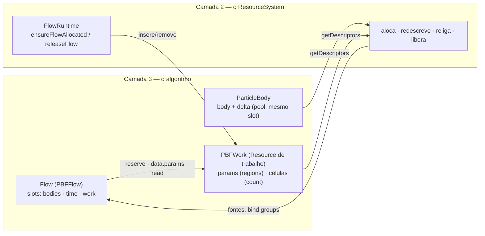

# Flows — escrevendo um algoritmo novo (nível N3)

Um **Flow** é um estágio do quadro: um solver de física, a composição das transformações, a sombra, o render
principal, o pós-processamento, a UI. Os Flows do motor e os seus usam o mesmo contrato. Você **declara** o que o
algoritmo consome e como ele reage a eventos; a Camada 2 (C2) resolve os dados da cena, atribui as ligações dos
recursos que os shaders declaram, cria e mantém os bind groups e decide quando o Flow entra no quadro.

Um Flow declara:

| Campo | O que é |
|---|---|
| `type` | Nome do estágio (mensagens de erro, profiling, `flowReady`) — dado, não nome de classe. |
| `slots` | Os dados da cena que o algoritmo lê, tipados, pelos construtores `slot.*`. |
| `pipelines` | Os pipelines compilados antes de o Flow ficar pronto (`PipelineDescriptor`). |
| `bindings` | Fontes dos recursos **privados**: `Map<BindingKey, BindingSource>`, pela identidade do recurso declarado — sempre objetos que a C2 alocou (descritores do Resource de trabalho ou de outro slot), nunca criados pelo Flow. |
| `listens` | Schemas cujos envios chegam ao Flow como evento: `poolWritten` (dado em pool, faixas de slots) ou `resourceReady` (Resource com objetos próprios). |
| `initialState` / `transitions` | A máquina de estados do algoritmo: `estado → evento → destino`. |
| `dispatch(frame, bound)` | A gravação do quadro. **Só grava**: nada é criado nem escrito aqui. |
| `dispose()` | Desfaz o que o Flow guarda fora da C2 (inscrições, caches de CPU); os objetos de GPU são da C2 e saem com o Resource de trabalho. |

**O Flow não cria objetos de GPU** (spec 039, Princípio III da constituição). Todo dado que vai à GPU é descritor de um
Resource e é alocado, redimensionado, religado e liberado pelo `ResourceSystem`: o estado de cada corpo no pool dele, o
trabalho por entidade como descritor de pool do mesmo corpo, e o trabalho da própria instância do Flow no **Resource de
trabalho** (`slot.work`, abaixo). Uma regra de lint proíbe `core.create`, `core.write`, `core.destroy` e
`core.readback` em `src/elements` e `src/presentation`.

## Slots

Cada slot é resolvido pela C2 e entregue ao `dispatch` em `bound.slots`, com tipo:

| Construtor | Resolve para | Uso típico |
|---|---|---|
| `slot.bodies()` | `BoundPool` do `bodyType` do registro | o pool de corpos de um solver |
| `slot.pool(key, { optional? })` | `BoundPool` (buffer, `count`, `stride`, `slotOf`, `rangeOf`, `entityAt`, `live`) | `WorldTransform`, restrições |
| `slot.pools(keys)` | mapa chave → `BoundPool \| undefined` | conjunto de colliders |
| `slot.singleton(schema, { optional?, select? })` | `BoundSingleton` (`resource`, `bufferOf(descId)`…) | câmera, `Time`, `GravityField` |
| `slot.entities({ all: [A, B, …], record?, groups?, owns? })` | `BoundEntities` (entidades com um Resource de cada tipo; com `record`, `entry.recordSlot` e `records`; com `groups`, `groups` e `instances`) | renderizáveis, casters, corpos |
| `slot.texture(schema, descId, { optional?, select? })` | `BoundTexture` (`texture`, `view`) | cor da cena, mapa de sombra |
| `slot.target('canvas' \| { color, depth?, samples? })` | `BoundTarget` (só em `RenderFlow`; `samples`/`sampleCount` com MSAA) | alvo de render |
| `slot.work(() => new MeuTrabalho())` | `BoundWork` (`resource`, `bufferOf(descId)`, `regionStride(descId)`…) | o espaço de trabalho da instância do Flow (spec 039) |

Com `record`, a C2 mantém um registro de GPU por entidade do conjunto, num pool com chave `record.schema.name`: cada
campo (`u32`) recebe o slot de pool do descritor nomeado de um Resource da entidade — ex.: `renderableRecord` =
`{ transformSlot: [Transform, 'world'], materialSlot: [Material, 'material'] }`. O estágio desenha com
`firstInstance = entry.recordSlot` e o shader lê o registro (`renderables[instance_index]`), sem bind group por
entidade. Conjuntos com a mesma declaração compartilham o pool; o estágio nunca escreve nele.

### Grupos de instâncias (`groups`)

Com `groups`, a C2 agrupa as entidades do conjunto por uma chave e mantém, num pool com chave `groups.schema.name`
(um struct com um único campo `u32`), uma **lista de instâncias** em que cada grupo ocupa um trecho contíguo. O
estágio desenha um grupo com uma chamada só — `draw.indexed(índices, group.count, 0, 0, group.first)` — e o shader
acha a entidade pela lista (`instances[instance_index]`):

```typescript
renderables: slot.entities({
  all: [Geometry, Material, Transform],
  record: renderableRecord,
  groups: {
    schema: RenderInstanceSchema,            // { renderable: u32 }
    key: (entry) => `${entry.get(Geometry).contentKey}|${entry.get(Transform).mirrored ? 'cw' : 'ccw'}`,
    instance: 'record',                      // valor da lista: o slot do registro (ou [Tipo, 'descId'])
    rekeyOn: { [Transform.schema.name]: ['scale'] }, // campos cujo envio reavalia a chave
  },
}),
```

`bound.slots.renderables.groups` é a lista de `DrawGroup` (`key`, `first`, `count`, `representative`), refeita só
quando a composição muda; `instances` é o pool da lista. A C2 mantém os grupos por eventos (inserção, remoção,
`rekeyOn`): com a cena parada nada é percorrido. Conjuntos com o mesmo schema de lista compartilham a lista.

### Posse da GPU (`owns`)

`owns: [[Transform, 'transform']]` passa à GPU a posse daquele descritor das entidades do conjunto: depois do
primeiro envio a CPU não escreve mais o slot (mutação ignorada com aviso único), o crescimento do pool preserva o
dado por cópia na GPU e o dado é lido sob demanda com `app.resources.read(resource)` / `readAll(resources)`. O
`BoundPool` informa `gpuOwned` (quantos slots são de posse da GPU) e `ownedByGpu(slot)`. É assim que a física
publica a pose dos corpos direto no `Transform`.

`owns` também aceita um descritor **individual** (spec 008): o conjunto passa a ser o escritor declarado de um dado
`upload: 'never'` — ex.: `owns: [[PointCloudGeometry, 'vertices']]` num estágio que escreve os vértices por kernel. A C2
registra o escritor (`resources.hasGpuWriter(geometria, 'vertices')`); o forward avisa uma vez quando desenha uma
geometria `'never'` sem escritor.

### Faixas e slots vivos (spec 008)

Um Resource com descritor `count: N` em pool ocupa N slots contíguos: `bound.slots.x.rangeOf(entityId)` dá
`{ first, count }` (os corpos de partículas usam isso; o desenho deles lê `first + instance_index`). Kernels que
percorrem `[0, count)` de um pool com faixas liberadas testam o bitset de vivos: `BoundPool.live` (no shader, um
recurso `array<u32>` com fornecedor `{ slot: 'bodies', part: 'live' }` ou `{ consumer: '<pool>.live' }`) e
`pool_live(live[i >> 5u], i)` do módulo `poolLive` da `wgslLib`.

Slot obrigatório não resolvido mantém o Flow `pending` (fora do quadro). Slots opcionais resolvem como `undefined`
enquanto o dado não existe; quando aparecem, somem ou trocam de recurso, o Flow recebe `slotChanged`.

## Espaço de trabalho (spec 039)

Tudo que um algoritmo usa além do dado da cena — parâmetros por passo, listas de pares, contadores, filas, grades,
histogramas — é dado de GPU e segue o Princípio III: é descritor de um Resource. Há três lugares, escolhidos pelo que
dimensiona o dado:

| O dado é… | Onde mora | Como cresce |
|---|---|---|
| **por entidade** (por partícula, por corpo, por colisor) | descritor de pool do **próprio Resource da entidade**, no mesmo slot do `body` (`upload: 'never'`, `allocation: 'onDemand'`) | com o pool (2×, cópia na GPU, `poolReallocated`); faixas livres reaproveitadas |
| **da instância do Flow** (parâmetros, pares, contadores, filas, a grade do domínio) | descritores do **Resource de trabalho** (`slot.work`) | `reserve` → redescrição (cresce e encolhe; `entitiesRecomposed`, `bindGroupReplaced`) |
| **de um Resource da cena com um por cena** (o campo dos fluidos, a estrutura de raios, o renderizador) | descritores desse Resource, inserido pelos estágios padrão | `reserve` → redescrição |

### Trabalho por entidade: o pool do corpo

Um Resource com vários descritores em pool ocupa o **mesmo slot** em todos eles. O trabalho por partícula é, portanto,
um descritor a mais do corpo — o índice da partícula no `body` é o índice dela no trabalho:

```ts
getDescriptors(): readonly GPUDescriptor[] {
  return [
    { id: 'body', role: 'storage-rw', schema: PBFParticleSchema, storage: 'pool', upload: 'initial', count: this.count },
    // Só existe na GPU, e só depois que o solver pede (`resources.ensurePoolAllocated('PBFDelta')`).
    { id: 'delta', role: 'storage-rw', schema: PBFDeltaSchema, storage: 'pool', upload: 'never',
      allocation: 'onDemand', count: this.count },
  ];
}
```

O shader lê pelo pool (`provider: { pool: 'PBFDelta' }`). Precedentes: os `partials` e a `energy` do `SoftBody`.

### Trabalho da instância: o Resource de trabalho (`slot.work`)

O Flow declara a fábrica do seu Resource de trabalho; a C2 o cria e o **insere no World quando aloca o Flow**
(`ensureFlowAllocated`) e o **remove no `releaseFlow`** — um por instância (cada `bodyType` de um solver tem o seu). Ele é
um Resource comum: descritores, `data`, `reserve`, redescrição, ciclo de vida, visível nas consultas do World.

```ts
const slots = {
  bodies: slot.bodies(),
  time: slot.singleton(Time.schema),
  work: slot.work(() => new DriftWork()),
};
```

- **Parâmetros por passo — uniforme por região.** Um descritor `uniform` com `regions: { count }` guarda N registros do
  schema, cada um num múltiplo do `minUniformBufferOffsetAlignment` do adaptador; o recurso de shader é ligado com offset
  dinâmico e o `dispatch` escolhe a região: `bindTo(pass.bind, { stage: [i * work.regionStride('params')] })`. O Flow
  escreve `work.data.params[i] = { … }` no `framePrepare` — a C2 envia no mesmo quadro (o envio dos sujos roda depois do
  `framePrepare`).
- **Capacidade — `reserve`.** O Resource de trabalho expõe `reserve(...)` (como o `FluidField`): quando a capacidade
  muda, ele se redescreve; a C2 realoca o que mudou de forma, nos dois sentidos, e refaz os bind groups. Nada fica preso
  a um valor anterior.
- **Valores da CPU — três caminhos, todos da C2.** O conteúdo que muda entre quadros e já é conhecido no `framePrepare`
  vai em `work.data[id]` (descritor `upload: 'always'`; a C2 envia só os descritores cujo campo mudou, antes da
  gravação). O valor conhecido só na gravação (a contagem de uma reconstrução, os parâmetros de uma chamada) vai por
  `resources.writeNow(work, id, bytes, offset?)` — também na faixa de um descritor em pool, relativo ao início dela — ou,
  num uniforme por região, por `resources.writeRegions(work, id, registros, primeira?)`. Uma textura com conteúdo da CPU
  (o atlas de uma fonte, uma imagem do mundo) é um descritor `texture` com os bytes em `data[id]`: a C2 os envia na
  alocação e a cada mudança.
- **Partes que saem.** `work.drop(parte)` tira os descritores de uma parte (uma busca recriada com outra grade, o trabalho
  de uma entidade que saiu); a C2 libera os buffers. Os auxiliares fazem isso no `destroy()`.
- **Contadores — `read`.** Um contador escrito na GPU (contatos, a fila da refração) é um descritor do Resource de
  trabalho lido por `resources.read(work, 'counter')` (a leitura sob demanda da spec 007: lote por tarefa, desempacotada
  pelo schema) — sem staging nem `mapAsync` no Flow.
- **Auxiliares de compute** (`PrefixSum`, `RadixSort`, `Compaction`, `Reduce`, `SpatialHashGrid`,
  `NeighborSearchPipeline`, `RayWave`…) são provedores de descritores: `static descriptors(prefixo, capacidade)` devolve
  os `GPUDescriptor` que o Resource dono inclui, e `attach(...)` liga o que a C2 alocou. O que é por entidade vai ao pool
  do corpo; o que é do domínio, ao Resource de trabalho.



## Bindings: recursos declarados (spec 031)

Os shaders não escrevem `@group/@binding`: cada recurso que um módulo usa é declarado com `wgslResource({ name,
binding, type, frequency, provider })` e posto em `requires`. A montagem (`composeWgsl`) atribui o grupo (pela
frequência: `frame` < `stage` < `batch` < `draw`) e a ligação (pela ordem do nome) e emite as linhas; o
`LayoutInferencer` lê essas declarações e deriva a visibilidade. Para cada binding que as entradas do pipeline usam, a
C2 resolve a fonte pelo **fornecedor declarado**:

1. `PipelineDescriptor.pools` — troca, só naquele pipeline, o pool que fornece um recurso;
2. `'private'` — a fonte que o Flow deu ao recurso: `{ pipeline, resource }` (só naquele pipeline — ex.: a mesma
   origem de pós com uma textura por efeito) vence o próprio recurso (todos os pipelines do Flow); sem fonte,
   `FlowBindingError` nomeando o recurso, o grupo, o pipeline e o Flow;
3. `{ scene: ponto }` — o global de um ponto de cena (o pool, ou um substituto zerado);
4. `{ slot: nome, part?, descriptor? }` — o que o slot do Flow resolveu (o pool, o bitset `live`, os registros ou as
   instâncias de um conjunto de entidades, uma textura, o descritor de um singleton);
5. `{ pool: chave }` / `{ consumer: nome }` — o `ConsumerResolver` registrado com esse nome.

Fonte ainda inexistente na cena faz o pipeline esperar. Cada pool criado registra o seu `PoolResolver`
automaticamente; fornecedores da C3/C4 (`Time`, `GravityField`, `ParticlePhysics`, `ShadowCaster.*`) já têm
resolver, e `Application.create({ consumers })` registra os seus (`SingletonResolver`,
`PoolResolver`, `TextureResolver` ou uma implementação própria de `ConsumerResolver`). Uma fonte privada para um
recurso que tem fornecedor é erro. No `dispatch`, grave os grupos sem índices: `prepared.bindTo(pass.bind, {
frequência: offsets })`, ou `prepared.groupsOf(frequência)` para regravar só o que mudou. Detalhes em
[Arquitetura — Contrato de shader estruturado](./architecture_resource_loaders.md).

## Séries temporais: o canal temporal (spec 037)

Todo "valor do quadro anterior" — o histórico do antisserrilhado, o acúmulo da luz global, a névoa, o filtro temporal,
a energia de um corpo — é a mesma coisa: uma **série** de um recurso no tempo. A C2 mantém a série; o Flow só grava a
fatia de agora e lê os atrasos de que precisa. Nada de pipeline por paridade, metade de buffer por paridade ou cópia
por quadro.

**Declarar.** Um descritor de textura (`texture`, `storage-texture`), de buffer de storage ou de pool ganha `history`:

```ts
{
    id: 'history',
    role: 'texture',
    allocation: 'onDemand',
    textureShape: { format: 'rgba16float', sizeFromCanvas: true },
    // 2 fatias (a de agora e a anterior); 32 bits com 'full' — sem `float32-filterable` e lida filtrada, a C2 fica em
    // 16 bits com um aviso.
    history: { depth: 2, precision: 'full', filtered: true },
}
```

A C2 aloca `depth` fatias (texturas do mesmo `textureShape`, buffers do mesmo tamanho, ou buffers do pool crescendo
com ele — pool só com `upload: 'never'`). O canal existe desde a inserção do recurso; as fatias de um descritor
`onDemand`, desde o `ensureAllocated` / `ensurePoolAllocated` de quem usa.

**O anel.** No começo de cada quadro (`frameRecording`), todo canal cuja fatia de agora foi gravada no quadro anterior
gira: a gravada vira o atraso 1, a mais antiga é reaproveitada como a de agora. Canal não gravado não gira — o atraso 1
continua sendo a última gravação, e o carimbo (`stamp(lag)`: o quadro e o tempo) e a idade (`age(lag)`: quadros desde
a gravação) dizem quanto tempo passou. `frames` conta as gravações seguidas desde a última invalidação; o atraso `k`
vale com `frames ≥ k`. A série recomeça (`frames = 0`) quando as fatias são recriadas (redimensionamento, `redescribe`,
crescimento do pool), quando entra ou sai entidade do pool da série, ou quando o produtor pede (`invalidate()`). O
corte de câmera continua na GPU (`CameraMatrices.history.x`, `temporal_cut`): é por câmera, não por recurso.

**Ligar.** O slot `slot.channel(Schema, 'descId')` (ou `slot.poolChannel('Pool')`) dá o `BoundChannel` (vivo: `depth`,
`head`, `frames`, `format`, `view(lag)`, `buffer(lag)`, `stamp(lag)`, `age(lag)`, `written()`, `invalidate()`). Os
recursos de shader de cada fatia declaram o atraso no fornecedor:

```ts
const previous = wgslResource({
    name: 'taa_history',
    binding: { texture: { sample: 'f32' } },
    frequency: 'draw',
    provider: { slot: 'taaHistory', lag: 1 },
});
```

A C2 cria um bind group por **fase** do anel (cada combinação das cabeças dos canais do grupo, até 64), todos fora da
gravação, e escolhe o do quadro em `bindTo` / `groupsOf`. Alvos de render usam `view(0)`. O `dispatch` que gravou a
fatia de agora chama `written()` — não o `framePrepare`: um quadro pulado pela prontidão não gira o anel.

**Quem já usa.** O antisserrilhado (`TemporalAntialiasing.history|state|light`), a luz global de tela
(`GlobalIllumination.screenHistory`, um buffer), a névoa (`Froxels.history`, 3D, lida filtrada), o filtro temporal
(`TemporalFilter.accumulated|accumulatedMoments|guide`) e a energia dos corpos rígidos e moles (`RigidBody.energy`: o pool
`BodyEnergy`; `SoftBody.energy`: o pool `SoftBodyEnergy`, um registro por corpo; 8 fatias, com o `EnergyMeter` na
cena — ver [Física](./physics_flows.md)). Contrato:
`specs/037-padronizacao-matematica/contracts/temporal-channel.md`.

## Transições e eventos

O Flow tem dois estados, ambos mudados por eventos:

- **Ciclo de vida** (`flow.lifecycle`), só da C2: `pending → preparing → ready → disposed`. Em `ready` a C2 emite
  `flowReady` e o `ExecutionSystem` passa a gravar o Flow; perder um slot obrigatório volta a `pending`
  (`flowSuspended`).
- **Estado do algoritmo** (`flow.state`), só por transições. A tabela tem uma entrada por estado (e `'*'` para
  qualquer estado); cada entrada é `'ignore'` ou `{ to, run? }`. **Evento sem entrada lança `FlowTransitionError`.**

No `run(event, ctx)` o Flow ajusta o espaço de trabalho (`work.reserve(...)`, parâmetros em `work.data`), religa
fontes privadas a objetos que a C2 alocou (`ctx.bind(new Map([[recurso, fonte]]))`), prepara pipelines que
dependem da cena (`ctx.prepare(descriptor)`, idempotente por `id`) e os libera (`ctx.release(id)`). A C2 recria os
bind groups afetados antes da próxima gravação.

Um Flow que escreve um dado só em alguns quadros declara em `framePrepare` se o produziu:
`ctx.produced(resource, descId, produced)` (spec 031). Quem lê consulta `resources.isProduced(resource, descId)`
(`ResourceDirectory`) e só grava com o dado produzido. Um descritor tem um produtor só (o primeiro Flow que o marca); um
segundo produtor é erro. É assim que a geometria escrita na GPU (`SurfaceFlow`, `produced('vertices')`) avisa a
estrutura de raios de que precisa reajustar as caixas.

| Evento | Quando a C2 entrega |
|---|---|
| `slotsResolved` | slots obrigatórios resolvidos (entrada em `preparing`) |
| `slotLost` | um slot obrigatório deixou de existir (volta a `pending`) |
| `slotChanged` | um slot opcional (ou um slot `pools`) apareceu, sumiu ou trocou de recurso |
| `pipelinesCompiled` | os pipelines declarados compilaram (entrada em `ready`); com `pipeline`, um preparado em transição |
| `bindGroupReplaced` | uma fonte foi recriada e o bind group trocado — o `dispatch` lê o novo em `bound.pipelines` |
| `entitiesChanged` | entidades entraram ou saíram de um slot `entities` — agregado: um evento por slot por quadro (`added`, `removed`), entregue antes de `framePrepare` |
| `canvasReconfigured` | o canvas mudou de tamanho (só Flows com `target`) |
| `poolReallocated` | um pool dos slots cresceu |
| `poolWritten` | a C2 enviou faixas de um pool de schema de `listens` (`poolKey`, `ranges`, `fields?`) — um por pool por envio |
| `resourceReady` | um Resource de `listens` com objetos próprios (não em pool) foi alocado ou enviado |
| `framePrepare` | **opt-in**: antes da gravação de cada quadro — escrever parâmetros no Resource de trabalho, pedir capacidade (`reserve`) |
| `frameRecorded` | **opt-in**: depois do envio do quadro — iniciar leituras |

`framePrepare` e `frameRecorded` só chegam a quem os declara. Eventos de domínio só chegam em `preparing`/`ready`.

## Exemplo completo — um integrador simples

Um Resource de partícula em pool, o Resource de trabalho do Flow com os parâmetros por passo, e um Flow que avança
`posição += velocidade × dt` uma vez por passo de física.

```typescript
import {
  Flow, slot, Time, StructSchema, FieldType, ResourceState, Entity, wgslModule, wgslResource, WORKGROUP_SIZE,
  type BoundFlow, type FlowTransitions, type Frame,
  type GPUDescriptor, type PipelineDescriptor, type Resource, type TransitionContext,
} from 'clayflow';

// 1. O dado: um pool de storage (uma partícula por entidade).
export const DrifterSchema = new StructSchema('Drifter', {
  position: FieldType.vec4f,
  velocity: FieldType.vec4f,
});

// `data` é o acessor de `Entity`, tipado pelo parâmetro: a subclasse atribui no construtor e não declara o campo.
export class Drifter extends Entity<{ position: number[]; velocity: number[] }> implements Resource {
  static readonly schema = DrifterSchema;
  state: ResourceState = ResourceState.Uninitialized;
  constructor(values: { position?: number[]; velocity?: number[] } = {}) {
    super();
    this.data = DrifterSchema.applyDefaults(values);
  }
  getDescriptors(): readonly GPUDescriptor[] {
    return [{ id: 'body', role: 'storage-rw', schema: DrifterSchema, storage: 'pool', upload: 'initial' }];
  }
  getPipelineDescriptors(): readonly PipelineDescriptor[] {
    return [];
  }
}

// 2. O espaço de trabalho do Flow: um Resource comum, criado e liberado pela C2 junto com o Flow.
const DriftParamsSchema = new StructSchema(
  'DriftParams',
  { dt: FieldType.f32, count: FieldType.u32 },
  { addressSpace: 'uniform' },
);

class DriftWork extends Entity<{ params: { dt: number; count: number }[] }> implements Resource {
  static readonly schema = new StructSchema('DriftWork', {});
  state: ResourceState = ResourceState.Uninitialized;
  #steps = 1;
  constructor() {
    super();
    this.data = { params: [] };
  }
  getDescriptors(): readonly GPUDescriptor[] {
    // Uma região por passo do quadro, cada uma no alinhamento do adaptador, ligada por offset dinâmico.
    return [{ id: 'params', role: 'uniform', schema: DriftParamsSchema, regions: { count: this.#steps } }];
  }
  getPipelineDescriptors(): readonly PipelineDescriptor[] {
    return [];
  }
  /** Garante uma região por passo; a redescrição realoca (para mais ou para menos). */
  reserve(steps: number): void {
    if (steps === this.#steps) return;
    const previous = this.getDescriptors();
    this.#steps = steps;
    this.redescribe(previous, { params: this.data.params.slice(0, steps) });
  }
}

// 3. O shader: recursos declarados e structs gerados dos schemas; nenhuma ligação nem offset à mão.
const driftBodies = wgslResource({
  name: 'bodies',
  binding: { storage: 'read_write' },
  type: { schema: DrifterSchema, array: true },
  frequency: 'stage',
  provider: { slot: 'bodies' },                         // o pool que o slot `bodies` resolveu
});
const driftParams = wgslResource({
  name: 'params',
  binding: { uniform: true },
  type: { schema: DriftParamsSchema },
  frequency: 'draw',
  provider: { slot: 'work', descriptor: 'params' },     // o descritor do Resource de trabalho (offset dinâmico)
});

const drift = wgslModule({
  name: 'drift',
  requires: [WORKGROUP_SIZE.module, driftBodies, driftParams],
  source: `
@compute @workgroup_size(WORKGROUP_SIZE) fn drift_main(@builtin(global_invocation_id) id: vec3u) {
    if (id.x >= params.count) { return; }
    bodies[id.x].position += bodies[id.x].velocity * params.dt;
}`,
});

// 4. O Flow.
const slots = {
  bodies: slot.bodies(),                    // o pool do bodyType do registro ('Drifter')
  time: slot.singleton(Time.schema),        // passos de física do quadro
  work: slot.work(() => new DriftWork()),   // o espaço de trabalho desta instância
};
type DriftSlots = typeof slots;
type Ctx = TransitionContext<DriftSlots>;

export class DriftFlow extends Flow<DriftSlots, 'running'> {
  readonly type = 'DriftFlow';
  readonly slots = slots;
  override readonly pipelines: readonly PipelineDescriptor[] = [
    { id: 'drift', role: 'compute', shader: drift, entryPoints: ['drift_main'] },
  ];
  protected readonly initialState = 'running' as const;
  protected readonly transitions: FlowTransitions<'running', Ctx> = {
    '*': {
      slotsResolved: 'ignore',
      slotLost: 'ignore',
      pipelinesCompiled: 'ignore',
      bindGroupReplaced: 'ignore',   // a C2 já trocou o grupo; o dispatch lê o novo
      poolReallocated: 'ignore',
      framePrepare: { to: 'running', run: (_e, c) => this.writeParams(c) },
    },
  };

  /** Antes da gravação: uma região por passo; a C2 envia no mesmo quadro. */
  private writeParams(ctx: Ctx): void {
    const time = ctx.bound.slots.time.resource as Time;
    const work = ctx.bound.slots.work.resource as DriftWork;
    work.reserve(Math.max(1, time.steps));
    for (let i = 0; i < time.steps; i++)
      work.data.params[i] = { dt: time.stepDt, count: ctx.bound.slots.bodies.count };
  }

  /** Só grava. */
  dispatch(frame: Frame, bound: BoundFlow<DriftSlots>): void {
    const count = bound.slots.bodies.count;
    const steps = (bound.slots.time.resource as Time).steps;
    if (count === 0 || steps === 0) return;
    const p = bound.compute('drift');
    const stride = bound.slots.work.regionStride('params');
    frame.compute('DriftFlow', (pass) => {
      pass.bind.setPipeline(p.spec);
      for (let i = 0; i < steps; i++) {
        p.bindTo(pass.bind, { draw: [i * stride] });   // grupos pela frequência; a região do passo pelo offset
        pass.dispatch.invocations(count, WORKGROUP_SIZE.value);
      }
    });
  }
}

// 5. O registro: instanciado quando o primeiro Drifter cria o pool.
app.flows.register(() => new DriftFlow(), { type: 'DriftFlow', phase: 'physics', bodyType: 'Drifter' });
app.world.insert(new Drifter({ velocity: [1, 0, 0, 0] }));
```

Os grupos e a visibilidade vêm do WGSL; o pool entra pelo slot `bodies` e os parâmetros pelo descritor do Resource de
trabalho, os dois alocados pela C2. Se o pool crescer ou o trabalho se redescrever, a C2 recria o grupo
(`bindGroupReplaced`) e o próximo `dispatch` já o usa. O Flow não tem `dispose`: o `DriftWork` sai da cena com ele.

## Registro

```typescript
const reg = app.flows.register(factory, { type, phase, bodyType?, priority? }); // → FlowRegistration (reg.flow)
app.flows.override(bodyType, factory, { type, phase, priority? });               // vence a prioridade
app.flows.unregister(reg);                                                       // descarta a instância
```

- **Sem `bodyType`** a factory é chamada no registro; **com `bodyType`**, quando o pool do tipo passa a existir
  (`poolCreated`) e o registro vence a seleção (override → maior `priority` → último registrado).
- **Ordem do quadro**: fases fixas `physics → transform → shadow → forward → post → ui`; dentro da fase, `priority`
  decrescente, empate pela ordem de registro.
- A factory recebe `FlowContext { core, world, resources, events, bodyType? }`. Do `core` o Flow só consulta (capacidades
  do adaptador, formato e tamanho do canvas); criar, escrever, destruir e ler objetos de GPU é da C2.
- `FlowRegistrationError`: `type` repetido na fase, `bodyType` vazio, registro fora de uma cena.

### Ordem dos estágios padrão (com a iluminação global, spec 033)

Um quadro com céu, GI, névoa e água por campo passa por estes estágios. Cada um fica pendente (sem custo) sem o
Resource de que precisa.

| Fase | Estágio (prioridade) | O que faz |
|---|---|---|
| `physics` | solvers, `EmitterFlow` (−100) | move as partículas e os corpos |
| `transform` | `TransformFlow`, `PbrTablesFlow` (10), `CameraFlow` (−10), `ShadowMatrixFlow` (−20) | matrizes de mundo, câmeras, matrizes de sombra |
| `transform` | `SoftSurfaceFlow` (−30), `SurfaceFlow` (−40), `GraphFlow` (−50) | geometria escrita na GPU |
| `transform` | `FluidFieldFlow` (−50) | o campo de distância dos fluidos |
| `transform` | `SkyFlow` (−55) | as tabelas da atmosfera, quando o sol anda |
| `transform` | `RaySceneFlow` (−60) | a estrutura de raios, depois de toda a geometria do quadro |
| `shadow` | `ShadowFlow` (0) | mapas de sombra |
| `shadow` | `ProbeFlow` (−5) | sondas de tela e do mundo, fótons |
| `shadow` | `FroxelFlow` (−30) | a névoa: injeção, acúmulo, integração (lê sombra e sondas) |
| `forward` | `ForwardFlow` (0) | passe de profundidade, opacos, céu ao fundo, transmissivos |
| `forward` | `ParticleFlow` (−50), `RefractionVolumeRequestFlow` (−61), `RefractionFlow` (−65) | sprites; o vidro e a água traçados (o pedido pelas superfícies dos volumes e o traçado) |
| `post`, `ui` | `PostFlow`, `UIFlow` | pós-processamento, interface |

Os estágios conversam por Resources e pontos de cena, não por chamadas: a GI entra no desenho pelo `scene_lighting`, a
névoa pelo `scene_fog`, o céu pelo `scene_background`
([Shaders — pontos de cena](./shaders.md#pontos-de-cena-spec-033)).

## Flows de render

`RenderFlow` é um `Flow` cujo slot `target` é o alvo de render: o canvas (`slot.target('canvas')`) ou texturas de
Resources (`{ color, depth }` — ex.: a cor e a profundidade dos `FrameTargets`, a `depth` de um `ShadowMap`; `color:
'none'` para passes só de profundidade). A C2 resolve o alvo, inclusive o formato (`bound.slots.target.format`), e o
recria com o canvas. No `dispatch`, `this.colorView(frame, bound.slots.target)` dá a view de cor do quadro; com MSAA
(`slot.target({ …, samples: { schema: FrameTargets.schema, descId: 'samples' } })`),
`this.colorAttachment(frame, target, { loadOp })` monta o anexo que desenha nas amostras e resolve na cor, e os
pipelines usam `multisample: { count: bound.slots.target.sampleCount }`.

```typescript
class OverlayFlow extends RenderFlow<{ target: TargetSlot }, 'idle'> {
  readonly type = 'OverlayFlow';
  readonly slots = { target: slot.target('canvas') };
  // pipelines com colorTargets: [{ format: ctx.core.canvasFormat, blend: … }], privados, transições…
  dispatch(frame: Frame, bound: BoundFlow<{ target: TargetSlot }>): void {
    const view = this.colorView(frame, bound.slots.target);
    const p = bound.pipelines.get('overlay');
    if (view === undefined || p?.role !== 'render' || !p.ready) return;
    frame.render({ colorAttachments: [{ view, loadOp: 'load', storeOp: 'store' }] }, 'OverlayFlow', (pass) => {
      pass.bind.setPipeline(p.spec).setBindGroup(0, p.groups[0]!);
      pass.draw.vertices(3);
    });
  }
}
app.flows.register((ctx) => new OverlayFlow(ctx), { type: 'overlay', phase: 'ui' });
```

## Regras que o gate verifica

- Nenhum estágio cria layout nem bind group: são da C2.
- Nenhum `dispatch` cria objeto de GPU (contado com todos os Flows padrão ativos).
- Toda tabela declara os eventos que a C2 pode entregar ao Flow, e os demais lançam `FlowTransitionError`.
- C3/C4 importam os tipos de GPU por `scene/contracts/gpu` (ou pelo barrel `clayflow`), nunca de `core/`.

Para o desenho completo (pools canônicos, resolvers, ciclo de vida dos Resources) veja
[Arquitetura](./architecture_resource_loaders.md).
