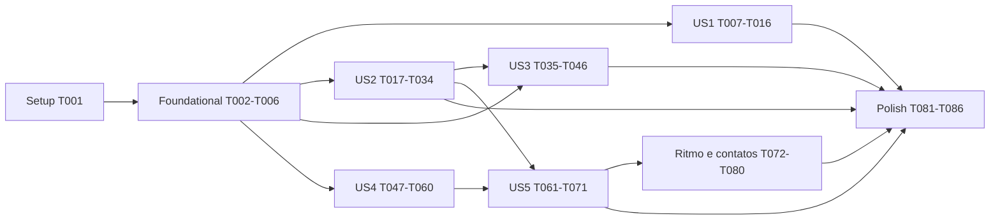

# Tasks: Endurecimento do núcleo

**Feature**: `004-core-hardening` | **Branch**: `feature/004-core-hardening`
**Input**: plan.md, spec.md, research.md (A1–A6, R1–R15), data-model.md, contracts/ (core-c1, time, resources-c2),
quickstart.md

## Format: `[ID] [P?] [Story?] Description with file path`

- **[P]**: paralelizável (arquivos distintos, sem dependência pendente).
- **[USx]**: tarefa de fase de user story.
- Testes Vitest CPU-side são exigidos (Constituição V); teste antes da implementação quando listados em par. A verdade
  da GPU é validada por smokes (`src/__smokes__`) servidos pelo servidor do bench, e o desempenho por
  `npm run bench:check` contra `bench/baselines/`.

## Path Conventions

- C1 `src/core/` (testes em `src/core/gpu/__tests__/`), C2 `src/scene/` (testes em `src/scene/__tests__/`), C3
  `src/elements/` (testes em `src/elements/**/__tests__/`), C4 `src/presentation/` (testes em
  `src/presentation/**/__tests__/`).
- Integração: `createScene` real com `EngineCore` mockado (`src/scene/__tests__/helpers/fakeSceneCore.ts`).
- Código de C3/C4 depende só de contratos; nada fora de C1 importa `core/gpu`.

---

## Phase 1: Setup

- [x] T001 Rodar `npm test`, `npx tsc --noEmit` e `npm run bench:check -- --from bench/results/latest.json` (ou registrar que não há `latest.json` local) para registrar a linha de base verde da branch; anotar em `specs/004-core-hardening/tasks.md` (nota abaixo do checkpoint) a CPU por quadro do baseline em `instances/10k`, `instances/10k-moving` e `unique-objects/1k` lida de `bench/baselines/apple-metal-3-chrome154-macos-1280x720-syhprh.json`

> **Linha de base (T001, 2026-10-09)**: `tsc` ✅, `npm test` 347/347 ✅, `bench:check --from latest.json` PASSOU.
> CPU por quadro do baseline (`apple-metal-3-chrome154-macos-1280x720-syhprh`, commit 6e19aef): `instances/10k` 2714,9 ms ·
> `instances/10k-moving` 2961,8 ms · `unique-objects/1k` 267,9 ms. Meta SC-001 (≥ 50% abaixo): ≤ 1357,5 · ≤ 1480,9 ·
> ≤ 134,0 ms.

---

## Phase 2: Foundational (Blocking Prerequisites)

**Contratos e captura do adaptador — US2 precisa do alinhamento de offset uniforme; US3 completa o dispositivo.**

- [x] T002 [P] Criar `src/core/contracts/DeviceOptions.ts` com `DeviceOptions` e `DeviceCapabilities` (data-model), JSDoc em todos os campos; reexportar em `src/core/contracts/index.ts` e no barrel de tipos de `src/index.ts`
- [x] T003 [P] Teste `src/core/gpu/__tests__/GpuContext.capabilities.test.ts` (adapter/device mockados em `navigator.gpu`): `createGpuContext` devolve adaptador (info + `isFallbackAdapter`), features obtidas e limites efetivos do device; `timestamp-query` pedido só se disponível
- [x] T004 Refatorar `src/core/gpu/GpuContext.ts` para devolver também `capabilities: DeviceCapabilities` (sem ainda aplicar `DeviceOptions` — US3) até T003 passar
- [x] T005 Adicionar `capabilities(): DeviceCapabilities` ao contrato `src/core/contracts/EngineCore.ts` (JSDoc: lança se não inicializado) e implementar em `src/core/gpu/GpuEngineCore.ts` guardando o resultado de `createGpuContext`; acrescentar `capabilities` a todos os doubles de `EngineCore` em testes (`fakeSceneCore.ts`, `fakeResourceCore.ts`, `renderHarness.ts` e mocks `as unknown as EngineCore`) com limites padrão do WebGPU
- [x] T006 Rodar `npx tsc --noEmit && npm test && npm run check:circular`

**Checkpoint**: contrato de capacidades disponível para C2–C4.

---

## Phase 3: User Story 1 — Identidade de recursos estável e barata (Priority: P1)

**Goal**: identidade calculada uma vez por spec, composta, specs imutáveis, posse no store (FR-001–FR-006).

**Independent test**: testes CPU de hash/congelamento/posse + `bench:check` com CPU por quadro caindo nas cenas-alvo.

- [x] T007 [P] [US1] Teste `src/core/gpu/__tests__/specHash.memo.test.ts`: segunda chamada com o mesmo objeto não reserializa (espiar `stableStringify` via contagem de acessos a um getter na spec, ou medir que um objeto congelado de 1 MB de WGSL hasheado 10 000 vezes custa ≈ 1 hash); objetos distintos de conteúdo igual → hash igual (inclusive aninhados: dois pipelines com shaders distintos de mesmo `source`); conteúdo diferente em qualquer nível → hash diferente; `BundleSpec` com `body` diferentes → hashes diferentes, mesmo `body` → igual; ciclos não travam; hashes de specs sem aninhamento permanecem estáveis entre execuções (valor fixo esperado)
- [x] T008 [US1] Reescrever `src/core/gpu/specHash.ts` até T007 e `src/core/gpu/__tests__/specHash.test.ts` passarem: memo `WeakMap<object,string>`; serialização canônica que substitui spec aninhada (objeto com `kind` de `ResourceSpec`) por `{"$spec":hash}` e função por `{"$fn":id}` (`WeakMap<Function, number>`); JSDoc com a regra de imutabilidade
- [x] T009 [P] [US1] Teste `src/core/gpu/__tests__/deepFreeze.test.ts`: congela objetos e arrays aninhados; não entra em funções (nem `prototype`); para em objetos já congelados (compartilhados e ciclos); atribuição posterior lança `TypeError` em módulo estrito
- [x] T010 [P] [US1] Criar `src/core/gpu/deepFreeze.ts` até T009 passar
- [x] T011 [P] [US1] Teste `src/core/gpu/__tests__/GpuResourceStore.owners.test.ts`: duas specs de conteúdo igual criam uma entrada com dois donos; `destroy` da primeira não destrói o objeto; `destroy` da segunda destrói; `create` repetido com o mesmo objeto não duplica posse; `clear` destrói tudo
- [x] T012 [US1] Implementar posse (`owners: Set<ResourceSpec>`) em `src/core/gpu/GpuResourceStore.ts` até T011 passar
- [x] T013 [P] [US1] Teste `src/core/gpu/__tests__/GpuEngineCore.identity.test.ts` (device mockado): `create`/`createAsync` congelam a spec (mutação lança), devolvem o mesmo objeto, deduplicam por conteúdo e registram posse; `destroy` respeita posse; `createAsync` concorrente da mesma spec compila uma vez
- [x] T014 [US1] Atualizar `src/core/gpu/GpuEngineCore.ts` (`create`, `createAsync` com promessa em voo por hash, `destroy`) e o JSDoc de `create`/`destroy` em `src/core/contracts/EngineCore.ts` (texto de `contracts/core-c1.md`) até T013 passar
- [x] T015 [US1] Rodar `npx tsc --noEmit && npm test`; corrigir qualquer teste ou código que mute spec após `create` (levantamento: nenhum em `src/`; conferir `createComputeKernel.ts:95`, `GpuEngineCore.ts:287-334` — `kernel.layouts` congelado)
- [x] T016 [US1] Medir: `npm run bench -- --scene instances,unique-objects --engine clayflow` e registrar em `specs/004-core-hardening/tasks.md` (nota do checkpoint) a CPU por quadro contra o baseline (medição intermediária; SC-001 é verificado em T085)

**Checkpoint**: identidade barata e imutável; ganho medido.

> **Medição T016 (2026-10-09, `bench --scene instances,unique-objects --engine clayflow`, 3 repetições)**: CPU por
> quadro `instances/10k` 93,0 ms (baseline 2714,9; −96,6%) · `instances/10k-moving` 284,0 ms (2961,8; −90,4%) ·
> `unique-objects/1k` 7,9 ms (267,9; −97,1%). `instances/100k` passou a concluir (3083,3 ms; antes `timeout`);
> `instances/1m` continua derrubando a aba (`Target crashed`).

---

## Phase 4: User Story 2 — O tempo governa a simulação (Priority: P1)

**Goal**: física por tempo, passo fixo com acumulador e teto, escalas/pausas, `step()` sem laço (FR-007–FR-013).

**Independent test**: smoke `time.ts` (30/60/144 Hz e `step()` × laço) + testes CPU do relógio e dos parâmetros por
passo.

- [x] T017 [P] [US2] Teste `src/scene/__tests__/Time.test.ts` (data-model `advance`): `fixedDt` 1/60 com quadros de 1/30, 1/60, 1/144 — total de passos em 5 s = 300 nos três; acumulador `< fixedDt`; teto `maxStepsPerFrame` com quadro de 1 s → 4 passos e `droppedTime` correto e `timeDropped` emitido; `scale` 0,25 → `dt` e passos proporcionais; `scale` 0 → 0 passos e `elapsed` parado; `pausePhysics` → 0 passos com `dt` > 0; `resume` restaura; `fixedDt` `undefined` → 1 passo de `physicsDt`; `realDt` limitado a `maxFrameDt`; valores inválidos lançam `RangeError`; `frame` incrementa
- [x] T018 [US2] Criar `src/scene/time/Time.ts` (Resource, schema GPU `Time { dt, elapsed, stepDt, steps }`, campos e métodos do contrato `contracts/time.md`, JSDoc) até T017 passar; criar `src/scene/events/TimeDroppedEvent.ts`; em `src/scene/events/FrameTickEvent.ts` acrescentar `realDt` e `frame`; atualizar `EventMap`; reexportar `Time` em `src/scene/index.ts`, `src/presentation/index.ts` (no lugar do antigo) e `src/index.ts`; remover `src/presentation/app/Time.ts`
- [x] T019 [US2] `src/scene/SceneContext.ts`: `createScene` cria e insere um `Time` no World e o expõe (`scene.time`); teste em `src/scene/__tests__/SceneContext.time.test.ts` (um `Time` por cena, consultável por `world.queryBySchemaName('Time')`)
- [x] T020 [P] [US2] Teste `src/presentation/app/__tests__/Application.step.test.ts` (cena com core mockado): `app.time === scene.time`; duas `Application` na mesma cena compartilham o mesmo `Time` (sem segundo `Time` no World); `step(1/60, 3)` emite 3 `frameTick` com `frame` 1..3 e `elapsed` 0,05; `step()` com o laço rodando lança; `GameLoop` (RAF mockado) chama o mesmo avanço com o `dt` medido e sem teto de 1/30
- [x] T021 [US2] Implementar `Application.step(dt?, frames?)` e o uso do `Time` da cena em `src/presentation/app/Application.ts`; `src/presentation/app/GameLoop.ts` passa a chamar `time.advance(realDt)` e emitir `frameTick { dt, realDt, elapsed, frame }`, sem o teto de 1/30, até T020 passar
- [x] T022 [P] [US2] Teste `src/elements/physics/__tests__/PerStepUniforms.test.ts` (core mockado com `capabilities().limits.minUniformBufferOffsetAlignment = 256`): região por iteração alinhada a 256; uma única `write` por quadro com `steps × substeps` regiões preenchidas; layout com `hasDynamicOffset: true`; offset da iteração `i` = `i × regionSize`; crescimento quando `steps × substeps` excede a capacidade recria o buffer, destrói o anterior e incrementa `generation` (o bind group pertence ao kernel do Flow, que o refaz e libera o antigo com `destroyComputeKernel` da C2)
- [x] T023 [US2] Criar `src/elements/physics/flows/PerStepUniforms.ts` (componente dos Flows de física: buffer uniform com regiões, bind group com offset dinâmico, escrita única por quadro; JSDoc citando research A1) até T022 passar
- [x] T024 [P] [US2] Teste `src/elements/physics/__tests__/LCPFlow.time.test.ts`: com `Time` no World e `steps = 2`, `substeps = 4`, o `dispatch` grava 2 predicts, 8 iterações de solve e 2 commits; cada iteração liga o offset da sua região; a região de substep contém `stepDt/substeps` em `gravity.w` e `stepDt` em `dt_frame`; `steps = 0` não grava passes de simulação nem readback
- [x] T025 [US2] Migrar `src/elements/physics/flows/LCPFlow.ts` para `Time.steps/stepDt` (consulta `world.queryBySchemaName('Time')`) e `PerStepUniforms` (shaders `src/elements/gpu/wgsl/**/rb_*.wgsl`: binding de `RBSimParams` com offset dinâmico — sem mudar o struct), removendo a opção `fixedDt` própria (substeps continuam opção) até T024 passar; readback só após quadros com passos
- [x] T026 [P] [US2] Migrar `src/elements/physics/flows/XPBDFlow.ts` para `Time` + `PerStepUniforms` com teste `src/elements/physics/__tests__/XPBDFlow.time.test.ts` (iterações = `steps × substeps`, `dt` por região)
- [x] T027 [P] [US2] Migrar `src/elements/physics/flows/FEMFlow.ts` para `Time` + `PerStepUniforms` com teste `src/elements/physics/__tests__/FEMFlow.time.test.ts` (`dt_sub` e `dt_frame` por região)
- [x] T028 [P] [US2] Migrar `src/elements/physics/flows/MPMFlow.ts` para `Time` + `PerStepUniforms` com teste `src/elements/physics/__tests__/MPMFlow.time.test.ts`
- [x] T029 [P] [US2] Migrar `src/elements/physics/flows/SPHFlow.ts` para `Time` + `PerStepUniforms` com teste `src/elements/physics/__tests__/SPHFlow.time.test.ts` (a reconstrução de vizinhança acompanha cada iteração)
- [x] T030 [P] [US2] Migrar `src/elements/physics/flows/PBFFlow.ts` para `Time` + `PerStepUniforms` com teste `src/elements/physics/__tests__/PBFFlow.time.test.ts`
- [x] T031 [US2] Substituir `emit('frameTick', …)` manual por `app.step()` em `src/__smokes__/transforms.ts`, `src/__smokes__/multiApp.ts`, `src/main.ts` e nos testes que avançam quadros pela `Application`; testes de C2 sem `Application` passam a usar `scene.time.advance` + `frameTick` com o payload novo (`ExecutionSystem.*.test.ts`, `phases.test.ts`, `integration/*.test.ts`, `DefaultEventBus.test.ts`, `DebugFlow.stagesNs.test.ts`)
- [x] T032 [US2] Benchmark: `bench/engines/clayflow.ts` passa a avançar com `app.step(1 / 60)` por quadro (tempo simulado igual ao do Rapier, research R8), mantendo o `dt` real no `update` das cenas; remover o comentário "sem `step()` até a F1"; atualizar `clay-engine-doc/docs/guides/benchmark.md` (protocolo: 1/60 s simulado por quadro nas duas engines)
- [x] T033 [US2] Smoke `src/__smokes__/time.ts`: cena de corpos rígidos com `fixedDt = 1/60`; executar 5 s simulados por `app.step` com quadros de 1/30, 1/60 e 1/144 e comparar as poses finais lidas por readback (diferença ≤ 1e-5 m, SC-003); `scale = 0.25` com laço por 2 s reais → avanço 25% ± 1% (SC-004); `pausePhysics` congela as poses enquanto `frameComplete` continua; 300 × `step(1/60)` ≡ 5 s de laço com `fixedDt` (SC-005); registrar no `src/__smokes__/README.md`
- [x] T034 [US2] Rodar o smoke `transforms.ts` (física revalidada — trajetórias do LCP mudam com `dtSub` correto) e `time.ts` no navegador; registrar resultado em `specs/004-core-hardening/tasks.md` (nota do checkpoint)

**Checkpoint**: simulação governada pelo tempo; mesma trajetória em qualquer taxa de quadros.

> **Smokes T034 (2026-10-09, `npm run smoke -- transforms,time`, Chrome 154 / Apple Metal 3)**: `transforms` PASSED
> (física revalidada com o `dtSub` correto — corpos caem, escala visual preservada); `time` PASSED — 30 × 60 × 144 Hz:
> diferença 0 m (SC-003); laço × `step` com 300 passos: 0 m (SC-005); escala 0,25 → 0,2500 do tempo real (SC-004);
> física pausada: 60 quadros, deslocamento 0 m. Os smokes passaram a rodar pelo servidor do bench
> (`npm run smoke`, `bench/smoke.html`), importando o barrel público `clayflow`.

---

## Phase 5: User Story 3 — Capacidades e limites do dispositivo (Priority: P2)

**Goal**: potência, features e limites configuráveis; relatório completo; despachos e busca de vizinhança dentro dos
limites do device (FR-014–FR-017, FR-029, FR-030).

**Independent test**: testes CPU com adapter mockado + `app.capabilities` no navegador + smoke `limits.ts`.

- [x] T035 [P] [US3] Ampliar `src/core/gpu/__tests__/GpuContext.capabilities.test.ts`: `powerPreference` repassada a `requestAdapter`; `requiredFeatures` indisponível → rejeita com mensagem que nomeia a feature; `optionalFeatures` indisponível → `missingFeatures`; limites de escala pedidos no máximo do adaptador; `requiredLimits` acima do máximo → máximo + `clampedLimits`
- [x] T036 [US3] Aplicar `DeviceOptions` em `src/core/gpu/GpuContext.ts` até T035 passar
- [x] T037 [US3] `EngineCore.initialize(canvas?, canvasOptions?, device?)` no contrato e em `src/core/gpu/GpuEngineCore.ts`; `requestRecover` e `reconfigureCanvas` reaplicam as `CanvasOptions`/`DeviceOptions` guardadas; teste `src/core/gpu/__tests__/GpuEngineCore.options.test.ts` (recover e resize preservam `alphaMode`/`colorSpace`)
- [x] T038 [US3] `ApplicationOptions.device?: DeviceOptions` e getter `app.capabilities` em `src/presentation/app/Application.ts` (repassa a `scene.core.initialize`); `requestNewDevice` usa as opções guardadas; teste em `src/presentation/app/__tests__/Application.device.test.ts`
- [x] T039 [US3] Benchmark: `bench/page/main.ts` passa a ler o adaptador do clayflow por `app.capabilities` quando disponível (sem mudar o `profileId`); verificar no navegador que o relatório traz adaptador, features e limites
- [x] T040 [P] [US3] Teste `src/core/gpu/__tests__/GpuComputePass.limits.test.ts` (encoder mockado, limite 65 535): `invocations(n, 64)` com `ceil(n/64) ≤ limite` → `dispatchWorkgroups(g, 1, 1)`; acima → `(65 535, ceil(g/65 535), 1)`; `invocations(0, 64)` não despacha nem conta; `workgroups` com qualquer dimensão acima do limite lança `RangeError` com `maxComputeWorkgroupsPerDimension` na mensagem; contador de dispatches incrementa uma vez por despacho
- [x] T041 [US3] `invocations(count, workgroupSize)` no contrato `src/core/contracts/passes/Dispatcher.ts` (JSDoc de `contracts/core-c1.md`) e em `src/core/gpu/passes/GpuComputePass.ts` (limite de `device.limits`, repassado por `GpuFrame`), validação em `workgroups`; doubles de passe (`fakeSceneCore.ts`, `renderHarness.ts` e mocks de `dispatch`) ganham `invocations`, até T040 passar
- [x] T042 [P] [US3] Teste `src/elements/gpu/__tests__/linearDispatch.test.ts`: varredura estática de `src/elements/gpu/wgsl/kernels/*.wgsl` e `transform_compose.wgsl` — todo kernel com `@workgroup_size(N)`, `N > 1`, que indexa elementos usa `@builtin(num_workgroups)` e `gid.x + gid.y * nwg.x * N` (lista explícita de exceções para kernels de grupo único, ex. `ns_scan_groups`); varredura de `src/elements/**/*.ts` sem `dispatch.workgroups(` com contagem de elementos (só `invocations` ou grupo único `workgroups(1)`)
- [x] T043 [US3] Migrar todos os kernels lineares de `src/elements/gpu/wgsl/kernels/` e as 22 chamadas de despacho (`NeighborSearchPipeline.ts`, `LCPFlow.ts`, `XPBDFlow.ts`, `FEMFlow.ts`, `MPMFlow.ts`, `SPHFlow.ts`, `PBFFlow.ts`, `TransformFlow.ts`) para `dispatch.invocations(count, WG)` e índice linear, até T042 passar; ajustar os testes dos Flows que conferem `workgroups`
- [x] T044 [P] [US3] Teste `src/elements/gpu/__tests__/NeighborSearchPipeline.scan.test.ts` (core mockado): níveis para 4 096, 65 536, 131 072 e 262 144 células (1/1/2/2 níveis acima do 0 conforme data-model — 4 096 > 256 já exige um nível); um buffer de somas e um uniform de contagem por nível, escritos só quando a grade muda; sequência gravada `scan_local` (subida) → `scan_groups` → `scan_combine` (descida) com `invocations` de cada nível; `dispose` destrói os buffers e uniforms de todos os níveis (a grade é fixa por instância); referência CPU do algoritmo (`exclusiveScanByLevels` no teste) igual à soma de prefixos sequencial para 262 144 contagens aleatórias
- [x] T045 [US3] Implementar a soma de prefixos em vários níveis em `src/elements/gpu/NeighborSearchPipeline.ts` e em `ns_scan_local.wgsl`/`ns_scan_groups.wgsl`/`ns_scan_combine.wgsl` (contagem do nível por uniform próprio, índice linear), até T044 passar
- [x] T046 [US3] Smoke `src/__smokes__/limits.ts`: (a) kernel de teste com `invocations(70 000 × 256, 256)` grava 1 em cada posição de um buffer de `u32` e um contador atômico; leitura de volta confirma todas as posições = 1 e contador = total (SC-010); (b) `NeighborSearchPipeline` com grade 64 × 64 × 64 (262 144 células) e partículas aleatórias: vizinhos lidos de volta iguais aos da força bruta na CPU (SC-011); registrar no `src/__smokes__/README.md`

**Checkpoint**: dispositivo configurável e diagnosticável; despachos e busca de vizinhança sem teto.

> **Smoke T046 (2026-10-09)**: `limits` PASSED — (a) 17 920 000 elementos em 70 000 grupos (> 65 535): todos
> marcados uma vez, contador 17 920 000 (SC-010); (b) 60 000 partículas em 262 144 células (52 554 em células
> ≥ 65 536), 71 224 vizinhos, 0 divergências contra a referência na CPU (SC-011). T039: relatório do bench traz
> adaptador, features (`core-features-and-limits`, `timestamp-query`) e limites no máximo do adaptador
> (`maxBufferSize`/`maxStorageBufferBindingSize` 4 294 967 292) com o mesmo `profileId`.

---

## Phase 6: User Story 4 — Recursos alocados e com ciclo de vida íntegro (Priority: P2)

**Goal**: C2 aloca toda a bag; transições validadas; reuso proibido; índices `uint32` (FR-018–FR-023).

**Independent test**: testes CPU por papel/transição/reuso + smoke `bigMesh.ts`.

- [x] T047 [P] [US4] Teste `src/scene/__tests__/StructSchema.vertexLayout.test.ts`: `position vec3f, normal vec3f, uv vec2f` → offsets 0/12/24, stride 32, formatos `float32x3/float32x3/float32x2`; tipos não permitidos em vértice lançam
- [x] T048 [US4] Implementar `vertexLayout` em `src/scene/descriptors/StructSchema.ts` até T047 passar
- [x] T049 [P] [US4] Criar contrato `src/scene/contracts/ResourceDirectory.ts` (`extends PoolDirectory`; `bufferOf`, `textureViewOf`, `samplerOf`; JSDoc "consumo pelos estágios na 006"), reexportar em `src/scene/contracts/index.ts`
- [x] T050 [P] [US4] Teste `src/scene/__tests__/ResourceSystem.allocation.test.ts` (core mockado): recurso com `vertex` (`Float32Array`), `index` (`Uint16Array` e `Uint32Array` → `format` correspondente, padding a 4 bytes), `indirect`, `texture` (com `sizeFromCanvas` recriada em resize), `storage-texture`, `sampler`, `staging`, `uniform`, `storage` com `count` 3 (envia os 3 elementos) — todos alocados e localizáveis por `ResourceDirectory`; dois descritores `uniform` no mesmo recurso → dois buffers, ambos destruídos na remoção; mutação de `data.vertices` reenvia no `frameRecording`; crescimento de pool destrói o bind group anterior
- [x] T051 [US4] Refatorar `src/scene/systems/ResourceSystem.ts` (`allocations: Map<Resource, Map<descId, Allocation>>`, alocação por papel conforme research R9, `implements ResourceDirectory`, destruição de todas as alocações e do bind group antigo do pool) até T050 passar
- [x] T052 [P] [US4] Teste `src/scene/__tests__/ResourceSystem.transitions.test.ts`: toda mudança de estado passa por `transition()`; transição inválida lança com estado atual, destino e schema; envio de recurso `GpuManaged` bloqueado por `suppressCpuUpload()` do handler (não por comparação); aviso de sujo ignorado vem de `ignoreDirtyMark()`; ciclo remover → reinserir: `Destroyed → Uninitialized → Loading → Ready` com nova alocação
- [x] T053 [US4] Implementar `transition()` e as regras por handler em `src/scene/systems/ResourceSystem.ts`; `Destroyed → Uninitialized` em `src/scene/lifecycle/states/DestroyedResourceStateHandler.ts`; atualizar `src/scene/__tests__/ResourceStateHandler.test.ts`, até T052 passar
- [x] T054 [P] [US4] Teste `src/scene/__tests__/World.reuse.test.ts`: inserir a mesma raiz duas vezes lança (mensagem "crie outra instância"); mesmo recurso em duas raízes lança; mesmo recurso duas vezes na árvore lança; dois `World` não compartilham o mapa recurso → entidade; `remove` seguido de `insert` da mesma raiz funciona; `entityIdOfResource` limpo após `remove`; inverter o caso "insert idempotente" de `src/scene/__tests__/World.test.ts`
- [x] T055 [US4] Implementar em `src/scene/world/World.ts` (mapa por instância de World, limpeza no `remove`, verificações no `insert`) até T054 passar; conferir `README.md`, guias e smokes (levantamento: todos criam instância por objeto)
- [x] T056 [P] [US4] Teste `src/elements/geometry/__tests__/indexFormat.test.ts`: `SphereGeometry`/`ParametricGeometry` com ≤ 65 535 vértices → `Uint16Array` e `indexFormat 'uint16'`; acima → `Uint32Array`/`'uint32'` com índices corretos; `GltfLoader` com índices `UNSIGNED_BYTE` → `Uint16Array` com os valores certos
- [x] T057 [US4] Implementar em `src/elements/geometry/Geometry.ts` (`indexFormat`), `SphereGeometry.ts`, `ParametricGeometry.ts`, `ParametricSurfaceGeometry.ts` e `src/presentation/assets/GltfLoader.ts` até T056 passar; ajustar os `schema` de vértice das geometrias para o `vertexLayout` (stride 32)
- [x] T058 [US4] `src/presentation/flows/ForwardFlow.ts` e `ShadowFlow.ts`: `format` e padding do IBO derivados do array (fim de `as Uint16Array` e `'uint16'` fixo); teste em `src/presentation/flows/__tests__/indexFormat.test.ts`
- [x] T059 [US4] Benchmark: declarar em `bench/engines/clayflow.ts` a limitação "geometria duplicada na GPU — cópia da C2 e dos estágios de desenho/sombra (até F1, spec 006)"
- [x] T060 [US4] Smoke `src/__smokes__/bigMesh.ts`: `ParametricGeometry` 300 × 300 (90 601 vértices) renderizada; verificar por pixels que a superfície cobre a área esperada (sem triângulos truncados, SC-008); registrar no README dos smokes

**Checkpoint**: C2 completa e confiável para a 006.

> **Smoke T060 (2026-10-09)**: `bigMesh` PASSED — 90 601 vértices, `uint32`, cobertura 100% nas duas metades da
> área projetada e nenhum pixel aceso fora dela (SC-008). Verificação negativa: forçando `Uint16Array` (truncado), a
> metade de cima cai para 47,89% e o smoke falha. Também passaram `transforms`, `time`, `integration` e `multiApp`
> com a C2 alocando vértices/índices.

---

## Phase 7: User Story 5 — Robustez em build minificado e sem vazamentos (Priority: P3)

**Goal**: sem dependência de nomes de classe; liberação de GPU e de ouvintes (FR-024–FR-026).

**Independent test**: smokes sobre o dist + smoke `churn.ts`.

- [x] T061 [P] [US5] Teste `src/presentation/flows/__tests__/renderables.test.ts`: forward e sombra mantêm o conjunto de renderizáveis pelos eventos do World (`entitiesInserted`/`entitiesRemoved` → hooks `onEntitiesInserted`/`onEntitiesRemoved`, mais varredura inicial na construção; entidade com `instanceof Geometry` + `instanceof Material` + `Transform`; câmera e luzes também por evento), inclusive geometria de classe nova não listada (subclasse de `Geometry` criada no teste) e classes com nome alterado (simular minificação com `Object.defineProperty(cls, 'name', { value: 'x' })`); remoção tira do conjunto; nenhuma consulta por nome de schema por quadro
- [x] T062 [US5] Refatorar `src/presentation/flows/ForwardFlow.ts` e `ShadowFlow.ts` (fim de `isGeometry`/`isMaterial`/`isGeom`, `seenSchemas` e `constructor.name`) até T061 passar; `grep -rn "constructor.name" src` sem ocorrências fora de testes
- [x] T063 [P] [US5] Teste `src/presentation/flows/__tests__/removalRelease.test.ts`: remover uma entidade chama `core.destroy` para VBO, IBO, UBOs e bind groups dela no forward e na sombra; o shader compartilhado não é destruído; `LCPFlow` destrói o buffer de donos anterior ao recriar (`src/elements/physics/__tests__/LCPFlow.owners.test.ts`)
- [x] T064 [US5] Implementar a liberação em `ForwardFlow.onEntitiesRemoved`, `ShadowFlow.onEntitiesRemoved` e `LCPFlow.ensureBodyOwnersBuffer` até T063 passar
- [x] T065 [P] [US5] Teste `src/scene/__tests__/dispose.test.ts`: `FlowRegistry.unregister(flow)` remove o estágio e chama `flow.dispose?.()`; `SceneContext.dispose()` remove as inscrições de `ExecutionSystem`, `ResourceSystem` e dos Flows (contagem de ouvintes do `EventBus` volta a zero); `TransformFlow.dispose` é chamado
- [x] T066 [US5] Implementar `FlowRegistry.unregister` (`src/scene/flows/FlowRegistry.ts`), `dispose()` em `ExecutionSystem` e `ResourceSystem`, e `SceneContext.dispose` completo até T065 passar
- [x] T067 [P] [US5] Teste `src/presentation/__tests__/listenersRelease.test.ts`: `DebugFlow.dispose` remove `frameTick`, `frameComplete` e `keydown`; `InteractionSystem.detach` remove `frameTick`; `FpsController.dispose` remove `click`; `Application.dispose` numa cena compartilhada desregistra os estágios padrão quando é a última aplicação da cena e não antes, e duas aplicações na mesma cena não duplicam estágios
- [x] T068 [US5] Implementar em `src/presentation/flows/DebugFlow.ts`, `src/presentation/flows/defaults.ts` (registro uma vez por cena, contagem de aplicações), `src/presentation/input/InteractionSystem.ts`, `src/presentation/input/controllers/FpsController.ts` e `src/presentation/app/Application.ts` até T067 passar
- [x] T069 [US5] Benchmark `--dist`: flag em `bench/core/args.ts` (+ teste em `bench/core/__tests__/args.test.ts`), alias `clayflow` → `dist/index.js` em `bench/vite.config.ts` via variável de ambiente lida pelo `bench/runner/server.ts`; documentar em `clay-engine-doc/docs/guides/benchmark.md`
- [x] T070 [US5] Smoke `src/__smokes__/churn.ts`: 100 ciclos de inserir e remover 1 000 objetos com `app.step`; `core.memoryUsage().totalBytes` final = inicial ± 1% e contagem de ouvintes estável (SC-006); registrar no README dos smokes
- [x] T071 [US5] Build minificado (SC-007): `npm run build:lib`; `npm run bench -- --dist --quick --scene unique-objects,rigid-bodies --engine clayflow` comparado com a execução sobre o fonte (mesmos draw calls e status); servir os smokes `transforms`, `time`, `bigMesh`, `churn` e `limits` com o alias do dist pelo servidor do bench e confirmar o mesmo resultado; registrar em `specs/004-core-hardening/tasks.md`

**Checkpoint**: produção igual ao desenvolvimento; sessões longas sem acúmulo.

> **Build minificado T071 (2026-10-09, SC-007)**: `npm run build:lib` (464 kB, 108 kB gzip). Bench `--quick`
> `--engine clayflow` fonte × `--dist`: `unique-objects/1k` ok/1001 draws × ok/1001; `rigid-bodies/1k` ok/1002 ×
> ok/1002; `rigid-bodies/10k` ok/10002 × ok/10002 (CPU por quadro equivalente: 7,92 × 7,90; 7,86 × 7,76; 100,7 × 99,7 ms).
> Smokes sobre o dist (`npm run smoke -- … --dist`): `transforms`, `time`, `bigMesh`, `churn`, `limits`, `integration`
> e `multiApp` PASSED — o mesmo resultado do fonte. Prova do alias: um marcador acrescentado ao `dist/index.js`
> aparece no console com `--dist` e não aparece sem a flag. Antes da 004 o dist não desenhava nada (A2).
> **Churn T070**: 100 × 1 000 objetos com sombra, memória 5,04 MiB estável (variação 0,000%), 14 ouvintes
> constantes; sem a liberação por entidade a memória vai a 1 218 MiB e o smoke falha.

---

## Phase 7b: Ritmo de quadros e contatos do LCP (FR-031, FR-032)

**Goal**: o motor não acumula quadros na GPU sem limite; o LCP armazena e resolve só contatos ativos dentro dos limites
do device (research R18/R19).

**Independent test**: testes CPU de quadros em voo, ritmo do laço e contatos compactados + smoke `rigidContacts.ts` +
bench `rigid-bodies`.

- [x] T072 [P] Teste `src/core/gpu/__tests__/GpuEngineCore.framesInFlight.test.ts` (device mockado com `onSubmittedWorkDone` controlável): `submit` incrementa, a conclusão decrementa, ordem de conclusão arbitrária, device perdido/`shutdown` zera; antes de qualquer submit = 0
- [x] T073 Implementar `framesInFlight()` no contrato `src/core/contracts/EngineCore.ts` e em `src/core/gpu/GpuEngineCore.ts`; doubles de `EngineCore` ganham `framesInFlight` até T072 passar
- [x] T074 [P] Teste `src/presentation/app/__tests__/Application.pacing.test.ts`: com `framesInFlight() ≥ maxFramesInFlight` o tick do `GameLoop` não avança nem emite `frameTick` e não move a marca de tempo (o próximo `realDt` inclui a espera); com espaço avança; `maxFramesInFlight` inválido lança; `app.readyForFrame()` reflete o limite; `app.step()` avança mesmo sem espaço
- [x] T075 Implementar o ritmo em `src/presentation/app/GameLoop.ts` e `ApplicationOptions.maxFramesInFlight`/`readyForFrame()` em `src/presentation/app/Application.ts` até T074 passar
- [x] T076 Benchmark: `bench/page/sampler.ts` aceita tick sem trabalho (amostra nula não conta nem fecha intervalo — teste em `bench/core/__tests__/sampler.test.ts`); `bench/engines/clayflow.ts` só avança quando `app.readyForFrame()`; documentar no guia do benchmark
- [ ] T077 [P] Teste `src/elements/physics/__tests__/LCPFlow.contacts.test.ts` (core mockado): capacidade `C` = `min(N·M, N × maxContactsPerBody, limite de binding / 80)` e buffers de contatos/bias/hash dimensionados por ela (não por N·M); contador zerado por `frame.clear` antes da narrowphase de cada substep; passe `rb_contact_accumulate` antes de cada commit com `body_contact` zerado; `contact_stamp` crescente por região de substep; excedente lido de volta gera aviso único
- [ ] T078 Implementar a compactação: `rb_contact.wgsl`/`rb_sim_params.wgsl` (`contact_stamp`), structs de contador e hash, `rb_narrowphase.wgsl` (append atômico + leitura do warm start), `rb_build_lcp.wgsl` e `rb_solve_lcp.wgsl` (só contatos ativos; o solver grava o warm start), novo `rb_contact_accumulate.wgsl`, `rb_lcp_commit.wgsl` (lê `body_contact`) e `src/elements/physics/flows/LCPFlow.ts` (opção `maxContactsPerBody`), até T077 passar
- [ ] T079 Smoke `src/__smokes__/rigidContacts.ts`: pilhas de esferas e caixas sobre o chão com 1 000 e com 10 000 corpos; após 6 s simulados todos repousam sobre o chão (penetração ≤ folga + 1 cm, velocidade ≈ 0), sem excedente de contatos; registrar tempo de GPU por quadro; registrar no README dos smokes (SC-013)
- [ ] T080 Bench `npm run bench -- --scene rigid-bodies --engine clayflow`: intervalo de quadro (média/p95/p99) abaixo do baseline e sem travamentos; memória de 10k em MB (SC-012); registrar em `specs/004-core-hardening/tasks.md`

**Checkpoint**: GPU não acumula quadros; física rígida dentro dos limites e em tempo de quadro.

---

## Phase 8: Polish & Cross-Cutting Concerns

- [x] T081 [P] Guia de arquitetura `clay-engine-doc/docs/guides/architecture_resource_loaders.md`: `Time` na C2 (motivo: C3 consome), acumulador e parâmetros por passo (A1), posse no store, `capabilities`, alocação por papel e `ResourceDirectory`, `Destroyed → Uninitialized`, reuso proibido por World
- [x] T082 [P] `clay-engine-doc/docs/guides/getting_started.md` e `README.md`: `app.time`, `app.step`, `device`/`capabilities`; guia de migração `clay-engine-doc/docs/guides/migration_legacy_to_clean.md`: tabela de mudanças incompatíveis do `quickstart.md`
- [x] T083 [P] JSDoc em todos os exports novos/alterados; `npm run doc:coverage` verde; `npm run doc` regenerado
- [ ] T084 `specs/ROADMAP.md`: §3 atualizado (itens do 004 resolvidos; achados A1/A2 registrados; limites de despacho 1D e scan de 65 536 células resolvidos (R16/R17); `createAsync` sem dedup em voo resolvido); status da F1/004
- [ ] T085 Desempenho: `npm run bench:check` sem regressão (SC-002) e CPU por quadro de `instances/10k`, `instances/10k-moving`, `unique-objects/1k` ≥ 50% abaixo do baseline (SC-001); registrar números em `specs/004-core-hardening/tasks.md`; se o gate passar e houver melhoria, regravar o baseline (`npm run bench:baseline`) com justificativa no commit
- [ ] T086 Gate completo verde: `npm run lint && npm run format:check && npm run check:circular && npm run check:dead && npx tsc --noEmit && npm run typecheck:bench && npm run test:coverage && npm run doc:coverage && npm run build:lib`; atualizar `Status` de `specs/004-core-hardening/spec.md`

---

## Dependencies & Execution Order



- US1, US2 e US4 dependem só da fase fundacional e podem andar em paralelo; US3 vem depois da US2 (arquivos distintos, exceto
  `GpuEngineCore.ts`, compartilhado por US1 e US3 — fazer US1 primeiro).
- A migração dos despachos (T043) e o scan em níveis (T045) mexem nos Flows de física e no
  `NeighborSearchPipeline`, que a US2 também altera — fazer a US2 antes da US3.
- A fase 7b (ritmo de quadros e contatos do LCP) vem depois da US5 e antes do polimento: nasceu da medição da T085
  (bench) e mexe no `GpuEngineCore`, no laço e no `LCPFlow`.
- US5 depende de US4 (forward/sombra já com formato de índice; `ResourceSystem` refatorado) e de US2 (`app.step` nos
  smokes `churn`/`time`).
- Dentro de cada fase: teste antes da implementação correspondente.

## Parallel Example

```text
# US2 após T023:
T026 XPBDFlow · T027 FEMFlow · T028 MPMFlow · T029 SPHFlow · T030 PBFFlow
# US4 em paralelo:
T047 vertexLayout teste · T049 ResourceDirectory · T054 World.reuse teste · T056 indexFormat teste
```

## Implementation Strategy

- Todas as fases são implementadas, na ordem de dependência acima; nenhuma é ponto de parada.
- Cada história tem seu teste independente; a feature só está pronta com **todas** as tarefas concluídas, o benchmark
  sem regressão e o gate completo verde (T085–T086).
