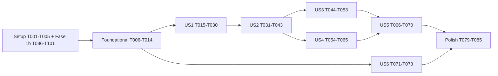

# Tasks: Núcleo de shaders

**Feature**: `005-shader-modules` | **Branch**: `feature/005-shader-modules`
**Input**: plan.md, spec.md, research.md (A1–A6, R1–R16), data-model.md, contracts/ (shader-modules, struct-schema,
compute-kernels), quickstart.md

## Format: `[ID] [P?] [Story?] Description with file path`

- **[P]**: paralelizável (arquivos distintos, sem dependência pendente).
- **[USx]**: tarefa de fase de user story.
- Testes Vitest CPU-side são exigidos (Constituição V); teste antes da implementação quando listados em par. A verdade
  da GPU é validada por smokes (`src/__smokes__`, `npm run smoke -- <nome>`) servidos pelo servidor do bench, e o
  desempenho por `npm run bench:check` contra `bench/baselines/` (regravado na 004).
- **Regra de preservação**: depois da Fase 1, toda tarefa que mexe em WGSL de um estágio termina com
  `npm run smoke -- trajectories,render` verde (trajetória bit a bit, ou dentro da tolerância registrada para SPH/PBF;
  imagem idêntica).

## Path Conventions

- C1 `src/core/`, C2 `src/scene/` (testes em `src/scene/__tests__/`), C3 `src/elements/` (testes em
  `src/elements/**/__tests__/`), C4 `src/presentation/` (testes em `src/presentation/**/__tests__/`).
- Fontes WGSL: `src/elements/gpu/wgsl/{math,kernels}/`, `src/elements/gpu/wgsl/forward.wgsl`,
  `src/presentation/flows/{shadow_depth,ui}.wgsl`, `src/presentation/flows/effects/effects.wgsl`.
- Módulos TS: `src/scene/shaders/` (montagem), `src/elements/gpu/shaders/` (`wgslLib`), `src/elements/gpu/compute/`
  (kernels genéricos), `src/elements/physics/shaders/` (entradas dos Flows de física).
- Integração: `createScene` real com `EngineCore` mockado (`src/scene/__tests__/helpers/fakeSceneCore.ts`,
  `fakeResourceCore.ts`).

---

## Phase 1: Setup — fixtures de antes

**Purpose**: gravar o comportamento atual antes de qualquer mudança em WGSL (R14, FR-040, FR-041).

- [x] T001 Registrar a linha de base verde da branch: `npm test`, `npx tsc --noEmit`, `npm run smoke -- limits,rigidContacts` (tempos de referência 8,2 ms / 223,7 ms) e `npm run bench:check -- --from bench/results/latest.json` se houver resultado local; anotar abaixo deste item em `specs/005-shader-modules/tasks.md`

> **Linha de base (T001, 2026-10-11)**: `tsc` ✅, `npm test` 618/618 ✅, `limits` ✅, `rigidContacts` 1k 8,1 ms/quadro ·
> 10k 228,7 ms/quadro ✅, `bench:check --from latest.json` PASSOU.

- [x] T002 Criar o smoke `src/__smokes__/trajectories.ts`: monta as cenas de física (LCP com esferas e caixas; XPBD com cadeia de restrições de distância; FEM; MPM sólido; MPM fluido; SPH; PBF) com posições iniciais determinísticas, avança 240 passos com `app.step(1/60)`, lê de volta o pool de cada corpo e, no modo `record`, grava `src/__smokes__/fixtures/trajectories-<perfil>.bin` + `trajectories-<perfil>.json` (cena, contagem, stride, offsets de `pos`/`vel` por `schema.offsetOf`); no modo `compare` (padrão) compara campo a campo e informa desvio máximo por cena; registrar em `src/__smokes__/README.md`
- [x] T003 Medir o determinismo entre execuções no código atual: rodar `trajectories` em `record` duas vezes seguidas e comparar; classificar cada cena em bit a bit (esperado: LCP, XPBD, FEM, MPM) ou não determinística (esperado: SPH, PBF — ordem dos vizinhos por contador atômico); gravar a tolerância por cena (= 2 × desvio máximo observado) no JSON da fixture e registrar os números em `specs/005-shader-modules/research.md` (R14)
- [x] T004 Criar o smoke `src/__smokes__/render.ts`: renderiza as cenas `instances/10k`, `unique-objects/1k` e `rigid-bodies/1k` do bench (mesmas câmeras, um quadro após `app.step` fixo), lê o canvas de volta (`copyTextureToBuffer` pela C1) e, em `record`, grava `src/__smokes__/fixtures/render-<cena>-<perfil>.png`; em `compare` exige igualdade de pixels; incluir também uma passagem com `PostFlow` (exposição + color grading) para cobrir `color`; registrar no README dos smokes

### Phase 1b: física que nunca rodou (research A7/A8, R17/R18, FR-036–FR-039) — antes de gravar

- [x] T086 Smoke `trajectories`: reprovar com `engineError` capturado, valores não finitos ou cena parada; critérios físicos por cena antes de gravar — LCP: todos os corpos sobre o chão ou fora dele por queda lateral registrada, nenhum abaixo de y = −0,05 dentro da área do chão; XPBD: partícula 0 fixa, elos com comprimento dentro de 5% do repouso; SPH/PBF/MPM: nenhuma partícula abaixo do topo do chão (y ≥ −0,01) e altura média abaixo da inicial (assentaram); FEM: queda livre esperada (só integra gravidade — A5) com y médio = y₀ − ½g t² ± 1%
- [x] T087 [P] Teste `src/elements/physics/__tests__/ColliderSet.test.ts`: mapa de dono por pool (corpo dinâmico → slot do `LCPSchema`, collider sem corpo → `0xFFFFFFFF`), buffers mínimos para pools ausentes, contagens, reconstrução em realocação de pool de collider/corpo e em remoção de entidades, `generation` muda só quando buffers mudam, bindings do grupo 2 (b0–b7)
- [x] T088 Implementar `src/elements/physics/colliders/ColliderSet.ts` e exportar por `src/elements/physics/colliders/index.ts`
- [x] T089 Migrar `src/elements/physics/flows/LCPFlow.ts` para obter pools, mapas de dono e contagens do `ColliderSet` (remove `rebuildBodyOwners`/`ensureBodyOwnersBuffer`/`bodyOwnersBuffers`); `LCPFlow.*.test.ts`, `time` e `rigidContacts` verdes e LCP bit a bit contra a gravação provisória da T086
- [x] T090 Criar `src/elements/gpu/wgsl/math/collider_set.wgsl` (bindings do grupo 2, `ColliderSetCounts`, `collider_set_push_out`, `collider_set_constrain`, pose por dono, SDF por `sdf.wgsl`) e trocar `ColliderDesc` por ele em `kernels/sph_collision.wgsl`, `kernels/pbf_collision.wgsl` e `kernels/mpm_grid_update.wgsl` (MPM: colliders do grupo 3 para o 2; remove o grupo de partículas não usado); ajustar `SPHFlow.ts`, `PBFFlow.ts`, `MPMFlow.ts` (bind group 2 do `ColliderSet`, invalidação por `generation`, `collider_count`/`COLLIDER_DESC_SIZE` removidos dos parâmetros e buffers)
- [x] T091 Ligar o XPBD padrão às restrições: `constraintPoolKey: DistanceConstraint.schema.name` em `src/elements/physics/flows/defaultFlows.ts`; teste em `src/elements/physics/__tests__/defaultFlows.test.ts`
- [x] T093 [P] Teste `src/elements/physics/__tests__/ParticleMaterial.test.ts`: padrões, validação (valores ≤ 0, Poisson fora de [0, 0,5), domínio vazio), grandezas derivadas (massa ρ₀s³, volume, h do SPH 1,3 s, h do PBF 2 s, célula MPM 2 s, K = ρ₀c², Lamé de E/ν, passos estáveis), `ParticleMaterial.of(world)` devolve o do World ou o padrão
- [x] T094 Implementar `src/elements/physics/materials/ParticleMaterial.ts` (Resource singleton, schema, getters derivados, `of(world)`) e exportar por `src/elements/physics/index.ts` e pela fachada com JSDoc
- [x] T095 SPH: `SPHFlow.ts` lê o `ParticleMaterial` (massa, h, k₀ = ρ₀c²/γ, viscosidade, restituição, domínio), substeps pelo passo estável, busca de vizinhança com célula = 2h e grade pelo domínio (recriada quando o material muda); `src/elements/physics/__tests__/SPHFlow.material.test.ts` (parâmetros gravados, substeps, recriação da vizinhança)
- [x] T096 PBF: `kernels/pbf_density_lambda.wgsl` e `kernels/pbf_position_correct.wgsl` com massa (ρ = mΣW, ∇C e Δp com m/ρ₀), `s_corr` k = 0,1/n = 4/Δq = 0,2h; `PBFFlow.ts` lê o material (massa, h = 2s, ε, domínio, vizinhança com célula = h); `src/elements/physics/__tests__/PBFFlow.material.test.ts`
- [x] T097 MPM: `kernels/mpm_p2g.wgsl` com massa/volume do material (uniform) e tensão por `material_id` (fluido: P Fᵀ = K J (J−1) I; elástico: neo-Hookean com μ/λ do material), `kernels/mpm_g2p.wgsl` reiniciando F = J^{1/3} I no fluido; `structs/mpm_sim_params.wgsl` com `particle_mass`, `particle_volume`, `bulk_modulus` (substituem campos de neve não usados, documentado); `MPMFlow.ts` com `material_id` pelo tipo de corpo, célula 2s, grade pelo domínio, substeps pelo passo estável; `src/elements/physics/__tests__/MPMFlow.material.test.ts`
- [x] T098 Fachadas: `FluidBody({ algorithm: 'MPM' })` cria F = I; `SoftBody` aceita `algorithm: 'MPM'` (schema `MPMSoftSchema`, F = I); testes em `src/elements/physics/__tests__/fluidBodyAuthoring.test.ts`/`softBodyAuthoring.test.ts`; o smoke `trajectories` usa a fachada (sem dados crus) e blocos com o espaçamento do material
- [x] T099 Critérios físicos dos fluidos no smoke `trajectories` (R18): sem NaN, dentro do domínio, acima do chão (y ≥ −s/2), assentado (velocidade média < 0,25 m/s em 4 s), altura média abaixo da inicial; SPH com densidade média interna em ±15% de ρ₀
- [x] T100 Determinismo e corridas (research A9): `kernels/ns_find.wgsl` grava os vizinhos ordenados por índice (`MAX_NEIGHBORS` = 128 validado em `NeighborSearchPipeline.ts`); PBF com correções em buffer de deltas e passes de aplicação (`kernels/pbf_apply.wgsl`; `pbf_vorticity` só ω; `pbf_xsph` com confinamento), colisão dentro do laço do solver, restrição unilateral, `s_corr` com expoente f32, XSPH/vorticidade com m/ρ₀; partículas de SPH/PBF colidem com raio s/2
- [x] T101 XPBD e MPM (research A9): `kernels/predict.wgsl` copia `pos` para `pred` em partícula fixa e `SoftBody` inicia `pred`; `XPBDFlow` com 8 substeps × 1 iteração por padrão; MPM com origem da grade em `mpm_p2g`/`mpm_g2p`, condição de contorno na faixa de uma célula (`collider_set_constrain(…, dx)`) e salvaguarda das partículas (`kernels/mpm_particle_collision.wgsl`, raio 0)
- [x] T092 Rodar `npm test`, `npm run smoke -- trajectories --record` (critérios físicos verdes, sem `engineError`), `time`, `rigidContacts`, `integration`; registrar em `research.md` (A7) o comportamento medido de cada cena

> **T092 (2026-10-11)**: `npm test` 653/653; `trajectories --record` com as 7 cenas nos critérios físicos e
> determinísticas bit a bit (LCP, XPBD, FEM, MPM sólido, MPM fluido, SPH, PBF); `time`, `limits`, `integration`, `multiApp`,
> `transforms`, `churn`, `bigMesh`, `rigidContacts` (1k 10,7 ms · 10k 222,0 ms por quadro) verdes.

- [x] T005 Gravar as fixtures (`npm run smoke -- trajectories,render -- --record`, opção nova no runner `bench/runner/smoke.ts` repassada à página) com a GPU sem outra carga e commitar `src/__smokes__/fixtures/`

> **T003–T005 (2026-10-11)**: as 7 cenas de `trajectories` são determinísticas bit a bit entre execuções (depois da Fase 1b;
> tolerância 0 em todas). `render`: 10 cenas (forward com sombra e wireframe, 8 efeitos isolados, UI), duas renderizações
> idênticas. A gravação revelou o `ColorGrading` apagando a imagem com os padrões (lift = strength, gain = 0) — corrigido
> com vocabulário de domínio (lift/gain/gamma, identidade por padrão). Fixtures do perfil `apple-metal-3` versionadas.

**Checkpoint**: fixtures versionadas; `npm run smoke -- trajectories,render` passa contra elas no código atual.

---

## Phase 2: Foundational — montagem e schemas na C2

**Purpose**: infraestrutura que todas as histórias usam (R1–R4). ⚠️ Nenhuma migração de estágio começa antes.

- [x] T006 [P] Testes do varredor em `src/scene/__tests__/scanWgslSymbols.test.ts`: `fn`/`struct`/`const`/`override`/`alias`/`var` (privado, workgroup, com `@group/@binding`), atributos antes da declaração, comentários de linha e de bloco aninhados ignorados, símbolos dentro de corpo de função ignorados, símbolo repetido no mesmo fonte
- [x] T007 Implementar `src/scene/shaders/scanWgslSymbols.ts` (varredor léxico de nível superior, sem parser completo)
- [x] T008 [P] Testes de `src/scene/__tests__/composeWgsl.test.ts`: diamante (D uma vez antes de B e C, antes de A), ordem de `requires` preservada, ciclo com caminho completo, dois objetos com o mesmo nome, símbolo conflitante entre módulos e entre módulo e struct gerado, `{{struct:X}}` válido (emitido uma vez, marcador removido) e inválido, dois schemas com mesmo `wgslName` e layouts distintos, determinismo (mesmo texto), memorização (mesmo objeto `ShaderModuleSpec`, congelado, `discriminator = 'wgsl:' + nome`), referência a função não definida
- [x] T009 Implementar `src/scene/shaders/WgslModule.ts` (`wgslModule()`, `WgslModule`, `WgslSymbol`, congelamento, conflito interno), `src/scene/shaders/WgslCompositionError.ts`, `src/scene/shaders/composeWgsl.ts` (DFS pós-ordem, structs no topo, marcadores, memo `WeakMap`, verificação de referências sobre o resultado — absorve `src/scene/flows/validateWgslReferences.ts`, que é removido) e `src/scene/shaders/index.ts`; exportar por `src/scene/index.ts`
- [x] T010 [P] Testes de layout em `src/scene/__tests__/StructSchema.layout.test.ts`: tabela de alinhamento/tamanho de storage e uniform (data-model), `array(elem, n)` (stride 16 em uniform), `struct(schema)` aninhado (alinhamento 16 em uniform), `runtimeArray` só como último campo e só em storage, atômicos proibidos em uniform, `wgslName` inválido, `u16`/`i16` inexistentes
- [x] T011 [P] Testes de geração e empacotamento em `src/scene/__tests__/StructSchema.wgsl.test.ts`: `toWGSL()` com tipos curtos e `wgslName`, arrays/aninhados/atômicos; `packInto` escreve exatamente `stride` bytes no offset com padding zerado, arrays de números e de objetos; `pack` igual a `packInto` num buffer novo; `offsetOf` coerente com `toWGSL` (offsets calculados pelas regras de WGSL a partir do texto gerado, em teste)
- [x] T012 Implementar em `src/scene/descriptors/FieldType.ts` (remover `u16`/`i16`; `atomicU32`/`atomicI32`; construtores `array`, `struct`, `runtimeArray`) e `src/scene/descriptors/StructSchema.ts` (`wgslName`, `addressSpace`, layout por regra, `toWGSL`, `packInto`, `pack` delegando); ajustar `vertexLayout` para rejeitar atômicos e compostos; atualizar `src/scene/descriptors/Schema.ts`/`TensorSchema.ts` onde a assinatura mudar
- [x] T013 [P] Testes em `src/scene/__tests__/createComputeKernel.test.ts`: aceita `shader: WgslModule`, monta uma vez (memo), `entryPoint` inexistente no módulo de entrada → erro legível, erro de montagem propagado com `kind`
- [x] T014 Trocar `shaderSource: string` por `shader: WgslModule` em `src/scene/flows/createComputeKernel.ts` e `src/scene/descriptors/PipelineDescriptor.ts` (atualizar `Flow.getPipelineDescriptors` e quem lê `shaderSource`, inclusive `src/scene/systems/LayoutInferencer.ts` que passa a receber o texto montado); remover `GpuEngineCore.compute()` de `src/core/gpu/GpuEngineCore.ts` e do contrato `src/core/contracts/EngineCore.ts`; migrar `src/__smokes__/limits.ts` e `src/main.ts` para `createComputeKernel` com `wgslModule`

**Checkpoint**: testes da fundação verdes. A troca de contrato da T014 e a migração dos estágios (US1) entram no mesmo commit: nenhum commit da branch fica com estágio sem compilar, e não há adaptador intermediário.

---

## Phase 3: User Story 1 — Shaders compostos por módulos (Priority: P1) 🎯

**Goal**: todo estágio monta seu shader por `composeWgsl` a partir de módulos com `requires` declarados; nenhuma
concatenação manual (FR-001–FR-006, SC-001).

**Independent Test**: varredura em teste não encontra `join('\n')`/`+ '\n' +` de WGSL nem import `?raw` fora de
módulos; todos os estágios compilam; `trajectories` e `render` verdes; os testes de `composeWgsl` cobrem os cenários
de aceitação.

- [x] T015 [US1] Declarar módulos de base provisórios para os fontes atuais de `src/elements/gpu/wgsl/math/` (`quat`, `mat`, `sdf`, `sph_kernels`, `mpm_weights`, `xpbd`, `lcp`, `contact_math`, `impulse`) em `src/elements/gpu/shaders/*.ts`, cada um importando seu `.wgsl` (`?raw`) e declarando `requires` reais (ex.: `lcp` → `quat`, `xpbd`); os arquivos atuais de `src/elements/gpu/wgsl/structs/` entram como módulos em `src/elements/gpu/shaders/structs.ts` — etapa da migração, removida na T041 quando os schemas da US2 os substituem
- [x] T016 [US1] Migrar `src/elements/scene/flows/TransformFlow.ts` para um módulo de entrada `transform_compose` (em `src/elements/scene/flows/shaders.ts`) com `requires: [quat, mat, structs]`; montar uma vez (remover a montagem duplicada)
- [x] T017 [US1] Migrar `src/elements/gpu/NeighborSearchPipeline.ts`: um módulo de entrada por kernel `ns_*` em `src/elements/gpu/shaders/neighborSearch.ts`, sem `+ '\n' +`
- [x] T018 [P] [US1] Migrar `src/elements/physics/flows/XPBDFlow.ts` para módulos de entrada em `src/elements/physics/shaders/xpbd.ts` (predict, distance_solve, velocity_update)
- [x] T019 [P] [US1] Migrar `src/elements/physics/flows/FEMFlow.ts` para `src/elements/physics/shaders/fem.ts` (fem_predict, fem_velocity_update)
- [x] T020 [P] [US1] Migrar `src/elements/physics/flows/MPMFlow.ts` para `src/elements/physics/shaders/mpm.ts` (p2g, grid_update, g2p, clear_grid), removendo a base definida duas vezes
- [x] T021 [P] [US1] Migrar `src/elements/physics/flows/SPHFlow.ts` para `src/elements/physics/shaders/sph.ts`
- [x] T022 [P] [US1] Migrar `src/elements/physics/flows/PBFFlow.ts` para `src/elements/physics/shaders/pbf.ts`
- [x] T023 [US1] Migrar `src/elements/physics/flows/LCPFlow.ts`: as 6 constantes `*_SHADER` viram módulos de entrada em `src/elements/physics/shaders/lcp.ts` (predict+gravity, narrowphase com 4 entradas, build_lcp, solve_lcp com 4 entradas, accumulate, commit)
- [x] T024 [US1] Migrar o forward: `src/elements/gpu/wgsl/forward.wgsl` vira módulo de entrada `forward` (em `src/elements/material/shaders.ts`) usado por `src/elements/material/{Standard,Wireframe,PointSprite}Material.ts` (`PipelineDescriptor.shader`) e por `src/presentation/flows/ForwardFlow.ts` (cria o `ShaderModuleSpec` por `composeWgsl`)
- [x] T025 [P] [US1] Migrar `src/presentation/flows/ShadowFlow.ts` (módulo `shadow_depth` em `src/presentation/flows/shaders.ts`)
- [x] T026 [P] [US1] Migrar `src/presentation/flows/PostFlow.ts` e `src/presentation/flows/effects/PostProcessEffect.ts`: módulo `effects_base`; efeito personalizado fornece `fragmentModule(): WgslModule` com `requires: [effects_base]` (substitui `fragmentSource` + concatenação); atualizar efeitos em `src/presentation/flows/effects/*.ts`
- [x] T027 [P] [US1] Migrar `src/presentation/ui/UiGpuPipeline.ts` e `src/presentation/flows/UIFlow.ts` (módulo `ui`)
- [x] T028 [US1] Atualizar testes existentes que inspecionam `shaderSource`/texto de shader (ex.: `src/elements/physics/__tests__/*`, `src/presentation/**/__tests__/*`) para o novo contrato
- [x] T029 [US1] Teste `src/elements/__tests__/noManualWgslAssembly.test.ts`: falha se algum `.ts` de `src/` (fora de `__tests__`, `__smokes__` e `src/scene/shaders/`) importa `?raw` sem estar em um arquivo de módulo (`src/**/shaders*.ts` ou `src/elements/gpu/shaders/`, `src/elements/gpu/compute/`) ou concatena WGSL com `join('\n')`/`+ '\n' +`
- [x] T030 [US1] Rodar `npm test`, `npx tsc --noEmit`, `npm run smoke -- trajectories,render,limits,rigidContacts,integration,transforms` e commitar T014–T030 juntos

> **US1 (2026-10-12)**: todos os estágios montam por `composeWgsl` (física, transformação, vizinhança, forward, sombra,
> pós, UI); `GpuEngineCore.compute()` e `ComputeKernelOptions` saíram da C1; `PostProcessEffect.fragmentModule()`
> substitui `fragmentSource`. `npm test` 708/708; `trajectories` 7/7 bit a bit, `render` 10/10 pixel a pixel; `limits`,
> `time`, `transforms`, `integration`, `multiApp`, `churn`, `bigMesh`, `rigidContacts` (1k 8,1 ms · 10k 214,6 ms) verdes.

**Checkpoint**: SC-001 atingido; trajetória e imagem inalteradas.

---

## Phase 4: User Story 2 — Um único lugar para cada layout (Priority: P1)

**Goal**: todo struct de dado de GPU gerado de schema; nenhum arquivo de struct à mão; nenhum offset numérico à mão
(FR-007–FR-011, SC-002).

**Independent Test**: `src/elements/gpu/wgsl/structs/` não existe; smoke `shaderLibrary` (T051) confere offsets na GPU
para cada schema; `trajectories` e `render` verdes.

- [x] T031 [P] [US2] Adicionar `wgslName` aos schemas de corpo em `src/elements/physics/bodies/schemas/{LCP,XPBDRigid,XPBDSoft,FEM,MPMSoft,MPMFluid,SPH,PBF}Schema.ts` (`RigidBody`, `Particle`, `MPMParticle`, `SPHParticle`, `PBFParticle`) e conferir em teste (`src/elements/physics/__tests__/bodySchemasWgsl.test.ts`) que `toWGSL()` reproduz os campos de `src/elements/gpu/wgsl/structs/{rigid_body,particle,mpm_particle,sph_particle,pbf_particle}.wgsl`
- [x] T032 [P] [US2] Criar os schemas de parâmetros em `src/elements/physics/schemas/params/` — `SimParamsSchema`, `FEMSimParamsSchema`, `MPMSimParamsSchema`, `SPHSimParamsSchema`, `PBFSimParamsSchema`, `RBSimParamsSchema`, `NarrowphaseParamsSchema` (uniform), com os campos e a ordem dos structs atuais (valores mágicos `particle_stride_f32`, `s_corr_n`, `fixed_scale`, `mu`/`lambda` do MPM como campos nomeados) — e teste `src/elements/physics/__tests__/paramSchemas.test.ts` comparando `stride`/`offsetOf` com os offsets usados hoje nos `fillParams`
- [x] T033 [P] [US2] Criar os schemas de estado do LCP e do MPM em `src/elements/physics/schemas/params/` — `RBContactSchema`, `RBWarmEntrySchema`, `RBBodyDeltaSchema`, `RBBodyCorrectionSchema` (atômicos), `MPMGridNodeSchema` (atômicos) — com teste de tamanho (96/16/32/16 B; grid node atual) em `src/elements/physics/__tests__/stateSchemas.test.ts`
- [x] T034 [P] [US2] Criar `NsSimParamsSchema` em `src/elements/gpu/NeighborSearchGrid.ts` (ou arquivo vizinho) e `TransformParamsSchema` em `src/elements/scene/flows/TransformFlow.ts`
- [x] T035 [P] [US2] Criar em C4 `ForwardShadowParamsSchema` (96 B do `forward.wgsl`), `ShadowDepthParamsSchema`, `EffectParamsSchema`, `ScreenParamsSchema`, `UiQuadSchema` ao lado de seus donos (`src/presentation/flows/ForwardFlow.ts` ou `src/elements/material/`, `ShadowFlow.ts`, `PostProcessEffect.ts`, `UiGpuPipeline.ts`); alinhar `src/elements/scene/ShadowMap.ts` ao struct que a sombra realmente lê; teste de tamanho em `src/presentation/flows/__tests__/presentationSchemas.test.ts`
- [x] T036 [US2] Refatorar `src/elements/physics/flows/PerStepUniforms.ts` para `{ discriminator, schema }` + `write(i, data)` via `packInto`, `binding().size = schema.stride`; remover `f32(i)`/`u32(i)`; teste em `src/elements/physics/__tests__/PerStepUniforms.test.ts` (região = roundUp(stride, alinhamento), escrita por campo, `reserve` inalterado)
- [x] T037 [US2] Migrar `XPBDFlow`, `FEMFlow`, `MPMFlow`, `SPHFlow`, `PBFFlow` (`src/elements/physics/flows/*.ts`): `*_BYTE_SIZE` removidos, `fillParams` por objeto de campos, módulos de entrada com `structs: [...]` no lugar dos módulos de struct provisórios; trajetórias verdes
- [x] T038 [US2] Migrar `src/elements/physics/flows/LCPFlow.ts`: `RBSimParams`/`NarrowphaseParams` por schema, tamanhos de buffer por `schema.stride` (remove `LCPFlow.ts:106-116`), leitura de volta de `pos`/`rot` por `LCPSchema.offsetOf` (remove `LCP_BODY_STRIDE_F32`), contador lido por `offsetOf`; atualizar `src/elements/physics/__tests__/LCPFlow.*.test.ts`
- [x] T039 [US2] Migrar `src/elements/gpu/NeighborSearchPipeline.ts` (`NsSimParams` por schema; `NsScanLevel` mantido até a US4 como schema `ScanLevelSchema`) e `TransformFlow` (`TransformParams` por schema)
- [x] T040 [US2] Migrar forward/sombra/pós/UI: `forward.wgsl` sem `Camera`/`WorldTransform`/`StandardMaterial`/`ShadowParams` declarados à mão (vêm de `Camera.schema`, `Transform.worldSchema`, `StandardMaterial.schema`, `ForwardShadowParamsSchema` via `structs`), `shadow_depth.wgsl`, `effects.wgsl`, `ui.wgsl` idem; empacotamento em `ForwardFlow.ts:611-625`, `ShadowFlow.ts:263,375`, `PostFlow.ts:240,363`, `PostProcessEffect.ts:82-91`, `UiGpuPipeline.ts:265-289` por `packInto`; `VsIn`/`VsOut` permanecem nos módulos de entrada (E/S de estágio); imagem idêntica
- [x] T041 [US2] Remover `src/elements/gpu/wgsl/structs/` inteiro e os módulos de struct provisórios (`src/elements/gpu/shaders/structs.ts`); structs locais de kernel (`TestContext`, `ContactDepth`, `ColliderFrame` com `bool`) ficam no kernel; `NarrowphaseParams`/`TransformParams` declarados dentro de kernels são removidos (vêm dos schemas)
- [x] T042 [US2] Teste `src/elements/__tests__/noManualOffsets.test.ts`: falha se algum Flow/pipeline de `src/elements` ou `src/presentation` escreve em `Float32Array`/`Uint32Array` de parâmetros por índice numérico literal para buffers de GPU (lista de exceções vazia; dados de vértice de geometria procedural continuam por `StructSchema`/`vertexLayout`)
- [x] T043 [US2] Rodar `npm test`, `npx tsc --noEmit`, `npm run smoke -- trajectories,render,limits,rigidContacts,time,integration`

> **US2 (2026-10-12)**: 22 arquivos de struct removidos; todo struct de buffer vem de schema (corpos com `wgslName`,
> parâmetros e estado em `elements/physics/schemas/`, vizinhança em `elements/gpu/schemas.ts`, `TransformParams`,
> `StandardMaterialSchema`, `ForwardShadowParams` em C3, sombra/pós/UI em `presentation/flows/renderSchemas.ts`).
> `SPHSimParams`, `PBFSimParams` e `NsSimParams` deixaram os `vec4` compactados por campos nomeados (kernels
> atualizados); funções/constantes que viviam em arquivos de struct foram para `math/lcp_state.wgsl` e
> `math/mpm_material.wgsl`. `PerStepUniforms.write` por schema; nenhum `*_BYTE_SIZE`/índice literal (teste
> `noManualOffsets`). `ShadowMap.schema` não é lido por shader nenhum — unificação da sombra como Resource na 006.
> `npm test` 716/716; trajetórias bit a bit e imagens idênticas; smokes verdes (`rigidContacts` 1k 9,5 ms · 10k
> 217,5 ms).

**Checkpoint**: SC-002 atingido (offsets na GPU conferidos na T051).

---

## Phase 5: User Story 3 — Matemática consolidada (Priority: P2)

**Goal**: `wgslLib` com 12 módulos de base, cada função num único arquivo, valores de referência na GPU
(FR-012–FR-018, SC-003).

**Independent Test**: `wgslSymbols.test.ts` (T066) sem duplicatas; smoke `shaderLibrary` verde; trajetórias e imagem
inalteradas.

- [x] T044 [P] [US3] Criar `src/elements/gpu/wgsl/math/linalg.wgsl` definitivo (det, inversa, transposta, produto, Frobenius, `polar_decomp_quaternion` vindo de `math/shape_matching.wgsl`) — _feito: a decomposição polar ficou em `mat`, que já requer `quat`; `linalg` não depende de quaternion_ e reduzir `math/mat.wgsl` a construção de matrizes (`mat3_from_quat`, `mat3_from_cols`, `quat_to_mat4`, `mat4_upper3x3_transform`, `rigid_mat4_inverse`) com `requires: [quat, linalg]`; módulos `linalg` e `mat` em `src/elements/gpu/shaders/`
- [x] T045 [P] [US3] Mover `W_poly6` e `grad_W_spiky` para `src/elements/gpu/wgsl/math/sph_kernels.wgsl` e remover as cópias de `kernels/pbf_density_lambda.wgsl`, `pbf_position_correct.wgsl`, `pbf_xsph.wgsl`, `pbf_vorticity.wgsl` (os módulos PBF passam a requerer `sph_kernels`); PBF bit a bit (cópias idênticas — research A3)
- [x] T046 [P] [US3] Fundir `math/contact_math.wgsl` e `math/impulse.wgsl` no módulo `lcp` (ou mantê-los como fontes do mesmo módulo, sem módulo próprio), atualizando `src/elements/physics/shaders/lcp.ts`
- [x] T047 [US3] Criar o módulo `fem` (`src/elements/gpu/wgsl/math/fem.wgsl` a partir de `math/fem_kinematics.wgsl` + `math/fem_xpbd.wgsl`, `requires: [linalg]`)
- [x] T048 [P] [US3] Extrair `brdf` (`src/elements/gpu/wgsl/math/brdf.wgsl`: `lambert_diffuse`, `ambient_term`, `sample_shadow_pcf`) e `color` (`math/color.wgsl`: `tonemap_exposure`, `gamma_encode`, `luminance`) de `forward.wgsl` e `effects.wgsl`, que passam a requerê-los; `render` com pixels idênticos
- [x] T049 [P] [US3] Criar `noise` (`src/elements/gpu/wgsl/math/noise.wgsl`: `pcg_hash`, `hash2`, `hash3`, `value_noise2/3`, `gradient_noise2/3` com interpolação quíntica) e a referência CPU em `src/elements/gpu/shaders/noiseReference.ts` (_feito em `src/__smokes__/support/noiseReference.ts`: só o smoke e o teste a usam, não é API do motor_) com teste `src/elements/gpu/__tests__/noiseReference.test.ts` (valores fixos, determinismo, faixa [-1, 1])
- [x] T050 [US3] Publicar `wgslLib` (objeto congelado com os 12 módulos + `fixed_point` + `atomic_alloc` quando existirem) em `src/elements/gpu/shaders/index.ts` e exportar por `src/elements/index.ts` com JSDoc
- [x] T051 [US3] Smoke `src/__smokes__/shaderLibrary.ts`: (a) compila cada módulo de `wgslLib` montado com um ponto de entrada de teste; (b) valores de referência na GPU contra CPU para `quat`, `linalg` (det/inversa/polar), `mat`, `sdf`, `sph_kernels`, `mpm_weights`, `fem`, `noise`, `color`, `brdf`; (c) para cada schema do motor (corpos, colliders, constraints, parâmetros, estado, Transform, Camera, materiais, render), um kernel grava `offsetOf`-sentinelas campo a campo e a CPU confere offsets e `stride` (SC-002); registrar no README dos smokes
- [x] T052 [US3] Auditar matemática repetida em CPU (FR-017) e registrar em `specs/005-shader-modules/inventory.md` (seção "CPU"): controllers de câmera e `ShadowFlow` → 006/F2; nada removido fora desse escopo
- [x] T053 [US3] Rodar `npm test`, `npm run smoke -- shaderLibrary,trajectories,render`

**Checkpoint**: SC-003 parcial (fecha com T066).

---

## Phase 6: User Story 4 — Kernels genéricos (Priority: P2)

**Goal**: `PrefixSum`, `RadixSort`, `Compaction`, `Reduce`, `GraphColorer`, `fixed_point`, `atomic_alloc`; busca de
vizinhança e LCP migrados (FR-019–FR-027, SC-005).

**Independent Test**: smoke `computeKernels` contra CPU nos casos de [compute-kernels.md](./contracts/compute-kernels.md);
`limits` e `rigidContacts` com os mesmos critérios e tempos não piores que na 004.

- [x] T054 [P] [US4] Testes CPU em `src/elements/gpu/__tests__/PrefixSum.test.ts`: níveis por contagem (`scanLevelCounts`), buffers por capacidade, `count > capacity` → `RangeError`, `count = 0` sem despacho, sequência de passes gravados (`recordingFrame`)
- [x] T055 [US4] Implementar `src/elements/gpu/compute/PrefixSum.ts` + `scan_local`/`scan_top`/`scan_combine` (`src/elements/gpu/compute/wgsl/`) com `ScanLevelSchema`, exclusiva/inclusiva; migrar `NeighborSearchPipeline.ts` para ele e remover `kernels/ns_scan_*.wgsl`; `limits` verde
- [x] T056 [P] [US4] Módulos `atomic_alloc` (`AtomicAllocCounterSchema`, `atomic_alloc`, `ATOMIC_ALLOC_FULL`) e `fixed_point` (`fixed_from_f32`, `fixed_to_f32`, `fixed_saturated`) em `src/elements/gpu/compute/wgsl/` + `src/elements/gpu/shaders/`; referência CPU de `fixed_point` com teste `src/elements/gpu/__tests__/fixedPoint.test.ts`
- [x] T057 [US4] Migrar o LCP: narrowphase requer `atomic_alloc` (remove `RBContactCounter` em favor de `AtomicAllocCounterSchema`); solve/accumulate/commit requerem `fixed_point` com escala 2²⁰ (remove `rb_to_fixed`/`rb_from_fixed` de `rb_contact_state`) — _feito: o corte de ±2000 por contato (`RB_FIXED_LIMIT`) é política do LCP e é aplicado antes de `fixed_from_f32`, que satura só no limite da representação; sem ele a trajetória mudava_; LCP bit a bit; `rigidContacts` com tempo não pior que 223,7 ms em 10k
- [x] T058 [P] [US4] Testes CPU de `RadixSort` (`src/elements/gpu/__tests__/RadixSort.test.ts`): passes por `bits`, validação de `bits`, pingue-pongue termina no buffer de entrada, `withValues`
- [x] T059 [US4] Implementar `src/elements/gpu/compute/RadixSort.ts` + kernels (histograma por grupo dígito-maior, scatter estável com 16 scans locais) usando `PrefixSum`
- [x] T060 [P] [US4] Testes CPU de `Compaction` e `Reduce` (`src/elements/gpu/__tests__/Compaction.test.ts`, `Reduce.test.ts`): módulo de predicado exigido com `compact_keep`/`compact_value`, modo `stable` usa `PrefixSum`, `reduceOp` memorizado por (op, tipo), identidades corretas
- [x] T061 [US4] Implementar `src/elements/gpu/compute/Compaction.ts` e `src/elements/gpu/compute/Reduce.ts` (+ `reduceOp`) com kernels
- [x] T062 [P] [US4] Testes CPU de `GraphColorer` (`src/elements/gpu/__tests__/GraphColorer.test.ts`): orquestração das rodadas, validação de laço, `maxColors` padrão 2Δ, montagem dos intervalos a partir de contagens lidas (função pura de verificação de coloração usada também pelo smoke)
- [x] T063 [US4] Implementar `src/elements/gpu/compute/GraphColorer.ts` (Jones–Plassmann + `Reduce` max de graus + `RadixSort` 8 bits + histograma + `PrefixSum`, `ColorRangeSchema`) e remover `src/elements/gpu/GraphColorSolver.ts` (e seu export/testes)
- [x] T064 [US4] Smoke `src/__smokes__/computeKernels.ts` com todos os casos da tabela de [compute-kernels.md](./contracts/compute-kernels.md) (inclusive > 65 535 grupos e 4 M elementos), registrando tempos de `RadixSort` e `PrefixSum` de 4 M; README dos smokes
- [x] T065 [US4] Exportar os kernels genéricos por `src/elements/gpu/index.ts`/`src/elements/index.ts` com JSDoc (entradas, saídas, limites); rodar `npm test`, `npm run smoke -- computeKernels,limits,rigidContacts,trajectories`

**Checkpoint**: SC-005 atingido.

---

## Phase 7: User Story 5 — WGSL do legado reconciliado (Priority: P3)

**Goal**: 0 órfãos; matemática extraída; cascas removidas; inventário (FR-028–FR-031, SC-004).

**Independent Test**: `wgslInventory.test.ts` e `wgslSymbols.test.ts` verdes; `inventory.md` cobre os 23 arquivos.

- [x] T066 [P] [US5] Teste `src/elements/__tests__/wgslSymbols.test.ts`: aplica `scanWgslSymbols` a todos os `.wgsl` de `src/` e falha se `fn`/`struct`/`const` aparece em mais de um arquivo (exceto entradas de estágio e structs de E/S em módulos de entrada distintos, lista explícita)
- [x] T067 [P] [US5] Teste `src/elements/__tests__/wgslInventory.test.ts`: todo `.wgsl` de `src/` é importado (`?raw`) por exatamente um arquivo de módulo TS; falha listando órfãos
- [x] T068 [US5] Remover as cascas de kernel do legado em `src/elements/gpu/wgsl/` depois da extração (T044, T047, T056): `kernels/{rb_solve,rb_solve_velocity,rb_velocity_recovery,rb_substep_update,rb_update_colliders,rb_sync_transform,collision,fem_solve,fem_collision,fem_vertex_write,mpm_vertex_write,vertex_write,distance_solve_color,distance_solve_jacobi,jacobi_apply,shape_match_transform,shape_correct}.wgsl`, `math/{fem_kinematics,fem_xpbd,shape_matching}.wgsl` (o `math/linalg.wgsl` do legado já foi substituído na T044), `structs/{contact_manifold,fem_element}.wgsl` (se ainda existirem após a T041)
- [x] T069 [US5] Escrever `specs/005-shader-modules/inventory.md`: uma linha por arquivo (23) — o que foi extraído e para qual módulo, motivo da remoção (collider único, UBO por objeto, vertex intercalado fixo, corpo único, serial, duplicado, substituído), fase que escreve o estágio (F2: ponte simulação → render; F5: FEM elástico com colisão, colisão e solve paralelo do XPBD, shape matching, solver do `XPBDRigidSchema`); mais a seção "CPU" da T052
- [x] T070 [US5] Rodar `npm test` (inventário e símbolos verdes) e `npm run smoke -- shaderLibrary`

**Checkpoint**: SC-003 e SC-004 atingidos.

---

## Phase 8: User Story 6 — Documento de arquitetura sem contradições (Priority: P3)

**Goal**: as 10 inconsistências da D5 com definição única; seção de shaders reescrita; correções de código exigidas
(FR-032–FR-035, SC-008).

**Independent Test**: registro item a item em `specs/005-shader-modules/inventory.md` (seção "D5") com a seção
corrigida; testes das duas correções de código.

- [x] T071 [P] [US6] Teste em `src/scene/__tests__/FlowRegistry.resolve.test.ts`: `resolve(bodyType)` devolve o de maior `priority`, empate = último registrado; `override` continua vencendo
- [x] T072 [US6] Corrigir `src/scene/flows/FlowRegistry.ts` (`resolve` por prioridade)
- [x] T073 [P] [US6] Teste em `src/elements/__tests__/Scene.add.test.ts`: `scene.add(e)` insere no World e anexa como filho, devolve `this`; `addEntity` devolve `EntityId`; reuso continua lançando `ReuseError`
- [x] T074 [US6] Corrigir `src/elements/scene/Scene.ts` (`add` sobrescrito inserindo no World)
- [x] T075 [US6] Corrigir `clay-engine-doc/docs/guides/architecture_resource_loaders.md` itens 1–5 da D5 conforme R15 (transições; exemplos por spec em L1122-1124/L1770-1785/L2023/L2045-2051/L2061/L924-951; membros do `Resource` em L2081/L3884; `Flow` público N3 em L3733-3735; `register` atual × alvo 006 em L1538-1540/L2117/L2229/L2307/L4638-4652)
- [x] T076 [US6] Corrigir itens 6–10 (ordem sem `before/after` e `resolve` por prioridade; `Scene.add`/`addEntity`; pool `Renderable` alvo F2 e tabela de pools L1983-2008 completa com status; Material pool alvo 006 × estado atual em L1328/L1985/L2613; ponte partículas → geometria alvo F2 em L2207/L2720/L2940-2972)
- [x] T077 [US6] Reescrever a seção de shaders (L2063-2065, L2775-2803, L3776-3778): módulos, `requires`, deduplicação por símbolo, structs gerados, `{{struct:X}}`, `wgslLib`, kernels genéricos; `consumes` marcado como alvo da 006
- [x] T078 [US6] Registrar em `specs/005-shader-modules/inventory.md` (seção "D5") cada item com a seção corrigida; verificar que nenhum exemplo do documento usa API inexistente (busca por `id:` em specs, `pack` no `Resource`, `FlowFactory`, `before:`)

**Checkpoint**: SC-008 atingido.

---

## Phase 9: Polish & Cross-Cutting Concerns

- [ ] T079 [P] Guia `clay-engine-doc/docs/guides/shaders.md` (módulos, `wgslLib`, structs gerados, kernels genéricos, erros de montagem) e link na barra lateral do Docusaurus
- [ ] T080 [P] Notas de migração (tabela do quickstart) em `clay-engine-doc/docs/guides/migration_legacy_to_clean.md` e `getting_started.md` onde aplicável; README se citar `shaderSource`
- [ ] T081 [P] `specs/ROADMAP.md`: §3.1 (composição WGSL ✅), §3.3 (matemática duplicada e órfãos resolvidos), §3.4 achados da 005 (XPBD sem colisão, `XPBDRigidSchema` sem solver, FEM sem solve elástico, `resolve`/`Scene.add`), D5 resolvida, status F1/005
- [ ] T082 JSDoc em todos os exports novos; `npm run doc:coverage`; regenerar a API (`npm run doc`)
- [ ] T083 Smokes completos no código-fonte e sobre o dist: `npm run build:lib && npm run smoke -- time,transforms,integration,multiApp,limits,churn,bigMesh,rigidContacts,stress60s,trajectories,render,shaderLibrary,computeKernels` e o mesmo com `--dist`; registrar resultados em `src/__smokes__/README.md`
- [ ] T084 `npm run bench:check` sem regressão (SC-007) com a GPU sem outra carga; registrar números abaixo deste item
- [ ] T085 Gate completo verde: `npm run lint && npm run format:check && npm run check:circular && npm run check:dead && npx tsc --noEmit && npm run typecheck:bench && npm run test:coverage && npm run doc:coverage && npm run build:lib`; atualizar `Status` de `specs/005-shader-modules/spec.md`

---

## Dependencies & Execution Order



- A Fase 1 grava as fixtures — a Fase 1b (T086–T101) corrige antes a física que nunca rodou, para que a fixture
  registre física funcionando; fora isso, nada de WGSL muda antes da gravação (T005).
- US1 → US2: a US2 substitui por schemas os módulos de struct que a US1 cria a partir dos arquivos atuais (T041 remove os dois).
- US3 e US4 dependem da US2 (schemas de parâmetros e estado) e podem andar em paralelo, exceto o LCP: T046 (US3) e
  T057 (US4) mexem em `src/elements/physics/shaders/lcp.ts` — fazer T046 antes de T057.
- US5 depende da extração feita em US3 (`linalg`, `fem`) e US4 (`fixed_point`).
- US6 só depende da fundação (documento e duas correções de C2/C3) e pode andar em paralelo com US1–US5.
- Dentro de cada fase: teste antes da implementação correspondente; cada tarefa que toca WGSL fecha com
  `trajectories,render` verdes.

## Parallel Example

```text
# Fundação:
T006 scanner testes · T008 composeWgsl testes · T010 layout testes · T011 toWGSL/packInto testes · T013 createComputeKernel testes
# US1 após T017:
T018 XPBD · T019 FEM · T020 MPM · T021 SPH · T022 PBF ; T025 sombra · T026 pós · T027 UI
# US2:
T031 corpos · T032 parâmetros · T033 estado · T034 vizinhança/transform · T035 apresentação
# US3 e US4 (após US2):
T044 linalg/mat · T045 sph_kernels · T048 color/brdf · T049 noise ; T054 PrefixSum testes · T058 RadixSort testes · T060 Compaction/Reduce testes
```

## Implementation Strategy

- Todas as fases são implementadas, na ordem de dependência acima; nenhuma é ponto de parada.
- Cada história tem seu teste independente; a feature só está pronta com **todas** as tarefas concluídas, trajetória e
  imagem preservadas, o benchmark sem regressão e o gate completo verde (T083–T085).
