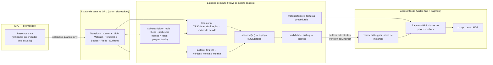
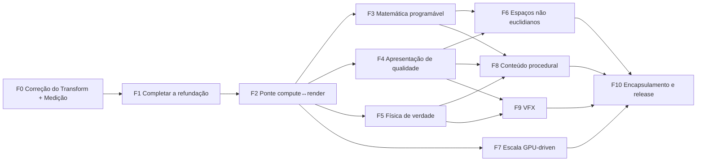

# Roadmap — Clay Engine: correção e evolução

**Criado**: 2026-10-03 · **Reescrito**: 2026-10-05 (após auditoria completa C1–C4 e leitura da arquitetura alvo)
**Governança**: [Constituição v1.0.0](../.specify/memory/constitution.md) — cada fase vira uma ou mais specs do
Spec Kit, com fachada de domínio (Princípio II) e gate completo verde.
**Arquitetura de referência**: [Arquitetura do Motor C1–C4](../clay-engine-doc/docs/guides/architecture_resource_loaders.md)
— a refundação, autoritativa. O legado ([apêndice de migração](../clay-engine-doc/docs/guides/migration_legacy_to_clean.md))
deteriorou a arquitetura original e por isso foi substituído; dele só se resgatam _capacidades_ (ex.: física
escrevendo direto no slot do objeto na GPU, composição de módulos WGSL), nunca estruturas.

---

## 1. Propósito

O Clay Engine existe para **criar mundos matematicamente customizáveis** na GPU, com um núcleo de kernels de
compute de propósito geral sobre o qual tudo — cenário, objetos, materiais, texturas, iluminação, forças,
partículas — é calculado.

- **Transformações programáveis** — as transformações lineares de objetos, cena, câmera e clip são calculadas em
  compute e podem ser substituídas por matemática do usuário.
- **Conteúdo paramétrico e procedural** — terrenos e cenários como superfícies paramétricas; árvores, pessoas e
  animais gerados por procedimento; água como partículas fluidas realistas; luz e texturas realistas.
- **Espaço também é programável** — começa por cenas euclidianas de jogo, mas permite espaços curvos e torcidos
  (estilo _Layers of Fear_): deformações de espaço, projeções customizadas, portais.
- **Compute-first** — compute calcula, vertex e fragment **apresentam**. As duas pipelines conversam por buffers
  compartilhados (buffers polivalentes da C1), sem passar pela CPU.
- **Encapsulamento em níveis** — quem não quiser descer o nível usa peças prontas; quem quiser preenche `data`,
  escreve funções WGSL em pontos de extensão, ou escreve um `Flow` inteiro.

Referências matemáticas (ponto de partida, não limite): [`notes/math.md`](../clay-engine-doc/docs/notes/math.md)
(superfícies paramétricas, homotopias, `P·V·M`, Jacobiana, métrica, curvatura, malha adaptativa),
[`conceitos_cg_matematica_fisica.md`](../clay-engine-doc/docs/guides/conceitos_cg_matematica_fisica.md),
[`10_Hierarquia_Objetos_3D.md`](../clay-engine-doc/docs/guides/10_Hierarquia_Objetos_3D.md) e os guias de física.

**Consumidor de referência**: [MorphSociety](https://github.com/dantasgut/morphysociety) — adota o clayflow no
próprio repositório; nunca é trazido para cá. Desempenho superior ao Three.js em escala continua sendo meta, medida
pelo harness da F0, como consequência da arquitetura.

## 2. Princípios que guiam as correções

1. **Completar a refundação, não reinventá-la.** O desenho C1–C4 é sólido: spec-as-identity, buffers polivalentes,
   pass slots, bag declarativa com inferência, `Flow<TSlots,S>` com slots tipados e máquina de estados, `consumes`
   resolvido por `ConsumerResolver`, pools com slot estável, ciclo de vida com `GpuManaged`. A C1 foi implementada
   quase ao pé da letra; **os mecanismos da C2 que fazem tudo funcionar não existem ou nada os chama** — por isso
   C3 e C4 refazem tudo à mão e não se conversam.
2. **O caminho quente nunca passa pela CPU.** Dado produzido em compute é consumido pelo render no mesmo buffer
   (`GpuManaged`). Readback só sob demanda (consultas, gameplay).
3. **Uma fonte de verdade por struct.** O `StructSchema` gera o WGSL; nada de struct duplicado à mão entre TS e WGSL.
4. **Matemática comum num núcleo único de módulos WGSL**, compartilhado por compute e render, com dependências
   declaradas e deduplicação por símbolo — o objetivo original de organizar solvers com shaders reusáveis.
5. **Pontos de extensão explícitos** para a matemática do usuário (§4.3), sem exigir um `Flow` novo para cada
   customização.
6. **O motor promete só o que entrega.** Documentação, JSDoc e nomes refletem o comportamento real.

## 3. Diagnóstico (auditoria 2026-10-04/05)

### 3.1 Mecanismos da refundação vs código

| Conceito da refundação                                                     | Estado no código                                                                                                                                                                                                                                                                                  |
| -------------------------------------------------------------------------- | ------------------------------------------------------------------------------------------------------------------------------------------------------------------------------------------------------------------------------------------------------------------------------------------------- |
| Fachada C1, spec-as-identity, pass slots, ciclo de frame                   | ✅ Implementado (`core/contracts/*`, `GpuEngineCore.ts`, `GpuFrame.ts`)                                                                                                                                                                                                                           |
| Buffers polivalentes (`vertex`/`index`/`indirect` com `STORAGE`)           | ✅ (006) Kernels por nome aceitam qualquer buffer ligável (vertex/index/indirect inclusive) e a visibilidade é inferida do WGSL                                                                                                                                                                   |
| `LayoutInferencer.infer` / `inferPool`                                     | ✅ (006) `LayoutInferencer.infer` deriva grupos, bindings, tipos e visibilidade do WGSL montado; a C2 cria layouts e bind groups de todos os Flows                                                                                                                                                |
| `consumes` + `ConsumerResolver`                                            | ✅ (006) `consumes` (nome ou `{ name, as }`) resolvido por `ConsumerResolver` (Singleton/Pool/Texture); pool registra o seu resolver; nome sem resolver é erro na preparação                                                                                                                      |
| `Flow<TSlots,S>` (slots + máquina de estados por eventos)                  | ✅ (006) Slots tipados (`slot.*`), ciclo de vida `pending → preparing → ready → disposed` pela C2 e estado do algoritmo só por tabela de transições; todos os Flows do motor migrados                                                                                                             |
| Seleção de Flow por `FlowDescriptor` (algoritmo ≠ tipo de corpo)           | ✅ (006) Registro por factory `{ type, phase, bodyType?, priority? }`; a C2 instancia no primeiro corpo do pool (`schema` ou `schema:algoritmo`); `override`/`unregister`                                                                                                                         |
| `flowReady`, `bindGroupReplaced`                                           | ✅ (006) Emitidos pela C2 (`flowReady`, `flowSuspended`, `poolCreated`, `bindGroupReplaced`)                                                                                                                                                                                                      |
| Ciclo de vida com capabilities e `GpuManaged`                              | ✅ (004) Toda mudança de estado passa por `ResourceSystem.transition()` (inválida lança); regras pelo handler (`suppressCpuUpload`, `ignoreDirtyMark`, `reportsIgnoredMutation`); `GpuManaged` efetivo; reinserção `Destroyed → Uninitialized`                                                    |
| ResourceSystem alocando a bag inteira                                      | ✅ (004) Todos os papéis e N descritores por Resource (vertex com layout compacto, index `uint16`/`uint32`, indirect, staging, texture/storage-texture + view, sampler); `ResourceDirectory` localiza o que foi alocado; desde a 006 os estágios consomem esses buffers (sem geometria duplicada) |
| "Reuso de instância proibido"                                              | ✅ (004) `World.insert` lança `ReuseError`; mapa recurso → entidade por World, limpo no `remove`; reinserção após `remove` permitida                                                                                                                                                              |
| Corpos como contêineres de partículas (`FluidBody`, `SoftBody` com arrays) | 🔴 Uma partícula por entidade (`FluidBody.ts:18-21`, `SoftBody.ts`) — N objetos JS, N registros, N uploads                                                                                                                                                                                        |
| `Time` governando a física (`scale`, `fixedDt` com substeps)               | ✅ (004) `Time` na C2 (um por World) com acumulador, teto de passos, `scale`/`physicsScale`, pausas e `app.step()`; os 6 Flows de física executam `steps × substeps` com parâmetros por iteração em regiões de buffer com offset dinâmico                                                         |
| Câmera composta com `Transform`; controllers mutam o `Transform`           | 🔴 Controllers escrevem matrizes da câmera por referência direta; matemática triplicada; `aspect` não atualiza                                                                                                                                                                                    |
| `RenderTarget`, `ShadowMap`, `Input`, `UiTree`, efeitos como Resources     | 🟡 (006) `ShadowMap` (pool + `depth`) e `FrameTargets` são Resources lidos pelos slots; `RenderTarget`, `Input`, `UiTree` e efeitos ainda fora do World                                                                                                                                           |
| Multi-câmera e render-to-texture                                           | ∅ Ausente                                                                                                                                                                                                                                                                                         |
| Pause/resume/snapshot/restore/headless                                     | ∅ Ausente                                                                                                                                                                                                                                                                                         |
| Fronteira (C4 não conhece C1 nem solvers concretos)                        | ✅ (006) C3/C4 importam a C1 só pelos reexports de `scene/contracts/gpu`, verificado no lint (constituição 1.1.0); solvers registrados por factory                                                                                                                                                |
| Composição WGSL (módulos, structs gerados, `{{struct:X}}`)                 | ✅ (005) `wgslModule` + `composeWgsl` (ordem topológica, dedup por símbolo, erros tipados); structs gerados do `StructSchema`; `wgslLib`; nenhuma montagem manual nem offset à mão (gate). Resolução a partir de `consumes`: ✅ (006)                                                             |

### 3.2 Desempenho

| Problema                                                                                                                                                                                                                                                                                                                                                                     | Evidência                                                      |
| ---------------------------------------------------------------------------------------------------------------------------------------------------------------------------------------------------------------------------------------------------------------------------------------------------------------------------------------------------------------------------- | -------------------------------------------------------------- |
| ✅ (004) ~~`specHash` sem cache em todo bind/set/write~~ — memorizado por referência e composto (`{"$spec":hash}`); specs congeladas; posse por spec no store. CPU por quadro de `instances/10k` 2715 → 93 ms                                                                                                                                                                | `specHash.ts:30`, `GpuRenderPass.ts:46-70`                     |
| ✅ (004, LCP) ~~Solver LCP em uma thread e contatos N·M~~ — contatos compactados por contador atômico, solve Jacobi paralelo por contato com divisão de massa, manifold de caixas; XPBD ainda em uma thread e narrowphase O(N·M) sem broadphase (F5)                                                                                                                         | `rb_solve_lcp.wgsl:7`, `LCPFlow.ts:564-570`, `XPBDFlow.ts:232` |
| Forward/sombra fora da arquitetura de Flows: em vez de consumir pelos slots/`consumes` os buffers que a C2 já aloca (Camera e Material individuais por Resource, Transform em pool contíguo), alocam por entidade VBO/IBO, 3 UBOs (câmera copiada e regravada por entidade a cada quadro), 4 bind groups, 1 draw; três cópias de geometria (Forward, Shadow, ResourceSystem) | `ForwardFlow.ts:600-693`, `ShadowFlow.ts:316-413`              |
| Sem dedup de geometria nem instancing; pool `Renderable` citado no desenho e nunca definido                                                                                                                                                                                                                                                                                  | `ForwardFlow.ts:521`, doc L4441                                |
| Física rígida: readback do pool inteiro → CPU → `Transform` → re-upload                                                                                                                                                                                                                                                                                                      | `LCPFlow.ts:590-701`                                           |
| ✅ (004) ~~Dispositivo sem features/limites/`powerPreference`~~ — `DeviceOptions`, limites de escala no máximo do adaptador, `capabilities()`/`app.capabilities`                                                                                                                                                                                                             | `GpuContext.ts:17-19`                                          |

### 3.3 Qualidade e correção

- Shader único Lambert para todos os materiais; roughness/metallic, cor/intensidade de luz, pool de luzes, UVs
  ignorados; normal sem matriz normal (`forward.wgsl`, `vs_main`/`fs_main`). (Topologia do material ignorada: resolvido
  na 008 — `Material.topology` na chave do grupo, arame e sprites.)
- Cena em LDR 8 bits; SSAO/FXAA falsos; tone mapping sobre LDR (`effects.wgsl`). (MSAA: resolvido na 008, puxado da
  F4/011 — 4 amostras por padrão.)
- `Transform.model` nunca derivado de posição/rotação/escala (`Transform.ts:25-33`); sombra com frustum fixo ±10.
- FEM sem solve elástico; emissores sem simulação; Wind/Vortex/Drag/Buoyancy sem consumidor. (Fluidos colidem com os
  colliders desde a 005; os 23 WGSL órfãos foram resolvidos na 005 — matemática extraída para a `wgslLib`, cascas
  removidas com inventário, estágios reescritos na F2/F5.)
- `ParametricGeometry` amostra em CPU com normal fixa `[0,1,0]`. (Índices `uint32` acima de 65 535 vértices: resolvido na 004.)
- ✅ (005) ~~Matemática WGSL duplicada~~ — cada função num único módulo (`wgslSymbols.test`), sem `.wgsl` órfão
  (`wgslInventory.test`), valores conferidos na GPU contra a CPU (smoke `shaderLibrary`).
- Robustez: flows padrão não substituíveis, câmera um quadro atrasada. (Resolvidos na 004: `constructor.name` e lista
  fixa de schemas renderizáveis — estágios por eventos do World + `instanceof`; `step()`; vazamentos de slots do
  forward/sombra, kernels, ouvintes e estágios padrão.)

### 3.4 Achados e correções da spec 004

- **A1 — escritas de uniform durante a gravação chegam com o último valor**: `core.write` entra na fila antes do
  command buffer do quadro; o `dtSub` do LCP nunca chegou à GPU. Corrigido com parâmetros por iteração em regiões de
  buffer com offset dinâmico (`PerStepUniforms`) e `Frame.clear` para zerar buffers no fluxo de comandos (a busca de
  vizinhança não acumula contagens entre reconstruções do quadro).
- **A2 — o build publicado não desenhava**: estágios reconheciam geometria e material por `constructor.name`, que a
  minificação apaga. Corrigido (eventos do World + `instanceof`); o bench `--dist` e os smokes sobre o dist dão o mesmo
  resultado do código-fonte.
- **Limites de despacho e de vizinhança** (antes previstos para a F5): despachos lineares respeitam
  `maxComputeWorkgroupsPerDimension` (`Dispatcher.invocations`, índice por `num_workgroups` em todos os kernels) e a
  soma de prefixos da busca de vizinhança tem vários níveis (sem teto de 65 536 células).
- **`createAsync` sem dedup em voo**: compilações concorrentes da mesma spec agora compilam uma vez.
- **SPH/PBF nunca simulavam** (buffers da vizinhança só existiam depois do primeiro rebuild): corrigido.
- **Quadros em voo sem limite** (R18): com a CPU por quadro em milissegundos, o motor submetia quadros mais rápido
  que a GPU concluía e o navegador travava por segundos. A C1 conta os quadros em voo (`framesInFlight()`) e o
  `GameLoop` só avança abaixo de `maxFramesInFlight` (padrão 2).
- **LCP com um slot de contato por par corpo × collider** (R19): 8 GB em 10k corpos, acima de `maxBufferSize` — o passe
  de colisão falhava em silêncio. Contatos compactados (capacidade `min(N·M·8, N × maxContactsPerBody, binding/96)`,
  aviso único de excedente), solve Jacobi paralelo por contato com divisão de massa (o solve serial derrubava o device
  em 10k), manifold de caixas (um contato por canto), warm start por chave de par/feature, gravidade aplicada uma vez
  por substep (pilhas não repousavam) e resistência ao rolamento (`rollingFriction`).
- **Pose predita não inicializada**: corpos estáticos nunca passam pela predição e a narrowphase lia chão e paredes na
  origem; corpos saíam rolando e caíam. `RigidBody` inicializa `pos_pred`/`rot_pred` com a pose inicial.

### 3.5 Achados e correções da spec 005

- **Fluidos nunca simulavam de fato**: a colisão lia um `ColliderDesc` que não existia mais. `ColliderSet` (pools
  tipados de colliders, compartilhado por LCP e fluidos) e `ParticleMaterial` (um por World); PBF (massa, expoente do
  `s_corr`, XSPH/vorticidade com m/ρ, restrição unilateral, colisão no laço do solver, corridas de dados), SPH
  (densidade em ±15% de ρ₀) e MPM (índice de grade com a origem, faixa de fronteira) coerentes e determinísticos.
- **XPBD sem pool de restrições** e predição de partícula fixa sem `pred`: corrigidos (8 substeps × 1 iteração).
- **Vizinhança**: `ns_find` ordena a lista de vizinhos (determinismo); partículas colidem com raio s/2.
- **Kernels genéricos** (`PrefixSum`, `RadixSort`, `Compaction`, `Reduce`, `GraphColorer`) com parâmetros por
  chamada em regiões de uniform por quadro (`FrameUniforms`); busca de vizinhança e LCP (alocação de contatos e ponto
  fixo) migrados; `GraphColorSolver` em CPU removido.
- **`FlowRegistry.resolve`** devolvia o último registrado: agora maior `priority` (empate: último), `override` vence.
- **`Scene.add`** só anexava (a entidade não entrava no World): agora insere; `addEntity` devolve o `EntityId`.
- **ColorGrading** apagava a imagem (opções lift/gain/gamma).
- **Pendentes (F5)**: XPBD sem colisão com colliders; `XPBDRigidSchema` sem solver; FEM sem solve elástico;
  câmera sem matrizes calculadas por Flow (F2). (`ShadowMap.schema` passou a ser lido por shader na 006.)

### 3.6 Achados e correções da spec 006

- **Forward fora da arquitetura de Flows** (causa principal do custo de `instances`): câmera, mundo e material pelos
  slots, material em pool de storage selecionado pelo registro `Renderable` mantido pela C2 (Emenda 1), grupos definidos uma vez por passe — nenhum objeto de GPU
  por entidade (12 → 0 nos estágios) e uma escrita de câmera por quadro, só quando muda.
- **Readback do LCP** mapeava slot → entidade na leitura, não na cópia; **`TransformFlow`** não recompunha na remoção;
  **`ColliderSet`** omitia o pool de malha: corrigidos.
- **Inserção em massa O(n²)** com o forward pronto e nos solvers com colliders: linear.
- **Sem luz que projeta sombra**, o forward escurecia perto da origem com o substituto: agora `shadowEnabled = 0`.

### 3.7 Achados e correções da spec 007

- **Um draw por objeto** (E5): grupos de instâncias por (geometria, pipeline, orientação) mantidos pela C2 por evento;
  forward e sombra desenham um `draw.indexed` por grupo; geometria deduplicada por conteúdo (uma cópia na GPU).
- **Um envio por objeto alterado**: envio por delta — bitset de slots sujos marcado na mutação e uma escrita por faixa
  contígua; `poolWritten` por pool com os campos de topo mudados.
- **Narrowphase O(N·M)** (E2, antecipado da F5): broadphase em grade hash na GPU sobre a busca de vizinhança da 005,
  pares por substep e narrowphase indireta; mesmo conjunto de contatos e trajetórias bit a bit.
- **Readback da pose por quadro** (E3): a física publica a pose direto no pool de `Transform` (posse da GPU); a CPU lê
  sob demanda (`resources.read`).
- **Matrizes na CPU**: câmera (`Camera` + `Transform`, `CameraFlow`) e matriz de sombra (`ShadowMatrixFlow`) produzidas
  na GPU; forward lê a direção da luz no pool `Light`; `Input` como Resource; controllers mutam o `Transform`.
- **Hierarquia**: `Parent` opcional, composto por níveis no `TransformFlow`.
- **Um milhão de entidades derrubava a aba**: custo por entidade na CPU de ~6,8 KB para ~1,3 KB (reativo sem closures,
  acessor `data` no protótipo de `Entity`, pools e registros em arrays tipados).

## 4. Modelo alvo

### 4.1 Fluxo de dados compute-first

Regras:

- **Um pool por tipo de dado de cena**, visível a compute, vertex e fragment (visibilidade inferida do WGSL). O
  render lê pelo índice de instância — fim do UBO por objeto.
- **Instancing compatível com "reuso de instância proibido"**: memória compartilhada vem de (1) coalescing em pools
  e (2) **dedup de geometria por conteúdo** (schema + parâmetros) no ResourceSystem; o pool `Renderable`
  (geometria, material, slot de transform) agrupa draws por (geometria, pipeline) com `draw.indexed(count, instances)`
  ou indirect.
- **`GpuManaged`**: quando um compute é dono de um buffer (ex.: física escreve `Transform`), a CPU para de fazer
  upload; nenhuma escrita de CPU sobrescreve o resultado da GPU.
- **Câmera = `Camera` + `Transform`**: controllers mutam o `Transform`; um kernel produz view, projection e
  viewProjection a partir dos parâmetros (ponto `camera`).
- **Corpos são contêineres de partículas**: `FluidBody`/`SoftBody` carregam arrays (posições, molas internas,
  tetraedros); constraints entre corpos ficam como Resources próprios.
- **Hierarquia opcional** (decisão D1): componente `Parent` resolvido pelo kernel de transformação, por níveis.

### 4.2 Núcleo de shaders

- **`WgslModule`** `{ name, source, requires[] }` com resolução topológica e **deduplicação por símbolo**. Módulos
  de base: `quat`, `mat`, `linalg`, `sdf`, `sph_kernels`, `mpm_weights`, `xpbd`, `lcp`, `noise`, `color`, `brdf`;
  módulos novos: `parametric` (avaliação, derivadas, métrica, curvatura), `space` (deformações e Jacobiana),
  `procedural` (L-systems, esqueletos, campos), `sampling`.
- **Structs gerados do `StructSchema`** (`toWGSL` com std140/std430 e tipos válidos — hoje `u16` gera WGSL inválido),
  realizando os marcadores `{{struct:X}}` do desenho.
- O mesmo módulo serve compute e render. ✅ (005) módulos de base, structs gerados e kernels genéricos (scan em vários
  níveis, radix, compactação, reduções, coloração de grafo) entregues; `parametric`, `space`, `procedural`,
  `sampling` e BVH ficam para as fases seguintes.
- Kernels genéricos reutilizáveis pelo núcleo: prefix sum, sort (radix/bitônico), compactação, reduções, construção de
  grade e busca de vizinhos (já existe em `NeighborSearchPipeline`), BVH — base comum para física, culling,
  partículas e conteúdo procedural.

### 4.3 Pontos de extensão matemáticos

Cada estágio compute aceita uma função WGSL do usuário com assinatura fixa, composta pelo núcleo de shaders e
validada na criação. O motor traz implementações prontas para cada um. São os "slots de função" que complementam os
slots de dados do `Flow<TSlots,S>`.

| Ponto       | Assinatura (conceito)                            | Pronto no motor                            | Exemplos do usuário                                  |
| ----------- | ------------------------------------------------ | ------------------------------------------ | ---------------------------------------------------- |
| `transform` | `(slot, data, t) → mat4`                         | TRS, TRS + `Parent`                        | órbitas, cinemática por equações, enxames            |
| `camera`    | `(data, t) → { view, projection }`               | perspectiva/ortográfica, lookAt            | projeções não lineares, lentes                       |
| `surface`   | `(u, v, t, data) → vec3` (+ derivadas opcionais) | plano, esfera, toro, terreno por ruído     | homotopias, superfícies arbitrárias                  |
| `space`     | `(x, t) → x'` (Jacobiana numérica ou fornecida)  | identidade                                 | corredores que se curvam, torções, espaços dobrados  |
| `field`     | `(x, v, t) → força`                              | gravidade, vento, vórtice, arrasto, empuxo | campos arbitrários                                   |
| `material`  | `(amostra de superfície) → parâmetros PBR`       | PBR por mapas/constantes                   | texturas procedurais, padrões dependentes da métrica |
| `emit`      | `(i, t, data) → partícula`                       | ponto, esfera, cone                        | emissores arbitrários                                |

### 4.4 Níveis de encapsulamento

| Nível  | Para quem                   | Como usa                                                                                       |
| ------ | --------------------------- | ---------------------------------------------------------------------------------------------- |
| **N0** | Quer coisas prontas         | Peças compostas: `Terrain`, `Water`, `Tree`, `Character`, `StandardMaterial`, presets de cena  |
| **N1** | Quer ajustar                | Preenche `data` de Resources atômicos (`ParametricSurface({ preset, params })`, campos, luzes) |
| **N2** | Quer programar a matemática | Funções WGSL nos pontos de extensão (§4.3)                                                     |
| **N3** | Quer um algoritmo novo      | Escreve um `Flow<TSlots,S>` com slots tipados, usando o núcleo de shaders                      |

## 5. Fases

| Fase                                   | Specs previstas                                                                                                                 | Entregas-chave                                                                                                                                                                                                                                                                                                                                                                                                                                                                                                                                                                                                                                                                                                                                                                                                                                                                                                                                                                                                                                                                                                                                                                                                                                                                                                                                                                                                                                                                                          | Critério de pronto                                                                                                                                                                                                                                      |
| -------------------------------------- | ------------------------------------------------------------------------------------------------------------------------------- | ------------------------------------------------------------------------------------------------------------------------------------------------------------------------------------------------------------------------------------------------------------------------------------------------------------------------------------------------------------------------------------------------------------------------------------------------------------------------------------------------------------------------------------------------------------------------------------------------------------------------------------------------------------------------------------------------------------------------------------------------------------------------------------------------------------------------------------------------------------------------------------------------------------------------------------------------------------------------------------------------------------------------------------------------------------------------------------------------------------------------------------------------------------------------------------------------------------------------------------------------------------------------------------------------------------------------------------------------------------------------------------------------------------------------------------------------------------------------------------------------------- | ------------------------------------------------------------------------------------------------------------------------------------------------------------------------------------------------------------------------------------------------------- |
| **F0 Correção do Transform e medição** | `003-reactive-transforms` → `002-benchmark-harness`                                                                             | **003** (implementada antes da 002): marcação automática de sujo como o desenho prevê — mutação de `data` emite `resourceDirty` (fim do `resourceDirty` manual por cast em `world.events`); `Transform` volta a ser só intenção (`position`/`rotation`/`scale`; `model` sai do schema); `TransformFlow` em compute lê o pool de `Transform` e escreve o pool de matrizes de mundo (`GpuManaged`), estágio substituível pelo futuro ponto `transform`; forward e sombra leem a matriz de mundo pelo slot da entidade no vertex shader (leitura de storage com visibilidade de vértice); `LCPFlow` publica pose (posição/rotação), não matriz. **002**: harness clayflow × Three.js; observabilidade de quadro (`FrameStats`, timestamps em todos os passes); baseline + gate                                                                                                                                                                                                                                                                                                                                                                                                                                                                                                                                                                                                                                                                                                                             | **003**: `new Transform({ position: [5,0,0,1] })` aparece em x = 5; mutação de `data` reflete no quadro seguinte sem chamada manual; exemplos do README corretos. **002**: relatório reproduzível medindo o motor como ele é, com limitações declaradas |
| **F1 Completar a refundação**          | `004-core-hardening`, `005-shader-modules`, `006-flow-slots`                                                                    | **004**: dispositivo completo (features, limites, `powerPreference`, relatório de capacidades); cache do `specHash`; `Time` governando a simulação (`step()`, passo fixo com acumulador, `scale`/`physicsScale`, execução headless); ResourceSystem aloca a bag inteira (vertex/index/indirect/texture/sampler, N descritores por Resource); `GpuManaged` efetivo; "reuso de instância proibido" aplicado; índices `uint32`; fim de `constructor.name`; vazamentos corrigidos. **005** ✅: `WgslModule` com dedup por símbolo; structs WGSL gerados do `StructSchema`; núcleo de matemática consolidado (`wgslLib`); kernels genéricos (scan, sort, compactação, redução, coloração de grafo); WGSL órfão resolvido; fluidos e XPBD corrigidos; documento de arquitetura sem as inconsistências da D5. **006** ✅: `Flow<TSlots,S>` com slots tipados e máquina de estados por eventos; registro por factory `{phase, bodyType, priority}` e `unregister`; seleção de Flow por `FlowDescriptor` feita pela C2 (`ensureFlowAllocated` → `flowReady`); `LayoutInferencer.infer` ligado; `consumes` resolvido por `ConsumerResolver`; visibilidade inferida; `ComputeKernelBinding` aceita vertex/index/indirect; `bindGroupReplaced`; `ForwardFlow`/`ShadowFlow` consomem Camera/Material/Transform pelos slots — sem alocação por entidade, câmera gravada uma vez por quadro, bind groups definidos uma vez por passe; fronteira de importação respeitada; documento de arquitetura sem inconsistências | Flows existentes migrados para slots sem regressão no benchmark; montagem e CPU por quadro de `instances` caem contra o baseline da F0; nenhum struct duplicado TS↔WGSL; build minificado funciona; mesma trajetória de simulação a 30/60/144 Hz        |
| **F2 Ponte compute↔render**            | `007-gpu-scene-state`, `008-compute-geometry`                                                                                   | **007**: pools de Transform/Camera/Light/Material/`Renderable` na GPU (o registro `Renderable`, mantido pela C2, entrou na 006 — Emenda 1); dedup de geometria por conteúdo; `Parent` opcional no `TransformFlow`; câmera = `Camera` + `Transform` com kernel de câmera, controllers mutando o `Transform`, `Input` como Resource; draws agrupados por (geometria, pipeline) com instâncias (vertex pulling e arena de geometria passaram para a F7 — R4 da 007); forward e sombra consomem pools; física escreve a pose direto no pool de `Transform` na GPU (fim do readback). **008**: geometria produzida em compute nos buffers polivalentes; corpos como contêineres de partículas (`FluidBody`/`SoftBody` com arrays); render de partículas, fluidos e corpos moles (`*_vertex_write` ligados, sprites instanciados a partir dos pools); `PointCloudGeometry` desenhada; topologia do material respeitada                                                                                                                                                                                                                                                                                                                                                                                                                                                                                                                                                                                        | 10k objetos com custo de CPU por quadro ~constante; corpos rígidos sem readback; SPH/PBF/MPM/XPBD visíveis                                                                                                                                              |
| **F3 Matemática programável**          | `009-math-extension-points`, `010-parametric-surfaces`                                                                          | **009**: pontos de extensão `transform`/`camera`/`surface`/`space`/`field`/`material`/`emit` com funções WGSL do usuário compostas pelo núcleo, validadas, com implementações prontas. **010**: avaliação de `S(u,v,t)` em compute com derivadas (analíticas ou numéricas), normal, métrica, curvatura; homotopias; malha adaptativa guiada pela métrica e pela distância à câmera; colisor SDF/heightfield derivado da superfície                                                                                                                                                                                                                                                                                                                                                                                                                                                                                                                                                                                                                                                                                                                                                                                                                                                                                                                                                                                                                                                                      | Superfícies paramétricas deformadas em tempo real com normais corretas; terreno paramétrico colidível                                                                                                                                                   |
| **F4 Apresentação de qualidade**       | `011-hdr-pbr`, `012-textures`, `013-lighting`, `014-render-targets-post`                                                        | HDR `rgba16float` + MSAA; PBR Cook-Torrance usando roughness/metallic e o pool de luzes; matriz normal; texturas (mapas, mipmaps em compute, arrays, KTX2) e **texturas procedurais em compute**; iluminação clustered, céu/IBL, CSM ajustado à cena, `ShadowMap` automático por luz; `RenderTarget` como Resource, multi-câmera e render-to-texture; SSAO com profundidade e normais, TAA, bloom em cadeia de mips; pós sem efeitos desenhando direto no canvas (sem o passthrough de tela cheia, ~0,2 ms medido na 007); documentação fiel                                                                                                                                                                                                                                                                                                                                                                                                                                                                                                                                                                                                                                                                                                                                                                                                                                                                                                                                                            | Paridade visual com Three.js em cenas de referência; nenhum efeito "falso" restante                                                                                                                                                                     |
| **F5 Física de verdade**               | `015-parallel-solvers`, `016-soft-and-fields`, `017-fluid-surfaces`, `018-queries-controller`                                   | XPBD paralelo (coloração de grafo/Jacobi — kernels já existem; o LCP já é paralelo desde a 004); broadphase com a busca de vizinhos; FEM com solve elástico; todos os campos de força consumidos (e programáveis via `field`); colisores de fluido; colisores SDF unificados (inclui superfícies paramétricas); superfície de fluido contínua a partir das partículas, com óptica (refração, absorção, Fresnel) e cáusticas num estágio independente da origem da superfície (017, reusado pela 029); raycast/shapecast com readback assíncrono; character controller                                                                                                                                                                                                                                                                                                                                                                                                                                                                                                                                                                                                                                                                                                                                                                                                                                                                                                                                   | 10k corpos rígidos a 60 fps; tecido e fluido interagindo com terreno paramétrico                                                                                                                                                                        |
| **F6 Espaços não euclidianos**         | `019-curved-spaces`                                                                                                             | Deformação `space` aplicada a geometria, luz e sombras de forma consistente (normais pela Jacobiana); projeções customizadas; portais (render-to-texture recursivo, transporte de câmera e objetos); simulação em coordenadas de carta com apresentação deformada (D3)                                                                                                                                                                                                                                                                                                                                                                                                                                                                                                                                                                                                                                                                                                                                                                                                                                                                                                                                                                                                                                                                                                                                                                                                                                  | Corredor que se curva e se torce, com portais, navegável e sem artefatos de iluminação                                                                                                                                                                  |
| **F7 Escala GPU-driven**               | `020-gpu-culling-indirect`                                                                                                      | Culling frustum + Hi-Z em compute → indirect por material; LOD guiado pela métrica; bundles estáticos; vertex pulling e arena única de geometria (`baseVertex`/`firstIndex`), vindos da 007 (R4: o layout intercalado de 32 B não é legível como `array<Struct>` em storage sem offsets à mão, a busca de vértice já é no shader nas GPUs Apple e a arena só paga com o indireto múltiplo); upload por delta (antecipado na 007)                                                                                                                                                                                                                                                                                                                                                                                                                                                                                                                                                                                                                                                                                                                                                                                                                                                                                                                                                                                                                                                                        | 100k instâncias a 60 fps; CPU < 2 ms/quadro independente do nº de objetos                                                                                                                                                                               |
| **F8 Conteúdo procedural**             | `021-procedural-terrain`, `022-procedural-vegetation`, `023-procedural-creatures`, `024-gltf-entities`, `029-large-scale-water` | Terreno paramétrico + ruído com streaming e splatting; árvores e vegetação em compute (L-systems/space colonization, vento, impostores); pessoas e animais procedurais (esqueleto gerado, skinning em compute, animação procedural e por clipes); glTF → entidades (malha, materiais, texturas, skins); `Assets` produzindo `TextureSpec`/entidades com cache e eventos. **029** (número fora da sequência para não renumerar as specs seguintes): água em grande escala — mar por espectro (FFT em cascatas, LOD por distância, espuma pela dobra da onda, vista submersa), lagos, rios por águas rasas (shallow water) em grade sobre o terreno com mapas de fluxo, cachoeiras; representação híbrida: superfície por altura no grosso e **água de partículas com superfície contínua (017) mantida como representação de primeira classe** — sozinha em volumes locais e acoplada onde a água quebra (impacto de cachoeira, arrebentação, respingos), com troca de massa entre as duas; mesma óptica e cáusticas da 017                                                                                                                                                                                                                                                                                                                                                                                                                                                                              | Paisagem viva gerada sem assets: terreno, floresta, criaturas animadas, água — rio descendo do terreno com cachoeira até um lago e o mar                                                                                                                |
| **F9 VFX**                             | `025-gpu-particles`, `026-fire-smoke`                                                                                           | Emissores em compute (ponto `emit`, spawn/update/sort), soft particles, flipbooks, fogo e fumaça (grade euleriana leve), decals; spray, névoa e espuma de água emitidos nos pontos de quebra da 029                                                                                                                                                                                                                                                                                                                                                                                                                                                                                                                                                                                                                                                                                                                                                                                                                                                                                                                                                                                                                                                                                                                                                                                                                                                                                                     | Fogueira com luz dinâmica e fumaça interagindo com vento                                                                                                                                                                                                |
| **F10 Encapsulamento e release**       | `027-presets-dx`, `028-robustness`                                                                                              | Peças N0 prontas (`Terrain`, `Water`, `Tree`, `Character`…), presets; `Application` sem expor C1/C2 (`scene`, `input`, `assets`, `pause/resume/snapshot/restore`); hot reload de WGSL, inspector, quality tiers, device lost, mobile/Safari; v1.0 semver; guia de migração do Three.js                                                                                                                                                                                                                                                                                                                                                                                                                                                                                                                                                                                                                                                                                                                                                                                                                                                                                                                                                                                                                                                                                                                                                                                                                  | Release 1.0; um jogo euclidiano e uma cena não euclidiana montados só com N0/N1                                                                                                                                                                         |

**Ordem**: 003 (correção do Transform) → 002 (medição) → F1 → F2 são sequenciais e bloqueiam o resto — sem slots, núcleo de shaders e ponte compute↔render,
toda capacidade nova repetiria os erros atuais. Depois F3, F4 e F5 podem andar em paralelo; F6 e F8 dependem delas.

## 6. Relação com a spec 002 (F0)

O harness mede o motor **como ele é**, com limitações declaradas por cena (FR-007b). Ajustes decorrentes da
auditoria: o adaptador clayflow dispara quadros com `frameTick` (a partir da 004, `app.step(1/60)` — 1/60 s simulado por quadro, como o Rapier); as cenas posicionam objetos só por
`position`/`rotation`/`scale`, o que exige a spec 003 (por isso a 003 é implementada antes); a cena de corpos rígidos ganha a variante `1k` (o solver em uma thread
não completa `10k` até a F5). Fases nas declarações de não suporte: luzes pontuais até **F4**, personagens animados
até **F8**; limitações: instancing e física sem readback até **F2**, HDR/MSAA até **F4**. Alinhamento após a
entrega da 003: a cena de instâncias ganha a variante `10k-moving` (mede o caminho de mutação reativa, cujo
agrupamento de envios é ganho da F2) e o tempo de CPU do quadro passa a incluir o envio dos dados alterados
(`frameRecording`).

**Status (2026-10-05)**: F0 entregue — 003 integrada (PR #34) e 002 implementada (`bench/`, guia
[Benchmark](../clay-engine-doc/docs/guides/benchmark.md)). O primeiro relatório completo, anexado ao PR da 002, é a
linha de base declarada da F1/F2; o baseline da máquina de referência fica em `bench/baselines/`. Leitura da linha
de base:

- **Causa principal — o `ForwardFlow` não segue a arquitetura de Flows**: em vez de consumir pelos slots os
  buffers que a C2 já aloca (Camera e Material individuais por Resource, Transform em pool contíguo), aloca 6 objetos
  de GPU por entidade, regrava a câmera em cada entidade a cada quadro e refaz 7 binds por draw. Só o Transform
  passa pelo caminho previsto. Correção na F1 (006, migração para slots) — não é coalescing novo, é usar o que existe.
- **Agravante — hash de spec sem cache** (UUIDv5/SHA-1 a cada bind, incluindo o WGSL do pipeline): ~90% da CPU por
  quadro no perfil, medido com a estrutura acima (que multiplica as chamadas); cache na F1 (004). A atribuição da
  montagem lenta (~20 s para 10k entidades) ainda não foi perfilada.
- `instances/100k` estoura o tempo e `instances/1m` derruba a aba no clayflow (alocação por entidade; sem instancing até a F2);
  `rigid-bodies/1k` às vezes pendura a GPU (readback + solver em uma thread, F2/F5).
- Reprodutibilidade: duas rodadas completas consecutivas com medianas a ≤ 5% em 13 de 14 linhas medidas. A duração
  (17,4 min completa, 4,3 min `--quick`) ainda excede a meta de SC-007 por causa do custo de montagem e das falhas
  do clayflow; deve cair com a F1/F2 sem mudar o protocolo.

**Status (2026-10-11)**: F1/004 implementada (`feature/004-core-hardening`). Contra o baseline da F0, a CPU por quadro
cai de 90% a 97% em todas as cenas medidas (`instances/10k` 2 715 → 93 ms, `instances/10k-moving` 2 962 → 290 ms,
`unique-objects/1k` 268 → 7,8 ms, `rigid-bodies/1k` 288 → 8,9 ms, `rigid-bodies/10k` 2 739 → 102 ms) e a memória de
`rigid-bodies/10k` de 8,3 GB para 547 MB; nenhuma regressão (a GPU de `instances/10k-moving` oscila entre estados de
clock — ver tasks T085). Baseline regravado. Restam para a F1: 005 (módulos WGSL) e 006 (slots — o forward ainda aloca
por entidade, a causa principal do custo restante de `instances`); `instances/100k` e `1m` continuam estourando o tempo
até a F2 (instancing).

**Status (2026-10-12)**: F1/006 implementada (`feature/006-flow-slots`; F1 concluída). Contra o baseline da 005, numa
rodada com carga externa (outro processo a 100% de CPU): CPU por quadro de `instances/10k` 88,4 → 16,9 ms (−81%),
`instances/10k-moving` 304 → 205 ms (−33%), `unique-objects/1k` 7,75 → 1,08 ms (−86%), `rigid-bodies/1k` 9,0 → 2,3 ms
(−75%), `rigid-bodies/10k` 104 → 19,9 ms (−81%); `instances/100k` passou a completar (166 ms de CPU). O gate apontou
p95/p99 de `unique-objects/1k` e a GPU de `instances/10k-moving` acima da tolerância — a confirmar numa rodada com a
máquina livre antes de regravar o baseline. `instances/1m` ainda derruba a aba (sem instancing até a F2/007).

**Status (2026-10-13)**: 006 fechada com a máquina livre (Chrome 155; baseline do perfil gravado do `b17d5d6`). CPU por
quadro: `instances/10k` 90,9 → 14,5 ms (−84%), `instances/10k-moving` 288 → 199 ms (−31%), `unique-objects/1k` 7,73 →
0,74 ms (−90%), `rigid-bodies/1k` 8,93 → 1,07 ms (−88%), `rigid-bodies/10k` 102 → 17,3 ms (−83%); GPU de
`instances/10k` 0,92 → 0,66 ms com a Emenda 1 (sem bind por draw). O gate apontou a GPU de `instances/10k-moving`
contra um baseline bimodal (ver PENDENCIAS §0). Contra o Three.js a distância segue grande: `instances/10k` 14,5 ms ×
0,03 ms de CPU (10 001 draws × 2 com `InstancedMesh`), `instances/10k-moving` 199 × 1,3 ms (um envio por objeto
alterado), `rigid-bodies/10k` 9 × 36 fps (GPU 28 × 6,7 ms pela narrowphase O(N·M) sem broadphase; p99 de 309 ms pelo
readback da pose a cada quadro); só `unique-objects/1k` é mais rápido no clayflow (1,5×).

**Status (2026-10-13)**: F2/007 implementada (`feature/007-gpu-scene-state`; aguarda PR). Antecipado de outras fases
porque as correções dependiam disso: broadphase do LCP (E2, F5/015), envio por delta agrupado (F7) e escala de 1
milhão de entidades. Vertex pulling e arena de geometria foram para a F7 (R4). Medido (máquina livre): `instances/10k`
CPU 14,5 → 0,02 ms (Three 0,03), 2 draws, GPU 0,46 ms (alvo 0,52); `instances/10k-moving` CPU 199 → 2,80 ms (meta
3 ms; Three 1,38); `rigid-bodies/10k` 9 → 206 fps (Three + Rapier 36), sem readback da pose; `instances/100k` 1755
fps; `instances/1m` completa o protocolo (408 fps, GPU 2,35 ms; heap JS retido 1,31 GB, meta 1,5 GB). A GPU restante
de `instances/10k` contra o Three (0,09 ms) é sobretudo o passthrough do pós sem efeitos (0,20 ms; F4).

**Status (2026-10-14)**: F2/008 implementada (PR #40) — **F2 concluída**. Corpos de
partículas como contêineres (`FluidBody`/`SoftBody` com arrays numa faixa contígua do pool; restrições por
`(corpo, índice)`; slots vivos na GPU); SPH, PBF, MPM (fluido e sólido), XPBD e FEM visíveis — sprites lidos direto do
pool (`ParticleFlow`) e superfície de corpo mole escrita por kernel (`SoftSurfaceFlow`) —, sem leitura de volta;
geometria escrita pela GPU (`PointCloudGeometry`, descritores `'never'` com escritor declarado); topologia do material
respeitada (sprites de vértice; `WireframeMaterial` refeito como no legado: arestas da geometria em quads com
espessura). Antecipado de outras fases por decisão do usuário: **MSAA** 4× (F4/011) e a otimização da busca de
vizinhança (F5/015: `particles/64k` 17 → 74 fps, GPU 60 → 13 ms). Os `*_vertex_write` do legado não voltaram: o desenho
lê o pool.

**Status (2026-10-14)**: F5/017 implementada (`feature/017-fluid-surfaces`; aguarda PR), antes das demais specs da F5 por
decisão do usuário. Água contínua a partir das partículas (`FluidSurfaceMaterial`): superfície em espaço de tela
(`FluidSurfaceFlow`, vistas da câmera e da luz), óptica (`WaterFlow`: refração, absorção, Fresnel, sombra) e
**cáusticas** (`CausticsFlow`, fótons em espaço da luz com enquadramento ajustado à água) num estágio que consome uma
superfície genérica (`WaterSurface`) — a 029 reusa. Capacidades novas: `World.attach`/`detach` (troca de material em
corpo vivo) e `ensureAllocated` de textura. Defeito corrigido: passo estável do PBF derivado do material.

## 7. Adoção pelo MorphSociety (no repositório do jogo)

| Marco                   | Capacidades | O jogo pode modernizar               | Critério (medido no jogo)                   |
| ----------------------- | ----------- | ------------------------------------ | ------------------------------------------- |
| **M1 Paisagem**         | F1–F4       | Terreno paramétrico, céu, luz        | FPS ≥ versão Three.js, visual equivalente   |
| **M2 Bioma vivo**       | F5, F8      | Vegetação, água, fauna e aldeões     | FPS ≥ 1,5× versão Three.js (preset ultra)   |
| **M3 Jogável**          | F5          | Avatar, colisões, picking            | Paridade de gameplay                        |
| **M4 Além do Three.js** | F6, F9      | Fogo, rios fluidos, espaços oníricos | Recursos sem equivalente nativo no Three.js |
| **M5 Adoção completa**  | F7, F10     | Cliente inteiro                      | Three.js removido do `package.json` do jogo |

## 8. Decisões em aberto

| #   | Questão                                                                                                                                                                                                                                                                                                                                                                                                                                                                                         | Proposta                                                                                                                                 |
| --- | ----------------------------------------------------------------------------------------------------------------------------------------------------------------------------------------------------------------------------------------------------------------------------------------------------------------------------------------------------------------------------------------------------------------------------------------------------------------------------------------------- | ---------------------------------------------------------------------------------------------------------------------------------------- |
| D1  | A refundação diz que a engine não impõe hierarquia; a visão pede controlar transformações da cena                                                                                                                                                                                                                                                                                                                                                                                               | Componente **opcional** `Parent` resolvido no kernel de transformação, por níveis; sem `Parent`, nada muda                               |
| D2  | Onde calcular view/projection e o `model` (a refundação não fixa)                                                                                                                                                                                                                                                                                                                                                                                                                               | Em compute: kernel de transformação para `model` e kernel de câmera (ponto `camera`) a partir de `Camera` + `Transform`                  |
| D3  | Física em espaço curvo                                                                                                                                                                                                                                                                                                                                                                                                                                                                          | Simular em coordenadas de carta (euclidianas) e aplicar `space` na apresentação; colisões contra a geometria deformada via SDF           |
| D4  | Fronteira de importação: 15 arquivos de C3/C4 usam `core/contracts`                                                                                                                                                                                                                                                                                                                                                                                                                             | Reexportar por `scene/` os contratos necessários a Flows e ajustar a regra/madge                                                         |
| D5  | Inconsistências do documento de arquitetura: modelo de transição de estado; exemplos com API antiga por `id`; `pack` listado após remoção; "dev não escreve Flows" × `Flow` público; `register(factory)` × instância; `add(stage, {before/after})` × ordem de registro; `Scene.add` retornando `this` × `EntityId`; pool `Renderable` não definido; Material `individual` (L1292) × pool key de material (L2552), a decidir antes da 006; ponte pool de partículas → geometria não especificada | ✅ Resolvida na 005: definição única por item no documento (estado atual × alvo 006/F2) e correções de `resolve` e `Scene.add` no código |
